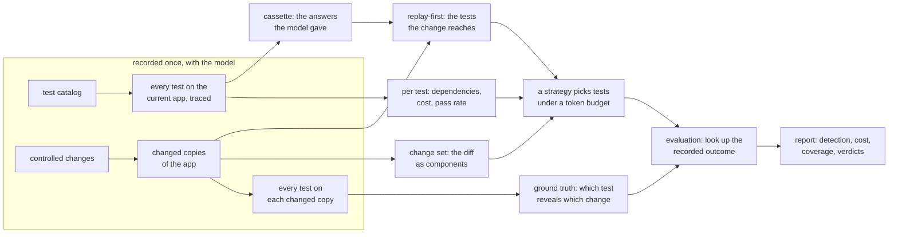

# TRACE-Eval

After a change to an LLM agent system (a skill, a prompt, the agent runtime, a config key), which tests should run,
in what order, and when can we stop? The aim is to spend fewer tokens and less time and still catch regressions.

This repository is a testbed for that question: a small, working multi-agent application whose agents are played by
a model, a catalog of tests, changes written by hand and changes generated from the app, and eleven selection
strategies. Its answer is *replay first*: a change is replayed against the answers the model gave the current app,
and a test whose requests to the model do not change needs no model at all. A strategy then orders the tests the
change reaches, and a threshold set on past changes says when to stop. Everything is compared offline, on recorded
runs, and `traceeval check` checks one change live.

## The pieces, and how they fit



- **The application**, ContentOps, lives in [`traceeval/sut/`](traceeval/sut/): an orchestrator and ten specialist
  agents defined in YAML, skills that each carry a machine-readable procedure, tools over deterministic services,
  and one config file. The agents are played by a model: Gemma 4 E4B by default, Qwen3.8-27B or gpt-oss-120b
  through an OpenAI-compatible endpoint. [docs/CONTENTOPS.md](docs/CONTENTOPS.md) describes it.
- **The tests** live in [`traceeval/catalog/`](traceeval/catalog/) as YAML. Each has a request, a context and
  checks on the final state, the tool calls and the answer. Each test names the properties it checks, ids from a
  catalog of properties ([`properties.yaml`](traceeval/catalog/properties.yaml)): behavioural requirements such as
  "a page is never published with broken links", some of them release blockers.
- **A traced run** of every test on the current app records, per test, the components it touched (agents, skills,
  tools, config keys, code lines), its cost in tokens and its pass rate. These are its observed dependencies, as
  opposed to the declared ones its author wrote.
- **The changes** are the entries of [`traceeval/mutation/catalog.py`](traceeval/mutation/catalog.py), each applied
  as an edit to a copy of the app. The diff becomes a change set: the components it touches, in the same
  identifiers the traces use. Running the whole suite on each changed copy gives the ground truth: a test *reveals*
  a change when it passes on the current app and fails on the changed copy, by majority over the repetitions. A
  change is a regression when at least one test reveals it. Three batches by hand, and twenty drawn at random,
  bundle two to nine changes, as a nightly run does; the check then also names the components it blames
  ([docs/RESEARCH_PLAN.md](docs/RESEARCH_PLAN.md) §5.6). A generator
  ([`traceeval/mutation/generator.py`](traceeval/mutation/generator.py)) makes 692 more changes mechanically, one
  per place an edit of its kind applies to; they have no label, and the recording says which a test reveals.
- **Replay-first** ([`traceeval/experiment/replay_first.py`](traceeval/experiment/replay_first.py)): the recording
  keeps every answer the model gave the current app. Run on a changed copy with those answers, a test either
  replays to the end, and its outcome there is known for no tokens, or diverges at the first request the current
  app never made, and needs the model from there on. A strategy then orders the diverged tests only.
- **The strategies** in [`traceeval/selection/`](traceeval/selection/) pick tests under a token budget from the
  change set, the traces, the costs and the pass rates, and from the outcomes of the other recorded changes. They
  never see the outcome of the change under evaluation. Eight are baselines, two are methods from the literature
  adapted to the testbed (CASPER and Risk-Aware Adaptive Evaluation, neither of which reads the diff;
  [docs/REFERENCES.md](docs/REFERENCES.md)), and `adaptive_bayes` is ours: an order that also stops. All are run
  the same way: a test the model already fails on the current app is not run, and a run ends at its first
  failure.
- **The report** compares the strategies: the regressions caught for the tokens and the time spent, with intervals
  over the changes, the changes that break a safety property, what is spent on the changes no test reveals, the
  verdict each run ends with, the coverage of the suite and of each change, and the same strategies replay-first.

## Run it

The test suite (`pytest`) and the spec-driven development (SDD) demo replay Gemma's recorded answers, stored in
[`tests/cassettes/`](tests/cassettes/), so they need no GPU and no API key:

```bash
pip install -e ".[dev]"
pytest -q                                                   # one to two minutes
traceeval sdd --workdir runs/sdd                            # spec-driven development demo
```

uv is configured to copy packages rather than hardlink them, avoiding Windows cloud-storage hardlink errors.

Recording an experiment needs a model, used as it is served: Gemma on the GPU server (`--backend vllm`), or Qwen,
gpt-oss or any other OpenAI-compatible endpoint (`--backend llm`). [docs/EXPERIMENT.md](docs/EXPERIMENT.md) §3 says
where each model runs.

```bash
scripts/gpu_remote.sh up gemma
traceeval experiment --backend vllm --workdir runs/gemma8 --reps 5    # about two hours
# -> runs/gemma8/results/report.md  (tables + 4 figures)
scripts/gpu_remote.sh down
```

The prototype, `traceeval check`, checks one change live. It replays the change first, in seconds and without the
model. Then our method picks a test among those that diverge, the test runs live on the changed app, the outcome
decides what runs next, and the check ends with a verdict.

```bash
traceeval check skill_routing_drop_approval --history runs/gemma8 --budget 0.2      # a change from the catalog
traceeval check path/to/my-copy-of-sut --history runs/gemma8                        # your own edit
traceeval check skill_seo_drop_length_guard --history runs/gemma8_gen --miss-rate 0.1   # clean at a miss rate
```

`--history` points to an experiment recorded with the same model and the same version of the app. It holds the
answers the model gave that app, what each test costs and which code it runs
([docs/EXPERIMENT.md](docs/EXPERIMENT.md) §5).

## Main results

From Gemma's recordings of the current app: 180 tests, 43 hand-written changes and 691 of the 692 changes
generated from the app, five repetitions each ([docs/RESEARCH_PLAN.md](docs/RESEARCH_PLAN.md) §5.7 to §5.9).

**What the replay settles, without a model.** Replaying a changed copy takes a few seconds.

| changes | settled by the replay alone | tests a change reaches, of 180: mean (median) |
|---|---|---|
| 43 written by hand | 8: on five no test diverges, three are caught by a test that replays to a failure | 34 (12) |
| 692 generated | 134: 98 as clean, 36 as regressions | 33 (12) |

- An edit to a prompt every request reads reaches 153 tests; a change in a tool's code reaches the few tests
  whose tool results change.
- The replayed outcome is the recorded one on all 6,298 (change, test) pairs that replay to the end, and every
  regression keeps a revealing test that diverges or fails in the replay.

**What replays is the outcome, not every model call.**

- 2% to 3% of the requests sent again get another answer than the recorded one, and no test ends otherwise: the
  empty change, the current app run the way the changed copies are, flips none of the 180 tests.
- Recorded again under another start of the server, 2 of the 1,442 labels on the reached tests move, both on
  multi-agent workflows whose five runs disagree.
- The other answers come from two settings of the server: many tests at a time, and its prefix cache. One test at
  a time and without the cache, every one of 11,010 requests gets its recorded answer again, across a restart of
  the server too, and a pass of the suite takes six minutes instead of half a minute. The five runs of a test on
  a changed copy are then one and the same run.

**A second model.** Qwen, recorded one test at a time, gives the same picture on the 43 changes: no test flips
under the empty change, the replay settles 8 changes, and every order of the reached tests finds all 32 of its
regressions for 4% to 5% of the suite, where the cache pays 14%. Three edits meant as harmless break a test under
Qwen: what a suite reveals belongs to the model.

**What a verdict costs**, in tokens per change, on the 43 changes:

| | tokens, share of the full suite | regressions found |
|---|---|---|
| an order of the whole suite, stopped at the first failure | 16% to 47% | 98% to 100% |
| the whole suite through a cache of the model's answers | 13.5% | all |
| replay first: an order of the reached tests, stopped at the first failure | 5% to 7% | 98% to 99% |
| replay first, stopped early by `adaptive_bayes` | 1.7% | 93% |

- Replaying recorded answers is an old idea (test factoring, 2005), and the cache already saves most of the
  tokens ([docs/related_work.md](docs/related_work.md) §8). What the replay adds is knowing, before any model
  call, which tests a change reaches: a regression then costs 2% to 3% of the suite instead of 12%.
- A change that breaks nothing costs every test it reaches, 12% to 14% of the suite, cache or not. That is what a
  stopping rule is for.
- On 342 generated changes the strategies never learned from, an order of the reached tests finds 98% or 99% of
  the 165 regressions for 11% of the suite at most, where an order of the whole suite spends 24% to 58%.

**Stopping with a miss rate you choose**, measured on the generated changes.

- A threshold set on past changes bounds how often a clean verdict is given on a regression. Measured, the miss
  rate is at its target (5%, 10%, 20%) on average, whatever orders the tests.
- One threshold for all changes is the cheapest: at a 10% target a clean verdict costs 8% of the suite with a
  learned score, instead of 20%. But it keeps its promise by missing most regressions of one group of changes,
  87% of those among edits to prompts and prose, and a learned score misses its target on changes unlike those
  it was set on.
- A threshold per group of changes keeps every group at its target. With `adaptive_bayes`'s probability it holds
  on unfamiliar changes too: of 25 hand-written regressions it misses none at a 5% and a 10% target and three at
  20%, and at 10% a clean verdict costs 15% of the suite instead of 37%.
- A group needs enough past regressions before its threshold stops anything: nine for a 10% target. Edits to
  prompts and prose reach the most tests and break one only one time in six, so the generator makes 157 of them.

**Live.**

- `traceeval check`, run live on each of the 43 changes, gives the offline verdict on 41, for 1.6% of the suite
  per check; the 43 checks take 16 minutes.
- With `--miss-rate 0.1` it finds all 28 regressions and raises no false alarm, for 2.8% of the suite per check,
  and it says what its threshold rests on.
- Without `--confirm`, the one false alarm among the 43 checks is a single failing run of a test that passes nine
  of its ten recorded runs. Running a failing test again before it counts (`--confirm`) takes such verdicts from
  6% to 8% of the runs to under 2%.

**Without the replay**, the strategies over the whole suite: the share of the 28 regressions each detects within
a budget of 5% and of 20% of the full-suite tokens, and the tokens it spends, as a mean over all 43 changes.

| strategy | detected at 5% | tokens spent | detected at 20% | tokens spent |
|---|---|---|---|---|
| `random`: the suite in a random order | 24% | 4.6% | 64% | 15% |
| `declared`: hand-written dependencies | 61% | 1.6% | 61% | 3.8% |
| `observed`: dependencies seen in traces | 64% | 3.0% | 86% | 8.6% |
| `ir_tfidf`: text similarity to the diff | 71% | 3.3% | 93% | 10% |
| `history_ml`: a model trained on the other changes | 71% | 3.3% | 89% | 10% |
| `casper_slices`: CASPER's slices, adapted | 36% | 4.3% | 65% | 15% |
| `risk_aware_ts`: Risk-Aware Adaptive Evaluation, adapted | 34% | 4.5% | 63% | 15% |
| `adaptive_bayes`: our order, which stops | 78% | 2.7% | 81% | 5.1% |

- Reading the change pays: ordering the tests by the traces, by the diff's text or by a model trained on the other
  changes finds 86% to 93% of the regressions at a 20% budget, for about a tenth of the suite's tokens. The two
  adapted methods do not read the diff and stay at the level of a random order.
- Hand-written dependencies stop at 61%: for eleven regressions, no test that reveals the change declares what
  changed.
- `adaptive_bayes` finds the most at a small budget. The 28 regressions do not establish that lead; the 154 of
  the held-out generated changes do (77% against 68% for `ir_tfidf` at 5%).
- It stays at 81% to 85% however large the budget, because it calls four narrow regressions clean: at a 20% budget
  27% of its clean verdicts are given on a regression some test reveals. After the replay, 6%.

The full numbers, with intervals over the changes, are in the reports of the two recordings
([hand-written](docs/results/gemma8/report.md), [generated](docs/results/gemma8_gen/report.md)), and the take-aways
of the experiments in [RESEARCH_PLAN.md](docs/RESEARCH_PLAN.md) §5.5. What follows from them is the plan in
[TODO.md](TODO.md).

Two results were recorded on the app as it was before the fixes of TODO §3 (`runs/gemma7` and the recordings
around it), and wait to be recorded again:

- Batches of changes: of 23 batches, 18 have a member that is a regression on its own. The adaptive method finds
  all 18 at both budgets, after one to eleven tests and 1.4% of the suite on average, and the component it blames
  most belongs to such a member in all but one run ([docs/RESEARCH_PLAN.md](docs/RESEARCH_PLAN.md) §5.6).
- Qwen3.8-27B's and gpt-oss-120b's recordings are not clean ground truths: recorded many tests at once, their
  answers vary with the batch, and every benign change appears revealed by a few tests. The models are used as
  they are served, so the two recordings are a finding, not a result
  ([docs/RESEARCH_PLAN.md](docs/RESEARCH_PLAN.md) §5.4). Qwen is being recorded again one test at a time.

## Built for the Adobe Team

The Adobe Team, who work on Adobe Experience Manager (AEM), Adobe's content management system, listed what they
lack today and want in the prototype, and the testbed has it:

- a catalog of properties, some of them release blockers;
- coverage of the suite and of each change;
- workflows of two to five agents with plans and approvals;
- budgets with early stopping;
- OpenTelemetry export of the traces.

[docs/AEM_ALIGNMENT.md](docs/AEM_ALIGNMENT.md) checks each requirement in its §2, with the Adobe Team's answers,
and its §4 has the next steps.

## Spec-driven development on the same testbed

`traceeval sdd` checks 25 pull requests against five change requests written as machine-checkable specs
([`traceeval/specs/`](traceeval/specs/)) and writes an evidence report: which clause failed and with what
counterexample, and the level of assurance reached, from example-tested up to proven. `traceeval sdd draft` has a
model draft a spec from a prose request, for a person to confirm. [docs/SDD_GUIDE.md](docs/SDD_GUIDE.md) explains
the layer and [docs/SDD_DEMO.md](docs/SDD_DEMO.md) has the results.

## How to read the documentation

[docs/README.md](docs/README.md) lists the documents by what you want to do and gives the reading order; each
document uses only what the ones before it define.
