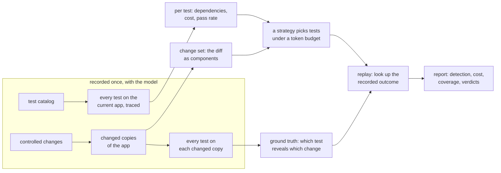

# TRACE-Eval

After a change to an LLM agent system (a skill, a prompt, the agent runtime, a config key), which tests should run,
in what order, and when can we stop? The aim is to spend fewer tokens and less time and still catch regressions.

This repository is a testbed for that question: a small, working multi-agent application whose agents are played by
a model, a catalog of tests, a set of controlled changes with known effects, and nine selection strategies, one of
which, `adaptive_bayes`, is the method this project proposes. The strategies are compared by replaying recorded
runs, and `traceeval check` runs the proposed method live on one change.

## The pieces, and how they fit



- **The application**, ContentOps, lives in [`traceeval/sut/`](traceeval/sut/): an orchestrator and ten specialist
  agents defined in YAML, skills that each carry a machine-readable procedure, tools over deterministic services,
  and one config file. The agents are played by a model: Gemma 4 E4B by default, Qwen3.8-27B or gpt-oss-120b
  through an OpenAI-compatible endpoint. [docs/CONTENTOPS.md](docs/CONTENTOPS.md) describes it.
- **The tests** live in [`traceeval/catalog/`](traceeval/catalog/) as YAML. Each has a request, a context and
  checks on the final state, the tool calls and the answer. Each test names the properties it checks, ids from a
  catalog of properties ([`properties.yaml`](traceeval/catalog/properties.yaml)): behavioural requirements such as
  "a page is never published with broken links", some of them release blockers.
- **A traced run** of every test on the current app records, per test, the components it touched (agents, skills,
  tools, config keys, code lines), its cost in tokens and its pass rate. These are its observed dependencies, as
  opposed to the declared ones its author wrote.
- **The changes** are the entries of [`traceeval/mutation/catalog.py`](traceeval/mutation/catalog.py), each applied
  as an edit to a copy of the app. The diff becomes a change set: the components it touches, in the same
  identifiers the traces use. Running the whole suite on each changed copy gives the ground truth: a test
  *reveals* a change when it passes on the current app and fails on the changed copy, by majority over the
  repetitions. A change is a regression when at least one test reveals it.
- **The strategies** in [`traceeval/selection/`](traceeval/selection/) pick tests under a token budget from the
  change set, the traces, the costs and the pass rates, and from the outcomes of the other recorded changes. They
  never see the outcome of the change under evaluation. Six are baselines, two are published methods reproduced
  (CASPER and Risk-Aware Adaptive Evaluation, neither of which reads the diff;
  [docs/REFERENCES.md](docs/REFERENCES.md)), and `adaptive_bayes` is the proposed method.
- **The report** compares the strategies: the regressions caught for the tokens and the time spent, the changes
  that break a safety property, what is spent on changes that break nothing, whether the adaptive method stops at
  the right moment, and the coverage of the suite and of each change.

## Run it

The test suite (`pytest`) and the spec-driven development (SDD) demo replay Gemma's recorded answers, stored in
[`tests/cassettes/`](tests/cassettes/), so they need no GPU and no API key:

```bash
pip install -e ".[dev]"
pytest -q                                                   # one to two minutes
traceeval sdd --workdir runs/sdd                            # spec-driven development demo
```

Recording an experiment needs the model, served from the GPU server (see
[docs/EXPERIMENT.md](docs/EXPERIMENT.md)) or from a local GPU with `--backend hf`. `--backend vllm` runs Gemma and
`--backend llm` runs Qwen or gpt-oss, or any other OpenAI-compatible endpoint; the models are used as they are
served, decoding greedily.

```bash
scripts/gpu_remote.sh up gemma
traceeval experiment --backend vllm --workdir runs/gemma7 --reps 5    # about two hours
# -> runs/gemma7/results/report.md  (tables + 3 figures)
scripts/gpu_remote.sh down
```

The prototype, `traceeval check`, checks one change live. The proposed method picks a test, the test runs live on
the changed app, the outcome decides what runs next, and the check ends with a verdict.

```bash
traceeval check skill_routing_drop_approval --history runs/gemma7 --budget 0.2      # a change from the catalog
traceeval check path/to/my-copy-of-sut --history runs/qwen7 --backend llm           # your own edit, with Qwen
```

`--history` points to an experiment recorded with the same model and the same version of the app. It tells the
method what each test costs and which code it runs.

## Main results

The results come from Gemma's recording of the current app (`runs/gemma7`: 180 tests, 43 changes, five repetitions
per test). Of the 34 regressions, 29 are revealed by at least one test. Gemma ignores the other five either way: it
behaves the same with or without the change. No benign change, one meant to break nothing, fails a test. The table
gives the share of those 29 that each strategy detects with a nominal budget of 20% of the full-suite tokens, and
what it actually spends:

| strategy | detected | tokens spent | time spent |
|---|---|---|---|
| `declared`: hand-written dependencies | 62% | 6.8% | 7.1% |
| `observed`: dependencies seen in traces | 86% | 15% | 16% |
| `ir_tfidf`: text similarity to the diff | 93% | 20% | 20% |
| `casper_slices`: CASPER's slices, reproduced | 59% | 20% | 23% |
| `risk_aware_ts`: Risk-Aware Adaptive Evaluation, reproduced | 57% | 20% | 22% |
| `adaptive_bayes`: the proposed method | 78% | 2.9% | 3.2% |

The adaptive method is the only one that stops on its own: it ends as soon as it is confident, and it never calls a
change that breaks nothing a regression. Its misses are mostly narrow regressions, revealed by one to five tests,
where it concludes too early that nothing broke. Of the 21 changes that break a safety property, it catches 84%.
`declared` and `observed` also spend less than the budget, but only because they run out of tests to select. The
two reproduced methods look at the traces and the outcomes but not at the diff, and sit between random (56%) and
the change-aware strategies. The full numbers are in the [Gemma report](docs/results/gemma7/report.md), and the
take-aways of the experiments in [RESEARCH_PLAN.md](docs/RESEARCH_PLAN.md) §5.5.

Qwen3.8-27B's and gpt-oss-120b's recordings of the same app are not clean ground truths: some of their answers vary
from run to run and with batching, so every benign change appears revealed by a few tests. The models are used as
they are served, so these recordings are reported as a finding rather than as results
([docs/RESEARCH_PLAN.md](docs/RESEARCH_PLAN.md) §5.4).

## Built for Adobe's AEM team

The AEM team (Adobe Experience Manager, Adobe's content management system) listed what they lack today and want in
the prototype, and the testbed has it: a catalog of properties, some of them release blockers; coverage of the
suite and of each change; workflows of two to five agents with plans and approvals; budgets with early stopping;
and OpenTelemetry export of the traces. [docs/AEM_ALIGNMENT.md](docs/AEM_ALIGNMENT.md) checks each requirement in
its §2, with the AEM team's answers, and its §4 has the next steps.

## Spec-driven development on the same testbed

`traceeval sdd` checks 25 pull requests against five change requests written as machine-checkable specs
([`traceeval/specs/`](traceeval/specs/)) and writes an evidence report: which clause failed and with what
counterexample, and the level of assurance reached, from example-tested up to proven. `traceeval sdd draft` has a
model draft a spec from a prose request, for a person to confirm. [docs/SDD_GUIDE.md](docs/SDD_GUIDE.md) explains
the layer and [docs/SDD_DEMO.md](docs/SDD_DEMO.md) has the results.

## How to read the documentation

[docs/README.md](docs/README.md) lists the documents by what you want to do. The reading order is README, then
[docs/CONTENTOPS.md](docs/CONTENTOPS.md), [docs/USER_GUIDE.md](docs/USER_GUIDE.md),
[docs/EXPERIMENT.md](docs/EXPERIMENT.md), [docs/RESEARCH_PLAN.md](docs/RESEARCH_PLAN.md),
[docs/AEM_ALIGNMENT.md](docs/AEM_ALIGNMENT.md) and [docs/DEMO.md](docs/DEMO.md), each document using only what the
ones before it define. [CLAUDE.md](CLAUDE.md) holds the conventions for coding agents working in the repository.
