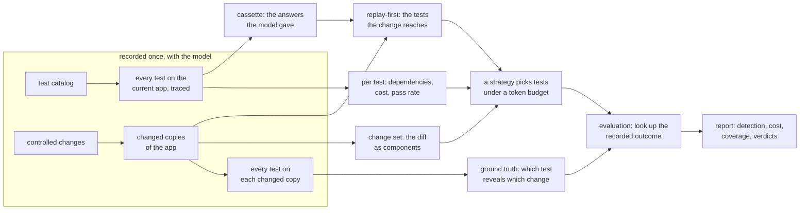

# TRACE-Eval

After a change to an LLM agent system (a skill, a prompt, the agent runtime, a config key), which tests should run,
in what order, and when can we stop? The aim is to spend fewer tokens and less time and still catch regressions.

This repository is a testbed for that question: a small, working multi-agent application whose agents are played by
a model, a catalog of tests, a set of controlled changes with known effects, and eleven selection strategies, one
of which, `adaptive_bayes`, is ours. Before any strategy runs, a change is replayed against the answers the model
gave the current app: a test whose requests to the model do not change needs no model at all. The strategies are
compared offline, on recorded runs, and `traceeval check` checks one change live.

## The pieces, and how they fit



- **The application**, ContentOps, lives in [`traceeval/sut/`](traceeval/sut/): an orchestrator and ten specialist
  agents defined in YAML, skills that each carry a machine-readable procedure, tools over deterministic services,
  and one config file. The agents are played by a model: Gemma 4 E4B by default, Qwen3.8-27B or gpt-oss-120b
  through an OpenAI-compatible endpoint. [docs/CONTENTOPS.md](docs/CONTENTOPS.md) describes it.
- **The tests** live in [`traceeval/catalog/`](traceeval/catalog/) as YAML. Each has a request, a context and
  checks on the final state, the tool calls and the answer. Each test names the properties it checks, ids from a
  catalog of properties ([`properties.yaml`](traceeval/catalog/properties.yaml)): behavioural requirements such as
  "a page is never published with broken links", some of them release blockers.
- **A traced run** of every test on the current app records, per test, the components it touched (agents, skills,
  tools, config keys, code lines), its cost in tokens and its pass rate. These are its observed dependencies, as
  opposed to the declared ones its author wrote.
- **The changes** are the entries of [`traceeval/mutation/catalog.py`](traceeval/mutation/catalog.py), each applied
  as an edit to a copy of the app. The diff becomes a change set: the components it touches, in the same
  identifiers the traces use. Running the whole suite on each changed copy gives the ground truth: a test *reveals*
  a change when it passes on the current app and fails on the changed copy, by majority over the repetitions. A
  change is a regression when at least one test reveals it. Three batches by hand, and twenty drawn at random,
  bundle two to nine changes, as a nightly run does; the check then also names the components it blames
  ([docs/RESEARCH_PLAN.md](docs/RESEARCH_PLAN.md) §5.6).
- **Replay-first** ([`traceeval/experiment/replay_first.py`](traceeval/experiment/replay_first.py)): the recording
  keeps every answer the model gave the current app. Run on a changed copy with those answers, a test either
  replays to the end, and its outcome there is known for no tokens, or diverges at the first request the current
  app never made, and needs the model from there on. A strategy then orders the diverged tests only.
- **The strategies** in [`traceeval/selection/`](traceeval/selection/) pick tests under a token budget from the
  change set, the traces, the costs and the pass rates, and from the outcomes of the other recorded changes. They
  never see the outcome of the change under evaluation. Eight are baselines, two are methods from the literature
  adapted to the testbed (CASPER and Risk-Aware Adaptive Evaluation, neither of which reads the diff;
  [docs/REFERENCES.md](docs/REFERENCES.md)), and `adaptive_bayes` is ours. All are run the same way: a test the
  model already fails on the current app is not run, and a run ends at its first failure.
- **The report** compares the strategies: the regressions caught for the tokens and the time spent, with intervals
  over the changes, the changes that break a safety property, what is spent on the changes no test reveals, the
  verdict each run ends with, the coverage of the suite and of each change, and the same strategies replay-first.

## Run it

The test suite (`pytest`) and the spec-driven development (SDD) demo replay Gemma's recorded answers, stored in
[`tests/cassettes/`](tests/cassettes/), so they need no GPU and no API key:

```bash
pip install -e ".[dev]"
pytest -q                                                   # one to two minutes
traceeval sdd --workdir runs/sdd                            # spec-driven development demo
```

uv is configured to copy packages rather than hardlink them, avoiding Windows cloud-storage hardlink errors.

Recording an experiment needs a model, used as it is served: Gemma on the GPU server (`--backend vllm`), or Qwen,
gpt-oss or any other OpenAI-compatible endpoint (`--backend llm`). [docs/EXPERIMENT.md](docs/EXPERIMENT.md) §3 says
where each model runs.

```bash
scripts/gpu_remote.sh up gemma
traceeval experiment --backend vllm --workdir runs/gemma8 --reps 5    # about two hours
# -> runs/gemma8/results/report.md  (tables + 4 figures)
scripts/gpu_remote.sh down
```

The prototype, `traceeval check`, checks one change live. It replays the change first, in seconds and without the
model. Then our method picks a test among those that diverge, the test runs live on the changed app, the outcome
decides what runs next, and the check ends with a verdict.

```bash
traceeval check skill_routing_drop_approval --history runs/gemma8 --budget 0.2      # a change from the catalog
traceeval check path/to/my-copy-of-sut --history runs/gemma8                        # your own edit
```

`--history` points to an experiment recorded with the same model and the same version of the app. It holds the
answers the model gave that app, what each test costs and which code it runs
([docs/EXPERIMENT.md](docs/EXPERIMENT.md) §5).

## Main results

The results come from Gemma's recording of the current app (`runs/gemma8`: 180 tests, 43 changes, five repetitions
per test). Of the 34 regressions, 28 are revealed by at least one test; with the other six Gemma behaves the same
with or without the change. A benign change is one meant to break nothing; none of them fails a test. The table
gives the share of those 28 that each strategy detects within a budget of 5% and of 20% of the full-suite tokens,
and the tokens it actually spends, as a mean over all 43 changes:

| strategy | detected at 5% | tokens spent | detected at 20% | tokens spent |
|---|---|---|---|---|
| `random`: the suite in a random order | 24% | 4.6% | 64% | 15% |
| `declared`: hand-written dependencies | 61% | 1.6% | 61% | 3.8% |
| `observed`: dependencies seen in traces | 64% | 3.0% | 86% | 8.6% |
| `observed_diverse`: the same tests, one behaviour group at a time | 54% | 3.8% | 93% | 9.4% |
| `ir_tfidf`: text similarity to the diff | 71% | 3.3% | 93% | 10% |
| `history_ml`: a model trained on the other changes | 71% | 3.3% | 89% | 10% |
| `casper_slices`: CASPER's slices, adapted | 36% | 4.3% | 65% | 15% |
| `risk_aware_ts`: Risk-Aware Adaptive Evaluation, adapted | 34% | 4.5% | 63% | 15% |
| `adaptive_bayes`: our method | 78% | 2.7% | 81% | 5.1% |

- Reading the change pays: ordering the tests by the traces, by the diff's text or by a model trained on the other
  changes finds 86% to 93% of the regressions at a 20% budget, for about a tenth of the suite's tokens. The two
  adapted methods do not read the diff and stay at the level of a random order.
- Hand-written dependencies stop at 61%: for eleven regressions, no test that reveals the change declares what
  changed.
- The adaptive method finds the most at a small budget. With 28 regressions that lead is not established: its
  difference to `ir_tfidf` at 5% is 6 points, with a 95% interval from −7 to +21.
- It stays at 81% to 85% however large the budget, because it calls four narrow regressions clean: at a 20% budget
  27% of its clean verdicts are given on a regression some test reveals. It never calls a change no test reveals a
  regression.
- The traces give a clean verdict that holds: once every test whose traces touched the change has run and passed
  (`observed`, with no budget), no test reveals the change, in every run. That costs 18% of the suite per change on
  average.
- All 20 changes that break a safety property are caught at 20% by `ir_tfidf` and `observed_diverse`; the adaptive
  method catches 89%.

Replay-first changes the picture ([docs/RESEARCH_PLAN.md](docs/RESEARCH_PLAN.md) §5.7). Replaying the 43 changed
copies takes under a minute and no model:

- Eight of the 43 changes are settled by the replay alone: on five no test diverges, and three are caught by a
  test that replays to a failure. On average 34 of the 180 tests diverge, and what is left of them after their
  divergence points is 21% of the suite's tokens (8% for the median change).
- The replayed outcome is the recorded one on all 6,298 (change, test) pairs that replay to the end, and every
  regression keeps a revealing test that diverges or fails in the replay.
- With no budget, an order of the diverged tests finds 98% to 100% of the regressions and gives no wrong clean
  verdict, for 9% to 10% of the suite's tokens per change. Without the replay, an order of the whole suite spends
  34% to 47%.
- Within a 5% budget the adaptive method goes from 78% of the regressions for 2.7% of the tokens to 96% for
  1.4%, and `ir_tfidf` from 71% to 89%. Once the replay has pruned the suite, the order matters much less.
- What replays exactly is the outcome, not every model call: about 2% of the requests a changed copy sends again
  get another answer than the recorded one, under the same server, and no outcome moves. The empty change, the
  original app run the way the changed copies are, flips none of the 180 tests.

The full numbers, with intervals over the changes, are in the [Gemma report](docs/results/gemma8/report.md), and the
take-aways of the experiments in [RESEARCH_PLAN.md](docs/RESEARCH_PLAN.md) §5.5. What follows from them is the plan
in [TODO.md](TODO.md).

Three results were recorded on the app as it was before the fixes of TODO §3 (`runs/gemma7` and the recordings
around it), and wait to be recorded again:

- Batches of changes: of 23 batches, 18 have a member that is a regression on its own. The adaptive method finds
  all 18 at both budgets, after one to eleven tests and 1.4% of the suite on average, and the component it blames
  most belongs to such a member in all but one run ([docs/RESEARCH_PLAN.md](docs/RESEARCH_PLAN.md) §5.6).
- A second recording of the whole experiment from scratch moves 4 of 7,740 labels.
- Qwen3.8-27B's and gpt-oss-120b's recordings are not clean ground truths: recorded many tests at once, their
  answers vary with the batch, and every benign change appears revealed by a few tests. The models are used as
  they are served, so the two recordings are a finding, not a result
  ([docs/RESEARCH_PLAN.md](docs/RESEARCH_PLAN.md) §5.4).

## Built for the Adobe Team

The Adobe Team, who work on Adobe Experience Manager (AEM), Adobe's content management system, listed what they
lack today and want in the prototype, and the testbed has it:

- a catalog of properties, some of them release blockers;
- coverage of the suite and of each change;
- workflows of two to five agents with plans and approvals;
- budgets with early stopping;
- OpenTelemetry export of the traces.

[docs/AEM_ALIGNMENT.md](docs/AEM_ALIGNMENT.md) checks each requirement in its §2, with the Adobe Team's answers,
and its §4 has the next steps.

## Spec-driven development on the same testbed

`traceeval sdd` checks 25 pull requests against five change requests written as machine-checkable specs
([`traceeval/specs/`](traceeval/specs/)) and writes an evidence report: which clause failed and with what
counterexample, and the level of assurance reached, from example-tested up to proven. `traceeval sdd draft` has a
model draft a spec from a prose request, for a person to confirm. [docs/SDD_GUIDE.md](docs/SDD_GUIDE.md) explains
the layer and [docs/SDD_DEMO.md](docs/SDD_DEMO.md) has the results.

## How to read the documentation

[docs/README.md](docs/README.md) lists the documents by what you want to do and gives the reading order; each
document uses only what the ones before it define.
