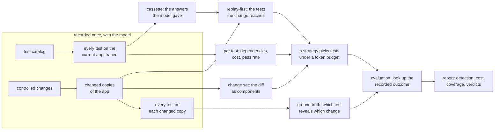

# TRACE-Eval

After a change to an LLM agent system (a skill, a prompt, the agent runtime, a config key), which tests should run,
in what order, and when can we stop? The aim is to spend fewer tokens and less time and still catch regressions.

This repository is a testbed for that question, and its answer is *replay first*:

1. a change is replayed against the answers the model gave the current app, and a test whose requests to the model
   do not change needs no model at all;
2. a strategy orders the tests the change does reach;
3. a threshold set on past changes says when to stop.

Everything is compared offline, on recorded runs, and `traceeval check` checks one change live.

**Where to start:** read this page, then [docs/README.md](docs/README.md), which lists the documents by what you
want to do and gives the reading order. Each document uses only what the ones before it define.

## The pieces, and how they fit



- **The application**, ContentOps ([`traceeval/sut/`](traceeval/sut/), [docs/CONTENTOPS.md](docs/CONTENTOPS.md)):
  an orchestrator and ten specialist agents defined in YAML, skills that each carry a machine-readable procedure,
  tools over deterministic services, and one config file. A model plays the agents: Gemma 4 E4B by default,
  Qwen3.8-27B or gpt-oss-120b through an OpenAI-compatible endpoint.
- **The tests** ([`traceeval/catalog/`](traceeval/catalog/), YAML): a request, a context, and checks on the final
  state, the tool calls and the answer. Each test names the properties it checks, ids from a catalog of properties
  ([`properties.yaml`](traceeval/catalog/properties.yaml)): behavioural requirements such as "a page is never
  published with broken links", some of them release blockers.
- **A traced run** of every test on the current app records what the test touched (agents, skills, tools, config
  keys, code lines), its cost in tokens and its pass rate. These are its *observed* dependencies; the *declared*
  ones are those its author wrote.
- **The changes** ([`traceeval/mutation/catalog.py`](traceeval/mutation/catalog.py)): edits written by hand, each
  applied to a copy of the app. The diff becomes a *change set*: the components it touches, in the same identifiers
  the traces use.
- **The ground truth**: the whole suite run on each changed copy. A test *reveals* a change when it passes on the
  current app and fails on the changed copy, by majority over the repetitions. A change is a *regression* when at
  least one test reveals it.
- **Batches**: three written by hand and twenty drawn at random bundle two to nine changes, as a nightly run does.
- **Generated changes** ([`traceeval/mutation/generator.py`](traceeval/mutation/generator.py)): 692 more, made
  mechanically, one per place an edit of its kind applies to. They have no label; the recording says which a test
  reveals.
- **Replay-first** ([`traceeval/experiment/replay_first.py`](traceeval/experiment/replay_first.py)): the next
  section.
- **The strategies** ([`traceeval/selection/`](traceeval/selection/)) pick tests under a token budget. They read
  the change set, the traces, the costs, the pass rates and the outcomes of the *other* recorded changes, never the
  outcome of the change under evaluation. There are eleven:
  - eight baselines;
  - two methods from the literature adapted to the testbed, CASPER and Risk-Aware Adaptive Evaluation, neither of
    which reads the diff ([docs/REFERENCES.md](docs/REFERENCES.md));
  - `adaptive_bayes`, ours: an order that also stops.

  All run under the same two rules: a test the model already fails on the current app is not run, and a run ends
  at its first failure.
- **The report** compares the strategies: the regressions caught for the tokens and the time spent, the verdict
  each run ends with, the coverage of the suite and of each change, and the same strategies replay-first.

## How replay-first works

The recording keeps only the model's answers, each under the exact request that got it: the prompt, every message
so far with its tool results, the tools offered, the decoding settings. On a changed copy every test runs with the
model's calls answered from those answers, and everything else runs as the copy has it: the harness, the tools, the
services and the test's checks. A test then either *replays* to the end, with its outcome known for no tokens, or
*diverges* at the first request the current app never made, and needs the model from there on.

| the change alters | what the replay sees | the test |
|---|---|---|
| what an agent is sent up front: its prompt, skills, tools and their descriptions | the first request of the agent's conversation is new | diverges there, and goes to the model |
| what a tool returns: its code, a service, the starting data | a tool result differs, and with it the next request | diverges there, and goes to the model |
| only state the model never reads | every request is one the original app made; the checks see the new state | replays to its outcome: a failure if the change broke it |
| nothing the test's run touches | every request is one the original app made | replays to its recorded outcome |

The replayed outcome is the live one under two conditions ([docs/RESEARCH_PLAN.md](docs/RESEARCH_PLAN.md) §3.3,
[the paper](docs/paper/main.tex) §4):

- **R**: the model as served gives the same request the same answer. The empty change measures it for a model and
  its server.
- **D**: the app's code is deterministic given the answers. It holds here by construction, and the original app
  replayed against its own answers checks it.

This is not the prompt caching of model providers, which reuses part of the computation and still calls the model:
a request the recording holds makes no call at all.

What it is for:

- a change that no test can tell from the original app is settled without the model, and so is one that a replayed
  test fails;
- a strategy orders only the tests the change reaches, each with a cost known in advance: at most its tokens after
  the divergence point;
- once all of those pass, the clean verdict leaves nothing the change reaches untested;
- for a batch of changes, each member's own replay says which tests it reaches and whether it needs the model at
  all, and a failing test's suspects are the members whose own replay reaches it, found for free.

## Run it

The test suite and the spec-driven development (SDD) demo replay Gemma's recorded answers, stored in
[`tests/cassettes/`](tests/cassettes/), so they need no GPU and no API key:

```bash
pip install -e ".[dev]"
pytest -q                                                   # one to two minutes
traceeval sdd --workdir runs/sdd                            # spec-driven development demo
```

Recording an experiment needs a model, used as it is served: Gemma on the GPU server (`--backend vllm`), or Qwen,
gpt-oss or any other OpenAI-compatible endpoint (`--backend llm`). [docs/EXPERIMENT.md](docs/EXPERIMENT.md) §3 says
where each model runs.

```bash
scripts/gpu_remote.sh up gemma
traceeval experiment --backend vllm --workdir runs/gemma8 --reps 5    # about two hours
# -> runs/gemma8/results/report.md  (tables + 4 figures)
scripts/gpu_remote.sh down
```

The prototype, `traceeval check`, checks one change live:

1. it replays the change, in seconds and without the model;
2. our method picks a test among those that diverge, the test runs live on the changed app, and its outcome decides
   what runs next;
3. the check ends with a verdict.

```bash
traceeval check skill_routing_drop_approval --history runs/gemma8 --budget 0.2      # a change from the catalog
traceeval check path/to/my-copy-of-sut --history runs/gemma8                        # your own edit
traceeval check skill_seo_drop_length_guard --history runs/gemma8_gen --miss-rate 0.1   # clean at a miss rate
traceeval check skill_seo_drop_length_guard --history runs/gemma8_gen --miss-rate 0.1 --floor   # and covered
```

- `--history` points to an experiment recorded with the same model and the same version of the app. It holds the
  answers the model gave that app, what each test costs and which code it runs
  ([docs/EXPERIMENT.md](docs/EXPERIMENT.md) §5).
- `--floor` adds the coverage floor before a clean verdict.
- For a batch, the check first prints which tests each member reaches, and a failing test is followed by its
  suspects among the members.

## Main results

From Gemma's recordings of the current app: 180 tests, 43 hand-written changes and 691 of the 692 changes
generated from the app, five repetitions each.

| per change, on the 43 hand-written changes | tokens, share of the full suite | regressions found |
|---|---|---|
| an order of the whole suite, stopped at the first failure | 16% to 47% | 98% to 100% |
| the whole suite through a cache of the model's answers | 13.5% | all |
| replay first: an order of the reached tests, stopped at the first failure | 5% to 7% | 98% to 99% |
| replay first, stopped early by `adaptive_bayes` | 1.7% | 93% |

What the recordings say, with the section of [docs/RESEARCH_PLAN.md](docs/RESEARCH_PLAN.md) that has the numbers:

| finding | the evidence | section |
|---|---|---|
| A fifth of the changes need no model | no test diverges, or a test replays to a failure; the other changes reach 40 of the 180 tests on average | §5.2 |
| What replays is the outcome, not every model call | 2% to 3% of the requests sent again get another answer, and no test ends otherwise | §5.2 |
| Served one test at a time and without the prefix cache, every answer repeats | for Gemma and Qwen, across a restart of the server too; Gemma's suite then takes ten times as long | §5.2 |
| The cache is the baseline | replaying recorded answers is an old idea (test factoring, 2005), and a cache already saves most of the tokens. Knowing which tests a change reaches, a regression costs 2% to 3% of the suite instead of 12%; a change that breaks nothing still costs 12% to 14% | §5.2, [related work](docs/related_work.md) §8 |
| A stop with a miss rate you choose | a threshold per group of changes, set on past changes: at a 10% target `adaptive_bayes` misses none of the 25 regressions the replay leaves open, for 15% of the suite instead of 37%. One threshold for all changes misses 87% of the regressions among edits to prompts and prose | §5.4 |
| A coverage floor under the threshold | every clean verdict covers what the change touches, for a few tenths of a point of the suite. A fixed minimal set of 15 tests covers as much and misses 13 of the 25 regressions: covering is not catching | §5.4 |
| It holds live | `traceeval check --miss-rate 0.1 --confirm` finds all 28 regressions and raises no false alarm, for 2.8% of the suite per check | §5.4 |
| It holds on changes nobody chose, and for a second model | the same on 342 generated changes the strategies never learned from; with Qwen, recorded one test at a time, every order of the reached tests finds all 32 of its regressions for 4% to 5% of the suite | §5.3, §5.2 |
| A day's changes can be checked as one batch | live checks find 19 of the 20 batches a test reveals, with no false alarm. The members' own replays say which tests each member reaches (one member in seven reaches none) and name a failing test's suspects: two members of six on average, always with the member that fails it alone | §5.5 |
| Without the replay, reading the change pays | an order by the traces, by the diff's text or by a model trained on the other changes finds 86% to 93% of the regressions within a 20% budget, hand-written dependencies 61%, and the two adapted methods stay at a random order's level | §5.6 |
| Many tests at once is not a clean ground truth for every model | the answers of Qwen and gpt-oss vary with the batch | §5.8 |

The full tables, with intervals over the changes, are in the reports of the recordings
([hand-written](docs/results/gemma8/report.md), [generated](docs/results/gemma8_gen/report.md),
[Qwen](docs/results/qwen8/report.md)). The take-aways are in [RESEARCH_PLAN.md](docs/RESEARCH_PLAN.md) §5.9, and
what follows from them is the plan in [TODO.md](TODO.md).

## Built for the Adobe Team

The Adobe Team, who work on Adobe Experience Manager (AEM), Adobe's content management system, listed what they
lack today and want in the prototype, and the testbed has it:

- a catalog of properties, some of them release blockers;
- coverage of the suite and of each change;
- workflows of two to five agents with plans and approvals;
- budgets with early stopping;
- OpenTelemetry export of the traces.

[docs/AEM_ALIGNMENT.md](docs/AEM_ALIGNMENT.md) checks each requirement in its §2, with the Adobe Team's answers,
and its §4 has the next steps.

## Spec-driven development on the same testbed

`traceeval sdd` checks 25 pull requests against five change requests written as machine-checkable specs
([`traceeval/specs/`](traceeval/specs/)) and writes an evidence report: which clause failed and with what
counterexample, and the level of assurance reached, from example-tested up to proven. `traceeval sdd draft` has a
model draft a spec from a prose request, for a person to confirm. [docs/SDD_GUIDE.md](docs/SDD_GUIDE.md) explains
the layer and [docs/SDD_DEMO.md](docs/SDD_DEMO.md) has the results.
