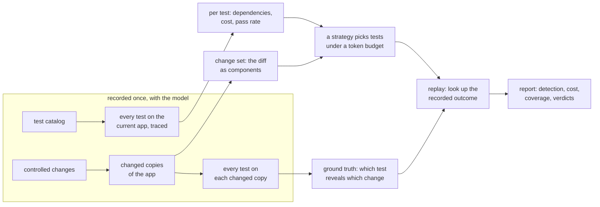
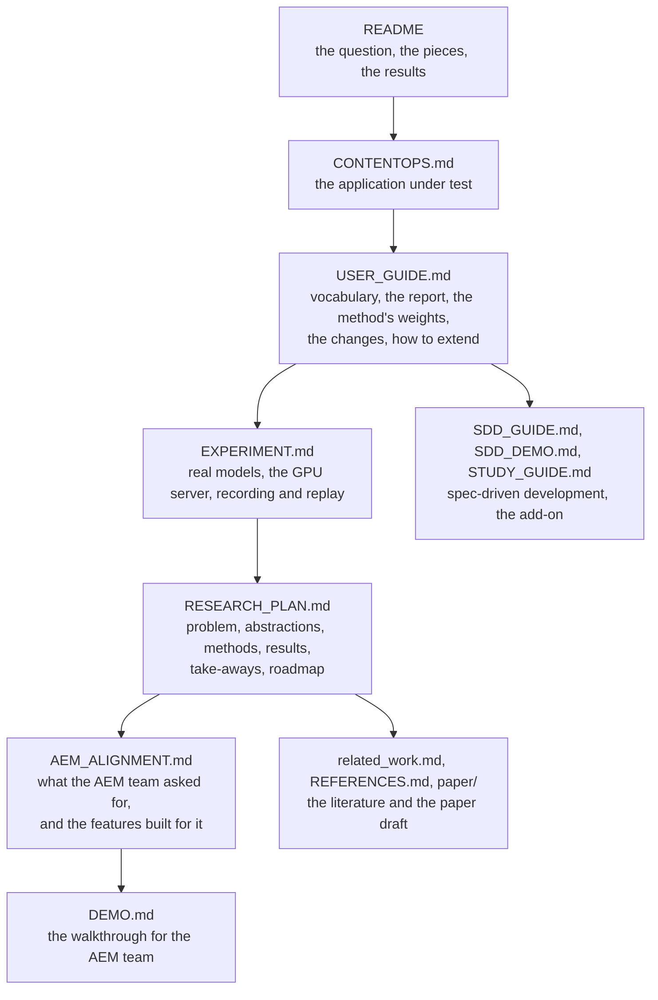

# TRACE-Eval

After a change to an LLM agent system (a skill, a prompt, harness code, a config key), which tests should run, in
what order, and when can we stop? The aim is to spend fewer tokens and less time and still catch regressions.

This repository is a testbed for that question: a small, working multi-agent application whose agents are played
by a real model, a catalog of tests, a set of controlled changes with known effects, and nine selection strategies,
one of which, `adaptive_bayes`, is the method this project proposes. The strategies are compared by replaying
recorded runs, and `traceeval check` runs the proposed method live on one change.

## The pieces, and how they fit



- **The application**, ContentOps, lives in [`traceeval/sut/`](traceeval/sut/): an orchestrator and ten specialist
  agents defined in YAML, skills that each carry a machine-readable procedure, tools over deterministic services,
  and one config file. A real model plays the agents: Gemma 4 E4B by default, Qwen3.8-27B or gpt-oss-120b through
  an OpenAI-compatible endpoint. [docs/CONTENTOPS.md](docs/CONTENTOPS.md) describes it.
- **The tests** live in [`traceeval/catalog/`](traceeval/catalog/) as YAML. Each has a request, a context and
  deterministic checks on the final state, the tool calls and the answer; two also have their answer judged by a
  model against a rubric. Each test names the properties it checks, ids from the catalog of properties
  ([`properties.yaml`](traceeval/catalog/properties.yaml)): a behavioural requirement with a category, how it is
  checked, a mandatory flag and a threshold.
- **A traced run** of every test on the current app records, per test, the components it touched (agents, skills,
  tools, config keys, code lines), its cost in tokens and its pass rate. These are its observed dependencies, as
  opposed to the declared ones its author wrote.
- **The changes** are the entries of [`traceeval/mutation/catalog.py`](traceeval/mutation/catalog.py), each applied
  as an edit to a copy of the app. The diff becomes a change set: the components it touches, in the same
  identifiers the traces use. Running the whole suite on each changed copy gives the ground truth: a test
  *reveals* a change when it passes on the current app and fails on the changed copy, by majority over the
  repetitions. A change is a regression when at least one test reveals it.
- **The strategies** in [`traceeval/selection/`](traceeval/selection/) pick tests under a token budget from the
  change set, the traces, the costs and the pass rates, and from the outcomes of the other recorded changes.
  They never see the outcome of the change under evaluation. [`strategies.py`](traceeval/selection/strategies.py)
  holds the baselines, [`reproduced.py`](traceeval/selection/reproduced.py) two published methods reproduced
  (CASPER's slices and Risk-Aware Adaptive Evaluation's bandit, neither of which reads the diff), and
  [`adaptive_bayes.py`](traceeval/selection/adaptive_bayes.py) the proposed method, with two variants that compare
  text measures and one without its mandatory-coverage rule.
- **The report** shows, per strategy, how many regressions it catches for how many tokens and how much time, how
  many of the changes that break a safety property it catches, what it spends on changes that break nothing, and
  whether the adaptive method stops at the right moment. It also gives the coverage of the suite and of each
  change.

## Run it

The tests and the spec-driven development (SDD) demo replay Gemma's recorded answers, stored in
[`tests/cassettes/`](tests/cassettes/), so they need no GPU and no API key:

```bash
pip install -e ".[dev]"
pytest -q                                                   # one to two minutes
traceeval sdd --workdir runs/sdd                            # spec-driven development demo
```

Recording an experiment needs the model, served from the GPU server (see
[docs/EXPERIMENT.md](docs/EXPERIMENT.md)) or from a local GPU with `--backend hf`. `--backend vllm` runs Gemma and
`--backend llm` runs Qwen or gpt-oss.

```bash
scripts/gpu_remote.sh up gemma
traceeval experiment --backend vllm --workdir runs/gemma5 --reps 3    # about an hour
# -> runs/gemma5/results/report.md  (tables + 3 figures)
scripts/gpu_remote.sh down
```

The prototype, `traceeval check`, checks one change live. The proposed method picks a test, the test runs on the
changed app with the real model, the outcome decides what runs next, and the check ends with a verdict.

```bash
traceeval check skill_routing_drop_approval --history runs/gemma5 --budget 0.2      # a change from the catalog
traceeval check path/to/my-copy-of-sut --history runs/qwen5 --backend llm           # your own edit, with Qwen
```

`--history` points to an experiment recorded with the same model and the same version of the app. It tells the
method what each test costs and which code it runs.

## Main results

The results come from Gemma's recording of the current app (`runs/gemma5`: 176 of the 180 tests, 43 changes, three
repetitions per test; CFG-01 to CFG-03 and WF2-03 are not in it). Of the 34 regressions, 29 are revealed by at
least one test. Gemma ignores the other five either way: it behaves the same with or without the change. No benign
change, one meant to break nothing, fails a test. The table gives the share of those 29 that each strategy detects
with a nominal budget of 20% of the full-suite tokens, and what it actually spends:

| strategy | detected | tokens spent | time spent |
|---|---|---|---|
| `declared`: hand-written dependencies | 61% | 6.8% | 6.9% |
| `observed`: dependencies seen in traces | 86% | 15% | 15% |
| `ir_tfidf`: text similarity to the diff | 92% | 20% | 20% |
| `casper_slices`: CASPER's slices, reproduced | 50% | 20% | 22% |
| `risk_aware_ts`: Risk-Aware Adaptive Evaluation, reproduced | 59% | 20% | 21% |
| `adaptive_bayes`: the proposed method | 79% | 2.9% | 3.1% |

The adaptive method is the only one that leaves budget unspent. It stops as soon as it is confident, and it never
calls a change that breaks nothing a regression. Its misses are mostly narrow regressions, revealed by one to
five tests, where it concludes too early that nothing broke. Of the 21 changes that break a safety property, it
catches 86%. The two reproduced methods look at the traces and the outcomes but not at the diff, and sit between
random (52%) and the change-aware strategies. The full numbers are in the
[Gemma report](docs/results/gemma5/report.md), and the take-aways of the experiments in
[RESEARCH_PLAN.md](docs/RESEARCH_PLAN.md) §5.5.

Qwen3.8-27B's recording of the same app is not a clean ground truth. It records every benign change as revealed by
two to five tests, for two reasons. Six tests answer differently when run 64 at a time over three servers than when
run one at a time: the two it judges itself, the one at the 60-character boundary and three long workflows. And
some of its answers vary from run to run even under identical conditions. gpt-oss-120b, a third model, varies even
more, and five repetitions instead of three do not settle its vote. The models are used as they are served, so
these recordings are reported as a finding rather than as results ([EXPERIMENT.md](docs/EXPERIMENT.md) §7).

## Features asked for by Adobe's AEM team

The AEM team listed what they lack today and want in the prototype. Their requirements and follow-up questions
are summed up in [docs/AEM_ALIGNMENT.md](docs/AEM_ALIGNMENT.md), together with the plan and its status.

| feature | status |
|---|---|
| Catalog of properties, each with a category, how it is checked, a mandatory flag and a threshold ([`properties.yaml`](traceeval/catalog/properties.yaml)). Reports give pass rates against the thresholds and the share of affected properties each strategy covered | done |
| Drafting the catalog with a model, from the requirements only (skills' rules, agents, config guards, specs) and within fixed limits, for people to edit: `traceeval properties draft`, then `apply` | done; Qwen's draft is in [`docs/properties/draft_qwen/`](docs/properties/draft_qwen/) |
| Coverage from several angles, in the report and in `traceeval check`. For the suite: each dimension (agents, features, skills, tools, tool error paths, config, setting values, properties, workflows, execution paths, risk), declared and observed, with what no test covers, and per agent, skill, tool and feature the tests that declare it and the tests that invoke it (`traceeval coverage`). For each change: the changed components exercised, the affected properties checked, the affected workflows run, the affected features reached and the refusals in the changed code reached | done |
| Mandatory properties in the method: while the budget allows, a run that has found no regression does not end until every mandatory property the change may affect has been tested | done (`adaptive_bayes`) |
| Test selection, prioritization and stopping under a token budget | done (`adaptive_bayes`, `traceeval check`) |
| Per-test metadata: agents, skills, tools, config, workflow, risk, cost, history (declared and observed) | done |
| Trace assertions: final state, required and forbidden tools, attempts, audit, step limit, agent order, tool order | done |
| Workflows, where one prompt runs 2–5 agents. The orchestrator plans, passes each step its instruction and the ids of earlier steps, asks a person before publishing, scheduling or taking pages down, and stops at a failed step | done: six workflows of two to five agents (campaign launch, site optimization, legal takedown, localized price update, rollback of a broken release, privacy request), each with a variant where a step must stop |
| Agents modelled on AEM's: brand governance, data insights, site optimization, and asset search in the assets agent | done |
| Environment failures kept apart. A run broken by the model server or the network is marked `INFRA_INVALID` and left out of pass rates and replays, so it never counts against the agent. `traceeval check` stops instead of giving a verdict | done |
| OpenTelemetry export of traces (`traceeval run --otel`), with the plan, the routing decisions and the approvals as span events | done |

## Spec-driven development on the same testbed

`traceeval sdd` checks 25 pull requests against five change requests written as machine-checkable specs, kept in
[`traceeval/specs/`](traceeval/specs/). Each spec is built from clauses picked from a
[catalog of templates](traceeval/spec/catalog.yaml). Two of the pull requests are the unchanged code, which the
specs check as it stands. The others change one to four files. The command writes an evidence report: which
clause failed, the counterexample or the misplaced code, the level of assurance reached and the level required
(from example-tested up to proven), and what a coding agent had to read and run. `traceeval sdd draft` has a
model draft a spec from a prose request, for a person to confirm.

Start with [docs/SDD_GUIDE.md](docs/SDD_GUIDE.md) if you are new to spec-driven development, or with
[docs/SDD_DEMO.md](docs/SDD_DEMO.md) for the results. The report is in [docs/sdd/report.md](docs/sdd/report.md).

## How to read the documentation

Each document uses only what the ones before it define.



- [docs/CONTENTOPS.md](docs/CONTENTOPS.md): the application, its agents, skills, tools and rules.
- [docs/USER_GUIDE.md](docs/USER_GUIDE.md): how the pieces fit, how to read the report, how the method weighs a
  test, the controlled changes, how to add a test, a change or a strategy.
- [docs/EXPERIMENT.md](docs/EXPERIMENT.md): the experiment with real models. Where the models run, the GPU server
  script, the recorded answers, the commands to type, and what the recordings show.
- [docs/RESEARCH_PLAN.md](docs/RESEARCH_PLAN.md): the research framing: the problem, the abstractions, the methods,
  the results, the take-aways and the roadmap.
- [docs/AEM_ALIGNMENT.md](docs/AEM_ALIGNMENT.md): Adobe's platform, the AEM team's requirements, and the features
  built for them.
- [docs/DEMO.md](docs/DEMO.md): the 20-minute walkthrough for the AEM team, with the commands and what each shows.
- [docs/SDD_GUIDE.md](docs/SDD_GUIDE.md), [docs/SDD_DEMO.md](docs/SDD_DEMO.md),
  [docs/STUDY_GUIDE.md](docs/STUDY_GUIDE.md): the spec-driven development layer, its results, and a reading plan
  for the whole repository in diagrams.
- [docs/related_work.md](docs/related_work.md), [docs/REFERENCES.md](docs/REFERENCES.md), `docs/paper/`: how this
  work relates to the literature, the full references, and the paper draft.
- [CLAUDE.md](CLAUDE.md): conventions for coding agents working in the repository.

The agents and the judge run on real models only, used as they are served. Running a model behind OpenAI's API
through the `llm` backend waits for API tokens. An adapter that adds tau2-bench, a public agent benchmark, as a
second system under test is planned ([docs/RESEARCH_PLAN.md](docs/RESEARCH_PLAN.md) §6).
