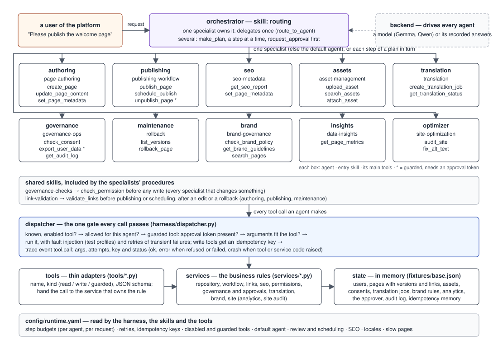
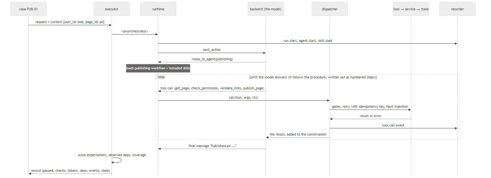

# ContentOps: the application under test

ContentOps is a small, made-up content platform run by AI agents. Picture a CMS such as AEM with an
assistant in front of it: instead of clicking through screens, people type what they want and a team of
agents does the work. Every test, every controlled change and every spec in this repository is about this
one application, and all of its code lives in [`traceeval/sut/`](../traceeval/sut/).

## What people ask it to do

The platform starts with a few users, each with a different job. Alice is an author. Bob writes and
publishes. Erin only publishes. Carol is the administrator, the one who can approve sensitive operations.
Dave can only look. They are in the platform's starting data,
[`fixtures/base.json`](../traceeval/sut/fixtures/base.json), next to a small website of pages, some assets,
and the people whose personal data the platform holds.

They talk to the platform in plain language. Some requests from the test catalog:

- "Please publish the welcome page"
- "Update the SEO title tag of the welcome post"
- "Translate the welcome post into German"
- "Upload a new image banner.png and attach it to the welcome post"
- "Export the personal data of subject s1 (GDPR access request)"
- "Revert the history page to version 1"
- "Who changed the home page? Show me the audit history"

The platform answers in prose and, when the request calls for it, changes its data: pages with their
versions, links and metadata; assets; translation jobs; and an audit log that records every change.

## How it is built



*One request, top to bottom. The orchestrator hands the request to one specialist. The specialist follows
its skill's procedure. Every tool call it makes passes through the dispatcher. The tools pass the work on
to the services, which change the data and write the audit log.*

```
request --> orchestrator --> one specialist agent --> its skills --> tools --> services --> data
```

Each layer is a folder or file you can open:

| Layer | What it is | Open it |
|---|---|---|
| Agents | One YAML file per agent: its instructions, the skills it follows, the tools it may call, and the trigger words that send requests its way | [`sut/agents/`](../traceeval/sut/agents/) |
| Skills | One `SKILL.md` per skill: a `Procedure` block with the steps to follow, plus rules in plain prose. Two skills are shared by several agents | [`sut/skills/`](../traceeval/sut/skills/) |
| Tools | Thin adapters. Each has a name, a kind (`read`, `write` or `guarded`) and a parameter schema. The orchestrator also has a control tool, `route_to_agent` | [`sut/tools/`](../traceeval/sut/tools/) |
| Services | The business logic: pages, versions and assets; review, publish, schedule and unpublish; links; SEO; roles and permissions; consent, export and audit; translation | [`sut/services/`](../traceeval/sut/services/) |
| Data | An in-memory copy of a JSON file with the users, pages, assets, consents and audit log, plus a memory of idempotency keys | [`fixtures/base.json`](../traceeval/sut/fixtures/base.json), [`services/state.py`](../traceeval/sut/services/state.py) |
| Harness | What runs the agents: the agent loop, the dispatcher that every tool call passes through, the router, the skill loader, fault injection and retries | [`sut/harness/`](../traceeval/sut/harness/) |
| Settings | The step budget, retries, idempotency keys, disabled and guarded tools, the default agent, the review and scheduling switches, SEO limits, default languages, and how noisy the simulated agent is | [`config/runtime.yaml`](../traceeval/sut/config/runtime.yaml) |
| Backends | What makes the decisions. The *simulated* backend follows the skill's procedure step by step, so it is deterministic and costs nothing. The *LLM* backend lets a real model decide, through any OpenAI-compatible endpoint that supports tool calling | [`harness/backends/`](../traceeval/sut/harness/backends/) |

## The agents, and how they work together

Agents do not chat with each other. The only hand-off is the orchestrator passing the request to one
specialist with `route_to_agent`. The only way any agent changes anything is by calling a tool. Everything
else, such as which skill to follow and what to do next, happens inside a single agent.

The orchestrator is the front door. It reads the request, looks at every specialist's description and
trigger words, and delegates exactly once. When no trigger word matches, the request goes to the default
agent named in the settings, which is `authoring`. The orchestrator never touches content itself.

Click an agent to see its definition, or a skill to read its procedure:

| Agent | Looks after | Follows | May call |
|---|---|---|---|
| [orchestrator](../traceeval/sut/agents/orchestrator.yaml) | sending each request to the right specialist | [routing](../traceeval/sut/skills/routing/SKILL.md) | `route_to_agent` |
| [authoring](../traceeval/sut/agents/authoring.yaml) | creating draft pages and editing page text, and asking for a review when told to | [page-authoring](../traceeval/sut/skills/page-authoring/SKILL.md) | `search_pages`, `get_page`, `create_page`, `update_page_content`, `set_page_metadata`, `validate_links`, `request_review`, `list_versions`, `check_permission` |
| [publishing](../traceeval/sut/agents/publishing.yaml) | putting pages live, scheduling them, taking them down | [publishing-workflow](../traceeval/sut/skills/publishing-workflow/SKILL.md) | `get_page`, `check_permission`, `validate_links`, `request_review`, `approve_review`†, `publish_page`, `schedule_publish`, `unpublish_page`† |
| [seo](../traceeval/sut/agents/seo.yaml) | checking and setting a page's title, description and keywords, within the title-length limit | [seo-metadata](../traceeval/sut/skills/seo-metadata/SKILL.md) | `get_page`, `get_seo_report`, `set_page_metadata`, `check_permission` |
| [assets](../traceeval/sut/agents/assets.yaml) | uploading files to the asset library and attaching them to pages | [asset-management](../traceeval/sut/skills/asset-management/SKILL.md) | `get_page`, `upload_asset`, `get_asset`, `attach_asset`, `check_permission` |
| [translation](../traceeval/sut/agents/translation.yaml) | starting translation jobs and reporting how far they are | [translation](../traceeval/sut/skills/translation/SKILL.md) | `get_page`, `check_permission`, `create_translation_job`, `get_translation_status` |
| [governance](../traceeval/sut/agents/governance.yaml) | exporting a person's data when they have consented, and answering audit questions | [governance-ops](../traceeval/sut/skills/governance-ops/SKILL.md) | `check_permission`, `check_consent`, `export_user_data`†, `get_audit_log` |
| [maintenance](../traceeval/sut/agents/maintenance.yaml) | restoring an earlier version of a page | [rollback](../traceeval/sut/skills/rollback/SKILL.md) | `get_page`, `list_versions`, `rollback_page`, `validate_links`, `check_permission` |

† A *guarded* tool. The dispatcher refuses the call unless the request carries an approval token, but it
only checks that a token is there, not whose it is. The services behind `approve_review` and
`export_user_data` check the rest: the token must belong to the approving user, and that user's role must
allow the action. `unpublish_page` gets no such check, so any token will do.

### The shared skills

Two skills are shared. They are the platform's way of saying "every specialist does this the same way":

- [governance-checks](../traceeval/sut/skills/governance-checks/SKILL.md) asks `check_permission` whether
  the user may do what they asked, and stops with an explanation if they may not. Every specialist
  includes it.
- [link-validation](../traceeval/sut/skills/link-validation/SKILL.md) runs `validate_links` on the page and
  stops if any link is broken. Authoring includes it after writing a page, publishing before putting one
  live or scheduling it, and maintenance after a rollback.

Specialists *include* these skills rather than copying them, so a change to a shared skill changes every
agent that includes it. That ripple is exactly what the test-selection work has to follow.

### Where the tools live

| File | Tools |
|---|---|
| [`content_tools.py`](../traceeval/sut/tools/content_tools.py) | `search_pages`, `get_page`, `create_page`, `update_page_content`, `set_page_metadata`, `list_versions`, `rollback_page` |
| [`publish_tools.py`](../traceeval/sut/tools/publish_tools.py) | `validate_links`, `request_review`, `approve_review`†, `publish_page`, `schedule_publish`, `unpublish_page`† |
| [`asset_tools.py`](../traceeval/sut/tools/asset_tools.py) | `upload_asset`, `get_asset`, `attach_asset` |
| [`translation_tools.py`](../traceeval/sut/tools/translation_tools.py) | `create_translation_job`, `get_translation_status`, and also `get_seo_report` |
| [`governance_tools.py`](../traceeval/sut/tools/governance_tools.py) | `check_permission`, `check_consent`, `export_user_data`†, `get_audit_log` |
| [`control_tools.py`](../traceeval/sut/tools/control_tools.py) | `route_to_agent`, which the agent loop handles itself and which never reaches the dispatcher |

### One request, step by step



*Bob asks: "Please publish the welcome page". The executor starts the orchestrator, which routes the
request to publishing. The publishing agent follows its procedure: fetch the page, check the permission,
check the links, publish. Each step goes through the dispatcher and is recorded. At the end, the final
data and the answer are scored against what the test case expects.*

## Who enforces which rule

The rules sit in three places. It matters which is which: if a change removes a check from a skill, the
layers below it will not catch the mistake.

**The harness, on every tool call.** The dispatcher refuses a call when the tool does not exist, when the
settings have switched it off, when this agent is not allowed to use it, when it is guarded and the request
has no approval token, or when the arguments do not fit. A call that gets through runs with fault
injection, and transient failures are retried. Write tools get an idempotency key, so the services that
honour it do not repeat a change when a retry follows a lost acknowledgement. Every call leaves a
`tool.call` event in the trace. Around the dispatcher, the agent loop limits how many steps a request may
take (delegations count too) and how deep delegation may go. The code is in
[`dispatcher.py`](../traceeval/sut/harness/dispatcher.py) and [`runtime.py`](../traceeval/sut/harness/runtime.py).

**The skills.** The skills hold most of the business rules: check the permission before acting, never
publish a page with broken links, get a review approved before going live, keep the SEO title within the
limit, export nobody's data without their consent. Most services do not check permissions themselves.
They trust the skill to have asked first.

**The services and tools.** A few rules are checked again at the bottom. Approving a review and exporting
personal data need the right role and the user's own approval token. Rolling a page back needs the right
role, so a rollback skill that forgot to ask would still be refused: the page stays safe, but the agent
makes a call it should not have made. Scheduling is refused when the settings switch it off.

Tests can also break things on purpose, to check that the resilience rules hold. A fault profile names the
tool it hits ([`faults.py`](../traceeval/sut/harness/faults.py)):

- `transient_once:<tool>`: the first call fails before it runs, so a retry is safe.
- `ack_timeout_once:<tool>`: the first call runs but its acknowledgement is lost, so a retry without an
  idempotency key makes the change twice.
- `permanent_down:<tool>`: every call fails.

## Why it is shaped like this

It is meant to be small but realistic. It has enough layers (instructions, skills, tools, services,
settings, harness) that a change can land in the wrong one. It has enough rules (gates, retries, budgets)
that a change can break one without touching the feature it was aimed at. And under the simulated backend
every run is deterministic and free, so the whole catalog can be run again and again.

To follow a single request through the code, see [STUDY_GUIDE.md §1.1](STUDY_GUIDE.md#11-one-run-end-to-end).
The test scenarios that exercise the platform are in [`traceeval/catalog/tests/`](../traceeval/catalog/tests/).
