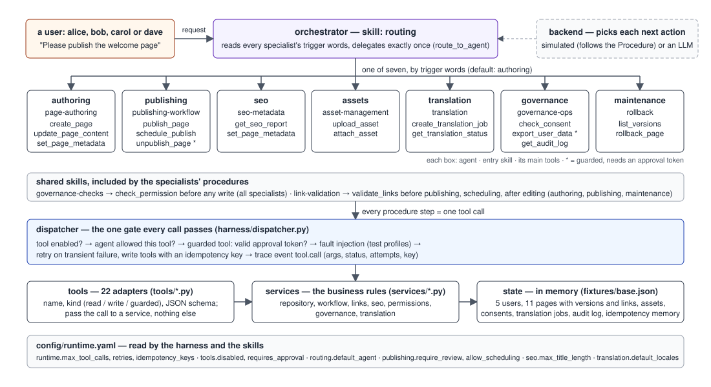
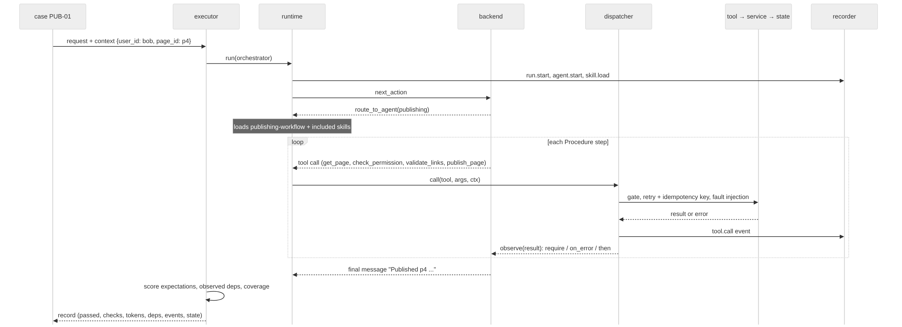

# ContentOps: the application under test

ContentOps is a small content-management platform operated by agents — a toy version of what a CMS such
as AEM looks like when an LLM agent sits in front of it. It is the system that every test, every
controlled change and every spec in this repository talks about. Everything is in `traceeval/sut/`.

## What a user can do

Users (an author, a publisher, an admin, a viewer) write requests in natural language: "publish the
welcome page", "set the SEO title of the launch post", "translate the widget page into German and
French", "export the personal data of subject s1", "roll back the history page to version 2". The
platform answers in prose and changes its state: pages, their versions, links and metadata; assets;
translation jobs; an audit log of every write.

## How it is built



*One request, top to bottom: the orchestrator delegates once; the specialist follows its skill's
procedure; every step is a tool call through the dispatcher; adapters hand over to services; services
change the state and write the audit log.*

```
request --> orchestrator (routes by trigger words) --> one specialist agent --> its skills --> tools --> services --> state
```

| layer | what it is | where |
|---|---|---|
| agents (8) | YAML definitions: system prompt, the skills they may use, the tools they may call, trigger words for routing | `sut/agents/*.yaml` |
| skills (10) | markdown files with a machine-readable `Procedure` (the steps to follow) plus prose rules; shared skills (`governance-checks`, `link-validation`) are included by others | `sut/skills/*/SKILL.md` |
| tools (22) | thin adapters with a name, a kind (`read`, `write`, `guarded`) and a JSON schema, registered with a decorator | `sut/tools/*.py` |
| services | the business logic: repository (pages, versions, assets), workflow (review, publish, schedule, unpublish), links, SEO, permissions, governance, translation | `sut/services/*.py` |
| state | an in-memory copy of a JSON fixture: users, pages, assets, consents, audit log; idempotency memory | `sut/services/state.py`, `sut/fixtures/base.json` |
| harness | the agent loop (`runtime.py`), the dispatcher that governs every tool call (`dispatcher.py`), the router, the skill loader, the config reader, fault injection, retries | `sut/harness/` |
| config | the runtime settings: step budget, retries, idempotency keys, disabled and guarded tools, default agent, review/scheduling flags, SEO limits, default locales | `sut/config/runtime.yaml` |
| backends | *simulated*: executes the skill's procedure step by step, deterministic and free; *LLM*: a real model on an OpenAI-compatible endpoint, with tool calling | `sut/harness/backends/` |

## The agents and who talks to whom

Agents do not talk to each other freely: the only inter-agent message is the orchestrator's single
delegation (`route_to_agent`), and the only way an agent acts on the world is a tool call through the
dispatcher. Everything else is inside one agent: its skills, its backend, its context.

- **orchestrator** — the front door. Reads the request, consults every specialist's description and
  trigger words (recorded as `agent.consult` events), delegates exactly once; if no trigger matches,
  the configured default (`routing.default_agent: authoring`) gets it. Skill: `routing`. Tool: only
  `route_to_agent`.
- **authoring** — creates draft pages and edits page bodies. Skill `page-authoring`; includes
  `governance-checks` (permission first) and `link-validation` (after an edit). Tools: `search_pages`,
  `get_page`, `create_page`, `update_page_content`, `set_page_metadata`, `validate_links`,
  `request_review`, `list_versions`, `check_permission`.
- **publishing** — takes pages live, schedules them, takes them down. Skill `publishing-workflow`;
  includes `governance-checks` and `link-validation` (before publishing or scheduling). Tools:
  `get_page`, `check_permission`, `validate_links`, `request_review`, `approve_review`*,
  `publish_page`, `schedule_publish`, `unpublish_page`*.
- **seo** — reviews and sets SEO metadata within the configured title limit. Skill `seo-metadata` +
  `governance-checks`. Tools: `get_page`, `get_seo_report`, `set_page_metadata`, `check_permission`.
- **assets** — uploads assets to the DAM and attaches them to pages. Skill `asset-management` +
  `governance-checks`. Tools: `get_page`, `upload_asset`, `get_asset`, `attach_asset`, `check_permission`.
- **translation** — creates translation jobs and reports their status. Skill `translation` +
  `governance-checks`. Tools: `get_page`, `check_permission`, `create_translation_job`,
  `get_translation_status`.
- **governance** — data-subject exports under consent, audit-log questions. Skill `governance-ops` +
  `governance-checks`. Tools: `check_permission`, `check_consent`, `export_user_data`*, `get_audit_log`.
- **maintenance** — restores earlier page versions. Skill `rollback` + `governance-checks` +
  `link-validation`. Tools: `get_page`, `list_versions`, `rollback_page`, `validate_links`,
  `check_permission`.

\* guarded: the dispatcher refuses the call unless the request carries a valid approval token.

Shared skills are the platform's way of saying "every specialist does this the same way":
`governance-checks` calls `check_permission(user, action)` before any write and stops with an
explanation when the user may not; `link-validation` calls `validate_links(page)` and stops when
anything is broken. A specialist's procedure *includes* them, so a change to a shared skill changes
every specialist that includes it — which is exactly what the test-selection work tracks.

### One request, step by step



*"Please publish the welcome page" as bob: the executor starts the orchestrator, the orchestrator
routes to publishing, the publishing agent follows its procedure (fetch, permission, links, publish),
each step goes through the dispatcher and is recorded, and the final state and message are scored
against the case's expectations.*

## The rules the harness enforces on every tool call

Role permissions (`check_permission` before any write), approval tokens for guarded tools
(`approve_review`, `export_user_data`, `unpublish_page`), retries on transient failures with an
idempotency key so that a lost acknowledgement does not duplicate a write, a per-request step budget,
tool enablement by configuration, delegation depth, and a trace event for every call. Fault profiles
(`transient_once:<tool>`, `ack_timeout_once:<tool>`, `permanent_down:<tool>`) inject failures on
purpose so that the resilience rules can be tested.

## Why it is shaped like this

It is deliberately *small but real*: enough layers (prompt, skill, tool, service, config, harness) that a
change can land in the wrong one, enough rules (gates, retries, budgets) that a change can break one
without touching the feature it was meant for, and fully deterministic under the simulated backend so
that thousands of runs cost nothing. A one-line walkthrough of a request is in
[STUDY_GUIDE.md §1.1](STUDY_GUIDE.md); the 134 scenarios that exercise it are in `traceeval/catalog/`.
