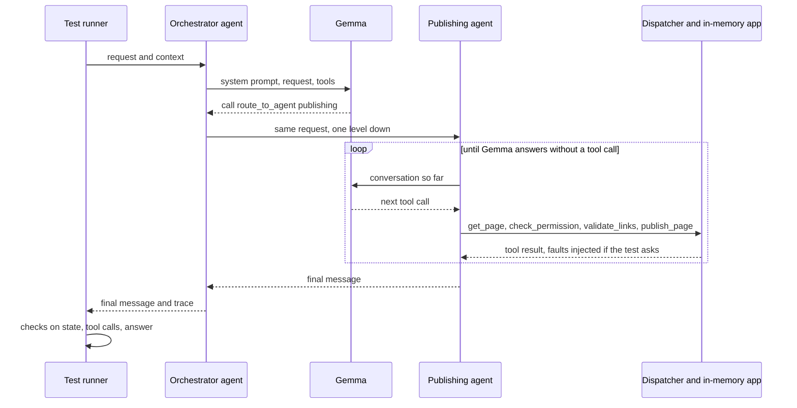
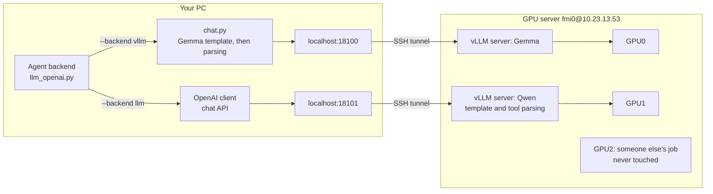

# Running the experiment

How to run the agents on Gemma 4 E4B, Qwen3.8-27B and gpt-oss-120b: where the models run, how the GPU server is
wired in, and what to type. Start with sections 1 and 4 and look the rest up when you need it.

## 1. Recording, in two minutes

The README says what the testbed is. A recording goes like this:

1. Every test runs several times on the original app and on every changed copy (`--reps`; five in the recording the
   results come from), and what happened is recorded.
2. The majority of the runs decides the outcome. A run the environment broke, because the model server or the
   network did not answer, is marked `INFRA_INVALID` and left out, as if it had not been made.
3. That gives the ground truth: which tests fail under which change.
4. After that, comparing the strategies costs nothing, because we replay the recordings: strategy X would have run
   these tests, so it would or would not have caught this change, for this many tokens.

Recording costs GPU time, which is why we use the GPU server (section 4). Replaying recorded answers is free
(section 5).

## 2. What happens when one test runs

Take PUB-01, "Please publish the welcome page", from user `bob` for page `p4`.



The runner ([`experiment/runner.py`](../traceeval/experiment/runner.py)) starts the case through the executor,
which builds a fresh app from the fixture, the starting data; the path through the orchestrator, the specialist,
the dispatcher and the scorers is the one [CONTENTOPS.md](CONTENTOPS.md) shows. The part it does not show is the
model call. At every step the runtime ([`sut/harness/runtime.py`](../traceeval/sut/harness/runtime.py)) asks the
agent's backend ([`backends/llm_openai.py`](../traceeval/sut/harness/backends/llm_openai.py)) "what next?", which
is one model call. Gemma picks `route_to_agent(publishing)`, and the runtime runs the publishing agent the same
way: model call, tool call, result, model call again, until Gemma answers in plain text.

### What Gemma sees

An agent's system prompt is made of its own prompt, its tools and its skill. The skill's procedure is written
out as numbered plain steps, with included skills expanded in place and every config value shown
([`render_procedure`](../traceeval/sut/harness/skills.py)). This is the start of what the publishing agent
reads:

```text
1. Call `get_page` with page_id=<page_id>. Its result is called `fetch`.
2. If the intent is `unpublish`: action = "unpublish".
...
7. Call `validate_links` with page_id=<page_id>. Go on only if broken_count == 0; otherwise stop and
   answer: "Found {broken_count} broken link(s) on {page_id}: {the link of each entry in broken}. Fix them first."
   Its result is called `links`.
...
```

The procedure is where the skill spells out the workflow, so editing it changes what the model is told to do.

### What Gemma writes

Gemma has its own syntax for tool calls. This is an answer from the model log:

```text
<|tool_call>call:check_permission{action:<|"|>attach<|"|>,user_id:<|"|>alice<|"|>}<tool_call|>
```

The tokenizer's own parser turns that into `check_permission(action="attach", user_id="alice")`. We don't
parse it by hand.

## 3. Where the models run

Three models can play the agents:

- Gemma 4 E4B, a small model from Google, by default;
- Qwen3.8-27B, Alibaba's open model, about six times bigger, so we can check that results hold for more than one
  model;
- gpt-oss-120b, OpenAI's open-weights model, served over both GPUs of the GPU server, fmi0, when they are free.

The `--backend` option picks who plays the agents:

| backend | what it is | when to use it |
|---|---|---|
| `hf` (default) | Gemma in this Python process, on a local GPU, one call at a time | a quick look at one case, no server needed |
| `vllm` | Gemma served by vLLM (the server that runs a model and answers over an OpenAI-style API) on the GPU server (GPU0), reached through an SSH tunnel; many calls at once | recording experiments with Gemma |
| `llm` | an OpenAI-compatible endpoint: by default Qwen on the GPU server (GPU1), or the one named by `TRACEEVAL_LLM_BASE_URL` and `TRACEEVAL_LLM_MODEL` | recording experiments with Qwen or gpt-oss-120b; a model behind OpenAI's API would use it too |
| `replay` | Gemma's recorded answers, no model (`tests/cassettes/gemma.jsonl`, or the file named by `TRACEEVAL_CACHE`) | the test suite and the spec-driven development (SDD) demo; running a recorded experiment again |

The models are wired in slightly differently:

- **Gemma (`hf`, `vllm`).** We build the prompt on your machine with Gemma's chat template and send it as
  token ids. The answer comes back as raw text, and we parse it on your machine
  ([`traceeval/llm/chat.py`](../traceeval/llm/chat.py)). The only difference between `hf` and `vllm` is which
  machine does the arithmetic, so a test gets the same prompt and the same parsing on either engine.
- **Qwen (`llm`).** We use the ordinary chat API. vLLM applies Qwen's chat template and turns Qwen's tool-call
  syntax into structured calls on the server, so there is no Qwen-specific prompt or parsing code in the
  repository, only its default URL and model name. Qwen's thinking mode is turned off on the server, so it answers
  directly, as Gemma does.
- **gpt-oss-120b (`llm`).** It is reached the same way as Qwen. It reasons before it answers, so it needs more room
  per answer (`TRACEEVAL_LLM_MAX_TOKENS=4096`).

Two cases, SEO-07 and PUB-20, have a rubric. Once their fixed checks pass, a model also judges the answer against
the rubric. By default the judge is the model playing the agents; `TRACEEVAL_JUDGE=gemma` or `qwen` picks one
explicitly, where `qwen` means the model the `llm` backend serves (Qwen, or gpt-oss when that is the one running).
Gemma's verdicts are recorded and replayed with its other answers, while the `llm` backend's model is always asked
on its server.

This is the path of one model call when Gemma and Qwen are both running:



Each vLLM server listens only on the GPU server's own localhost, so nobody on the network can reach it. Your
PC gets in through one SSH tunnel per model, which uses the same key you log in with.

Runs are repeatable, with one caveat. Decoding is greedy (temperature 0), so the same prompt gives the same answer.
On vLLM this is nearly exact rather than bit-exact: the batch a request lands in can change the floating-point
arithmetic slightly. Once in a while that flips a token, and with it the rest of the run. With Qwen running 64
cases at once, tests failed under changes that could not have affected them; run one case at a time (`--workers
1`), Qwen's runs agree with each other as Gemma's do ([RESEARCH_PLAN.md](RESEARCH_PLAN.md) §5.4). That is why a
ground truth should come from several repetitions (`--reps 3`, majority vote) rather than one, and, for a model
served like Qwen, from the changed copies recorded one test at a time.

## 4. The GPU server, step by step

Everything goes through one script, [`scripts/gpu_remote.sh`](../scripts/gpu_remote.sh). Run it from the
repository root in Git Bash or any other bash shell. It knows three models, called presets:

| preset | model | GPU | port | run with |
|---|---|---|---|---|
| `gemma` (the default) | `google/gemma-4-E4B-it` | 0 | 18100 | `--backend vllm` |
| `qwen` | `Qwen/Qwen3.8-27B-FP8` (8-bit weights, about 30 GB) | 1 | 18101 | `--backend llm` |
| `gptoss` | `openai/gpt-oss-120b` (4-bit weights, about 65 GB), one copy split over both GPUs | 0 and 1 | 18102 | `--backend llm` with `TRACEEVAL_LLM_BASE_URL=http://127.0.0.1:18102/v1` and `TRACEEVAL_LLM_MODEL=openai/gpt-oss-120b` and `TRACEEVAL_LLM_MAX_TOKENS=4096` |

Gemma and Qwen use different GPUs and ports, so both can run at the same time, each with its own experiment.
gpt-oss needs both GPUs; Gemma and Qwen then run on the university's cluster (below).

### What lives where

| where | what |
|---|---|
| server `~/traceeval-vllm/.venv` | a Python 3.12 environment with vLLM 0.31.0, kept apart from anything else on the server |
| server `~/traceeval-vllm/gemma.log`, `qwen.log` | each server's log: start-up, errors, request counts |
| server `~/traceeval-vllm/gemma.pid`, `qwen.pid` | each server's process id, so `down` can stop it |
| server `~/.cache/huggingface/` | the model weights |
| your PC `~/.traceeval-vllm-tunnel-gemma.pid`, `...-qwen.pid` | each tunnel's process id, so `down` can close it |

### Once per server

```bash
scripts/gpu_remote.sh setup     # creates ~/traceeval-vllm/.venv on the server, installs vLLM, checks the models
```

### Every working session

```bash
scripts/gpu_remote.sh up gemma  # start Gemma on GPU0, open its tunnel, wait until it answers
scripts/gpu_remote.sh up qwen   # the same for Qwen on GPU1
scripts/gpu_remote.sh status    # GPU memory, and for each model: server, tunnel, endpoint

# Gemma
traceeval run --test PUB-01 --backend vllm                              # one case, to check
traceeval experiment --backend vllm --workdir runs/gemma7 --reps 5      # the whole recording
traceeval check skill_routing_drop_approval --history runs/gemma7       # one change, live (section 5)

# Qwen (in another terminal, at the same time if you like)
traceeval run --test PUB-01 --backend llm
traceeval experiment --backend llm --workdir runs/qwen7 --reps 5
traceeval check skill_routing_drop_approval --history runs/qwen7 --backend llm

# gpt-oss-120b (it takes both fmi0 GPUs: Gemma and Qwen then run on the cluster)
scripts/gpu_remote.sh up gptoss
export TRACEEVAL_LLM_BASE_URL=http://127.0.0.1:18102/v1 TRACEEVAL_LLM_MODEL=openai/gpt-oss-120b
export TRACEEVAL_LLM_MAX_TOKENS=4096
traceeval experiment --backend llm --workdir runs/gptoss7 --reps 5

scripts/gpu_remote.sh down      # stop every server and close the tunnels: frees the GPUs
scripts/gpu_remote.sh down qwen # or just one of them
```

Qwen is the slower model. When Gemma isn't needed, put a copy of Qwen on each GPU (`TRACEEVAL_GPUS`, in the
settings below) and run the changes with `--workers 64`.

`up` does four things:

1. It checks whether that model's server is already running, using its pid file. If not, it starts
   `vllm serve` on the server, detached from the SSH session, so it keeps running when the script exits.
2. It opens that model's SSH tunnel in the background, unless one is already open.
3. It polls the endpoint until it answers. That takes a few minutes while vLLM loads the model and compiles
   its kernels.
4. If the server dies while starting, it prints the last lines of the server log and exits.

You can run `up` as often as you like: it reuses a running server and an open tunnel.

**Please run `down` when you're done.** The server is shared, and vLLM keeps most of each GPU's memory
reserved while it runs, even when idle.

### More GPUs: the SLURM cluster, and several servers in one run

More H100 GPUs are available through the university's cluster, whose jobs are scheduled by SLURM (the login is in
the settings table). Its GPU node, `hpc-nodegpu01`, is the same machine as fmi0. It has 8 H100s, of which SLURM
hands out 4. Each of our jobs asks for 2. Two jobs may run at once, one per model, each with its own job name and
port, when the other users leave the GPUs free. The same script drives the cluster with `TRACEEVAL_SITE=hpc`:

```bash
TRACEEVAL_SITE=hpc scripts/gpu_remote.sh up qwen     # a SLURM job for 2 GPUs (8 hours at most), tunnel on port 18111
TRACEEVAL_SITE=hpc scripts/gpu_remote.sh status      # our jobs, and which endpoints answer
TRACEEVAL_SITE=hpc scripts/gpu_remote.sh down        # cancel the jobs, close the tunnels
```

`up` submits a job that serves the model on the GPU node's own localhost, waits until SLURM starts it, and
opens the tunnel through the controller, the machine you log in to. The first job takes longer, because it
also creates the vLLM environment in your cluster home and downloads the model.

The job checks its GPUs first and stops if one is already in use. SLURM does not see processes started
outside it, such as another user's server or one started on fmi0, and may hand out their GPUs anyway. This
does happen, so check `TRACEEVAL_SITE=hpc scripts/gpu_remote.sh status` and, if needed, ask the cluster's
admin which GPUs are free.

To use both sites in one run, list both servers in the URL variable, separated by commas. Each request goes to the
next server in turn (`traceeval/llm/chat.py::Servers`), so a server listed twice gets twice the requests. List the
cluster's server twice when it holds a copy of the model on each of its two GPUs. The servers give the same answers
apart from rare one-off differences, which a split run makes somewhat more frequent (section 3). For Qwen:

```bash
# Qwen on fmi0's GPU1 and on the cluster's two GPUs: a third of the requests to fmi0, two thirds to the cluster
export TRACEEVAL_LLM_BASE_URL=http://127.0.0.1:18101/v1,http://127.0.0.1:18111/v1,http://127.0.0.1:18111/v1
traceeval experiment --backend llm --workdir runs/qwen7 --reps 5 --workers 64
```

For Gemma the variable is `TRACEEVAL_VLLM_URL` (ports 18100 and 18110).

### Settings

All settings are optional and are read from environment variables:

| variable | default | meaning |
|---|---|---|
| `TRACEEVAL_SITE` | `fmi0` | `fmi0` (the shared server) or `hpc` (the SLURM cluster) |
| `TRACEEVAL_GPU_HOST` | `fmi0@10.23.13.53` (hpc: `ciprian.paduraru@hpc-ctrl01.acc-ub.local`) | the SSH login (key-based, no password prompt) |
| `TRACEEVAL_GPUS` | the preset's GPU (hpc: 2) | which GPUs to use, with one copy of the model on each. `TRACEEVAL_GPUS=0,1 scripts/gpu_remote.sh up gemma` puts Gemma on both GPUs when Qwen isn't needed. On hpc, how many GPUs to ask SLURM for |
| `TRACEEVAL_VLLM_PORT` | the preset's port (hpc: plus 10) | the port, the same on both ends of the tunnel |
| `TRACEEVAL_HF_MODEL` | `google/gemma-4-E4B-it` | the `gemma` preset's model; `--backend hf` and `vllm` read it too |
| `TRACEEVAL_VLLM_URL` | `http://127.0.0.1:18100/v1` | where `--backend vllm` sends Gemma's calls; several servers separated by commas |
| `TRACEEVAL_LLM_BASE_URL`, `TRACEEVAL_LLM_MODEL` | `http://127.0.0.1:18101/v1`, `Qwen/Qwen3.8-27B-FP8` | where `--backend llm` sends its calls (several servers separated by commas), and the model name the servers know |
| `TRACEEVAL_LLM_API_KEY` | `EMPTY` | the key `--backend llm` sends; a local vLLM server needs none |
| `TRACEEVAL_LLM_MAX_TOKENS` | `700` | the most tokens `--backend llm` lets the model write per answer; gpt-oss-120b needs 4096 |
| `TRACEEVAL_JUDGE` | the agents' model | `gemma` or `qwen`: the model that judges the cases with a rubric |
| `TRACEEVAL_VLLM_ENV` | none | extra settings for the vLLM server, for example `VLLM_BATCH_INVARIANT=1`, which makes answers independent of batching (not supported for Qwen3.8) |

To add another model, add a preset to the `case` statement in `preset()` at the top of the script, with the
model, GPU, port and any vLLM flags it needs, and add its name to `PRESETS`.

### When something goes wrong

| symptom | what to do |
|---|---|
| `endpoint ... does not answer` but the server is running (often after the PC slept) | the tunnel died: `scripts/gpu_remote.sh down NAME` then `up NAME` |
| `up` says "the server stopped" | read the log lines it prints, or `scripts/gpu_remote.sh logs NAME` |
| log shows `nvcc ... Unknown option '--compress-mode=size'` or `NVCC version must be at least 12.9` | a vLLM component tried to compile kernels with the server's old CUDA compiler (12.0). The script turns off the two components known to do this (`VLLM_USE_FLASHINFER_SAMPLER=0`, `VLLM_USE_DEEP_GEMM=0`); turn off any other one the same way |
| log shows `max_num_seqs ... exceeds available Mamba cache blocks` | the model can't keep state for that many requests at once: lower `--max-num-seqs` in the script |
| log shows "out of memory" | another job took GPU memory: check `status`, pick other GPUs with `TRACEEVAL_GPUS`, or lower `--gpu-memory-utilization` in the script |
| the tunnel fails with "address already in use" | something on your PC uses the port: set `TRACEEVAL_VLLM_PORT` to another one (use the same value for `up`, the runs and `down`) |
| SSH asks for a password | the script needs key login: `ssh-copy-id fmi0@10.23.13.53` once |

## 5. Running an experiment

```bash
traceeval experiment --backend vllm --workdir runs/gemma7 --reps 5
```

This runs four steps: `baseline`, `mutants`, `evaluate` and `report`. You can also run them one at a time
with the same options.

- **`baseline`** runs every test on the original app, one test at a time, because it records code coverage
  per test and coverage can follow only one test at a time in a process.
- **`mutants`** makes a changed copy of the app for each change (in `runs/gemma7/variants/`) and runs every test on
  it, 32 tests at a time by default (`--workers`), since the vLLM server handles many requests at once. With the
  local `hf` engine the default is 1. `--only <ids>` records some changes only, which is how a batch of changes is
  recorded ([USER_GUIDE.md](USER_GUIDE.md) §6).
- **`evaluate`** replays the strategies on the recordings; it makes no model calls.
- **`report`** writes `runs/gemma7/results/report.md`. Its first section is the sanity check: every
  regression must be revealed by at least one test, and no benign change by any.

`--reps 1` is good for a first look. For a ground truth you'll rely on, `--reps 3` is enough for Gemma (section 7);
the recording the results come from used 5. The majority vote over the repetitions absorbs the one-off differences
of section 3; for a model whose answers vary more, no number of repetitions settles it
([RESEARCH_PLAN.md](RESEARCH_PLAN.md) §5.4).

The work folder is git-ignored; to keep a run, copy its `results/` into `docs/results/`. It holds:

| path | what |
|---|---|
| `history/*.jsonl` | one line per test run: outcome, failed checks, tokens, the trace, observed dependencies (large: it includes line coverage) |
| `variants/` | the changed copies of the app |
| `results/report.md`, `results/*.csv` | the report and the raw replay tables |

To see what Gemma did (`--backend hf` or `vllm`), set `TRACEEVAL_MODEL_LOG` to a file. Every call to Gemma is then
appended to it as one JSON line with the agent, the last message it got, the raw answer, the tokens and the
seconds.

```bash
TRACEEVAL_MODEL_LOG=runs/gemma7/model_calls.jsonl traceeval run --test PUB-02 --backend vllm
```

To export a run's trace, add `--otel trace.json` to `traceeval run`. It writes the trace as OpenTelemetry spans in
OTLP JSON, the JSON form of the OpenTelemetry protocol ([AEM_ALIGNMENT.md](AEM_ALIGNMENT.md) §3.6). There is a span
for the run, one for each agent turn, nested by delegation, and one for each tool call, model call and skill load.
The plan, the delegations and the approvals are span events.

```bash
traceeval run --test WF3-01 --backend replay --otel runs/otel/wf3-01.json
```

### Checking one change live (the prototype)

`traceeval check` is what a developer would run before merging. It applies the proposed method to one change
and has the model run the chosen tests live, instead of looking their outcomes up in a recording
([`traceeval/experiment/check.py`](../traceeval/experiment/check.py)).

```bash
traceeval check skill_routing_drop_approval --history runs/gemma7 --budget 0.2    # a change from the catalog
traceeval check my-sut-copy --history runs/qwen7 --backend llm                    # a changed copy of traceeval/sut
```

It runs the loop of [USER_GUIDE.md](USER_GUIDE.md) §5 live, on the changed app.

The check prints each test as it runs, and then:

- the verdict: `REGRESSION`, `no regression`, `no regression found within the budget`,
  `no failure within the budget`, or `nothing to test` for a change that touches no code;
- the tokens and seconds spent;
- the method's probability that the change broke something;
- the change coverage ([USER_GUIDE.md](USER_GUIDE.md) §4) and what the tests left out: the affected properties left
  unchecked (marked when mandatory), the workflows not run, the features not reached and the refusals not reached;
- what the tests invoked: how many of the application's agents, skills, tools and features.
- for a batch of changes, `blamed`: the components the method holds responsible, with its probability for each,
  most likely first.

`--history` is a recording made with the same model (the README); `traceeval experiment --reps 1` is enough for it.
A changed copy of the app is compared with `traceeval/sut`, so copy that folder before editing it.

Run live on every one of the 43 changes, one check at a time with Gemma on the GPU server, the check gives the
verdict the replay's five seeds agree on for 42 of them, with the same tests and the same tokens to within a few
hundred ([results/gemma7/live_vs_replay.md](results/gemma7/live_vs_replay.md) has the table). The one difference is
a live false alarm: under the benign rewording of the orchestrator's prompt, WF3-03 failed live, with the
orchestrator skipping the approval, where its five recorded runs pass. That is the one-off difference of section 3,
on a test whose outcome hangs on one decision of the model. The 43 checks took 21 minutes of model time, six tests
and 1.9% of the suite's tokens per check at the median.

### Recorded answers: running without a model

Every answer Gemma gives can be recorded, keyed by exactly what it was sent
([`traceeval/llm/cache.py`](../traceeval/llm/cache.py)). Decoding is greedy and the app has no clock and no
randomness, so a run that starts from recorded answers sends the same prompts again and replays exactly.

- **`--backend replay`** answers only from recorded answers, with no model and no GPU. The test suite and
  `traceeval sdd` do this by default, from `tests/cassettes/gemma.jsonl`.
- **`TRACEEVAL_CACHE=<file>`** with `--backend hf` or `vllm` answers what the file has, asks Gemma for the rest
  and adds those answers to the file. Running the same experiment again then costs nothing.
- When the app changes a prompt through a skill, an agent definition, a config value or a tool result,
  the recorded answer no longer matches, and a replay run ends as `INFRA_INVALID` with `CacheMiss`. Start
  Gemma, run `TRACEEVAL_BACKEND=vllm pytest -q`, which replays what it can and records the rest, and commit
  the cassette, the file of recorded answers. To drop answers that nothing asks for any more, delete the file
  first and record everything again.

```bash
scripts/gpu_remote.sh up gemma
TRACEEVAL_BACKEND=vllm pytest -q            # records into tests/cassettes/gemma.jsonl what the tests lack
TRACEEVAL_CACHE=tests/cassettes/gemma.jsonl traceeval sdd --backend vllm --workers 32   # the SDD demo, faster
scripts/gpu_remote.sh down
```

## 6. What the models get wrong, and how the prompts and checks allow for it

A model does not follow a skill the way a script would, and the prompts and checks are written with that in
mind:

- Procedures are plain steps. A skill's `## Procedure` block is shown to the model as numbered sentences,
  with included skills written out and settings filled in (section 2). Shown the procedure as raw YAML, Gemma
  calls `say` and `governance-checks` as tools.
- Conditions are spelled out. A step says `If <request_review> is given and true:`, because
  `If <request_review>:` reads as an order. It says `fetch.review_approved is false` instead of `not ...`, and
  `<seo_title> has more than 60 characters` instead of `len(...) > ...`.
- Tool results sit on the model's turn. Gemma was trained with each tool result attached to the turn that
  asked for it, and [`chat.py`](../traceeval/llm/chat.py) converts the conversation to that form.
- An empty answer gets one reminder. When the model ends its turn without any text, the backend asks once
  for the answer the step prepared, and the `answered` check fails a run that still ends empty.
- The orchestrator is told the rules it would otherwise improvise. A request that no specialist owns goes
  to the agent named by `routing.default_agent`; without that setting, Qwen answers "Hello there" itself.
  Every request is delegated, and a specialist's answer goes to the user as it is. A plan is only for parts
  owned by different specialists. The runtime holds an approval for the steps after it: asked to copy the
  approval into each step instead, Gemma keeps the token and drops the approver.

What remains are the models' own mistakes, which clearer wording does not fix. On the original app, Gemma passes
172 of the 180 tests. Qwen passes 173: it gets five of Gemma's mistakes right (PUB-10, AUT-04, SEO-02, WF1-01,
WF6-02), shares CFG-01 and WF2-03, splits on WF5-02 (half of its runs), and makes mistakes of its own:

| case | model | what goes wrong |
|---|---|---|
| PUB-10 | Gemma | it requests the review, as it should, and then schedules the page anyway |
| WF1-01 | Gemma | the same in the campaign launch: it schedules the launch page after requesting a review instead of having the approver approve it |
| WF2-03 | Gemma | in the site optimization, with the broken page ranked first, it sends all three pages to publishing in one step. Publishing stops at the broken page, and Gemma tells the user that the other two were republished when they were not. Only the checks on the final state catch it |
| WF5-02 | Gemma | in the rollback workflow, after the restored version fails its link check, it still sends the page to publishing, without an approval. Publishing's own link check refuses it, so the page stays down |
| WF6-02 | Gemma | in the privacy workflow, after the export is refused for lack of consent, it stops the whole plan, although the byline edits do not depend on the export. It claims nothing false, and no safety property is broken |
| AUT-04 | Gemma | after an edit it requests a review nobody asked for |
| CFG-01 | Gemma | asked to publish a page on a platform that does not require reviews, it requests one anyway |
| SEO-02 | Gemma | it applies an 83-character title over the 60-character limit |
| WF1-02, and WF5-02 in half of its runs | Qwen | it re-plans after a failed step, as Adobe's Agent Orchestrator does. It rewrites the campaign page that failed the brand check, or has the broken link of the restored page fixed, and goes on to translate, schedule or publish, where the routing skill and the tests say stop |
| PUB-07 | Qwen | after the takedown is refused for lack of an approval token, it asks the approver itself and then takes the page down. The test expects the refusal to stand |
| WF4-01 | Qwen | it asks for the locale "es" instead of es-ES, the job is refused, and it does not republish |
| DS-ROUTING/r40 | Qwen | it answers a vague request itself instead of handing it to the default agent |
| SEO-07 | Qwen | the case it judges itself against a rubric: its own judge rejects its answer |

There is a pattern:

- Gemma acts on guards, the conditions that should stop a step, when they come from a tool's answer (a denied
  permission, a broken link). It does not act on guards it has to work out for itself (a review flag, a length).
- In a plan, Gemma does not judge well which steps depend on a failed one.
- Qwen follows the guards, but in a plan it tends to repair a failed step and go on.

Gemma's cases are listed in `KNOWN_MODEL_MISTAKES` (`tests/test_sut.py`); the test suite expects them to fail and
every other case to pass. A test the model fails on the original app cannot reveal a change, which is also why some
changes have no revealing test (section 7).

## 7. The recordings

Three recordings of the current app, each with 180 tests, 43 changes, five repetitions and the model judge:

| recording | model | where | time | clean ground truth? |
|---|---|---|---|---|
| `runs/gemma7`, report in `docs/results/gemma7/` | Gemma | fmi0's GPU0 | about two hours: 31 minutes for the baseline, one test at a time, and under two minutes per change, because the changed copies run many tests at once (`--workers`) | yes; the results come from it |
| `runs/qwen7`, `docs/results/qwen7/` | Qwen | two SLURM GPUs | about six hours | no (below) |
| `runs/gptoss7`, `docs/results/gptoss7/` | gpt-oss | both of fmi0's GPUs | three and a half hours | no (below) |

On the original app 172 of 180 tests pass, 29 of the 34 regressions are revealed and no benign change is, so the
report's sanity line says VIOLATED for the five changes below. They are misses of the model, not of the testbed,
and they stay in the set:

| change | why no test reveals it under Gemma |
|---|---|
| `config_require_review_false`, `code_edit_keeps_review` | it schedules a page without an approved review anyway (PUB-10), requests a review nobody asked for after an edit (AUT-04), and requests one even when none is required (CFG-01) |
| `config_seo_title_20`, `skill_seo_drop_length_guard` | it applies an over-long title whatever the limit (SEO-02) |
| `skill_linkval_ignore_assets` | it stops at a broken asset reference even when the skill says it does not block |

Gemma's five runs of each test agree on the original app and disagree on only four (change, test) pairs over all 43
changes; the majority vote absorbs them, and three repetitions are enough.

Qwen's and gpt-oss's recordings are not clean ground truths ([RESEARCH_PLAN.md](RESEARCH_PLAN.md) §5.4). The 116
baseline runs of Qwen's recording that a dropped tunnel broke are left out, so about 110 of its tests have four
valid baseline runs instead of five. We take the models as they are served, with no re-runs or filtering to make
them agree with themselves, so the results are Gemma's.

## 8. Where to look in the code

| file | role |
|---|---|
| [`scripts/gpu_remote.sh`](../scripts/gpu_remote.sh) | start, check and stop the model server on the GPU server |
| [`traceeval/llm/chat.py`](../traceeval/llm/chat.py) | the model client: prompt, engines (`hf`, `vllm`), parsing, log; the `llm` backend's client; several servers in turn (`Servers`); which model judges (`judge_client`) |
| [`traceeval/llm/cache.py`](../traceeval/llm/cache.py) | recorded answers: the cache in front of a model, and `replay` without one |
| [`traceeval/sut/harness/backends/llm_openai.py`](../traceeval/sut/harness/backends/llm_openai.py) | one agent's conversation with the model: system prompt, tool calls, results |
| [`traceeval/sut/harness/skills.py`](../traceeval/sut/harness/skills.py) | skills, and `render_procedure`, which writes a procedure as plain steps |
| [`traceeval/experiment/runner.py`](../traceeval/experiment/runner.py) | runs the suite on the original app and on each change, sequentially or in parallel |
| [`traceeval/cli.py`](../traceeval/cli.py) | the `traceeval` command |

For the rest of the repository (strategies, report, SDD), see [USER_GUIDE.md](USER_GUIDE.md) and
[STUDY_GUIDE.md](STUDY_GUIDE.md).
