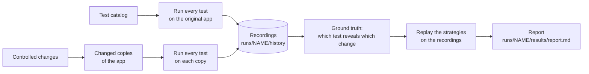
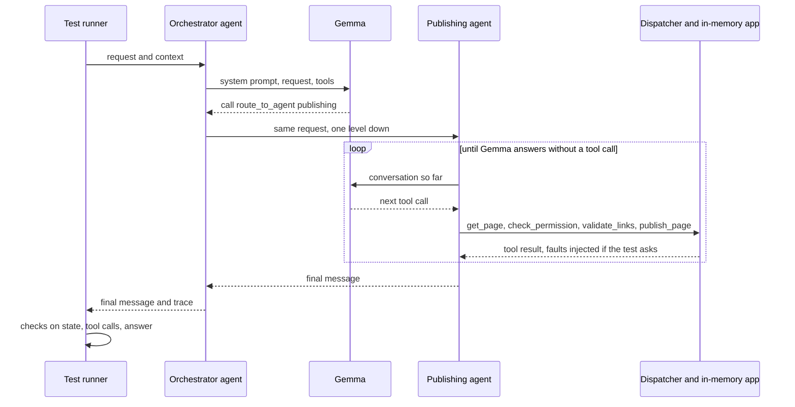
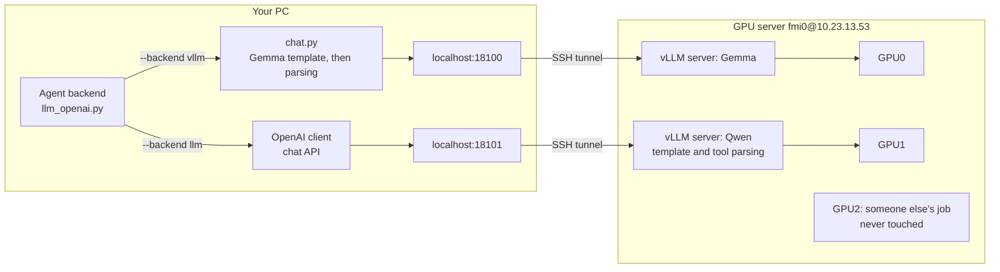

# Running the experiment with a real model

This page explains how the experiment runs the agents on real models: Gemma 4 E4B, and Qwen3.8-27B as a
second model. It covers where the models run, how the GPU server is wired in, and what to type. Start with
sections 1 and 4, and look up the rest when you need it.

The diagrams are written in Mermaid, which GitHub draws, and PyCharm too with the Mermaid plugin.

## 1. The idea in two minutes

The research question is easy to state. Someone changes an LLM agent system: a skill, a prompt, a line of
harness code or a config value. Which tests should we run, and when can we stop, so that we still catch the
change if it broke something, without paying for the whole test suite every time?

To study that, the repository has four parts:

- **An app with agents.** ContentOps is a small content platform with an orchestrator and specialist agents
  for publishing, authoring, SEO, assets and other areas. A request that needs several specialists gets a
  plan, which runs one specialist at a time. Each agent follows a skill, a `SKILL.md` file with a step-by-step
  procedure, and calls tools. The app's data (pages, users, reviews) lives in memory, so a test can't damage
  anything, and the harness can inject faults such as a tool that fails once. See [CONTENTOPS.md](CONTENTOPS.md).
- **Tests.** 177 cases: scenario tests in [`traceeval/catalog/tests/`](../traceeval/catalog/tests/) and dataset
  items in `traceeval/catalog/datasets/`. Each case gives a request ("Please publish the welcome page") and
  checks the outcome: was the page published, which tools were called, which facts the answer reports.
- **Changes.** 43 controlled edits in [`traceeval/mutation/catalog.py`](../traceeval/mutation/catalog.py),
  each labelled *regression* (it should break something) or *benign* (it should not). For example,
  `config_seo_title_20` lowers the SEO title limit from 60 to 20 characters.
- **Selection strategies.** The strategies in [`traceeval/selection/`](../traceeval/selection/) decide which
  tests to run for a given change.

We run every test three times on the original app and on every changed copy, and record what happened. The
majority of the three runs decides the outcome. That gives the ground truth: which tests fail under which
change. After that, comparing the strategies costs nothing, because we replay the recordings: strategy X would
have run these tests, so it would or would not have caught this change, for this many tokens.



Each agent's decisions come from a real model: Gemma 4 E4B, a small open model from Google, or Qwen3.8-27B.
Recording costs GPU time, which is why we use the GPU server (section 4). Replaying recorded answers is free
(section 5).

## 2. What happens when one test runs

Take PUB-01, "Please publish the welcome page", from user `bob` for page `p4`.



1. The **runner** ([`experiment/runner.py`](../traceeval/experiment/runner.py)) starts the case through the
   **executor** ([`experiment/executor.py`](../traceeval/experiment/executor.py)), which builds a fresh app
   from the fixtures.
2. The **runtime** ([`sut/harness/runtime.py`](../traceeval/sut/harness/runtime.py)) runs the orchestrator.
   At every step it asks the agent's backend "what next?". With a model backend
   ([`backends/llm_openai.py`](../traceeval/sut/harness/backends/llm_openai.py)), that is one model call.
3. Gemma picks `route_to_agent(publishing)`. The runtime then runs the publishing agent the same way: model
   call, tool call, result, model call again, until Gemma answers in plain text.
4. Every tool call goes through the **dispatcher**
   ([`sut/harness/dispatcher.py`](../traceeval/sut/harness/dispatcher.py)), which checks permissions,
   retries transient failures, injects the faults the test asks for, and records everything in the trace.
5. The **scorers** ([`scoring/scorers.py`](../traceeval/scoring/scorers.py)) check the result against the
   case's `expect` block. For PUB-01 they check that the request was routed to publishing, that page `p4` is
   now `published`, that the required tools were called and `request_review` was not, that the audit log has
   one `publish_page`, and that the answer is not empty.

### What Gemma sees

An agent's system prompt is made of its own prompt, its tools and its skill. The skill's procedure is written
out as numbered plain steps, with included skills expanded in place and every config value shown
([`render_procedure`](../traceeval/sut/harness/skills.py)). This is the start of what the publishing agent
reads:

```text
1. Call `get_page` with page_id=<page_id>. Its result is called `fetch`.
2. If the intent is `unpublish`: action = "unpublish".
...
7. Call `validate_links` with page_id=<page_id>. Go on only if broken_count == 0; otherwise stop and
   answer: "Found {broken_count} broken link(s) on {page_id}: {the link of each entry in broken}. Fix them first."
   Its result is called `links`.
...
```

The procedure is the skill's own statement of the workflow, so a change to it changes what the model is told
to do.

### What Gemma writes

Gemma has its own syntax for tool calls. This is a real answer from the model log:

```text
<|tool_call>call:check_permission{action:<|"|>attach<|"|>,user_id:<|"|>alice<|"|>}<tool_call|>
```

The tokenizer's own parser turns that into `check_permission(action="attach", user_id="alice")`. We don't
parse it by hand.

## 3. Where the models run

Two models play the agents. Gemma 4 E4B, a small model from Google, is the default. Qwen3.8-27B, released by
Alibaba in August 2026 and about six times bigger, is the second model, so we can check that results hold for
more than one model. The `--backend` option picks who plays the agents:

| backend | what it is | when to use it |
|---|---|---|
| `hf` (default) | Gemma in this Python process, on your local GPU (RTX 4090), one call at a time | a quick look at one case, no server needed |
| `vllm` | Gemma served by vLLM on the GPU server (GPU0), reached through an SSH tunnel; many calls at once | recording experiments with Gemma |
| `llm` | an OpenAI-compatible endpoint: by default Qwen on the GPU server (GPU1), or the one named by `TRACEEVAL_LLM_BASE_URL` and `TRACEEVAL_LLM_MODEL` | recording experiments with Qwen; an OpenAI model would use it too |
| `replay` | Gemma's recorded answers, no model (`tests/cassettes/gemma.jsonl`, or the file named by `TRACEEVAL_CACHE`) | the test suite and the spec-driven development (SDD) demo; running a recorded experiment again |

The two models are wired in slightly differently:

- **Gemma (`hf`, `vllm`).** We build the prompt on your machine with Gemma's chat template and send it as
  token ids. The answer comes back as raw text, and we parse it on your machine
  ([`traceeval/llm/chat.py`](../traceeval/llm/chat.py)). The only difference between `hf` and `vllm` is which
  machine does the arithmetic, so a test gets the same prompt and the same parsing on either engine.
- **Qwen (`llm`).** We use the ordinary chat API. vLLM applies Qwen's chat template and turns Qwen's tool-call
  syntax into structured calls on the server, so there is no Qwen-specific code in the repository. Qwen's
  thinking mode is turned off on the server, so it answers directly, as Gemma does.

Two cases, SEO-07 and PUB-20, have a rubric. Once their fixed checks pass, a model also judges the answer
against the rubric. By default the judge is the model playing the agents; `TRACEEVAL_JUDGE=gemma` or `qwen`
picks one explicitly. Gemma's verdicts are recorded and replayed with its other answers, while Qwen is always
asked on its server.

This is the path of one model call when both models are running:



Each vLLM server listens only on the GPU server's own localhost, so nobody on the network can reach it. Your
PC gets in through one SSH tunnel per model, which uses the same key you log in with.

Runs are repeatable, with one caveat. Decoding is greedy (temperature 0), so the same prompt gives the same
answer. On vLLM this is nearly exact rather than bit-exact: the batch a request lands in can change the
floating-point arithmetic slightly. Once in a while that flips a token, and with it the rest of the run. With
Qwen running many cases at once, tests failed under changes that could not have affected them (section 7). That
is why a ground truth should come from several repetitions (`--reps 3`, majority vote) rather than one.

## 4. The GPU server, step by step

Everything goes through one script, [`scripts/gpu_remote.sh`](../scripts/gpu_remote.sh). Run it from the
repository root in Git Bash or any other bash shell. It knows two models, called presets:

| preset | model | GPU | port | run with |
|---|---|---|---|---|
| `gemma` (the default) | `google/gemma-4-E4B-it` | 0 | 18100 | `--backend vllm` |
| `qwen` | `Qwen/Qwen3.8-27B-FP8` (8-bit weights, about 30 GB) | 1 | 18101 | `--backend llm` |

Because they use different GPUs and ports, both can run at the same time, each with its own experiment.

### What lives where

| where | what |
|---|---|
| server `~/traceeval-vllm/.venv` | a Python 3.12 environment with vLLM 0.31.0, kept apart from anything else on the server |
| server `~/traceeval-vllm/gemma.log`, `qwen.log` | each server's log: start-up, errors, request counts |
| server `~/traceeval-vllm/gemma.pid`, `qwen.pid` | each server's process id, so `down` can stop it |
| server `~/.cache/huggingface/` | the model weights (both already downloaded) |
| your PC `~/.traceeval-vllm-tunnel-gemma.pid`, `...-qwen.pid` | each tunnel's process id, so `down` can close it |

### Once (already done)

```bash
scripts/gpu_remote.sh setup     # creates ~/traceeval-vllm/.venv on the server, installs vLLM, checks the models
```

### Every working session

```bash
scripts/gpu_remote.sh up gemma  # start Gemma on GPU0, open its tunnel, wait until it answers
scripts/gpu_remote.sh up qwen   # the same for Qwen on GPU1
scripts/gpu_remote.sh status    # GPU memory, and for each model: server, tunnel, endpoint

# Gemma
traceeval run --test PUB-01 --backend vllm                              # one case, to check
traceeval experiment --backend vllm --workdir runs/gemma5 --reps 3      # the whole recording
traceeval check skill_routing_drop_approval --history runs/gemma5       # one change, live (section 5)

# Qwen (in another terminal, at the same time if you like)
traceeval run --test PUB-01 --backend llm
traceeval experiment --backend llm --workdir runs/qwen5 --reps 3
traceeval check skill_routing_drop_approval --history runs/qwen5 --backend llm

scripts/gpu_remote.sh down      # stop both servers and close the tunnels: frees the GPUs
scripts/gpu_remote.sh down qwen # or just one of them
```

Qwen is the slower model. When Gemma isn't needed, `TRACEEVAL_GPUS=0,1 scripts/gpu_remote.sh up qwen` puts a
copy of Qwen on each GPU, and vLLM shares the requests between the copies. Run the changes with `--workers 64`
in that case.

`up` does four things:

1. It checks whether that model's server is already running, using its pid file. If not, it starts
   `vllm serve` on the server, detached from the SSH session, so it keeps running when the script exits.
2. It opens that model's SSH tunnel in the background, unless one is already open.
3. It polls the endpoint until it answers. That takes a few minutes while vLLM loads the model and compiles
   its kernels.
4. If the server dies while starting, it prints the last lines of the server log and exits.

You can run `up` as often as you like: it reuses a running server and an open tunnel.

**Please run `down` when you're done.** The server is shared, and vLLM keeps most of each GPU's memory
reserved while it runs, even when idle.

### More GPUs: the SLURM cluster, and several servers in one run

More H100 GPUs are available through the university's cluster, whose jobs are scheduled by SLURM (login
`ciprian.paduraru@hpc-ctrl01.acc-ub.local`). Its GPU node, `hpc-nodegpu01`, is the same machine as fmi0. It
has 8 H100s, of which SLURM hands out 4. Each of our jobs asks for 2. Two jobs may run at once, one per model,
each with its own job name and port, when the other users leave the GPUs free. The same script drives the
cluster with `TRACEEVAL_SITE=hpc`:

```bash
TRACEEVAL_SITE=hpc scripts/gpu_remote.sh up qwen     # a SLURM job for 2 GPUs (8 hours at most), tunnel on port 18111
TRACEEVAL_SITE=hpc scripts/gpu_remote.sh status      # our jobs, and which endpoints answer
TRACEEVAL_SITE=hpc scripts/gpu_remote.sh down        # cancel the jobs, close the tunnels
```

`up` submits a job that serves the model on the GPU node's own localhost, waits until SLURM starts it, and
opens the tunnel through the controller, the machine you log in to. The first job takes longer, because it
also creates the vLLM environment in your cluster home and downloads the model.

The job checks its GPUs first and stops if one is already in use. SLURM does not see processes started
outside it, such as another user's server or one started on fmi0, and may hand out their GPUs anyway. This
does happen, so check `TRACEEVAL_SITE=hpc scripts/gpu_remote.sh status` and, if needed, ask the cluster's
admin which GPUs are free.

To use both sites in one run, list both servers in the URL variable, separated by commas. Each request goes to
the next server in turn (`traceeval/llm/chat.py::Servers`), so a server listed twice gets twice the requests.
List the cluster's server twice when it holds a copy of the model on each of its two GPUs. Decoding is greedy,
so the servers give the same answers apart from rare one-off differences, which a split run makes somewhat
more frequent (section 7). For Qwen:

```bash
# Qwen on fmi0's GPU1 and on the cluster's two GPUs: a third of the requests to fmi0, two thirds to the cluster
export TRACEEVAL_LLM_BASE_URL=http://127.0.0.1:18101/v1,http://127.0.0.1:18111/v1,http://127.0.0.1:18111/v1
traceeval experiment --backend llm --workdir runs/qwen5 --reps 3 --workers 64
```

For Gemma the variable is `TRACEEVAL_VLLM_URL` (ports 18100 and 18110).

### Settings

All settings are optional and are read from environment variables:

| variable | default | meaning |
|---|---|---|
| `TRACEEVAL_SITE` | `fmi0` | `fmi0` (the shared server) or `hpc` (the SLURM cluster) |
| `TRACEEVAL_GPU_HOST` | `fmi0@10.23.13.53` (hpc: `ciprian.paduraru@hpc-ctrl01.acc-ub.local`) | the SSH login (key-based, no password prompt) |
| `TRACEEVAL_GPUS` | the preset's GPU (hpc: 2) | which GPUs to use, with one copy of the model on each. `TRACEEVAL_GPUS=0,1 scripts/gpu_remote.sh up gemma` puts Gemma on both GPUs when Qwen isn't needed. On hpc, how many GPUs to ask SLURM for |
| `TRACEEVAL_VLLM_PORT` | the preset's port (hpc: plus 10) | the port, the same on both ends of the tunnel |
| `TRACEEVAL_HF_MODEL` | `google/gemma-4-E4B-it` | the `gemma` preset's model; `--backend hf` and `vllm` read it too |
| `TRACEEVAL_VLLM_URL` | `http://127.0.0.1:18100/v1` | where `--backend vllm` sends Gemma's calls; several servers separated by commas |
| `TRACEEVAL_LLM_BASE_URL`, `TRACEEVAL_LLM_MODEL` | `http://127.0.0.1:18101/v1`, `Qwen/Qwen3.8-27B-FP8` | where `--backend llm` sends its calls (several servers separated by commas), and the model name the servers know |
| `TRACEEVAL_JUDGE` | the agents' model | `gemma` or `qwen`: the model that judges the cases with a rubric |
| `TRACEEVAL_VLLM_ENV` | none | extra settings for the vLLM server, for example `VLLM_BATCH_INVARIANT=1`, which makes answers independent of batching (not supported for Qwen3.8) |

To add a third model, add a preset to the `case` statement in `preset()` at the top of the script, with the
model, GPU, port and any vLLM flags it needs, and add its name to `PRESETS`.

### When something goes wrong

| symptom | what to do |
|---|---|
| `endpoint ... does not answer` but the server is running (often after the PC slept) | the tunnel died: `scripts/gpu_remote.sh down NAME` then `up NAME` |
| `up` says "the server stopped" | read the log lines it prints, or `scripts/gpu_remote.sh logs NAME` |
| log shows `nvcc ... Unknown option '--compress-mode=size'` or `NVCC version must be at least 12.9` | a vLLM component tried to compile kernels with the server's old CUDA compiler (12.0). The script turns off the two components known to do this (`VLLM_USE_FLASHINFER_SAMPLER=0`, `VLLM_USE_DEEP_GEMM=0`); turn off any other one the same way |
| log shows `max_num_seqs ... exceeds available Mamba cache blocks` | the model can't keep state for that many requests at once: lower `--max-num-seqs` in the script |
| log shows "out of memory" | another job took GPU memory: check `status`, pick other GPUs with `TRACEEVAL_GPUS`, or lower `--gpu-memory-utilization` in the script |
| the tunnel fails with "address already in use" | something on your PC uses the port: set `TRACEEVAL_VLLM_PORT` to another one (use the same value for `up`, the runs and `down`) |
| SSH asks for a password | the script needs key login: `ssh-copy-id fmi0@10.23.13.53` once |

## 5. Running an experiment

```bash
traceeval experiment --backend vllm --workdir runs/gemma5 --reps 3
```

This runs four steps: `baseline`, `mutants`, `evaluate` and `report`. You can also run them one at a time
with the same options.

- **`baseline`** runs every test on the original app, one test at a time, because it records code coverage
  per test and coverage can follow only one test at a time in a process.
- **`mutants`** makes a changed copy of the app for each change (in `runs/gemma5/variants/`) and runs every
  test on it, 32 tests at a time by default (`--workers`), since the vLLM server handles many requests at
  once. With the local `hf` engine the default is 1.
- **`evaluate`** replays the strategies on the recordings; it makes no model calls.
- **`report`** writes `runs/gemma5/results/report.md`. Its first section is the sanity check: every
  regression must be revealed by at least one test, and no benign change by any.

`--reps 1` is good for a first look. For a ground truth you'll rely on, use `--reps 3`. Greedy decoding on
vLLM is not perfectly repeatable (section 3), and the majority vote over the repetitions takes care of that.

The work folder is git-ignored; to keep a run, copy its `results/` into `docs/results/`. It holds:

| path | what |
|---|---|
| `history/*.jsonl` | one line per test run: outcome, failed checks, tokens, the trace, observed dependencies (large: it includes line coverage) |
| `variants/` | the changed copies of the app |
| `results/report.md`, `results/*.csv` | the report and the raw replay tables |

To see what the model did, set `TRACEEVAL_MODEL_LOG` to a file. Every model call is then appended to it as
one JSON line with the agent, the last message it got, Gemma's raw answer, the tokens and the seconds.

```bash
TRACEEVAL_MODEL_LOG=runs/gemma5/model_calls.jsonl traceeval run --test PUB-02 --backend vllm
```

To export a run's trace, add `--otel trace.json` to `traceeval run`. It writes the trace as OpenTelemetry
spans in OTLP JSON ([AEM_ALIGNMENT.md](AEM_ALIGNMENT.md) §3.6). There is a span for the run, one for each
agent turn, nested by delegation, and one for each tool call, model call and skill load. The plan, the
delegations and the approvals are span events.

```bash
traceeval run --test WF3-01 --backend replay --otel runs/otel/wf3-01.json
```

### Checking one change live (the prototype)

`traceeval check` is what a developer would run before merging. It applies the proposed method to one change
and has the model run the chosen tests live, instead of looking their outcomes up in a recording
([`traceeval/experiment/check.py`](../traceeval/experiment/check.py)).

```bash
traceeval check skill_routing_drop_approval --history runs/gemma5 --budget 0.2    # a change from the catalog
traceeval check my-sut-copy --history runs/qwen5 --backend llm                    # a changed copy of traceeval/sut
```

The method picks the most informative test for its cost and runs it on the changed app; the outcome decides
what runs next. The check stops at the first test that passed on the original app and fails now (a
regression), when the method is sure nothing broke, or when the budget is spent. Before it ends without a
regression, every mandatory property the change may affect gets a test, as far as the budget allows.

The check prints each test as it runs, and then:

- the verdict: `REGRESSION`, `no regression`, `no regression found within the budget`,
  `no failure within the budget`, or `nothing to test` for a change that touches no code;
- the tokens and seconds spent;
- the method's probability that the change broke something;
- the change coverage: the share of the changed components the tests exercised, of the properties the change
  may affect that they checked, of the affected workflows they ran, of the affected features they reached and
  of the refusals in the changed code they reached;
- what they left out: the affected properties left unchecked (marked when mandatory), the workflows not run, the
  features not reached and the refusals not reached.

`--history` gives the method what it knows beforehand: each test's cost, the code it runs on the original
app, and how the other changes showed up in the tests. Record the history with the same model, and record it
again whenever the app's code changes, since code is matched by line number. `traceeval experiment --reps 1`
is enough for this. A changed copy of the app is compared with `traceeval/sut`, so copy that folder before
editing it.

### Recorded answers: running without a model

Every answer Gemma gives can be recorded, keyed by exactly what it was sent
([`traceeval/llm/cache.py`](../traceeval/llm/cache.py)). Decoding is greedy and the app has no clock and no
randomness, so a run that starts from recorded answers sends the same prompts again and replays exactly.

- **`--backend replay`** answers only from recorded answers, with no model and no GPU. The test suite and
  `traceeval sdd` do this by default, from `tests/cassettes/gemma.jsonl`.
- **`TRACEEVAL_CACHE=<file>`** with `--backend hf` or `vllm` answers what the file has, asks Gemma for the rest
  and adds those answers to the file. Running the same experiment again then costs nothing.
- **When the app changes a prompt** through a skill, an agent definition, a config value or a tool result,
  the recorded answer no longer matches, and a replay run ends as `INFRA_INVALID` with `CacheMiss`. Start
  Gemma, run `TRACEEVAL_BACKEND=vllm pytest -q`, which replays what it can and records the rest, and commit
  the cassette, the file of recorded answers. To drop answers that nothing asks for any more, delete the file
  first and record everything again.

```bash
scripts/gpu_remote.sh up gemma
TRACEEVAL_BACKEND=vllm pytest -q            # records into tests/cassettes/gemma.jsonl what the tests lack
TRACEEVAL_CACHE=tests/cassettes/gemma.jsonl traceeval sdd --backend vllm --workers 32   # the SDD demo, faster
scripts/gpu_remote.sh down
```

## 6. What a real model gets wrong, and how the prompts and checks allow for it

A model does not follow a skill the way a script would, and the prompts and checks are written with that in
mind:

- **Procedures are plain steps.** A skill's `## Procedure` block is shown to the model as numbered sentences,
  with included skills written out and settings filled in (section 2). When the procedure was shown as raw
  YAML, Gemma tried to call `say` and `governance-checks` as tools.
- **Conditions are spelled out.** A step says `If <request_review> is given and true:`, because
  `If <request_review>:` reads as an order. It says `fetch.review_approved is false` instead of `not ...`, and
  `<seo_title> has more than 60 characters` instead of `len(...) > ...`.
- **Tool results sit on the model's turn.** Gemma was trained with each tool result attached to the turn that
  asked for it, and [`chat.py`](../traceeval/llm/chat.py) converts the conversation to that form.
- **Checks look for facts rather than wording.** A test checks for a phrase only when it is a fact the answer
  has to report, such as a job id, a path or which link is broken. A check that the answer contains *broken*
  would fail a model that says "invalid".
- **An empty answer gets one reminder.** When the model ends its turn without any text, the backend asks once
  for the answer the step prepared, and the `answered` check fails a run that still ends empty.
- **The orchestrator is told the rules it would otherwise improvise.** A request that no specialist owns goes
  to the agent named by `routing.default_agent`; without that setting, Qwen answered "Hello there" itself.
  Every request is delegated, and a specialist's answer goes to the user as it is. A plan is only for parts
  owned by different specialists. The runtime holds an approval for the steps after it: when Gemma was asked
  to copy the approval into each step instead, it kept the token and dropped the approver.

What remains are the models' own mistakes, which clearer wording does not fix. On the original app, Gemma
passes 170 of the 176 recorded tests and Qwen passes 171. Gemma also fails WF2-03, a seventh case that the
recording does not include. Qwen gets five of Gemma's mistakes right (PUB-10, AUT-04, SEO-02, WF1-01, WF6-02)
and makes mistakes of its own:

| case | model | what goes wrong |
|---|---|---|
| PUB-10 | Gemma | it requests the review, as it should, and then schedules the page anyway |
| WF1-01 | Gemma | the same in the campaign launch: it schedules the launch page after requesting a review instead of having the approver approve it |
| WF2-03 | Gemma | in the site optimization, with the broken page ranked first, it sends all three pages to publishing in one step. Publishing stops at the broken page, and Gemma tells the user that the other two were republished when they were not. Only the checks on the final state catch it |
| WF5-02 | Gemma | in the rollback workflow, after the restored version fails its link check, it still sends the page to publishing, without an approval. Publishing's own link check refuses it, so the page stays down |
| WF6-02 | Gemma | in the privacy workflow, after the export is refused for lack of consent, it stops the whole plan, although the byline edits do not depend on the export. It claims nothing false, and no safety property is broken |
| AUT-04 | Gemma | after an edit it requests a review nobody asked for |
| SEO-02 | Gemma | it applies an 83-character title over the 60-character limit |
| WF1-02, WF5-02 | Qwen | it re-plans after a failed step, as Adobe's Agent Orchestrator does. It rewrites the campaign page that failed the brand check, or has the broken link of the restored page fixed, and goes on to translate, schedule or publish, where the routing skill and the tests say stop |
| PUB-07 | Qwen | after the takedown is refused for lack of an approval token, it asks the approver itself and then takes the page down. The test expects the refusal to stand |
| WF4-01 | Qwen | it asks for the locale "es" instead of es-ES, the job is refused, and it does not republish |
| DS-ROUTING/r40 | Qwen | it answers a vague request itself instead of handing it to the default agent |

There is a pattern. Gemma acts on guards, the conditions that should stop a step, when they come from a
tool's answer (a denied permission, a broken link). It does not act on guards it has to work out for itself
(a review flag, a length). In a plan, it does not judge well which steps depend on a failed one. Qwen follows
the guards, but in a plan it tends to repair a failed step and go on. Gemma's cases are listed in
`KNOWN_MODEL_MISTAKES` (`tests/test_sut.py`); the test suite expects them to fail and every other case to
pass. A test the model fails on the original app cannot reveal a change, which is also why some changes have
no revealing test (section 7).

## 7. The recordings

The results in `docs/results/gemma5/` come from `runs/gemma5`: Gemma on the current app, with 176 tests, 43
changes, three repetitions and the model judge. The recording took about an hour on fmi0's GPU0: 18 minutes
for the baseline, one test at a time, and about a minute per change with 64 tests at a time. Qwen's recording
of the same app (`docs/results/qwen5/`) took about four hours on fmi0's GPU1 and the two SLURM GPUs. It is not
a clean ground truth, for the reasons given below.

| | Gemma 4 E4B |
|---|---|
| original app | 170 of 176 pass |
| regressions revealed | 29 of 34 |
| benign changes that fail a test | none of 9 |
| sanity line of the report | VIOLATED (the five below) |

The changes that no test reveals are misses of the model rather than of the testbed, and they stay in the
set:

| change | why no test reveals it under Gemma |
|---|---|
| `config_require_review_false`, `code_edit_keeps_review` | it schedules a page without an approved review anyway (PUB-10), and requests a review nobody asked for after an edit (AUT-04) |
| `config_seo_title_20`, `skill_seo_drop_length_guard` | it applies an over-long title whatever the limit (SEO-02) |
| `skill_linkval_ignore_assets` | it stops at a broken asset reference even when the skill says it does not block |

Gemma's three runs of each test agreed on the original app, and disagreed on only five (change, test) pairs
over all 43 changes. The majority vote absorbs them.

Qwen's recording is spoiled as a ground truth by how the model is served. Its runs disagreed on 260 pairs.
Worse, the recording has every benign change revealed by two to five tests, although a benign change should
break nothing. Six tests answer differently when run 64 at a time over three servers than when run one at a
time: the two cases with a rubric, which Qwen judges itself, the 60-character boundary and three long
workflows. SEO-07, for example, passes all three baseline runs and fails on most changed copies, including
the no-op change `benign_code_comment_docstring`, whose change set is empty. The cause is the one section 3
describes. Greedy decoding on vLLM is repeatable only up to batching, and the baseline and the changed copies
are batched differently: the baseline runs one test at a time, for code coverage, and the changed copies run
64 at a time over three servers. A larger model is not automatically a cleaner ground truth. Every regression
is revealed, 27 of the 34 by a test outside those six, but so is every benign change, so Qwen's strategy
numbers are not reported as results.

Two remedies fall short. vLLM 0.31's batch-invariant mode, which makes greedy decoding exactly repeatable,
does not support Qwen3.8: the server refuses it for the model's linear-attention layers ("not supported for
GDN_ATTN"). Recording the baseline the same way as the changes is not enough either. With the no-op change as
the reference, recorded exactly like the others, seven of the eight other benign changes still have one to
five tests that fail where the reference passes. Some of Qwen's answers therefore vary from run to run even
under identical conditions. Like Gemma, Qwen is used as it is served. Its recording stands as this finding,
and the results are Gemma's.

The table below compares the strategies at a budget of 20% of the full suite's tokens, on the 29 regressions
Gemma reveals. The full tables are in [RESEARCH_PLAN.md](RESEARCH_PLAN.md) §5.1 and in the report.

| strategy | detected | tokens spent |
|---|---|---|
| `declared` (hand-written dependencies) | 61% | 7% |
| `observed` (dependencies from traces) | 86% | 15% |
| `ir_tfidf` (text similarity to the diff) | 92% | 20% |
| `adaptive_bayes` (the proposed method) | 79% | 3% |

Hand-written dependencies miss what shared skills, harness code and configuration keys reach, and traces
recover most of it. The adaptive method leaves most of the budget unspent. It also discounts a test by its
failures on the original app, while the other strategies treat those failures as if the change had caused
them. On the changes no test reveals, `full` does this in 71% of its replays and `ir_tfidf` in 70%; the
adaptive method does it in none.

## 8. Where to look in the code

| file | role |
|---|---|
| [`scripts/gpu_remote.sh`](../scripts/gpu_remote.sh) | start, check and stop the model server on the GPU server |
| [`traceeval/llm/chat.py`](../traceeval/llm/chat.py) | the model client: prompt, engines (`hf`, `vllm`), parsing, log; the `llm` backend's client; several servers in turn (`Servers`); which model judges (`judge_client`) |
| [`traceeval/llm/cache.py`](../traceeval/llm/cache.py) | recorded answers: the cache in front of a model, and `replay` without one |
| [`traceeval/sut/harness/backends/llm_openai.py`](../traceeval/sut/harness/backends/llm_openai.py) | one agent's conversation with the model: system prompt, tool calls, results |
| [`traceeval/sut/harness/skills.py`](../traceeval/sut/harness/skills.py) | skills, and `render_procedure`, which writes a procedure as plain steps |
| [`traceeval/sut/harness/runtime.py`](../traceeval/sut/harness/runtime.py) | the agent loop and delegation |
| [`traceeval/experiment/runner.py`](../traceeval/experiment/runner.py) | runs the suite on the original app and on each change, sequentially or in parallel |
| [`traceeval/scoring/scorers.py`](../traceeval/scoring/scorers.py) | the checks, and the model judge (`judge_answer`) |
| [`traceeval/experiment/check.py`](../traceeval/experiment/check.py) | the prototype: one change checked live with the proposed method |
| [`traceeval/cli.py`](../traceeval/cli.py) | the `traceeval` command |

For the rest of the repository (strategies, report, SDD), see [USER_GUIDE.md](USER_GUIDE.md) and
[STUDY_GUIDE.md](STUDY_GUIDE.md).
