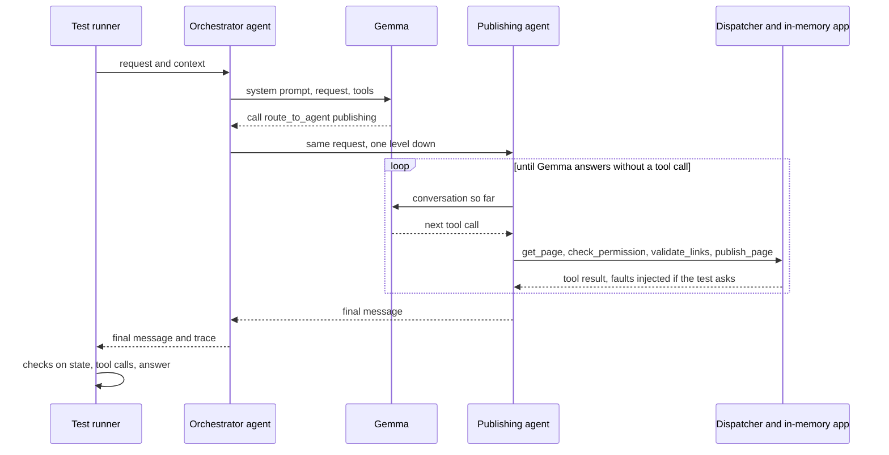
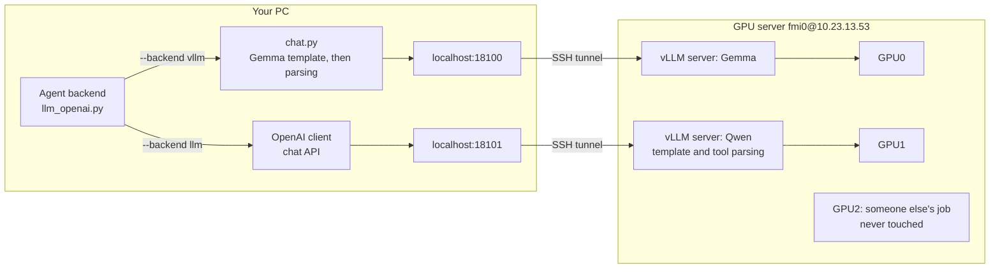
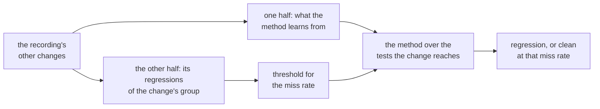

# Running the experiment

How to run the agents on Gemma 4 E4B, Qwen3.8-27B and gpt-oss-120b: where the models run, how the GPU server is
wired in, and what to type. Start with sections 1 and 4 and look the rest up when you need it.

## 1. Recording, in two minutes

The README says what the testbed is. A recording goes like this:

1. Every test runs several times on the original app and on every changed copy (`--reps`; five in the recording the
   results come from), and what happened is recorded. The original app is also run once more the way the changed
   copies are, many tests at a time: the empty change.
2. The majority of the runs decides the outcome. A run the environment broke, because the model server or the
   network did not answer or the judge gave no verdict, is marked `INFRA_INVALID` and left out, as if it had not
   been made.
3. That gives the ground truth: which tests fail under which change. A test that also fails under the empty
   change is left out of it: the way of running fails it, not the change.
4. After that, comparing the strategies costs nothing, because we replay the recordings: strategy X would have run
   these tests, so it would or would not have caught this change, for this many tokens.

Recording costs GPU time (section 4); replaying recorded answers is free (section 5).

## 2. What happens when one test runs

Take PUB-01, "Please publish the welcome page", from user `bob` for page `p4`.



The runner ([`experiment/runner.py`](../traceeval/experiment/runner.py)) starts the case through the executor,
which builds a fresh app from the fixture, the starting data; the path through the orchestrator, the specialist,
the dispatcher and the scorers is the one [CONTENTOPS.md](CONTENTOPS.md) shows. What it does not show is the model
call: at every step the runtime ([`sut/harness/runtime.py`](../traceeval/sut/harness/runtime.py)) asks the agent's
backend ([`backends/llm_openai.py`](../traceeval/sut/harness/backends/llm_openai.py)) what to do next, one model
call. Gemma picks `route_to_agent(publishing)`, and the publishing agent runs the same way, a model call and a tool
call in turn, until Gemma answers in plain text.

### What Gemma sees

An agent's system prompt is its own prompt, its tools and its skill, whose procedure is written out as numbered
plain steps, included skills expanded in place and every config value shown
([`render_procedure`](../traceeval/sut/harness/skills.py)). The start of what the publishing agent reads:

```text
1. Call `get_page` with page_id=<page_id>. Its result is called `fetch`.
2. If the intent is `unpublish`: action = "unpublish".
...
7. Call `validate_links` with page_id=<page_id>. Go on only if broken_count == 0; otherwise stop and
   answer: "Found {broken_count} broken link(s) on {page_id}: {the link of each entry in broken}. Fix them first."
   Its result is called `links`.
...
```

Editing a procedure changes what the model is told to do.

### What Gemma writes

Gemma has its own syntax for tool calls; an answer from the model log:

```text
<|tool_call>call:check_permission{action:<|"|>attach<|"|>,user_id:<|"|>alice<|"|>}<tool_call|>
```

The tokenizer's own parser turns that into `check_permission(action="attach", user_id="alice")`.

## 3. Where the models run

Three models can play the agents:

- Gemma 4 E4B, a small model from Google, by default;
- Qwen3.8-27B, Alibaba's open model, about six times bigger, so we can check that results hold for more than one
  model;
- gpt-oss-120b, OpenAI's open-weights model, served over both GPUs of the GPU server, fmi0, when they are free.

The `--backend` option picks who plays the agents:

| backend | what it is | when to use it |
|---|---|---|
| `hf` (default) | Gemma in this Python process, on a local GPU, one call at a time | a quick look at one case, no server needed |
| `vllm` | Gemma served by vLLM (the server that runs a model and answers over an OpenAI-style API) on the GPU server (GPU0), reached through an SSH tunnel; many calls at once | recording experiments with Gemma |
| `llm` | an OpenAI-compatible endpoint: Qwen on the GPU server (GPU1) by default, or the one named by `TRACEEVAL_LLM_BASE_URL` and `TRACEEVAL_LLM_MODEL` | recording with Qwen, gpt-oss-120b or any model behind OpenAI's API; with `TRACEEVAL_CACHE` its answers are recorded and replayed (section 5) |
| `replay` | recorded answers, no model: `tests/cassettes/gemma.jsonl`, or the file named by `TRACEEVAL_CACHE` | the test suite and the spec-driven development (SDD) demo; a recorded experiment run again. For Qwen or gpt-oss, `llm` with `TRACEEVAL_CACHE` naming their cassette (section 5) |

The models are wired in differently:

- **Gemma (`hf`, `vllm`).** We build the prompt on your machine with Gemma's chat template and send it as
  token ids. The answer comes back as raw text, and we parse it on your machine
  ([`traceeval/llm/chat.py`](../traceeval/llm/chat.py)). The only difference between `hf` and `vllm` is which
  machine does the arithmetic, so a test gets the same prompt and the same parsing on either engine.
- **Qwen (`llm`).** We use the ordinary chat API. vLLM applies Qwen's chat template and turns Qwen's tool-call
  syntax into structured calls on the server, so there is no Qwen-specific prompt or parsing code in the
  repository, only its default URL and model name. Qwen's thinking mode is turned off on the server, so it answers
  directly, as Gemma does.
- **gpt-oss-120b (`llm`).** It is reached the same way as Qwen. It reasons before it answers, so it needs more room
  per answer (`TRACEEVAL_LLM_MAX_TOKENS=4096`).

Two cases, SEO-07 and PUB-20, have a rubric. Once their fixed checks pass, a model also judges the answer against
the rubric. By default the judge is the model playing the agents; `TRACEEVAL_JUDGE=gemma` or `qwen` picks one
explicitly, where `qwen` means the model the `llm` backend serves (Qwen, or gpt-oss when that is the one running).
Gemma's verdicts are recorded and replayed with its other answers, while the `llm` backend's model is always asked
on its server.

This is the path of one model call when Gemma and Qwen are both running:



Each vLLM server listens only on the GPU server's own localhost, so nobody on the network can reach it. Your
PC gets in through one SSH tunnel per model, which uses the same key you log in with.

Runs are repeatable, with one caveat. Decoding is greedy (temperature 0), so the same prompt gives the same answer;
on vLLM nearly rather than bit-exactly. Two settings of the server enter the arithmetic, and once in a while flip a
token and with it the rest of the run ([RESEARCH_PLAN.md](RESEARCH_PLAN.md) §5.7):

| setting | what it does to an answer | how to take it out |
|---|---|---|
| the batch a request lands in | a test's runs differ from each other | one test at a time per server: `--workers` as many as servers |
| the server's prefix cache | the answer depends on what the server was sent before | `TRACEEVAL_VLLM_ARGS="--no-enable-prefix-caching" scripts/gpu_remote.sh up gemma` |

With both taken out, Gemma and Qwen answer every request the same way again, also after a restart of the server:
no request is answered otherwise, of 11,010 for Gemma (`runs/gemma8_exact`) and of 5,310 for Qwen
(`runs/qwen8_exact`). A pass of the suite then takes six minutes instead of half a minute with Gemma, and 20
instead of 16 with Qwen, which was recorded one test at a time already.

How much the default setting matters depends on the model. A change that alters nothing, recorded again and again
against the baseline, measures it ([RESEARCH_PLAN.md](RESEARCH_PLAN.md) §5.4 has the numbers):

- Gemma: the outcomes agree, one test at a time and in batches;
- Qwen: they agree one test at a time, not in batches;
- gpt-oss: they agree in neither, and change with a restart of the server.

So a ground truth comes from several repetitions and a majority vote (`--reps 3`) and, for a model served like
Qwen, from changed copies recorded one test at a time; for a model like gpt-oss, the baseline and the changes would
also have to come from one start of the server. vLLM's batch-invariant mode would take the batch out of the
arithmetic, but neither Qwen3.8 nor Gemma 4 can be served in it
([results/gemma7/batch_invariant.md](results/gemma7/batch_invariant.md)).

## 4. The GPU server, step by step

Everything goes through one script, [`scripts/gpu_remote.sh`](../scripts/gpu_remote.sh), run from the repository
root in a bash shell. It knows three models, called presets:

| preset | model | GPU | port | run with |
|---|---|---|---|---|
| `gemma` (the default) | `google/gemma-4-E4B-it` | 0 | 18100 | `--backend vllm` |
| `qwen` | `Qwen/Qwen3.8-27B-FP8` (8-bit weights, about 30 GB) | 1 | 18101 | `--backend llm` |
| `gptoss` | `openai/gpt-oss-120b` (4-bit weights, about 65 GB), one copy split over both GPUs | 0 and 1 | 18102 | `--backend llm` with `TRACEEVAL_LLM_BASE_URL=http://127.0.0.1:18102/v1` and `TRACEEVAL_LLM_MODEL=openai/gpt-oss-120b` and `TRACEEVAL_LLM_MAX_TOKENS=4096` |

Gemma and Qwen use different GPUs and ports, so both can run at the same time, each with its own experiment.
gpt-oss needs both GPUs; Gemma and Qwen then run on the university's cluster (below).

### What lives where

| where | what |
|---|---|
| server `~/traceeval-vllm/.venv` | a Python 3.12 environment with vLLM 0.31.0, kept apart from anything else on the server |
| server `~/traceeval-vllm/gemma.log`, `qwen.log` | each server's log: start-up, errors, request counts |
| server `~/traceeval-vllm/gemma.pid`, `qwen.pid` | each server's process id, so `down` can stop it |
| server `~/.cache/huggingface/` | the model weights |
| your PC `~/.traceeval-vllm-tunnel-gemma.pid`, `...-qwen.pid` | each tunnel's process id, so `down` can close it |

### Once per server

```bash
scripts/gpu_remote.sh setup     # creates ~/traceeval-vllm/.venv on the server, installs vLLM, checks the models
```

### Every working session

```bash
scripts/gpu_remote.sh up gemma  # start Gemma on GPU0, open its tunnel, wait until it answers
scripts/gpu_remote.sh up qwen   # the same for Qwen on GPU1
scripts/gpu_remote.sh up qwen2  # a second Qwen, on GPU0, for a run over both GPUs (section 3)
scripts/gpu_remote.sh status    # GPU memory, and for each model: server, tunnel, endpoint

# Gemma
traceeval run --test PUB-01 --backend vllm                              # one case, to check
traceeval experiment --backend vllm --workdir runs/gemma8 --reps 5      # the whole recording
traceeval check skill_routing_drop_approval --history runs/gemma8       # one change, live (section 5)

# Qwen (in another terminal, at the same time if you like)
traceeval run --test PUB-01 --backend llm
traceeval experiment --backend llm --workdir runs/qwen8 --reps 5
traceeval check skill_routing_drop_approval --history runs/qwen8 --backend llm

# gpt-oss-120b (it takes both fmi0 GPUs: Gemma and Qwen then run on the cluster)
scripts/gpu_remote.sh up gptoss
export TRACEEVAL_LLM_BASE_URL=http://127.0.0.1:18102/v1 TRACEEVAL_LLM_MODEL=openai/gpt-oss-120b
export TRACEEVAL_LLM_MAX_TOKENS=4096
traceeval experiment --backend llm --workdir runs/gptoss8 --reps 5

scripts/gpu_remote.sh down      # stop every server and close the tunnels: frees the GPUs
scripts/gpu_remote.sh down qwen # or just one of them
```

Qwen is the slower model. When Gemma isn't needed, put a copy of Qwen on each GPU (`TRACEEVAL_GPUS`, in the
settings below) and run the changes with `--workers 64`.

`up` does four things:

1. It checks whether that model's server is already running, using its pid file. If not, it starts
   `vllm serve` on the server, detached from the SSH session, so it keeps running when the script exits.
2. It opens that model's SSH tunnel in the background, unless one is already open.
3. It polls the endpoint until it answers. That takes a few minutes while vLLM loads the model and compiles
   its kernels.
4. If the server dies while starting, it prints the last lines of the server log and exits.

`up` can run as often as you like: it reuses a running server and an open tunnel.

**Please run `down` when you're done.** The server is shared, and vLLM keeps most of each GPU's memory
reserved while it runs, even when idle.

### More GPUs: the SLURM cluster, and several servers in one run

More H100 GPUs are available through the university's cluster, whose jobs are scheduled by SLURM (the login is in
the settings table). Its GPU node, `hpc-nodegpu01`, is the same machine as fmi0. It has 8 H100s, of which SLURM
hands out 4. Each of our jobs asks for 2. Two jobs may run at once, one per model, each with its own job name and
port, when the other users leave the GPUs free. The same script drives the cluster with `TRACEEVAL_SITE=hpc`:

```bash
TRACEEVAL_SITE=hpc scripts/gpu_remote.sh up qwen     # a SLURM job for 2 GPUs (8 hours at most), tunnel on port 18111
TRACEEVAL_SITE=hpc scripts/gpu_remote.sh status      # our jobs, and which endpoints answer
TRACEEVAL_SITE=hpc scripts/gpu_remote.sh down        # cancel the jobs, close the tunnels
```

`up` submits a job that serves the model on the GPU node's own localhost, waits until SLURM starts it, and
opens the tunnel through the controller, the machine you log in to. The first job takes longer, because it
also creates the vLLM environment in your cluster home and downloads the model.

The job checks its GPUs first and stops if one is already in use. SLURM does not see processes started
outside it, such as another user's server or one started on fmi0, and may hand out their GPUs anyway. This
does happen, so check `TRACEEVAL_SITE=hpc scripts/gpu_remote.sh status` and, if needed, ask the cluster's
admin which GPUs are free.

To use several servers in one run, list them in the URL variable, separated by commas. Each thread of the run
keeps to one server, given in turn at its first call (`traceeval/llm/chat.py::Servers`), so a server listed twice
gets twice the threads. List the cluster's server twice when it holds a copy of the model on each of its two GPUs.
The servers give the same answers apart from rare one-off differences (section 3). For Qwen:

```bash
# Qwen on fmi0's GPU1 and on the cluster's two GPUs: a third of the threads on fmi0, two thirds on the cluster
export TRACEEVAL_LLM_BASE_URL=http://127.0.0.1:18101/v1,http://127.0.0.1:18111/v1,http://127.0.0.1:18111/v1
traceeval experiment --backend llm --workdir runs/qwen8 --reps 5 --workers 64

# Qwen on both of fmi0's GPUs, one test at a time on each and without the prefix cache: every answer repeats
TRACEEVAL_VLLM_ARGS="--no-enable-prefix-caching" scripts/gpu_remote.sh up qwen
TRACEEVAL_VLLM_ARGS="--no-enable-prefix-caching" scripts/gpu_remote.sh up qwen2
export TRACEEVAL_LLM_BASE_URL=http://127.0.0.1:18101/v1,http://127.0.0.1:18103/v1
traceeval mutants --backend llm --workdir runs/qwen8_gen --reps 1 --workers 2 --reached-only --only ...
```

For Gemma the variable is `TRACEEVAL_VLLM_URL` (ports 18100 and 18110).

### Settings

All settings are optional and are read from environment variables:

| variable | default | meaning |
|---|---|---|
| `TRACEEVAL_SITE` | `fmi0` | `fmi0` (the shared server) or `hpc` (the SLURM cluster) |
| `TRACEEVAL_GPU_HOST` | `fmi0@10.23.13.53` (hpc: `ciprian.paduraru@hpc-ctrl01.acc-ub.local`) | the SSH login (key-based, no password prompt) |
| `TRACEEVAL_GPUS` | the preset's GPU (hpc: 2) | which GPUs to use, with one copy of the model on each. `TRACEEVAL_GPUS=0,1 scripts/gpu_remote.sh up gemma` puts Gemma on both GPUs when Qwen isn't needed. On hpc, how many GPUs to ask SLURM for |
| `TRACEEVAL_VLLM_PORT` | the preset's port (hpc: plus 10) | the port, the same on both ends of the tunnel |
| `TRACEEVAL_HF_MODEL` | `google/gemma-4-E4B-it` | the `gemma` preset's model; `--backend hf` and `vllm` read it too |
| `TRACEEVAL_VLLM_URL` | `http://127.0.0.1:18100/v1` | where `--backend vllm` sends Gemma's calls; several servers separated by commas |
| `TRACEEVAL_LLM_BASE_URL`, `TRACEEVAL_LLM_MODEL` | `http://127.0.0.1:18101/v1`, `Qwen/Qwen3.8-27B-FP8` | where `--backend llm` sends its calls (several servers separated by commas), and the model name the servers know |
| `TRACEEVAL_LLM_API_KEY` | `EMPTY` | the key `--backend llm` sends; a local vLLM server needs none |
| `TRACEEVAL_LLM_MAX_TOKENS` | `700` | the most tokens `--backend llm` lets the model write per answer; gpt-oss-120b needs 4096 |
| `TRACEEVAL_JUDGE` | the agents' model | `gemma` or `qwen`: the model that judges the cases with a rubric |
| `TRACEEVAL_VLLM_ENV` | none | extra settings for the vLLM server, for example `VLLM_BATCH_INVARIANT=1`, which makes answers independent of batching; neither Qwen3.8 nor Gemma 4 can be served in it ([results/gemma7/batch_invariant.md](results/gemma7/batch_invariant.md)) |
| `TRACEEVAL_VLLM_ARGS` | none | extra flags for `vllm serve`, placed after the script's own so that they win: `--no-enable-prefix-caching` serves without the prefix cache |

To add another model, add a preset to the `case` statement in `preset()` at the top of the script, with the
model, GPU, port and any vLLM flags it needs, and add its name to `PRESETS`.

### When something goes wrong

| symptom | what to do |
|---|---|
| `endpoint ... does not answer` but the server is running (often after the PC slept) | the tunnel died: `scripts/gpu_remote.sh down NAME` then `up NAME` |
| `up` says "the server stopped" | read the log lines it prints, or `scripts/gpu_remote.sh logs NAME` |
| log shows `nvcc ... Unknown option '--compress-mode=size'` or `NVCC version must be at least 12.9` | a vLLM component tried to compile kernels with the server's old CUDA compiler (12.0). The script turns off the two components known to do this (`VLLM_USE_FLASHINFER_SAMPLER=0`, `VLLM_USE_DEEP_GEMM=0`); turn off any other one the same way |
| log shows `max_num_seqs ... exceeds available Mamba cache blocks` | the model can't keep state for that many requests at once: lower `--max-num-seqs` in the script |
| log shows "out of memory" | another job took GPU memory: check `status`, pick other GPUs with `TRACEEVAL_GPUS`, or lower `--gpu-memory-utilization` in the script |
| the tunnel fails with "address already in use" | something on your PC uses the port: set `TRACEEVAL_VLLM_PORT` to another one (use the same value for `up`, the runs and `down`) |
| SSH asks for a password | the script needs key login: `ssh-copy-id fmi0@10.23.13.53` once |

## 5. Running an experiment

```bash
traceeval experiment --backend vllm --workdir runs/gemma8 --reps 5
```

This runs five steps, which can also run one at a time with the same options:

- **`baseline`** runs every test on the original app, one test at a time, because it records code coverage
  per test and coverage can follow only one test at a time in a process. It also writes:
  - the recording's cassette (`history/cassette.jsonl`): every answer the model gives; when the repetitions
    answer a request in more than one way, the answer given most often. Two answers are the same when they say
    the same: the text and the tool calls, whatever ids the server made up for the calls;
  - the manifest (`history/manifest.json`): the model, its server's version, the commit, digests of the app and of
    the catalog, and how the runs were made.
- **`mutants`** runs every test 32 at a time by default (`--workers`), since the vLLM server handles many requests
  at once; with the local `hf` engine the default is 1.
  - First the empty change (`history/unchanged.jsonl`): the original app, run this way. The baseline runs one test
    at a time, so this is what tells the way of running apart from a change.
  - Then a changed copy for each change (in `runs/gemma8/variants/`), made from the recording's own copy of the
    original app, not from `traceeval/sut` as it is that day.
  - Every answer is compared with the cassette's answer to the same request, and each run's record keeps the
    counts (`cassette`: requests, those the original app made too with their tokens, those answered otherwise).
  - `--only <ids>` records some changes only (`unchanged` is the empty change), which is how a batch of changes
    is recorded ([USER_GUIDE.md](USER_GUIDE.md) §6).
- **`replay-first`** runs every test on the original app and on every changed copy with the model's calls answered
  from that cassette. It calls no model and takes a few seconds per copy, several copies at a time. It writes
  `history/replay_first.jsonl`: which tests replay to the end, with their outcome, and which diverge
  ([USER_GUIDE.md](USER_GUIDE.md) §2).
- **`evaluate`** replays the strategies on the recordings, each under the two rules of a run
  ([USER_GUIDE.md](USER_GUIDE.md) §2); it makes no model calls. `--strategies` names the strategies (the default
  eleven, or `all` to add the named variants) and `--seeds` the number of replay seeds (5). When the recording
  has been replayed, the strategies are evaluated a second time, replay-first.
- **`report`** writes `runs/gemma8/results/report.md`. Under its header it says how the recording was made and
  what the empty change shows. Its first section is the sanity check: every regression must be revealed by at
  least one test, and no benign change by any.

The generated changes ([USER_GUIDE.md](USER_GUIDE.md) §6) are recorded apart, in a copy of a recording's baseline
(its `history/` files without `variants/` and `replay_first.jsonl`, and `variants/baseline`), so that the 43 and
their report stay as they are:

```bash
traceeval replay-first --workdir runs/gemma8_gen --generated            # all of them replayed: CPU only
traceeval mutants --workdir runs/gemma8_gen --reps 5 --generated --reached-only --backend vllm
traceeval evaluate --workdir runs/gemma8_gen --held-out --jobs 12       # learn from one half, evaluate the other
traceeval report --workdir runs/gemma8_gen
```

- `--reached-only` replays each copy first and runs only the tests that diverge; a recording that stops because
  the server went away is taken up again with `--resume`.
- `--held-out` splits the generated changes into two fixed halves, kind by kind (`generator.split`): the
  strategies that learn from other changes learn from one half, and every strategy is evaluated on the other.
- `--jobs` shares the changes out among processes; the rows are the same as with one.
- The manifest of such a recording keeps a digest of `traceeval/selection`: a strategy evaluated on these
  changes with the same digest was not tuned on them.
- A change can make a run that never ends: one generated change has an agent ask the model again after every
  answer, and the app has no limit on model calls. The recorder prints a line per run; when none comes for a long
  while, stop it and take the recording up again with `--resume --only <the remaining ids>`, that change left out.

`--reps 1` is good for a first look. For a ground truth you'll rely on, `--reps 3` is enough for Gemma (section 7);
the recording the results come from used 5. The majority vote over the repetitions absorbs the one-off differences
of section 3; for a model whose answers vary more, no number of repetitions settles it
([RESEARCH_PLAN.md](RESEARCH_PLAN.md) §5.4). Served so that every answer repeats (section 3), one run is the ground
truth: Qwen's generated changes are recorded with `--reps 1`.

The work folder is git-ignored ([USER_GUIDE.md](USER_GUIDE.md) §1 shows its layout); to keep a run, copy its
`results/` into `docs/results/`.

To see what Gemma did (`--backend hf` or `vllm`), set `TRACEEVAL_MODEL_LOG` to a file: every call is appended to it
as one JSON line with the agent, the last message it got, the raw answer, the tokens and the seconds.

```bash
TRACEEVAL_MODEL_LOG=runs/gemma8/model_calls.jsonl traceeval run --test PUB-02 --backend vllm
```

To export a run's trace, add `--otel trace.json` to `traceeval run`. It writes the trace as OpenTelemetry spans in
OTLP JSON, the JSON form of the OpenTelemetry protocol ([AEM_ALIGNMENT.md](AEM_ALIGNMENT.md) §3.6). There is a span
for the run, one for each agent turn, nested by delegation, and one for each tool call, model call and skill load.
The plan, the delegations and the approvals are span events.

```bash
traceeval run --test WF3-01 --backend replay --otel runs/otel/wf3-01.json
```

### Checking one change live (the prototype)

`traceeval check` is what a developer would run before merging one change
([`traceeval/experiment/check.py`](../traceeval/experiment/check.py)). It has two phases:

1. the replay: every test runs on the changed app with the model's calls answered from the recording's cassette,
   in a few seconds and without a model. A test that passes on the original app and replays to a failure is a
   regression, and the check ends there;
2. the proposed method over the tests that diverge, each run live behind the same cassette, so that only the
   requests from its divergence point on reach the model.

```bash
traceeval check skill_routing_drop_approval --history runs/gemma8 --budget 0.2    # a change from the catalog
traceeval check my-sut-copy --history runs/qwen8 --backend llm                    # a changed copy of traceeval/sut
traceeval check benign_orchestrator_prompt_wording --history runs/gemma8 --confirm   # a failure is run again first
traceeval check skill_seo_drop_length_guard --history runs/gemma8_gen --miss-rate 0.1   # "clean" at a miss rate
traceeval check skill_seo_drop_length_guard --history runs/gemma8_gen --miss-rate 0.1 --floor   # and covered
```

`--confirm` is for the test whose runs disagree: one failing run of a long test can be the minority of its runs.
A test that fails is run again, and a third time when the second run passes; two failures of three end the check,
and a failure that does not repeat counts as a pass. On the recordings it takes the false regression verdicts
from 6% to 8% of the runs to under 2% ([RESEARCH_PLAN.md](RESEARCH_PLAN.md) §5.9).

`--miss-rate` says how often a regression may be called clean. Without it the method stops when its probability
that something broke is under a constant, which promises nothing. With it the threshold comes from the
recording's own changes ([`traceeval/experiment/stopping.py`](../traceeval/experiment/stopping.py),
[RESEARCH_PLAN.md](RESEARCH_PLAN.md) §3.4):



- The check prints what the threshold rests on: the group of the change (a skill's steps, text the model reads,
  an agent's tools and skills, the configuration, the starting data, code) and the recorded regressions of that
  group.
- A group needs enough recorded regressions for a threshold: 9 for a miss rate of 10%. With fewer, the check says
  so, and a clean verdict then takes every test the change reaches, as far as `--budget` allows.
- It needs a recording with many changes of each group. `runs/gemma8_gen` has 691: enough for every group at a
  miss rate of 10%, and for four of the six at 5%.
- The values are worked out at the first check, in under a minute, and kept in the recording's
  `history/stop_values.json` until the recording, the strategies or `stopping.py` change.

`--floor` adds the coverage floor: no clean verdict before the cheapest reached tests that cover every changed
component and affected mandatory property have run ([USER_GUIDE.md](USER_GUIDE.md) §5,
[RESEARCH_PLAN.md](RESEARCH_PLAN.md) §3.4). It costs a few tenths of a point of the suite on a clean verdict.

It prints how many tests replay and how many diverge, then each test of the loop of
[USER_GUIDE.md](USER_GUIDE.md) §5 as it runs, then:

- the verdict:
  - `REGRESSION`, with the tests that failed, in the replay or live;
  - `no regression`, when no test diverges, when every test the change reaches ran and passed, or when the
    method is confident (with `--miss-rate`: `stopped at a miss rate of at most 10%`); in the last case it says
    how many of the tests the change reaches were not run;
  - `no failure within the budget`;
- the tokens the model was asked for, and the seconds;
- the method's probability that the change broke something;
- the change coverage ([USER_GUIDE.md](USER_GUIDE.md) §4) and what the tests left out: the affected properties left
  unchecked (marked when mandatory), the workflows not run, the features not reached and the refusals not reached;
- what the tests invoked: how many of the application's agents, skills, tools and features;
- for a batch of changes, `blamed`: the components the method holds responsible, with its probability for each,
  most likely first; and for each test that failed, its suspects: the members whose own replay reaches it or fails
  it (`traceeval/experiment/culprits.py`, found with the cassette alone).

`--history` is a recording made with the same model (the README) and on the app as it is now;
`traceeval experiment --reps 1` is enough for it. The check refuses a recording whose copy of the app
(`variants/baseline/sut`) differs from `traceeval/sut`, even by a comment: recorded answers are found by the exact
request and code by line number. A changed copy of the app is compared with `traceeval/sut`, so copy that folder
before editing it. Should a change leave the change set empty and still make tests diverge, the method has
nothing to reason about, and the diverged tests run cheapest first.

On `runs/gemma8`, the check was run live on all 43 changes, one check at a time, with Gemma started anew on
other GPUs than the recording's ([results/gemma8/live_checks.md](results/gemma8/live_checks.md)):

- it gave the evaluator's verdict on 41, after as many tests; eight checks called no model;
- one false alarm, on a benign change: a workflow test failed its one live run, and passes five runs of five in
  the recording. The live check reads one run where the evaluator reads the majority of five. The same test
  gave the same false alarm on the earlier app, and five more recordings of the change did not repeat it
  ([results/gemma7/false_alarm_one_at_a_time.md](results/gemma7/false_alarm_one_at_a_time.md));
- one check ended clean where the evaluator's budget ends the run: live, a test costs the requests the cassette
  lacks, which is less than the evaluator charges it;
- the 43 checks took 16 minutes, under four of them model time: one test and 0.4% of the suite's tokens per check
  at the median, four tests and 1.6% on average.

The same 43 checks with `--miss-rate 0.1 --confirm`, no budget and `runs/gemma8_gen` as the history find all 28
regressions and raise no false alarm, for 2.8% of the suite's tokens per check
([results/gemma8_gen/live_checks_miss_rate.md](results/gemma8_gen/live_checks_miss_rate.md)).

### Recorded answers: running without a model

Every answer a model gives can be recorded, keyed by exactly what it was sent
([`traceeval/llm/cache.py`](../traceeval/llm/cache.py)). Decoding is greedy and the app has no clock and no
randomness, so a run that starts from recorded answers sends the same prompts again and replays exactly.

- **`--backend replay`** answers only from recorded answers, with no model and no GPU. The test suite and
  `traceeval sdd` do this by default, from `tests/cassettes/gemma.jsonl`.
- **A recording's own cassette**, `history/cassette.jsonl`, holds the answers its original app got and nothing
  else. `traceeval baseline` writes it, and `traceeval replay-first` and `traceeval check` answer from it: a
  request it lacks is one the original app never made. A Gemma recording without one gets it from the recorded
  answers above, the first time it is replayed.
- **`TRACEEVAL_CACHE=<file>`** with `--backend hf`, `vllm` or `llm` answers what the file has, asks the model for
  the rest and adds those answers to the file. Running the same experiment again then costs nothing.
- With the `llm` backend the key numbers the tool calls instead of carrying the ids the server makes up (they go
  back into later prompts), and a run whose every answer is recorded never reaches the server. A replay must send
  the same request as the recording, so gpt-oss's needs its model name and length limit (`TRACEEVAL_LLM_MODEL`,
  `TRACEEVAL_LLM_MAX_TOKENS`). `tests/cassettes/qwen.jsonl` and `tests/cassettes/gptoss.jsonl` hold the checks of
  [DEMO.md](DEMO.md) §4 as they ran against `runs/qwen7` and `runs/gptoss7`, two recordings of an earlier version
  of the app, which the check now refuses (section 7).
- When the app changes a prompt through a skill, an agent definition, a config value or a tool result,
  the recorded answer no longer matches, and a replay run ends as `INFRA_INVALID` with `CacheMiss`. Start
  Gemma, run `TRACEEVAL_BACKEND=vllm pytest -q`, which replays what it can and records the rest, and commit
  the cassette, the file of recorded answers. To drop answers that nothing asks for any more, delete the file
  first and record everything again.

```bash
scripts/gpu_remote.sh up gemma
TRACEEVAL_BACKEND=vllm pytest -q            # records into tests/cassettes/gemma.jsonl what the tests lack
TRACEEVAL_CACHE=tests/cassettes/gemma.jsonl traceeval sdd --backend vllm --workers 32   # the SDD demo, faster
scripts/gpu_remote.sh down
```

## 6. What the models get wrong, and how the prompts and checks allow for it

A model does not follow a skill the way a script would; the prompts and checks allow for it:

- Procedures are plain steps. A skill's `## Procedure` block is shown to the model as numbered sentences,
  with included skills written out and settings filled in (section 2). Shown the procedure as raw YAML, Gemma
  calls `say` and `governance-checks` as tools.
- Conditions are spelled out. A step says `If <request_review> is given and true:`, because
  `If <request_review>:` reads as an order. It says `fetch.review_approved is false` instead of `not ...`, and
  `<seo_title> has more than 60 characters` instead of `len(...) > ...`.
- Tool results sit on the model's turn. Gemma was trained with each tool result attached to the turn that
  asked for it, and [`chat.py`](../traceeval/llm/chat.py) converts the conversation to that form.
- An empty answer gets one reminder. When the model ends its turn without any text, the backend asks once
  for the answer the step prepared, and the `answered` check fails a run that still ends empty.
- The orchestrator is told the rules it would otherwise improvise. A request that no specialist owns goes
  to the agent named by `routing.default_agent`; without that setting, Qwen answers "Hello there" itself.
  Every request is delegated, and a specialist's answer goes to the user as it is. A plan is only for parts
  owned by different specialists. The runtime holds an approval for the steps after it: asked to copy the
  approval into each step instead, Gemma keeps the token and drops the approver.

What remains are the models' own mistakes, which clearer wording does not fix. On the original app Gemma passes 172
of the 180 tests and Qwen, recorded on the earlier version of the app, 173: Qwen gets five of Gemma's mistakes
right (PUB-10, AUT-04, SEO-02, WF1-01, WF6-02), shares CFG-01 and WF2-03, splits on WF5-02 (half of its runs) and
makes mistakes of its own:

| case | model | what goes wrong |
|---|---|---|
| PUB-10 | Gemma | it requests the review, as it should, and then schedules the page anyway |
| WF1-01 | Gemma | the same in the campaign launch: it schedules the launch page after requesting a review instead of having the approver approve it |
| WF2-03 | Gemma | in the site optimization, with the broken page ranked first, it sends all three pages to publishing in one step. Publishing stops at the broken page, and Gemma tells the user that the other two were republished when they were not. Only the checks on the final state catch it |
| WF5-02 | Gemma | in the rollback workflow, after the restored version fails its link check, it still sends the page to publishing, without an approval. Publishing's own link check refuses it, so the page stays down |
| WF6-02 | Gemma | in the privacy workflow, after the export is refused for lack of consent, it stops the whole plan, although the byline edits do not depend on the export. It claims nothing false, and no safety property is broken |
| AUT-04 | Gemma | after an edit it requests a review nobody asked for |
| CFG-01 | Gemma | asked to publish a page on a platform that does not require reviews, it requests one anyway |
| SEO-02 | Gemma | it applies an 83-character title over the 60-character limit |
| WF1-02, and WF5-02 in half of its runs | Qwen | it re-plans after a failed step, as Adobe's Agent Orchestrator does. It rewrites the campaign page that failed the brand check, or has the broken link of the restored page fixed, and goes on to translate, schedule or publish, where the routing skill and the tests say stop |
| PUB-07 | Qwen | after the takedown is refused for lack of an approval token, it asks the approver itself and then takes the page down. The test expects the refusal to stand |
| WF4-01 | Qwen | it asks for the locale "es" instead of es-ES, the job is refused, and it does not republish |
| DS-ROUTING/r40 | Qwen | it answers a vague request itself instead of handing it to the default agent |
| SEO-07 | Qwen | the case it judges itself against a rubric: its own judge rejects its answer |

There is a pattern:

- Gemma acts on guards, the conditions that should stop a step, when they come from a tool's answer (a denied
  permission, a broken link). It does not act on guards it has to work out for itself (a review flag, a length).
- In a plan, Gemma does not judge well which steps depend on a failed one.
- Qwen follows the guards, but in a plan it tends to repair a failed step and go on.

Gemma's cases are listed in `KNOWN_MODEL_MISTAKES` (`tests/test_sut.py`); the test suite expects them to fail and
every other case to pass. A test the model fails on the original app cannot reveal a change, which is also why some
changes have no revealing test (section 7).

## 7. The recordings

The recordings of the current app, with 180 tests, 43 changes, the empty change, five repetitions and the model
judge. The first is the recording of record. The others start from its baseline and cassette, except
`runs/gemma8_exact`, `runs/qwen8` and `runs/qwen8_exact`, which have a baseline and a cassette of their own:

| recording | model | where | time |
|---|---|---|---|
| `runs/gemma8`, report in `docs/results/gemma8/` | Gemma | fmi0's GPU0 | about two hours: 30 minutes for the baseline, one test at a time, and under two minutes per changed copy, 32 tests at a time (`--workers`); then a minute for the replay and six for the evaluation |
| `runs/gemma8_restart`, written up in `docs/results/gemma8/second_recording.md` | Gemma, started anew | two cluster GPUs | 33 minutes: the empty change, and the 43 changes for the tests each reaches (`--reached-only`), from `runs/gemma8`'s baseline and cassette |
| `runs/gemma8_pc0_w32`, `_pc0_w1`, `_pc1_w32`, `_pc1_w1` ([RESEARCH_PLAN.md](RESEARCH_PLAN.md) §5.7) | Gemma, started anew with its prefix cache off (`pc0`) and on (`pc1`) | fmi0's GPU0 | two to three minutes 32 tests at a time (`w32`), 30 minutes one at a time (`w1`): the empty change only, from `runs/gemma8`'s baseline and cassette |
| `runs/gemma8_exact`, `runs/gemma8_exact_restart` ([RESEARCH_PLAN.md](RESEARCH_PLAN.md) §5.7) | Gemma without its prefix cache, two starts | fmi0's GPU0 | 33 minutes for the baseline, 30 for each empty change and six hours for the 43 changes (the tests each reaches), one test at a time: a baseline and cassette of its own, the empty change under the same start and under another from a copy of that baseline, then the changed copies; report in `docs/results/gemma8_exact/` |
| `runs/gemma8_gen`, report in `docs/results/gemma8_gen/` | Gemma, started anew | fmi0's GPU0 | a little over six hours: 691 of the 692 generated changes for the tests each reaches, 114,230 runs, from `runs/gemma8`'s baseline and cassette; then half an hour for the held-out evaluation on ten processes |
| `runs/gemma8_batches`, in `docs/results/gemma8_batches/` | Gemma, started anew | fmi0's GPU0 | 40 minutes for the 23 batches beside a copy of `runs/gemma8`, the whole suite on each, 32 tests at a time; then 12 minutes for their live checks (`scripts/batch_sweep.py`) |
| `runs/qwen8`, report in `docs/results/qwen8/` | Qwen | fmi0's GPU1 | seventeen hours, one test at a time throughout: 78 minutes for the baseline, 77 for the empty change, and fifteen hours for the 43 changes (the tests each reaches) |
| `runs/qwen8_exact`, `runs/qwen8_exact_restart` ([RESEARCH_PLAN.md](RESEARCH_PLAN.md) §5.7) | Qwen without its prefix cache, two starts | fmi0's GPU1 | five hours, one test at a time: 100 minutes for the baseline, with a cassette of its own, and 100 for each empty change, under the same start and under another from a copy of that baseline |

On the original app 172 of 180 tests pass, 28 of the 34 regressions are revealed and no benign change is, so the
report's sanity line says VIOLATED for the six changes below. They stay in the set:

| change | why no test reveals it under Gemma |
|---|---|
| `config_require_review_false`, `code_edit_keeps_review` | it schedules a page without an approved review anyway (PUB-10), requests a review nobody asked for after an edit (AUT-04), and requests one even when none is required (CFG-01) |
| `config_seo_title_20`, `skill_seo_drop_length_guard` | it applies an over-long title whatever the limit (SEO-02) |
| `skill_linkval_ignore_assets` | it stops at a broken asset reference even when the skill says it does not block |
| `skill_routing_drop_brand_gate` | at the majority line: in four runs of five it stops the plan at the failed brand check without being told to, so WF1-02, the one test that can see the change, fails once |

The ground truth holds up: the empty change flips none of the 180 tests, the five runs of a (change, test) pair
disagree on four pairs only, and no replayed outcome differs from the recorded one
([RESEARCH_PLAN.md](RESEARCH_PLAN.md) §5.1 and §5.7). Recorded again under another start of the server, the empty
change still flips none, and 2 of the 1,442 labels on the tests the changes reach differ: `runs/gemma8_restart`
counts 29 revealed regressions, with `skill_routing_drop_brand_gate` among them.

The recordings below are of the app as it was before the harness and test fixes of [TODO.md](../TODO.md) §3.
`traceeval check` refuses them, and what they measured stands as measured on that version:

| recording | what it holds | model, where | result |
|---|---|---|---|
| `runs/gemma7` | the whole experiment; 29 of the 34 regressions revealed | Gemma, fmi0's GPU0 | `results/gemma7/report.md` |
| `runs/gemma7_second` | the whole experiment a second time, from scratch | Gemma, two SLURM GPUs | `results/gemma7/second_recording.md`: the same original app run for run, 4 of 7,740 labels differ |
| `runs/gemma7_oneatatime` | the benign rewording of the orchestrator's prompt, one test at a time, five repetitions | Gemma, fmi0's GPU0 | `results/gemma7/false_alarm_one_at_a_time.md` |
| `runs/gemma7_noise` | the empty change fifteen times, 32 tests at a time | Gemma, fmi0's GPU0 | `results/gemma7/noise_floor.md` |
| `runs/qwen7` | the whole experiment, about six hours | Qwen, two SLURM GPUs | `results/qwen7/report.md`; not a clean ground truth (below) |
| `runs/qwen_w1_a`, `runs/qwen_w1_b` | the empty change one test at a time, three and two repetitions | Qwen, two SLURM GPUs and fmi0's GPU1 | `results/qwen7/one_at_a_time.md` |
| `runs/qwen7_noise` | the empty change fifteen times, 64 tests at a time | Qwen, two SLURM GPUs | `results/qwen7/noise_floor.md` |
| `runs/gptoss7` | the whole experiment, three and a half hours | gpt-oss, both of fmi0's GPUs | `results/gptoss7/report.md`; not a clean ground truth (below) |
| `runs/gptoss7_w1` | the empty change one test at a time, three repetitions | gpt-oss, both of fmi0's GPUs | `results/gptoss7/one_at_a_time.md` |

These recordings of Qwen and gpt-oss, made many tests at a time, are not clean ground truths
([RESEARCH_PLAN.md](RESEARCH_PLAN.md) §5.4). The 116 baseline runs of `runs/qwen7` that a dropped tunnel broke are
left out, so about 110 of its tests have four valid baseline runs instead of five. The models are taken as they
are served, with no re-runs or filtering to make them agree with themselves. So the results are Gemma's, and
Qwen's come from `runs/qwen8`, which was recorded one test at a time.

## 8. Where to look in the code

| file | role |
|---|---|
| [`scripts/gpu_remote.sh`](../scripts/gpu_remote.sh) | start, check and stop the model server on the GPU server |
| [`traceeval/llm/chat.py`](../traceeval/llm/chat.py) | the model client: prompt, engines (`hf`, `vllm`), parsing, log; the `llm` backend's client; several servers, one per thread (`Servers`); which model judges (`judge_client`) |
| [`traceeval/llm/cache.py`](../traceeval/llm/cache.py) | recorded answers: the cache in front of a model, `replay` without one, and the clients that keep a recording's answers (`Tee`), replay them (`ReplayFirstClient`) and compare with them (`Compare`) |
| [`traceeval/sut/harness/backends/llm_openai.py`](../traceeval/sut/harness/backends/llm_openai.py) | one agent's conversation with the model: system prompt, tool calls, results |
| [`traceeval/sut/harness/skills.py`](../traceeval/sut/harness/skills.py) | skills, and `render_procedure`, which writes a procedure as plain steps |
| [`traceeval/experiment/runner.py`](../traceeval/experiment/runner.py) | runs the suite on the original app, under the empty change and on each change, sequentially or in parallel |
| [`traceeval/experiment/manifest.py`](../traceeval/experiment/manifest.py) | what a recording was made from and with, and what differs from the files of today (`drift`) |
| [`traceeval/experiment/check.py`](../traceeval/experiment/check.py), [`stopping.py`](../traceeval/experiment/stopping.py) | one change checked live: the replay, then the method over the tests that diverge; the threshold of its clean verdict for a miss rate |
| [`traceeval/cli.py`](../traceeval/cli.py) | the `traceeval` command |

For the rest of the repository (strategies, report, SDD), see [USER_GUIDE.md](USER_GUIDE.md) and
[STUDY_GUIDE.md](STUDY_GUIDE.md).
