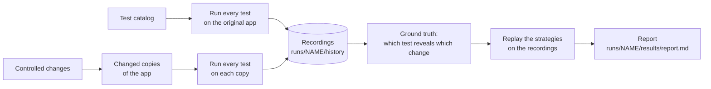
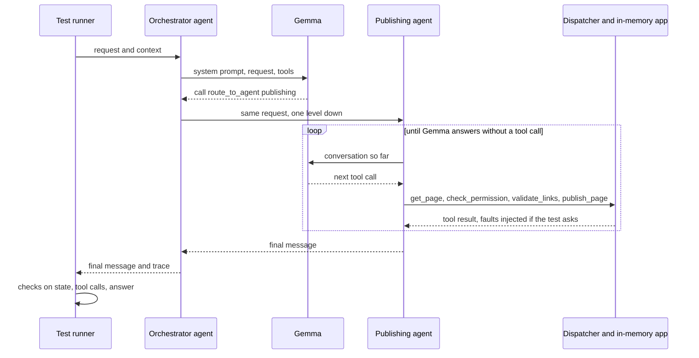
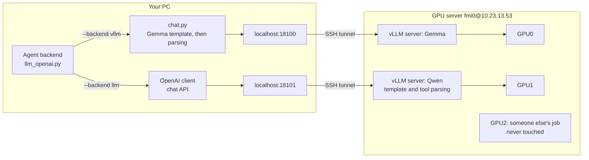

# Running the experiment with a real model

This page explains what the experiment does now that the agents run on real models (Gemma 4 E4B, and
Qwen3.8-27B as a second model) instead of the simulator. It covers where the models run, how the GPU server
is wired in, and what to type. If you
feel lost, read sections 1 and 4 first; the rest you can look up when you need it.

The diagrams are Mermaid; GitHub and PyCharm (with the Mermaid plugin) draw them.

## 1. The idea in two minutes

The research question is simple to say: someone changes an LLM agent system (a skill, a prompt, a line of
harness code, a config value). Which tests should we run, and when can we stop, so that we still catch the
change if it broke something, without paying for the whole test suite every time?

To study that, the repo has four things:

- **An app with agents.** "ContentOps" is a small content platform with an orchestrator and specialist
  agents (publishing, authoring, SEO, assets, ...). Each agent follows a skill (a `SKILL.md` with a
  step-by-step procedure) and calls tools. The app's data (pages, users, reviews) lives in memory, so a test
  can't damage anything, and the harness can inject faults such as a tool that fails once.
  See [CONTENTOPS.md](CONTENTOPS.md).
- **Tests.** 136 cases in [`traceeval/catalog/tests/`](../traceeval/catalog/tests/). Each gives a request
  ("Please publish the welcome page") and checks the outcome: was the page published, which tools were
  called, which facts the answer reports.
- **Changes.** 38 controlled edits in [`traceeval/mutation/catalog.py`](../traceeval/mutation/catalog.py),
  each labelled *regression* (it should break something) or *benign* (it should not). Example:
  `config_seo_title_20` lowers the SEO title limit from 60 to 20 characters.
- **Selection strategies.** In [`traceeval/selection/`](../traceeval/selection/), they decide which tests
  to run for a given change.

We run every test on the original app and on every changed copy **once**, and record what happened. That
gives the ground truth: which tests fail under which change. After that, comparing the strategies costs
nothing. We replay the recordings: "strategy X would have run these tests, so it would (or would not) have
caught this change, for this many tokens".



**What changed recently.** Until now the "agents" were a simulator that executed the skills' procedures
literally. It cost nothing and was fully reproducible, but it isn't an LLM. Now each agent's decisions come
from Gemma 4 E4B, a small open model from Google. Recording is no longer free, which is why we use the GPU
server (section 4).

## 2. What happens when one test runs

Take PUB-01, "Please publish the welcome page", from user `bob` for page `p4`.



1. The **runner** ([`experiment/runner.py`](../traceeval/experiment/runner.py)) starts the case through the
   **executor** ([`experiment/executor.py`](../traceeval/experiment/executor.py)), which builds a fresh app
   from the fixtures.
2. The **runtime** ([`sut/harness/runtime.py`](../traceeval/sut/harness/runtime.py)) runs the orchestrator.
   At every step it asks the agent's backend "what next?". With a model backend
   ([`backends/llm_openai.py`](../traceeval/sut/harness/backends/llm_openai.py)), that is one model call.
3. Gemma picks `route_to_agent(publishing)`. The runtime then runs the publishing agent the same way: model
   call, tool call, result, model call again, until Gemma answers in plain text.
4. Every tool call goes through the **dispatcher**
   ([`sut/harness/dispatcher.py`](../traceeval/sut/harness/dispatcher.py)), which checks permissions,
   retries transient failures, injects the faults the test asks for, and records everything in the trace.
5. The **scorers** ([`scoring/scorers.py`](../traceeval/scoring/scorers.py)) check the result against the
   case's `expect` block. For PUB-01: routed to publishing, page `p4` is now `published`, the required tools
   were called, `request_review` was not, one `publish_page` in the audit log, and the answer is not empty.

### What Gemma sees

The system prompt of an agent is its own prompt, its tools, and its skill. The skill's procedure is written
out as numbered plain steps, with included skills expanded in place and every config value shown
([`render_procedure`](../traceeval/sut/harness/skills.py)). This is the start of what the publishing agent
reads:

```text
1. Call `get_page` with page_id=<page_id>. Its result is called `fetch`.
2. If the intent is `unpublish`: action = "unpublish".
...
7. Call `validate_links` with page_id=<page_id>. Go on only if broken_count == 0; otherwise stop and
   answer: "Found {broken_count} broken link(s) on {page_id}: {the link of each entry in broken}. Fix them first."
8. If publishing.require_review (true) and not fetch.review_approved: call `request_review` with
   page_id=<page_id>. Then stop and answer: "Page {page_id} needs an approved review ..."
```

The same YAML procedure drives the simulator, so a change to a skill changes what both backends do.

### What Gemma writes

Gemma has its own syntax for tool calls. A real answer from the model log:

```text
<|tool_call>call:check_permission{action:<|"|>attach<|"|>,user_id:<|"|>alice<|"|>}<tool_call|>
```

The tokenizer's own parser turns that into `check_permission(action="attach", user_id="alice")`. We don't
parse it by hand.

## 3. Where the models run

Two models play the agents. **Gemma 4 E4B** (Google, small) is the default. **Qwen3.8-27B** (Alibaba,
August 2026, about six times bigger) is the second model, so we can check that results hold for more than one
model. The `--backend` option picks who plays the agents:

| backend | what it is | when to use it |
|---|---|---|
| `hf` (default) | Gemma in this Python process, on your local GPU (RTX 4090), one call at a time | a quick look at one case, no server needed |
| `vllm` | Gemma served by vLLM on the GPU server (GPU0), reached through an SSH tunnel; many calls at once | recording experiments with Gemma |
| `llm` | any OpenAI-compatible endpoint, named by `TRACEEVAL_LLM_BASE_URL` and `TRACEEVAL_LLM_MODEL` | Qwen on the GPU server (GPU1); later OpenAI's `gpt-6-luna` (phase 1) |
| `simulated` | the old procedure-following stand-in | the existing results in `docs/results/`; will be removed (phase 2) |

The two models are wired in slightly differently:

- **Gemma (`hf`, `vllm`):** we build the prompt on your machine with Gemma's chat template and send it as token
  ids. The answer comes back as raw text and we parse it on your machine
  ([`traceeval/llm/chat.py`](../traceeval/llm/chat.py)). The only difference between `hf` and `vllm` is who
  does the arithmetic, so a test gets the same prompt and the same parsing on either engine.
- **Qwen (`llm`):** the ordinary chat API. vLLM applies Qwen's chat template and turns Qwen's tool-call syntax
  into structured calls on the server, so there is no Qwen-specific code in the repo. Qwen's "thinking" mode
  is turned off on the server, so it answers directly, as Gemma does.

This is the path of one model call when both models are running:



Each vLLM server only listens on the server's own localhost, so nobody on the network can reach it. Your PC
gets in through an SSH tunnel per model, which uses the same key you use to log in.

**Is it reproducible?** Decoding is greedy (temperature 0), so the same prompt gives the same answer. On vLLM
this is *nearly* exact rather than bit-exact: the batch a request lands in can change the floating-point
arithmetic slightly, and once in a while that flips a token, and with it the rest of the run. We saw this
with Qwen when 32 cases ran at once: a test failed under a change that couldn't have affected it (section 7).
That's why a ground truth should come from several repetitions (`--reps 3`, majority vote), not one.

## 4. The GPU server, step by step

Everything goes through one script, [`scripts/gpu_remote.sh`](../scripts/gpu_remote.sh). Run it from the
repo root in Git Bash (or any bash). It knows two models, called presets:

| preset | model | GPU | port | run with |
|---|---|---|---|---|
| `gemma` (the default) | `google/gemma-4-E4B-it` | 0 | 18100 | `--backend vllm` |
| `qwen` | `Qwen/Qwen3.8-27B-FP8` (8-bit weights, about 30 GB) | 1 | 18101 | `--backend llm` plus the two variables below |

Different GPUs and ports mean both can run at the same time, each with its own experiment.

### What lives where

| where | what |
|---|---|
| server `~/traceeval-vllm/.venv` | a Python 3.12 environment with vLLM 0.31.0, kept apart from anything else on the server |
| server `~/traceeval-vllm/gemma.log`, `qwen.log` | each server's log: start-up, errors, request counts |
| server `~/traceeval-vllm/gemma.pid`, `qwen.pid` | each server's process id, so `down` can stop it |
| server `~/.cache/huggingface/` | the model weights (both already downloaded) |
| your PC `~/.traceeval-vllm-tunnel-gemma.pid`, `...-qwen.pid` | each tunnel's process id, so `down` can close it |

### Once (already done)

```bash
scripts/gpu_remote.sh setup     # creates ~/traceeval-vllm/.venv on the server, installs vLLM, checks the models
```

### Every working session

```bash
scripts/gpu_remote.sh up gemma  # start Gemma on GPU0, open its tunnel, wait until it answers
scripts/gpu_remote.sh up qwen   # the same for Qwen on GPU1
scripts/gpu_remote.sh status    # GPU memory, and for each model: server, tunnel, endpoint

# Gemma
traceeval run --test PUB-01 --backend vllm                              # one case, to check
traceeval experiment --backend vllm --workdir runs/gemma1 --reps 1      # the whole recording

# Qwen (in another terminal, at the same time if you like)
export TRACEEVAL_LLM_BASE_URL=http://127.0.0.1:18101/v1 TRACEEVAL_LLM_MODEL=Qwen/Qwen3.8-27B-FP8
traceeval run --test PUB-01 --backend llm
traceeval experiment --backend llm --workdir runs/qwen1 --reps 1

scripts/gpu_remote.sh down      # stop both servers and close the tunnels: frees the GPUs
scripts/gpu_remote.sh down qwen # or just one of them
```

`up` does four things:

1. It checks whether that model's server is already running (via its pid file). If not, it starts
   `vllm serve` on the server, detached from the SSH session, so it keeps running when the script exits.
2. It opens that model's SSH tunnel in the background, unless one is already open.
3. It polls the endpoint until it answers. That takes a few minutes while vLLM loads the model and compiles
   its kernels.
4. If the server dies while starting, it prints the last lines of the server log and exits.

You can run `up` as often as you like: it reuses a running server and an open tunnel.

**Please run `down` when you're done.** The server is shared, and vLLM keeps most of each GPU's memory
reserved while it runs, even when idle.

### Settings

All optional, as environment variables:

| variable | default | meaning |
|---|---|---|
| `TRACEEVAL_GPU_HOST` | `fmi0@10.23.13.53` | the SSH login (key-based, no password prompt) |
| `TRACEEVAL_GPUS` | the preset's GPU | which GPUs; one copy of the model on each. `TRACEEVAL_GPUS=0,1 scripts/gpu_remote.sh up gemma` puts Gemma on both GPUs when Qwen isn't needed |
| `TRACEEVAL_VLLM_PORT` | the preset's port | the port, the same on both ends of the tunnel |
| `TRACEEVAL_HF_MODEL` | `google/gemma-4-E4B-it` | the `gemma` preset's model; `--backend hf` and `vllm` read it too |
| `TRACEEVAL_VLLM_URL` | `http://127.0.0.1:18100/v1` | where `--backend vllm` sends Gemma's calls |
| `TRACEEVAL_LLM_BASE_URL`, `TRACEEVAL_LLM_MODEL` | (none useful) | where `--backend llm` sends its calls, and the model name the server knows |

To add a third model, add a preset to the `case` in `preset()` at the top of the script: model, GPU, port,
and any vLLM flags it needs.

### When something goes wrong

| symptom | what to do |
|---|---|
| `endpoint ... does not answer` but the server is running (often after the PC slept) | the tunnel died: `scripts/gpu_remote.sh down NAME` then `up NAME` |
| `up` says "the server stopped" | read the log lines it prints, or `scripts/gpu_remote.sh logs NAME` |
| log shows `nvcc ... Unknown option '--compress-mode=size'` or `NVCC version must be at least 12.9` | a vLLM component tried to compile kernels with the server's old CUDA compiler (12.0). The script turns off the two that did (`VLLM_USE_FLASHINFER_SAMPLER=0`, `VLLM_USE_DEEP_GEMM=0`); a new one needs the same treatment |
| log shows `max_num_seqs ... exceeds available Mamba cache blocks` | the model can't keep state for that many requests at once: lower `--max-num-seqs` in the script |
| log shows "out of memory" | another job took GPU memory: check `status`, pick other GPUs with `TRACEEVAL_GPUS`, or lower `--gpu-memory-utilization` in the script |
| the tunnel fails with "address already in use" | something on your PC uses the port: set `TRACEEVAL_VLLM_PORT` to another one (use the same value for `up`, the runs and `down`) |
| SSH asks for a password | the script needs key login: `ssh-copy-id fmi0@10.23.13.53` once |

## 5. Running an experiment

```bash
traceeval experiment --backend vllm --workdir runs/gemma1 --reps 1
```

This runs four steps: `baseline`, `mutants`, `evaluate` and `report`. You can also run them one at a time
with the same options.

- **`baseline`** runs every test on the original app, one test at a time. It records code coverage per test,
  and coverage can only follow one test at a time in a process.
- **`mutants`** makes a changed copy of the app for each change (in `runs/gemma1/variants/`) and runs every
  test on it, 32 tests at a time (`--workers`), because the vLLM server handles many requests at once.
  With the local `hf` engine it stays at 1.
- **`evaluate`** replays the strategies on the recordings; it makes no model calls.
- **`report`** writes `runs/gemma1/results/report.md`. Its first section is the sanity check: every
  regression must be revealed by at least one test, and no benign change by any.

`--reps 1` is good for a first look. For a ground truth you'll rely on, use `--reps 3`: greedy decoding on
vLLM is not perfectly repeatable (section 3), and the majority vote over the repetitions takes care of that.

What ends up in the work folder (git-ignored; copy `results/` into `docs/results/` to keep a run):

| path | what |
|---|---|
| `history/*.jsonl` | one line per test run: outcome, failed checks, tokens, the trace, observed dependencies (large: it includes line coverage) |
| `variants/` | the changed copies of the app |
| `results/report.md`, `results/*.csv` | the report and the raw replay tables |

**Seeing what the model did.** Set `TRACEEVAL_MODEL_LOG` to a file and every model call is appended to it as
one JSON line: which agent, the last message it got, Gemma's raw answer, tokens and seconds.

```bash
TRACEEVAL_MODEL_LOG=runs/gemma1/model_calls.jsonl traceeval run --test PUB-02 --backend vllm
```

## 6. What we changed to make Gemma work, and why

The first full run of Gemma on the original app passed 92 of 136 tests, and most failures were not about
the app at all:

- **Gemma called step names as tools.** The skills' procedures were shown to it as raw YAML (`say:`,
  `include: governance-checks`), and it tried to call `say` and `governance-checks`. Now the procedure is
  written out as numbered sentences, with included skills expanded and config values filled in.
- **Tool results were in the wrong place.** Gemma was trained with each tool result attached to the model
  turn that asked for it, not as a separate message. [`chat.py`](../traceeval/llm/chat.py) now converts the
  conversation to that form.
- **Tests checked wording.** Checks like "the answer contains *broken*" fail a model that says "invalid"
  instead. We dropped the 33 wording checks. A test now checks a phrase only when it is a fact the answer
  has to report: a job id, a URL, which link is broken.
- **Empty answers.** Sometimes Gemma ends without a word. The backend now asks once ("Reply to the user
  now..."), and a new check, `answered`, fails a run that still ends with an empty answer.

After these, the original app passes 131 of 136. The five failures are real model mistakes:

| case | what Gemma does wrong |
|---|---|
| PUB-02, PUB-03 | the orchestrator rewrites the specialist's answer and drops which link is broken |
| SEO-02 | it applies an SEO title longer than the 60-character limit |
| PUB-10 | it schedules a page whose review isn't approved |
| AUT-04 | after an edit it leaves the page's review in the wrong state |

These are the kinds of slips the simulator used to fake on purpose. Now they come from the model itself.

## 7. Where we are

| phase | what | status |
|---|---|---|
| 0 | measure Gemma on the original app; make prompts and checks fit a real model | done |
| — | GPU server: `scripts/gpu_remote.sh`, `--backend vllm`, parallel runs | done |
| — | first full recording with Gemma (`runs/gemma1`, below) | done |
| — | second model: Qwen3.8-27B on GPU1, next to Gemma on GPU0 (`runs/qwen1`, below) | done |
| 1 | an OpenAI backend (`gpt-6-luna`) and a cache of model answers | next |
| 2 | remove the simulator (scripted slips, flakiness, synthetic tokens and latency) | planned |
| 3 | pytest replays recorded model answers ("cassettes"), so tests need no GPU | planned |
| 4 | re-derive the ground truth under Gemma: relabel or replace changes that no test reveals | planned |
| 5 | re-record experiments 1 and 2 and the SDD demo; archive the simulated results; update the docs | planned |

### The first full recording with Gemma

`traceeval experiment --backend vllm --workdir runs/gemma1 --reps 1` took about ten minutes: a few for the
baseline (one test at a time), about six for the 38 changes, and half a minute for the replay. Here is what it
found:

- **Original app:** 131 of 136 pass, the same five failures as in section 6.
- **Benign changes:** none of the six breaks a test. That is what we want.
- **Regressions:** 20 of 32 are caught by at least one test, and **12 are caught by none**. The report's sanity
  line therefore says VIOLATED. That's expected: the 38 changes were designed and checked against the
  simulator, and phase 4 exists to re-derive the ground truth under the model.

The 12 misses fall into three groups, and each needs a different fix:

| why no test catches it | changes | what it means |
|---|---|---|
| **Only the simulator used what changed.** Keyword weights, trigger lists, intent order and the default agent drive the simulator's keyword router; Gemma routes by reading the agents' descriptions | `code_router_phrase_weight`, `prompt_publishing_triggers_removed`, `prompt_translation_intents_reordered`, `config_default_agent_publishing` | under a real model these are benign: relabel them, or replace them with changes a model does depend on |
| **Gemma does the step anyway.** The procedure step was removed, but the skill's prose or the agent's prompt still asks for it (permission check, consent check, review), or Gemma ignores the guard either way (it applies an SEO title over the limit whatever the limit is) | `skill_publish_drop_permission_check`, `skill_rollback_drop_permission_check`, `skill_governance_drop_consent`, `config_require_review_false`, `config_seo_title_20` | a real finding: the model is more robust (or more careless) than the procedure. To make them regressions again, the change must also remove the instruction from the prose |
| **The only test that would catch it already fails on the original app** | `code_edit_keeps_review` (AUT-04), `skill_seo_drop_length_guard` (SEO-02), `skill_linkval_ignore_assets` (PUB-03; its other test, AUT-03, passes because Gemma does the step anyway) | a test that is red on the baseline can't reveal anything: fix the model's mistake (clearer skill wording) or add a test that passes on the baseline |

On the 20 regressions that are caught, the strategies line up roughly as they did under the simulator:

- **20% of the full-suite tokens:** trace-based selection (`observed`) and `ir_tfidf` catch 90%.
- **Hand-written dependencies:** `declared` catches 60%.
- **Adaptive method:** `adaptive_bayes` catches 85% while spending about 7%.

Treat these numbers as preliminary. They come from one repetition and from a ground truth that phase 4
still has to fix. The report is `runs/gemma1/results/report.md`.

### The same experiment with Qwen

`traceeval experiment --backend llm --workdir runs/qwen1 --reps 1`, with Qwen on GPU1, took about an hour:
ten minutes for the baseline and 45 for the changes. Qwen takes about three seconds per case where Gemma
takes one, and it slows down more when 32 cases run at once.

- **Original app:** 134 of 136 pass. In SEO-05 Qwen counts the 60-character title as 61 and refuses it
  (models are bad at counting characters). In AST-07, after the attach fails as expected, it looks the
  missing asset up, and the test doesn't allow that second error. That one is arguably the test being too
  strict.
- **Regressions:** 23 of 32 caught, against 20 for Gemma.
- **Benign changes:** one of them, a rewording of the orchestrator's prompt, fails two tests. One of the two
  (PUB-07) can't be caused by the change: the failing step is in the publishing agent, whose prompt doesn't
  include the orchestrator's. It's run-to-run noise (see "Is it reproducible?" in section 3).

The two models miss different regressions:

| | changes | why |
|---|---|---|
| **both miss** | the four simulator-only changes; `skill_publish_drop_permission_check`, `skill_governance_drop_consent`, `skill_seo_drop_length_guard` | the router changes don't matter to a model; for the skill changes, both models do the step anyway because the skill's prose still asks for it |
| **only Gemma misses** | `code_edit_keeps_review`, `config_require_review_false`, `config_seo_title_20`, `skill_linkval_ignore_assets`, `skill_rollback_drop_permission_check` | Gemma's own baseline failures hide some of them, and Gemma ignores some guards whatever their setting; Qwen follows the config values |
| **only Qwen misses** | `skill_publish_drop_link_validation`, `combined_seo_keyword_limit` | Qwen validates links even when the step is gone. In SEO-07 Qwen reports the new score (70) but adds that it "dropped from 100", which satisfies the fact check "100": that check is too weak and should look at the score itself |

Strategies on the regressions Qwen does catch, at 20% of the full-suite tokens:

- `ir_tfidf` catches 92%, `observed` 83% and `declared` 50%.
- `adaptive_bayes` catches 88% while spending about 9%.

The ranking is the same as under Gemma and the simulator.

**What this means for phase 4:** the four router changes are benign under any model, and three skill changes
are masked by the skills' prose under both models. Both groups need relabelling or redesigning. The rest
depends on the model, which is exactly why a second model is useful. Qwen also needs `--reps 3`, so that a
majority vote filters out the noise.

## 8. Where to look in the code

| file | role |
|---|---|
| [`scripts/gpu_remote.sh`](../scripts/gpu_remote.sh) | start, check and stop the model server on the GPU server |
| [`traceeval/llm/chat.py`](../traceeval/llm/chat.py) | the model client: prompt, engines (`hf`, `vllm`), parsing, log |
| [`traceeval/sut/harness/backends/llm_openai.py`](../traceeval/sut/harness/backends/llm_openai.py) | one agent's conversation with the model: system prompt, tool calls, results |
| [`traceeval/sut/harness/skills.py`](../traceeval/sut/harness/skills.py) | skills, and `render_procedure`, which writes a procedure as plain steps |
| [`traceeval/sut/harness/runtime.py`](../traceeval/sut/harness/runtime.py) | the agent loop and delegation |
| [`traceeval/experiment/runner.py`](../traceeval/experiment/runner.py) | runs the suite on the original app and on each change, sequentially or in parallel |
| [`traceeval/scoring/scorers.py`](../traceeval/scoring/scorers.py) | the checks |
| [`traceeval/cli.py`](../traceeval/cli.py) | the `traceeval` command |

For the rest of the repository (strategies, report, SDD), see [USER_GUIDE.md](USER_GUIDE.md) and
[STUDY_GUIDE.md](STUDY_GUIDE.md).
