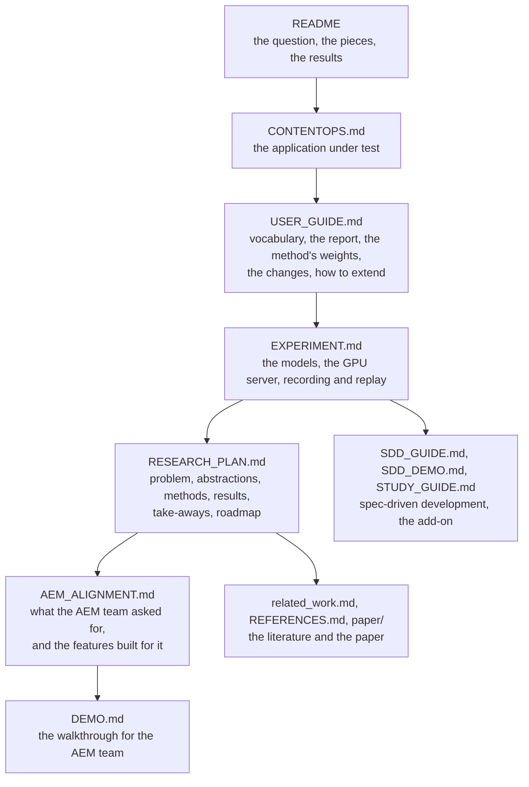

# The documentation

Start with the repository [README](../README.md): the question, the pieces, how to run it, the main results. Then
pick by what you want to do. The diagrams are Mermaid: GitHub renders them, and so does PyCharm with the
Mermaid plugin.

## By what you want to do

| you want to | read |
|---|---|
| understand the question, the pieces and the main results | [README](../README.md) |
| see the application the tests exercise: its users, agents, skills, tools and rules | [CONTENTOPS.md](CONTENTOPS.md) |
| work in the repository: the vocabulary, how to read a report, how the method weighs a test, the controlled changes, how to add a test, a change or a strategy | [USER_GUIDE.md](USER_GUIDE.md) |
| record with a model: the GPU server, the commands, recording and replay, what the recordings show, what the models get wrong | [EXPERIMENT.md](EXPERIMENT.md) |
| the research: the problem, the abstractions, the methods, the results, the take-aways, the roadmap | [RESEARCH_PLAN.md](RESEARCH_PLAN.md) |
| Adobe's platform, what the AEM team asked for, the features built for it, the next steps | [AEM_ALIGNMENT.md](AEM_ALIGNMENT.md) |
| give or follow the demo for the AEM team, command by command | [DEMO.md](DEMO.md) |
| the full results of a recording: tables and figures | [results/gemma7/report.md](results/gemma7/report.md), the results the README quotes; [results/qwen7/](results/qwen7/report.md) and [results/gptoss7/](results/gptoss7/report.md), the other two models |
| spec-driven development: what a spec is, how a pull request is judged against it, the assurance rungs | [SDD_GUIDE.md](SDD_GUIDE.md), then [SDD_DEMO.md](SDD_DEMO.md) for the results and [sdd/report.md](sdd/report.md) for the full report |
| read the code of the spec-driven development layer, with diagrams, in two to three hours | [STUDY_GUIDE.md](STUDY_GUIDE.md) |
| the literature, the references and the paper | [related_work.md](related_work.md), [REFERENCES.md](REFERENCES.md), `paper/main.tex` (build with `latexmk -pdf main`) |
| work on the code with a coding agent: commands, layout, conventions, gotchas | [../CLAUDE.md](../CLAUDE.md) |

## Reading order

Each document uses only what the ones before it define, so a first reading goes top to bottom. The spec-driven
development documents and the literature branch off the main line.

## What else is in this folder

- `results/`: one folder per recording (`gemma7`, `qwen7`, `gptoss7`), each with the report and its three figures.
- `sdd/`: the spec-driven development report, its figures, and a spec drafted by Qwen from a change request, with
  its answer.
- `properties/draft_qwen/`: the catalog of properties as Qwen drafted it from the requirements, with the model's
  answers, so the draft can be replayed without a GPU.
- `diagrams/` and `figures/`: the Mermaid sources and the rendered images the guides use.
- `paper/`: the LaTeX paper, its bibliography and the overview figure.
