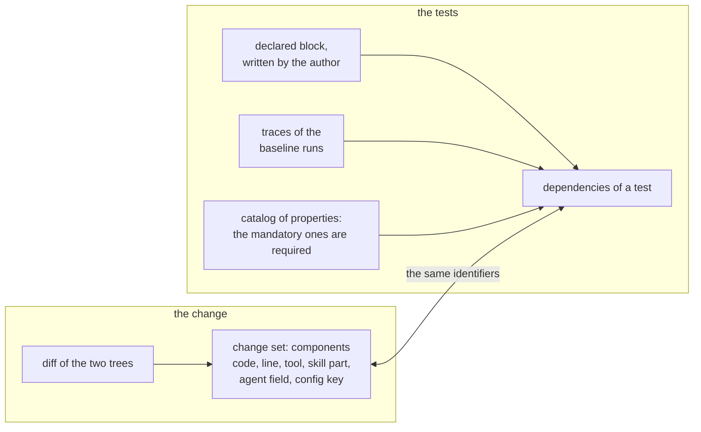
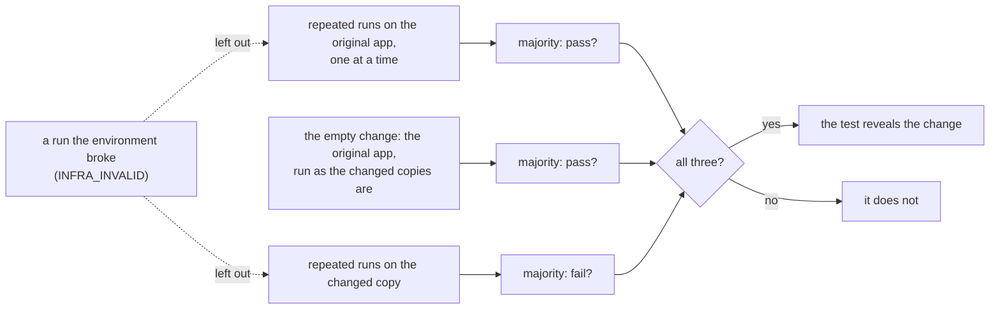
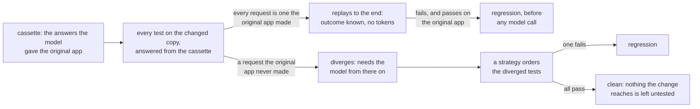
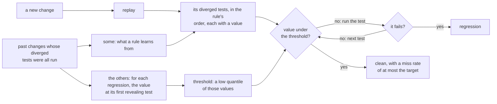

# TRACE-Eval: research and implementation plan

**Change-aware, cost-bounded selection, prioritization and stopping of tests and evals for LLM agent systems**

University of Bucharest / ILDS. The results are in `docs/results/gemma8/report.md`

---

## In short

- **Problem.** After a change to an agent system, decide which tests and eval items to run, in what order, and
  when to stop, under a token budget and without missing regressions.
- **Method (§3.3, §3.4).** Replay first: every test is re-run on the changed app with the model's calls answered
  from the answers recorded on the original app.
  - A test that replays to the end has its outcome for no tokens. A test that diverges is one the change
    reaches, and only those need the model.
  - A strategy orders the reached tests, and a failure is confirmed by a repetition before it ends the run.
  - The run stops with a clean verdict at a threshold set on past changes, which bounds how often that verdict is
    given on a regression.
- **Testbed.** A small multi-agent app (`traceeval/sut`) whose agents are played by a model (Gemma 4 E4B;
  Qwen3.8-27B and gpt-oss-120b as further models), 180 tests, 43 hand-written changes (9 of them benign) and 692
  changes generated mechanically from the app. Recordings with five repetitions give the ground truth, and eleven
  strategies are compared offline under the same two rules (§3).
- **Results (§5.7 to §5.9, Gemma).**
  - A fifth of the changes need no model at all, and the others reach 40 of the 180 tests on average, 12 to
    15 at the median.
  - What replays is the outcome of a test: 2% to 3% of the requests are answered otherwise when they are sent
    again, and no test ends otherwise. Under another start of the server 2 of 1,442 labels move.
  - Those other answers come from two settings of the server, many tests at a time and its prefix cache. With
    neither, every request gets its recorded answer again, across a restart too, at a tenth of the speed.
  - A verdict costs 5% to 7% of the suite's tokens per change. The whole suite through a cache of answers costs
    13.5%, and an order of the whole suite without the replay 16% to 47%.
  - A threshold set on past changes keeps the miss rate of a clean verdict at its target. One threshold for all
    changes does it by missing most regressions of one group of changes. A threshold per group keeps every group
    at its target, and with `adaptive_bayes`'s probability it also holds on changes unlike the past ones.
  - Live, `traceeval check` gives the offline verdict on 41 of the 43 changes. With a target miss rate of 10% it
    finds all 28 regressions and raises no false alarm, for 2.8% of the suite's tokens per check.
- **Without the replay (§5.1).** Reading the change pays: the strategies that read the diff or the traces find 86%
  to 93% of the regressions for a tenth of the suite's tokens, hand-written dependencies 61%. `adaptive_bayes`
  finds the most at a small budget and stays near 85% however large the budget, because a quarter of its clean
  verdicts are given on a regression.
- **What is not new (§7).** Replaying recorded answers into changed code is test factoring's mechanism (2005), and
  a cache of answers already pays only for changed requests. The cache is the baseline every cost is given
  against.
- **Next.** The plan is `TODO.md`: Qwen's recording under the same protocol, the 43 changes under the serving
  setup in which every answer repeats, a second application (tau2-bench, §6). Re-planning after a failed step
  waits for a product decision (`docs/AEM_ALIGNMENT.md` §4.1).

---

## 0. Reading order

In reading order: the problem (§1), the abstractions the method rests on (§2), the methods (§3), the evaluation
environment (§4), the results and the take-aways (§5), the roadmap (§6), the paper (§7) and the open questions for
the Adobe Team (§8). The research problem is kept general: any agent platform built from skills, prompts, tools,
harness code and configuration. AEM, Adobe's platform, is the motivating instance, and the method does not depend
on it.

**Design decisions**

| Topic | Decision | Reason |
|---|---|---|
| System under test (SUT) | A purpose-built mini content-operations platform ("ContentOps": pages, assets, publishing, SEO, translation, governance, rollback) is the primary SUT. | The primary SUT gives a multi-agent structure with shared components built in on purpose (the hard case the Adobe Team describes) and full control over mutations. Its agents run on a local model, and recorded answers make reruns free and exact. tau2-bench, the second system under test, adds external validity (§6). |
| Agent runtime | A pure Python harness with an OpenAI-compatible LLM backend. | It is the shortest path, and the harness code must itself be mutable and instrumentable (coverage contexts). |
| Observability | Our own trace recorder with an OpenTelemetry-compatible event model (agent, skill, tool, config and llm events) and an OTLP JSON exporter (`tracing/otel.py`). | No services in the loop, and the export needs no dependency. |
| Oracles (what decides pass or fail) | Deterministic checks (final state, tool trajectories, audit log, response substrings). An LLM judge (Gemma or Qwen, against the case's rubric) runs only for explicitly marked answer-quality properties, and only after the deterministic checks pass. | Regression tracking must not depend on judge noise. |
| Ground truth | Mutation analysis: 43 controlled changes, benign ones included, applied as file edits. The selectors see only the diff. | Needed to measure the detection rate against a known answer, and to measure wasted budget. |
| Evaluation | Record, then replay: run the full suite once per variant, and evaluate all strategies offline. | Decouples method development (thousands of replays) from execution cost (one recording per variant). |

---

## 1. Problem statement and research questions

A change set $\Delta$ (edits to skill files, prompts or agent definitions, harness or tool code, configuration)
arrives at an agent platform with a suite $T$ of tests and eval-dataset items, each with a cost $c(t)$ in tokens
and time. We must choose a subset $S \subseteq T$ and an order, possibly adaptively, under a budget $B$, so that
the regressions $\Delta$ introduces are detected with high probability and at low cost. The procedure should stop
when more evidence is not worth its price.

We keep the three sub-problems of Adobe's requirements document (not in this repository; `docs/AEM_ALIGNMENT.md` §1
sums it up) separate throughout: selection (which tests), prioritization (in which order) and budget-aware stopping
(when to stop). The research questions are those of the requirements document, each with a metric:

- **RQ1 (selection)** Can we identify the tests relevant to a change? *Metric: selection recall of the revealing
  tests and cost of the selected subset, declared vs. observed dependencies.*
- **RQ2 (traces)** Do execution traces improve selection beyond static/declared dependency information? *Metric:
  RQ1 and RQ3 metrics for `declared` vs. the strategies built on observed dependencies (`observed`, `cost_aware`,
  `adaptive_bayes`).*
- **RQ3 (prioritization)** Can we order tests to detect regressions earlier? *Metric: APFD, cost-cognizant
  $\mathrm{APFD}_c$, cost to first detection.*
- **RQ4 (budget)** Can we reduce time and tokens while retaining acceptable detection and coverage? *Metric:
  detection rate vs. budget curves, tokens actually spent, waste on the changes no test reveals, stopping
  accuracy.*

**Claimed contribution.** A change-aware, trace-informed, cost-bounded method for selecting agent tests, with a
stopping rule based on the posterior probability of a regression, and a reproducible testbed (SUT, mutation
catalogue, metrics) for evaluating such methods. The contribution is the method; the testbed
is what makes it testable. §5.1 says how far the experiments support that claim, and `TODO.md` what follows from
them.

---

## 2. Models underlying the method

### 2.1 Tests and their facts

A test (a case of the catalog, `traceeval/catalog/`) is a request to the application with a context, and
expectations on what must be true afterwards: the final state, the tools called and not called, the audit log,
facts in the answer, and for workflows the order of agents and tools. Each test also carries the facts the methods
use:

- a **risk** level, critical, high, medium or low, which the metrics read as a severity of 4, 3, 2 or 1;
- the **properties** it checks, ids from the catalog of properties (`properties.yaml`: category, how it is
  checked, a mandatory flag, a threshold and the components it comes from; `docs/AEM_ALIGNMENT.md` §3.4). The
  mandatory ones, the safety properties, are the required dependencies of §2.3;
- its **declared dependencies**, the metadata its author wrote;
- its **fault profile**, if it injects one (`docs/CONTENTOPS.md`);
- its **cost** and its **pass rate**, measured on the original app (§2.4, §2.5);
- its **behaviour signature**: the agents, tools, fault profile and dataset of its baseline runs. Tests with the
  same signature are near-duplicates, whose outcomes are correlated.

The diff and the tests meet in one vocabulary of components, defined in §2.2 and used on both sides:

### 2.2 Change model (what a diff becomes)

The extractor (`traceeval/mutation/changeset.py`) turns a diff into *components* with the same identifiers used
for dependencies:

| Component | Example | Granularity notes |
|---|---|---|
| `code:<file>::<function>` + `line:<file>:<n>` | `code:harness/retry.py::with_retry`, `line:harness/retry.py:29` | functions compared as syntax trees, docstrings ignored; changed baseline code lines; an insertion anchors to the code lines around it. |
| `tool:<name>` | `tool:set_page_metadata` | When a changed function is a registered tool adapter. |
| `tool:<name>#schema` | `tool:schedule_publish#schema` | What the model is told about the tool changed: its description, its parameters or their hints. |
| `skill:<name>#procedure` / `#prose` / `#meta` | `skill:link-validation#procedure` | The procedure block, compared as the steps the model is shown, in their order; the instruction prose and the front matter, compared as text. |
| `agent:<name>.<field>` | `agent:publishing.triggers`, `agent:seo.tools` | Order-sensitive comparison (intent order matters). A tool or skill list that only lost items names them (`removed: tool:check_consent`). |
| `agent:<orchestrator>.specialists` | `agent:orchestrator.specialists` | An agent was added or taken away: the orchestrator's prompt lists them all. |
| `config:<dotted.key>` | `config:runtime.retries` | Changes of the effective value only. |
| `fixture:<name>` | `fixture:base` | The starting data changed. |
| comments and formatting | — | Left out. Comments, docstrings, blank lines, YAML comments and the order of config mappings add no component, file or diff line, so no selector or probability depends on them. |

The rule behind the table: an edit that cannot change what the harness does adds nothing, and what the model is
sent counts as it is sent. A re-wrapped paragraph of a skill is another prompt, so it is a change; a comment in a
procedure block is not shown to the model, so it is none.

### 2.3 Dependency model (declared, observed, required)

- **Declared** dependencies are the metadata a test author wrote (the `declared:` block in the catalog). They are
  incomplete on purpose, as in practice: shared skills reached through `include`, harness code and most
  configuration keys are not declared.
- **Observed** dependencies come from the baseline traces: the agents started, the agent-definition fields the
  orchestrator consulted, the skills loaded (with version and digest), the tools called (with status and
  attempts), the configuration keys read, and the code functions and lines executed (coverage.py dynamic
  contexts, one context per test and repetition). They also hold what the model was sent without the run acting
  on it: the tools each agent was offered (`tool:<name>#schema`) and the fixture. Every module is imported before
  the first test runs, so a module's own level is in no test's coverage: a change there touches the tests that
  ran a function of the file, or, for a package's `__init__`, any code of the package.
- **Required** dependencies are what must always be evaluated: the catalog's mandatory properties, the safety ones.
  The adaptive method tests every mandatory property a change may affect before it ends without a regression (step
  5, §5.3).

### 2.4 Cost model

$c(t)$ is the agent tokens (prompt and completion over all model calls in the delegation chain) plus the judge
tokens (only when a judge runs). Latency is recorded alongside. Tokens come from the model server's usage fields,
so a case that delegates, retries or reads long skills costs more. A full-suite run of the 180 tests costs about
2.1M tokens under Gemma and 2.5M under Qwen.

### 2.5 Outcome model and ground truth

A test run ends in one of five outcomes:

- PASS;
- TOOL_ERROR: a tool crashed, or failed in a way the case does not allow;
- AGENT_FAILURE: the tool calls were allowed, but a check on the state, the calls or the answer failed;
- HARNESS_ERROR: the run itself raised;
- INFRA_INVALID: the environment broke the run, because the model server or the network did not answer, a
  replay had no recorded answer, or the judge gave no verdict (its answer must open with PASS or FAIL).

An INFRA_INVALID run is left out, as if it had not been made. Of the other outcomes, only pass or fail enters the
ground truth. With $K$ repetitions per variant, the ground truth "$t$ reveals $\Delta$" is a *majority flip*: the
baseline pass rate is $\ge 0.5$ and the variant pass rate is $< 0.5$. A test that the model fails on the original
app cannot reveal anything; its fail rate there, $f_t$, is a direct input to the selectors.

Two more rules keep the ground truth to what the change did:

- **The empty change.** The baseline runs one test at a time, because it records coverage, and the changed copies
  many at a time. A recording therefore also runs the original app the way the changed copies are run. A test
  that fails there by majority reveals no change: the way of running fails it.
- **Missing pairs.** A (change, test) pair with no valid run has no outcome. It reveals nothing, no strategy is
  given the test on that change, and the report counts such pairs.

---

## 3. Methods (strategies implemented in `traceeval/selection/`)

Each strategy answers the same question, which tests to run on the changed app and in what order, from the same
inputs: the recording of the current app (traces, costs, pass rates) and the change set. None sees the ground
truth.

Every strategy is run the same way (`selection/base.py`), so that they are compared like for like:

- a test the model already fails on the current app is not run: it fails on the changed copy too, whatever the
  change, so it cannot reveal anything;
- a run ends at its first failure: a test that passed on the current app now fails, which is a regression.

What differs is which tests a strategy picks, in what order, and when a run without a failure ends. One by one:

- `full` runs the suite in catalog order, that is, as the tests are listed in `catalog/tests/*.yaml`, followed
  by the dataset items. It is the reference, not a method.
- `random` runs it in a random order, the baseline every method must beat.
- `declared` runs only the tests whose hand-written metadata names a changed component, riskiest first. This is
  classic regression test selection on what the authors declared, and the metadata is incomplete on purpose, as it
  is in practice.
- `ir_tfidf` ranks every test by how much its text resembles the diff, with words weighted by TF-IDF so that a
  word every test uses counts little. A test's text is everything its author wrote about it: id, name, request,
  context, the properties it checks and the dependencies it declares. It is information-retrieval prioritization
  (as in REPiR, listed in `docs/REFERENCES.md`) and uses no traces.
- `observed` runs only the tests whose recorded traces touched a changed component (an agent, a skill, a tool, a
  setting read, a code line executed), ordered by how often they touched it times their risk, divided by cost. This
  is the trace-informed selection the project argues for.
- `observed_diverse` runs the same selection one behaviour group at a time (the tests with the same agents and
  tools), so that a small budget covers many behaviours before it repeats one.
- `cost_aware` ranks the whole suite by risk, closeness to the change, failure history and cost, affected tests
  first and cheap ones before expensive ones; when the affected tests pass it goes on to the others.
- `history_ml` is predictive test selection: a logistic regression, trained on the other recorded changes, gives
  every test a probability of revealing this change from how its traces meet the change set, its cost and its
  risk, and the suite is ranked by that probability times risk per token. It is the one baseline that learns from
  the same history as the proposed method.
- `casper_slices` adapts CASPER. It groups the tests into slices that behave alike on the current app (tool
  calls, hand-offs, skills, size of the run), runs two representatives of every slice on the changed app, and then
  runs the slices in the order of how much the representatives' behaviour moved: the rise of a failure model's
  prediction from the signals of their runs on the current app to those on the changed app. It does not read the
  diff.
- `risk_aware_ts` adapts Risk-Aware Adaptive Evaluation. It is a bandit: after each test it refits a model of
  which tests fail, draws a failure probability for every test still to run, and runs the one whose draw times its
  risk is highest. It does not read the diff either.
- `adaptive_bayes` is the proposed method. For every changed component it keeps the probability that the component
  is broken, and for every test the probability that the test fails if it is, calibrated on the other recorded
  changes and on the test's own record. It runs the test with the most information per token and updates after each
  outcome. Besides ending at the first failure, it ends when the probability that anything is broken is small;
  before it ends without a regression it runs a test of every mandatory property the change may affect. It is the
  only strategy that can call a change clean before its tests run out.

The same strategies, placed in the literature:

| Strategy | Family | Runs | A run without a failure ends when |
|---|---|---|---|
| `full` | reference | the suite, in catalog order | the suite has run, or the budget |
| `random` | baseline | the suite, in a random order | the suite has run, or the budget |
| `declared` | classic regression test selection (RTS) on metadata | the tests whose declared dependencies name the change | its selection has run |
| `ir_tfidf` | information-retrieval test case prioritization (TCP), REPiR-style (`docs/REFERENCES.md`) | the suite, by text similarity | the suite has run, or the budget |
| `observed` | trace-informed RTS | the tests whose traces touched the change | its selection has run |
| `observed_diverse` | the observed selection, one behaviour group at a time | the same selection | its selection has run |
| `cost_aware` | the formula of Adobe's requirements | the suite, affected tests first | the suite has run, or the budget |
| `history_ml` | predictive test selection (Machalica et al.) | the suite, by learned probability | the suite has run, or the budget |
| `casper_slices` | CASPER (Muse et al. 2026), adapted | representatives, then slices by behavioural shift | the suite has run, or the budget |
| `risk_aware_ts` | Risk-Aware Adaptive Evaluation (Maji & Chowdhury 2026), adapted | one test per round, by a sampled failure probability | the suite has run, or the budget |
| `adaptive_bayes` | **proposed** | the test with the most information per token | it is confident nothing broke |

The results in §5 compare these eleven. Four variants run when named (`--strategies`):

- `adaptive_bayes_tfidf` and `adaptive_bayes_notext` differ from the proposed method only in how text is compared
  (§5.2), and `adaptive_bayes_nomandatory` leaves out step 5 (§5.3);
- `risk_aware_ts_per_token` divides the bandit's score by the test's cost, as a budget in tokens suggests (§5.1).

### 3.1 The proposed method: adaptive Bayesian selection with budget-aware stopping

The loop is the one pictured in `docs/USER_GUIDE.md` §5; the paragraphs below define each box.

*Hypotheses (step 1 of the five in `adaptive_bayes.py`'s docstring).* Each changed component $c$ is broken with a
prior $\pi_c$ that depends on its kind: about 0.45 to 0.5 for code, skill, config and agent components, 0.12 to
0.15 for prompt wording and prose. The posterior is kept exactly over all $2^k$ subsets $B$ of the $k$ changed
components ($k \le 8$). The `tool:` and `line:` ids of a code change are views of it, not hypotheses of their own,
and a change set with more than eight components keeps the eight with the highest prior.

*Likelihood (step 2).* Under the hypothesis that the components in $B$ are broken, a test fails with probability

$$P(t \text{ fails} \mid B) = 1 - (1 - f_t) \prod_{c \in B} (1 - s_{tc}),$$

where $f_t$ is the test's fail rate on the original app and $s_{tc}$, the sensitivity of test $t$ to component $c$,
is the product of four factors,

$$s_{tc} = r_{k(c)} \cdot \ell_{t,k(c)} \cdot \phi_t(c) \cdot \tau_t,$$

in the paper's notation (`docs/USER_GUIDE.md` §5 calls them kind ratio, test record, coverage and tilt):

- $r_k$ is the empirical reveal ratio of kind $k$, learned from the other recorded changes: the fraction of
  statically impacted tests that actually revealed a change of that kind. Kinds separate, for example, tests that
  executed the changed line from tests that executed only the changed function, and agent fields are calibrated per
  field. The ratio is where "covered is not revealed" enters the model, as measured numbers rather than hand-set
  constants. A ratio learned from few changes is padded toward a default for its kind ($m = 2$ changes' worth, as
  below), so that one earlier change cannot make a whole kind look certain.
- $\ell_{tk} = (O_{tk} + m)/(E_{tk} + m)$ is the test's own record on the earlier changes of kind $k$ that impacted
  it. $O_{tk}$ is how many of them it revealed, $E_{tk}$ how many an average impacted test would have revealed (the
  sum of those changes' reveal rates), and $m = 2$ pads a short record. A test that ran many changed functions and
  never caught anything gets a record below 1; one that caught changes most impacted tests missed gets a record
  above 1. Comparing with $E_{tk}$, instead of counting catches, matters because a change that breaks a large part
  of the suite (link validation turned off everywhere: 49 tests) says little about each test it breaks. Like $r_k$,
  the records are recomputed from the recordings at every run, without the change under evaluation
  (`docs/USER_GUIDE.md` §5). The record is there because kind-level sensitivities alone let the method spend on
  cheap tests that merely call a changed function.
- $\phi_t(c)$ is how often $t$ exercised $c$ in its baseline runs. For an agent's tool or skill list that only lost
  items, it is how often $t$ used one of the removed items.
- $\tau_t \in [0.5, 2]$ combines the lexical relevance of the change text (code only, never comments) to the test's
  own text (name, request, expectations) with a bonus when the author declared the dependency. It is a proxy for
  whether the test's oracle plausibly observes the changed behaviour. The relevance measure is an option (`text`):
  word overlap (the default), TF-IDF, or none (§5.2).

*Policy (step 3).* The next test is $\arg\max_t\, g_t / c(t)$, where $g_t$ is the expected information gain about
$B$, tilted by risk, and $c(t)$ the test's cost. After a pass, the sensitivities of tests with the same behaviour
signature (agents, tools, fault profile, dataset) are multiplied by $\delta = 0.35$, because near-duplicate tests
give correlated evidence rather than independent draws. Each test runs at most once: the models decode greedily, so
a rerun almost always gives the same answer (§5.4 measures where it does not).

*Stopping (step 4).* The method stops with the verdict "regression" at the first failure of a test that passed on
the original app: that failure shows a changed behaviour, which is what the ground truth calls revealing, while a
failure the model also produces on the original app says nothing about the change. It stops with the verdict
"clean" when $P(B \neq \emptyset \mid \text{evidence}) < \varepsilon$, with $\varepsilon = 0.05$. Otherwise it runs
until the budget is exhausted or no test is informative. Selection, prioritization and stopping all come from the
same model.

*Mandatory coverage (step 5).* A coverage rule sits on top of the model. A run that found no regression then
tests every mandatory property the change may affect that is still untested, with the cheapest test that checks
it, while the budget allows (§5.3).

### 3.2 Why these baselines

They cover the families in the literature: classic RTS/TCP on declared coverage (Rothermel), IR-based TCP (Saha
2015), cost-cognizant TCP (Elbaum 2001), predictive test selection (Machalica 2019) and diversity-based ordering
(LTM, Pan et al.; `docs/REFERENCES.md`). CASPER (2026) and Risk-Aware Adaptive Evaluation (2026) are the closest
external competitors (`docs/related_work.md`), and both are adapted to the testbed (`selection/adapted.py`,
roadmap item 3(c)).

They are adaptations, not reproductions. The module's docstrings say where the testbed differs from each paper's
setting:

- CASPER's slices come from k-means instead of a genetic search, and its signals are the testbed's counterparts of
  the paper's ten;
- its score, the shift of a failure model's prediction, is computed from the signals of the replayed run;
- the bandit's budget is in tokens instead of trials, hence its per-token variant, and each test runs once (Policy,
  §3.1);
- a run ends at its first failure, as for every strategy, where the bandit's paper collects failures over a budget
  of trials.

### 3.3 Replay-first

The strategies choose among all the tests. Replay-first (`experiment/replay_first.py`) comes before them: it
finds, without a model, which tests the change can reach at all, and a strategy then orders those.

- **Why it works.** The models decode greedily and the app has no clock and no randomness, so a model call is a
  function of its request. A test whose every request on the changed copy is one the original app made gets the
  same answers, and its outcome follows without the model. The change can still alter that outcome through the
  code that runs between the calls: such a test replays to a failure.
- **The cassette.** `traceeval baseline` keeps every answer the model gives the original app
  (`history/cassette.jsonl`). When the repetitions answer a request in more than one way, the answer given most
  often is kept.
- **The divergence point.** A test diverges at its first request the cassette does not hold. That request either
  opens an agent's conversation, and then what the agent is sent up front changed (its prompt, skills, tools or
  task), or comes later, and then a tool result changed.
- **What a run costs.** Replaying a copy takes a few seconds of CPU. A diverged test is charged its tokens after
  the divergence point: the requests before it are answered from the cassette. That is what the replay alone can
  say, and it is an upper bound: after its divergence point a run still sends requests the original app made
  (the turn of an agent the change does not touch, say), and a check answers those from the cassette too. A
  recording counts their tokens (`llm/cache.py::Compare`), and the report gives the strategies' tokens both ways.
- **What the verdicts mean.** A replayed failure of a test that passes on the original app is a regression found
  for no tokens. A strategy that orders the whole suite and runs every diverged test without a failure gives a
  clean verdict that leaves no reachable test untested.
- **The condition.** All of it holds as far as a model call is a function of its request under the serving setup
  in use. A recording measures it three ways (§5.7):
  - request by request: while the changed copies are recorded, each answer is compared with the cassette's answer
    to the same request (`llm/cache.py::Compare`);
  - on the empty change: the original app run as the changed copies are, against the baseline;
  - outcome by outcome: the recorded runs of the pairs that replay to the end, against the replay.
- **What the change set adds.** A replay sees every change that reaches the model, whatever the diff looks like.
  The change set (§2.2) is what the strategies order the diverged tests by.
- **Precedents** (`docs/related_work.md` §8). The mechanism is not new:
  - test factoring (Saff et al., 2005) replays recorded environment answers into changed code, and a test
    passes, fails or cannot be replayed, in which case the real system runs;
  - mutable replay (Dora, 2013) goes live where a replay diverges, which is the reuse of the prefix;
  - for agents, Chronicle (2026) replays recorded model answers by position, and an exact-match cache in front
    of the model already pays only for the requests that changed.

  What is added here is the use made of it: the replay classifies the whole suite before any model call,
  selection and stopping apply to the tests the change reaches, and the condition is measured.

The replay-first comparison runs the eleven strategies of §3 over the diverged tests, and two orders that need
nothing but the replay: `cheapest`, by what is left of a test after its divergence point, and `late_divergence`,
by how late the change reaches the test.

### 3.4 Stopping with a bounded miss rate

After the replay, a clean verdict that leaves nothing untested costs every diverged test. A rule that stops
sooner has to say how often it is wrong. `scripts/analysis/stop_with_guarantee.py` measures such rules (§5.9),
and `traceeval check --miss-rate` stops by one of them.

- **A rule** puts the diverged tests of a change in an order and gives each a value: how much reason is left to
  go on. The value only goes down along the order. The tests run in that order, and the run ends at the first
  failure, or with a clean verdict at the first test whose value is under a threshold.
- **The threshold** comes from past changes with known outcomes, by split conformal prediction, the case of
  conformal risk control in which the loss is "the regression was missed" (`docs/related_work.md` §6). With $n$
  past regressions, each with the value $s_i$ at its first revealing test, the threshold for a target miss rate
  $\alpha$ is the $k$-th smallest $s_i$, $k = \lfloor \alpha (n+1) \rfloor$. With $k = 0$ no threshold is safe
  and every diverged test runs.
- **What is promised.** A new regression is called clean with probability at most $\alpha$, whatever the rule,
  provided the past regressions and the new one are exchangeable. A better rule does not make the promise
  safer; it makes the clean verdicts cheaper.
- **What is not.**
  - The promise is over all changes together, not for each kind of change, and it says nothing when the changes
    to come are unlike the past ones. Both are measured: the misses group by group, each kind with thresholds
    from the other kinds, and the hand-written changes with thresholds from the generated ones.
  - It is an average over the sets of past regressions a threshold could have been set on: for the set at
    hand, the miss rate can be above $\alpha$. A lower threshold holds for nine such sets in ten, if the
    regressions are independent draws from one population. It takes the largest $k$ for which at least $k$ of
    $n$ draws fall under $\alpha$ nine times in ten (a binomial tail).
  - It is a promise about regressions. The promise "at most $\alpha$ of all changes are regressions called
    clean" is weaker: where one change in ten breaks something, running no test at all keeps it.
- **A threshold per group.** A group is what a change edits, which the change set tells before any test runs:

  | group | the changed components |
  |---|---|
  | a skill's steps | a skill's procedure |
  | text the model reads | a skill's prose, an agent's prompt, a tool's description and parameters |
  | an agent's tools and skills | the tools and skills an agent is given |
  | the configuration | a setting |
  | the starting data | a fixture |
  | code | anything else |

  A change that touches several of these goes in the first group of the table that fits. A threshold set on
  the past regressions of the change's own group promises the miss rate within that group. It needs
  $1/\alpha - 1$ past regressions of the group before it stops anything. With fewer, a clean verdict takes
  every diverged test.
- **In the testbed** (`traceeval/experiment/stopping.py`). `traceeval check --miss-rate 0.1` splits the
  recording's changes in two fixed halves: `adaptive_bayes` learns from one, and the regressions of the other give
  the values, kept in `history/stop_values.json`. The threshold of the change's group replaces the method's
  constant, and the check says what it rests on.

| rule | order of the diverged tests | value of a test |
|---|---|---|
| `random` | drawn at random | a random number: what a threshold buys with no information |
| `text (TF-IDF)` | by the similarity of the test's text to the diff (`ir_tfidf`) | that similarity |
| `learned` | by a logistic model of "this test reveals this change" on `history_ml`'s features | its probability |
| `learned + replay` | the same, with where and how far in the change reaches the test | its probability |
| `adaptive_bayes` | the method's own, while every test passes | its probability that something is broken, which its clean verdict compares with a constant (§3.1) |

---

## 4. Evaluation environment (the testbed)

### 4.1 System under test: ContentOps

`docs/CONTENTOPS.md` describes the application: an orchestrator and ten specialists, thirteen skills, 32 tools over
deterministic services, a harness with a dispatcher, retries, fault injection and step budgets, and one
configuration file. The structure is deliberate: selection has to be hard, and there has to be something to say
about defence in depth.

- Some components are shared and have a wide blast radius: `governance-checks` and `link-validation` are included
  by several skills, `check_permission` is available to eight of the ten specialists and `get_page` to six, and the
  retry helper wraps every tool call.
- Others are narrow: the approval gate matters to one test.
- Some policies are enforced only in skills (publish permission), others also in tools (approval tokens).
- Mutations of a skill's prose and of its procedure are separate components (`#prose`, `#procedure`, §2.2).

### 4.2 Eval catalog

The catalog holds 106 scenario tests and two dataset-style evals:

- Scenario tests: publishing 23, authoring 14, assets/SEO 18, translation/governance/maintenance/orchestration 21,
  brand/insights/optimizer 12, three settings cases, and 15 workflow tests. The workflows are W1 campaign launch
  across five specialists, W2 site optimization across four, and W3 legal takedown, W4 localized price update, W5
  rollback of a broken release and W6 privacy request across two or three. Each has variants where the plan must
  stop.
- Dataset-style evals: 50 routing items (prompt $\to$ expected delegation, run in route-only mode, where the
  delegation is recorded and the specialist is not run) and 24 intent items (prompt $\to$ expected tool
  invocation).

### 4.3 Controlled changes (43)

The code calls a controlled change a mutation, a changed copy of the app a variant, and the table of which test
fails under which change the fault matrix.

| Category | Count | One example (all 43 in `docs/USER_GUIDE.md` §6) |
|---|---|---|
| code (tool adapters, services, harness) | 10 | the SEO tool writes the title into the description field |
| runtime | 3 | the agent loop stops six steps early |
| skill | 11 | the publishing skill drops its link validation |
| prompt / agent definition | 2 | the governance agent loses `check_consent` |
| configuration | 7 | link validation switched off everywhere |
| combined | 1 | a keyword-count rule in code plus a very low limit in config |
| benign | 9 | the publishing skill's prose reflowed |

The set is written for the models:

- a change has to touch an input a model acts on (keyword weights, trigger lists and the order of an agent's
  intents are not such inputs);
- a removed step has to go from both the procedure and the prose, or the model does the step anyway;
- candidates that told nothing about selection were left out: exact twins of other changes, crashes that only
  exercised the crash classification, and a change that broke most of the suite;
- ten of the changes are aimed at the multi-agent workflows: the orchestrator's approval and brand rules, the
  hand-off of ids between steps, the services behind the AEM-style agents, and two benign ones.

`docs/USER_GUIDE.md` §6 explains each of the 43 and why it is in the set. Three batches by hand and twenty drawn at
random bundle several of them, as a nightly run or a pull request would (§5.6); they are kept out of the tables of
§5.1, which are the 43 single changes.

The 43 were chosen, and a set that is chosen can flatter a method. A second set is therefore generated
(`traceeval/mutation/generator.py`): every edit of sixteen kinds that the app's own files allow, one per place
the edit applies to, 692 on the current app. They are the systematic counterparts of the hand-written kinds (a
step of a procedure deleted, swapped or with its condition negated, a guard or a rule deleted, a tool taken from
an agent, a setting at another value, two arguments swapped in an adapter, a condition negated in the code, a
tool's description cut short, a value of the starting data replaced) and two kinds meant to break nothing (a
skill's prose re-wrapped, a comment). No one labels them: the recording says which a test reveals (§5.8).

The kinds were fixed in two rounds, which a reader of §5.8 and §5.9 should know:

| round | kinds | changes |
|---|---|---|
| before any generated change was recorded | thirteen | 598 |
| once §5.9 had shown that edits to text had too few regressions for a stop threshold | three, all edits to text the model reads: a sentence of an agent's system prompt deleted, an agent's description cut short, the description of a tool's parameter emptied | 94 |

Both rounds are generated and recorded the same way, and no change was dropped.

The report checks a sanity property of the testbed: every regression-inducing change is revealed by at least one
test, and no benign change is revealed by any test. Under Gemma five regressions are revealed by no test (§5.1);
the other models' recordings are the subject of §5.4.

### 4.4 Protocol and metrics

The recording is `docs/EXPERIMENT.md` §5's `baseline` and `mutants` steps with $K$ repetitions; a recording of the
180 tests under 43 changes and the empty change with 5 repetitions is about 40k runs. Its manifest says what it
was made from and with: the model and its server, the commit, digests of the app and of the catalog, and how
each part was run. The changed copies are made from the recording's own copy of the original app. `evaluate`
then replays, once per (change, strategy, budget, seed), with the budget one of 2, 5, 10, 20, 30, 50 or 100% of
the full-suite tokens:

- the strategy sees the baseline facts and the change set only, and learns from the other recorded changes, except
  those that share a change with the one under test (a batch's members, and the batches that hold one of them);
- each execution is answered from the recorded runs of that variant (a random repetition supplies the outcome and
  cost), and adaptive strategies interact sequentially;
- every run follows the two rules of §3;
- the seeds draw which recorded run answers a test and the choices of the strategies that draw at random. The
  sample behind every number is the changes, so the report's intervals are bootstrap intervals over the changes.

The generated changes (§4.3) are recorded for the tests they reach only: a copy is replayed first, the tests
that diverge are run with the model, and the others keep the replay's outcome. They are split into two fixed
halves, kind by kind: the strategies that learn from other changes (`history_ml`, the adaptive method's
calibration) learn from one half, and every strategy is evaluated on the other. No constant of a strategy was
set after they were recorded: the recording's manifest holds a digest of the strategies' code, that of commit
`3f240f3`. The stopping rule of §3.4 is an option of `adaptive_bayes` added since, which leaves its default run
as it was.

`replay-first` replays every copy against the recording's cassette (§3.3), and `evaluate` then makes the same
evaluation a second time, replay-first: a test that replays to the end is not run, a replayed failure of a test
that passes on the original app ends the run before any test runs, and a diverged test is charged its recorded
tokens less those of the requests that replay.

The metrics:

- change coverage, which needs no ground truth (`docs/USER_GUIDE.md` §4; the dimensions are defined in
  `docs/AEM_ALIGNMENT.md` §3.5);
- property coverage: of the properties a change breaks, those its selected tests exercise;
- detection (a revealing test ran and failed), tokens spent over all changes, cost to first detection, safety
  recall;
- the verdict a run ends with: regression (a test failed), clean (the adaptive method says so, or every test of
  the strategy's order ran and passed) or none (the budget ended the run);
- false alarm: a run that stops on a failure of a test that does not reveal the change, because the recorded run
  it drew differs from that test's majority;
- APFD and $\mathrm{APFD}_c$ of the complete prioritized order, each change counting as one fault found by the
  first of its revealing tests (Rothermel et al. 2001; Elbaum et al. 2001; the formulas are in
  `docs/USER_GUIDE.md` §4 and the papers in `docs/REFERENCES.md`);
- selection recall and selected-subset cost.

---

## 5. Results

### 5.1 Gemma (`runs/gemma8`: 180 tests and 43 changes, 5 repetitions each, the model judge, 5 replay seeds)

The agents are played by Gemma 4 E4B, served with vLLM on a GPU server (`docs/EXPERIMENT.md`). §5.4 covers Qwen's
and gpt-oss's recordings, which are of an earlier version of the app. The ground truth belongs to the model:

- On the original app, 172 of 180 tests pass; the eight failures are Gemma's own mistakes (`docs/EXPERIMENT.md`
  §6). Its five runs of each test always agreed.
- 28 of the 34 regressions are revealed. Five of the other six are the model's misses, the same wrong behaviour
  with or without the change; the sixth sits at the majority line (`docs/EXPERIMENT.md` §7).
- None of the nine benign changes fails a test. Across all 43 changes, the five runs disagreed on only four
  (change, test) pairs, and the majority vote absorbs them.
- The empty change, the original app run 32 tests at a time as the changed copies are, flips none of the 180
  tests, and every one of its 900 runs ends as its test does in the baseline. Its runs are not the baseline's
  word for word: §5.7 counts the requests that are answered otherwise.

Two more recordings say how far such a ground truth can be trusted. Both are of the app before the fixes of
`TODO.md` §3 (`runs/gemma7`), on which 29 regressions were revealed:

- The empty change recorded fifteen times flips no test and has no test whose runs disagree, at any number of
  runs from three to fifteen (`docs/results/gemma7/noise_floor.md`); three repetitions say what fifteen say.
- The whole experiment recorded a second time from scratch, on a cluster job with the model on two GPUs
  (`docs/results/gemma7/second_recording.md`), gives the same original app run for run, and 4 of the 7,740
  (change, test) labels move. The regression revealed by a single test (`skill_routing_drop_brand_gate`, WF1-02)
  loses it, as it does in `runs/gemma8`, and one benign change is "revealed" by PUB-02. What moves between two
  recordings rests on one test.

Detection of the 28 regressions Gemma reveals, by nominal budget, and the tokens actually spent, as a mean over all
43 changes (share of the full suite):

| strategy | 5% | 10% | 20% | 50% | 100% | tokens @5% | tokens @20% | tokens @100% |
|---|---|---|---|---|---|---|---|---|
| full (catalog order) | 0.14 | 0.25 | 0.43 | 0.96 | 1.00 | 0.048 | 0.169 | 0.464 |
| random | 0.24 | 0.39 | 0.64 | 0.91 | 1.00 | 0.046 | 0.154 | 0.445 |
| declared | 0.61 | 0.61 | 0.61 | 0.61 | 0.61 | 0.016 | 0.038 | 0.054 |
| ir_tfidf | 0.71 | 0.79 | 0.93 | 1.00 | 1.00 | 0.033 | 0.100 | 0.339 |
| observed | 0.64 | 0.79 | 0.86 | 0.89 | 1.00 | 0.030 | 0.086 | 0.176 |
| observed_diverse | 0.54 | 0.82 | 0.93 | 1.00 | 1.00 | 0.038 | 0.094 | 0.161 |
| cost_aware | 0.64 | 0.79 | 0.86 | 0.89 | 1.00 | 0.034 | 0.109 | 0.378 |
| history_ml | 0.71 | 0.86 | 0.89 | 0.96 | 1.00 | 0.033 | 0.100 | 0.363 |
| casper_slices (CASPER, adapted) | 0.36 | 0.48 | 0.65 | 0.81 | 1.00 | 0.043 | 0.145 | 0.468 |
| risk_aware_ts (Risk-Aware Adaptive Evaluation, adapted) | 0.34 | 0.49 | 0.63 | 0.88 | 0.99 | 0.045 | 0.147 | 0.447 |
| adaptive_bayes | 0.78 | 0.81 | 0.81 | 0.85 | 0.85 | 0.027 | 0.051 | 0.085 |

The sample behind each number is the 28 regressions, so the report gives a 95% bootstrap interval over them and
each strategy's paired difference to the best one, at the 5% and the 20% budget:

| budget | best | the others whose difference to the best has an interval that holds 0 |
|---|---|---|
| 5% | `adaptive_bayes`, 0.78 (0.61 to 0.92) | `ir_tfidf` and `history_ml` (both -0.06), `observed`, `cost_aware` (-0.14), `declared` (-0.17) |
| 20% | `ir_tfidf`, 0.93 (0.82 to 1.00) | `observed_diverse` (0.00), `history_ml` (-0.04), `observed`, `cost_aware` (-0.07), `adaptive_bayes` (-0.11, from -0.29 to +0.03) |

$\mathrm{APFD}_c$ of the complete order runs from 0.74 (catalog order) and 0.77 (random) to between 0.89 and 0.94
for the strategies that use the change: `ir_tfidf` and the adaptive method 0.94, `observed_diverse` and
`history_ml` 0.91. The first detection comes after 1.7% of the suite's tokens for the adaptive method, 3.6% for
`ir_tfidf`, 3.8% for `history_ml`, and 11% to 12% for the adapted methods. The report's sections 2 to 4 hold the
full tables; time spent follows tokens closely.

**Reading.**
- *RQ1/RQ2.* Declared metadata caps detection at 61%: for eleven regressions no revealing test declares what
  changed, because shared skills reached through `include`, harness code and most configuration keys are not
  declared. Observed dependencies have full selection recall, with a selection that costs 44% of the suite for a
  revealed regression on average: 86% of the regressions within a 20% budget, all of them with no budget. The main
  argument for trace-informed selection holds.
- *RQ3.* Informed orders raise $\mathrm{APFD}_c$ from 0.77 (random) to between 0.89 and 0.94. The text order and
  the adaptive method's are the best, and the adaptive method finds the first regression soonest.
- *RQ4.* Every run ends at its first failure, so every strategy returns budget on a regression; what differs is
  what a run without a failure costs. `declared` aside, the adaptive method spends the least: 78% of the
  regressions for 2.7% of the tokens at a 5% budget, 81% for 5.1% at 20%. Two limits:
  - at 5% its lead over `ir_tfidf` and `history_ml` (71% for 3.3%) is 6 points, with an interval from -7 to +21;
  - its ceiling is 85%, where `observed_diverse`, `ir_tfidf` and `history_ml` reach 89% to 93% at a 20% budget
    for about twice its tokens. It stops with a "clean" verdict before reaching four narrow regressions (115 of
    980 replays of regressions): the delegation that drops the ids of earlier steps, the agent loop that stops six
    steps early, retries without idempotency keys and the authoring skill without its metadata step.
- *Verdicts.* The report's section 3 says how each strategy's runs end. At a 20% budget:
  - the adaptive method calls 14% of the runs on a regression clean, so 27% of its clean verdicts are wrong (30%
    at a 5% budget). It never calls a change no test reveals a regression (0 of 525 replays);
  - `declared` gives a clean verdict whenever its selection has run: half of them are on a regression;
  - `observed` gives one when every test whose traces touched the change has run and passed, and none of those is
    on a regression. Within a 20% budget that settles half of the runs on the changes no test reveals; with no
    budget all but the two that end on a one-off failure (below), for 31% of the suite on those changes;
  - the strategies that order the whole suite give no verdict until the suite has run.
- *One run against the majority.* On four (change, test) pairs the five runs disagree, each time one run against
  four. A replay that draws the odd run reads it as the test's outcome:
  - DS-INTENTS/i20 fails once in five under the governance skill without its consent step, so it is no revealing
    test. The adaptive method ends on it in one seed of five: the verdict tables count that run as a regression
    found, the detection tables do not;
  - WF1-02 fails once in five under the routing skill without its brand gate, a change no test reveals. A run
    that ends on that failure is a false alarm: up to 4% of the replays of a strategy on the changes no test
    reveals.
- *Critical regressions.* Of the 20 changes that break a safety property, `ir_tfidf` and `observed_diverse` catch
  all at a 20% budget, the adaptive method 89% from a 10% budget on, `history_ml` 85%, `observed` 80%.
- *Tests the model already fails.* Gemma's eight failing tests fail on nearly every changed copy too. No strategy
  runs them (§3): they cannot reveal a change, and a failure of one says nothing about it. They hold a tenth of the
  suite's tokens, which is why a strategy that orders the whole suite spends at most 90% of it.
- *Text.* TF-IDF over the diff finds 93% at a 20% budget and reads no trace. Part of that comes from the declared
  block, which is in a test's text: without it `ir_tfidf` finds 78% (`scripts/analysis/test_text.py`).
- *History.* `history_ml`, trained on the other recorded changes, does as well as the text order and no better.
  The adaptive method's calibration adds nothing measurable either: with no earlier change to learn from it finds
  85% at a 20% budget, for 5.9% of the tokens (`scripts/analysis/method_ablations.py`).
- *The adapted methods.* CASPER's slices and the risk-aware bandit do not look at the diff, and it shows: 65% and
  63% of the regressions at a 20% budget, the level of a random order (64%) and far from the strategies that read
  the diff or the traces (81% to 93%; hand-written dependencies alone 61%); an order close to random's
  ($\mathrm{APFD}_c$ 0.76 and 0.74, against 0.77); and a first detection at 11% to 12% of the suite, where the
  change-aware strategies need 2% to 6%. The bandit's impact score is the test's risk, so it does better on the
  changes that break a safety property (76% at 20%, 97% at 50%). Its per-token variant does worse, 53% at 20%: per
  token the cheapest tests come first, and those are the dataset items, which seldom reveal a change.
- *Where CASPER fits.* The numbers above measure what the diff is worth, not CASPER in its own setting.
  - CASPER was built for changes that have no diff a test can be mapped to: a model upgrade, a provider's silent
    update, a prompt-level change whose effect spreads through the model's behaviour. It needs only the logs of the
    last full run, so it applies to a system whose code the testing team does not own, and its cost does not grow
    with the suite: a fixed number of representatives per slice samples a suite of a thousand tests as cheaply as
    one of a hundred, and the slices themselves are a map of the suite's behaviours that the team can read.
  - A platform like AEM's sees both kinds of change. The change-aware strategies cover the edits to skills, code
    and settings; CASPER's representatives are the natural first pass after a model update, when every test is
    affected and the question is which behaviours drifted.
  - The two could also be combined: the slices can serve as the near-duplicate groups of the adaptive method, and a
    slice whose representatives drifted can enter the model as a changed component.
  - On this testbed every change is an edit with a diff and the suite is small (180 tests, which the adaptation
    cuts into twelve slices), which is the case slicing has least to offer.
- *Live against the evaluator.* `traceeval check`, run live on the 43 changes with Gemma started anew on other
  GPUs, gives the evaluator's replay-first verdict on 41, after as many tests
  (`docs/results/gemma8/live_checks.md`). Looking up recorded runs is a faithful stand-in for running the method
  live. The two exceptions:
  - a false alarm on a benign change: WF3-03 fails its one live run under the reworded orchestrator prompt, and
    passes five runs of five in the recording and four of five in the second one. The live check reads one run
    where the evaluator reads the majority of five;
  - a budget: the evaluator charges a test everything after its divergence point, the live check the requests
    the cassette lacks, so the same budget buys more tests live (§5.7), and one check ends clean where the
    evaluator's run ends on its budget.

### 5.2 Text in the method: an option (roadmap 3(b))

The method's text signal (the tilt in §3.1) can be word overlap (the default), the TF-IDF similarity of the
`ir_tfidf` strategy (`adaptive_bayes_tfidf`), or nothing (`adaptive_bayes_notext`, an ablation). Detection, with
the tokens spent over all changes in parentheses, on the Gemma recording of §5.1 (5 seeds):

| budget | overlap (default) | TF-IDF | no text | `ir_tfidf` alone |
|---|---|---|---|---|
| 5% | 0.78 (2.7%) | 0.82 (2.6%) | 0.60 (3.0%) | 0.71 (3.3%) |
| 20% | 0.81 (5.1%) | 0.86 (5.4%) | 0.71 (5.9%) | 0.93 (10%) |
| 50% | 0.85 (7.0%) | 0.86 (7.8%) | 0.71 (8.6%) | 1.00 (21%) |

No variant gives a "regression" verdict on a change no test reveals. Of their clean verdicts at a 20% budget, 27%
(default), 29% (TF-IDF) and 37% (no text) are given on a regression.

**Reading.** TF-IDF brings forward the one test that reveals a narrow change, and gains four to five points for the
same tokens. Without any text the method loses ten points at a 20% budget and eighteen at 5%: text is the
ingredient the method cannot do without. Removing the tests' own records, the calibrated kind ratios, the
near-duplicate discount or the risk tilt costs at most one point at a 20% budget, and the first two gain a few
(`scripts/analysis/method_ablations.py`). The testbed is textual: tests, skills and config keys share
vocabulary, which favours any text measure (a threat the paper notes). The default stays word overlap until a
recording of another application, where tests and changes are worded differently (tau2-bench, §6), shows whether
the gain holds there too.

### 5.3 Coverage, and mandatory properties in the method

Coverage is a metric the Adobe Team asked for (`docs/AEM_ALIGNMENT.md` §3.5); the report's section 6 gives it for
the suite and for each change. On this app:

- every agent, skill, configuration key, property and workflow has a test;
- one tool (`get_asset`) and two setting values have none;
- the declared metadata misses one skill and three settings that the traces show in use.

Change coverage needs no ground truth. Observed, cost-aware and TF-IDF selection and the adaptive method all
exercise 97% of the changed components at a 20% budget (one change touches code no test runs). No strategy checks
all the properties a change may affect, since every run ends at its first failure: the adaptive method checks half
of them (0.50), `observed` 0.57, and the bandit, which runs the risky tests first, 0.72. The adaptive method also
stops as soon as it is confident. That is the purpose of stopping, but it would also let the method call a change
clean with a mandatory property untested.

Step 5 of the method (on by default; `adaptive_bayes_nomandatory` is the ablation) closes that gap. A run that
found no regression does not end before every mandatory property the change may affect has a test, while the budget
allows. The test chosen is the cheapest one that checks the property and passes on the original app.

At a 20% budget the rule raises the share of regression-free runs that tested every affected mandatory property
from 0.33 to 0.90, for 0.8 extra tests per change, and detection from 0.78 to 0.81.

On this app the rule is also a detector. It catches `skill_publish_drop_link_validation`, which the method alone
calls clean: before ending, the method must test the mandatory property `safety_no_broken_publish`, and that test
fails. The rule never caused a false verdict. Below a 10% budget it often cannot afford the extra test.

### 5.4 Qwen and gpt-oss: why their recordings are not a ground truth

Both were recorded on the app as it was before the fixes of `TODO.md` §3, the version of `runs/gemma7`, with five
repetitions: Qwen3.8-27B on two SLURM GPUs (`runs/qwen7`, report in `docs/results/qwen7/`) and gpt-oss-120b on
both of fmi0's GPUs (`runs/gptoss7`, `docs/results/gptoss7/`). Each has 180 tests and 43 changes, the baseline
one test at a time and the changed copies in batches. The question the five
repetitions answer is whether a majority over five runs settles what a majority over the first three does not. It
does not, for either model.

Gemma gives the opposite picture (§5.1): its vote is stable, and the votes over the first three and over all five
runs differ on no label in `runs/gemma8`, and on two in `runs/gemma7`, the two pairs at the majority line.

Neither recording is a clean ground truth (`docs/EXPERIMENT.md` §6 has the tests each model gets wrong):

| | Qwen | gpt-oss |
|---|---|---|
| tests passing on the original app | 173 of 180 | 153 of 180 |
| regressions revealed | all 34 | all 34 |
| benign changes "revealed", majority over five runs | every one, by three to six tests, the empty change (`benign_code_comment_docstring`, whose change set is empty) included | every one, by two to five tests |
| the same under the first three runs | by two to four tests | by one to four tests |
| (change, test) pairs on which the two votes differ | 75, and the revealing sets of 40 of the 43 changes | 95 |
| pairs on which a change's own runs disagree | 357 | 577 |
| tests that carry the variation | seven: PUB-20 (judged against a rubric), SEO-05 (the 60-character title boundary), AUT-05 and four long workflows (WF2-01, WF2-02, WF4-02, WF5-02) | thirteen, mostly long workflows; WF1-01 and WF1-03 pass on the original app and fail on nearly every changed copy, the empty one included; MNT-05 flips on twenty changes |
| regressions with a revealing test outside those | 29 of 34 | 25 of 34 |
| CASPER's representatives | include SEO-05, WF5-02 and WF2-02, which "reveal" 40, 34 and 15 of the 43 changes: its slices appear to detect 92% at a 20% budget | include WF1-01, WF1-03 and MNT-05, which "reveal" 43, 42 and 20: 86% at a 20% budget, and every one of its runs ends with a regression verdict |

Two remedies fall short:

- vLLM's batch-invariant mode, which makes greedy decoding exactly repeatable, does not support Qwen3.8: the server
  refuses it for the model's linear-attention layers ("not supported for GDN_ATTN"), nor Gemma 4, whose
  full-attention heads of 512 dimensions are more than the FlashAttention version the mode falls back to takes
  (`docs/results/gemma7/batch_invariant.md`);
- recording the baseline the way the changes are recorded is not enough either: with the empty change, recorded
  exactly like the others, as the reference, every one of the eight other benign changes still flips tests, two to
  five under Qwen (WF4-01 and WF5-02 in nearly all of them) and one to four under gpt-oss.

Recording the empty change one test at a time, as the baseline is recorded, separates the two causes, and recording
it fifteen times in batches says whether more runs settle the vote:

- **Gemma.** One test at a time: no test flips and no test's runs disagree (five runs of a benign change,
  `docs/results/gemma7/false_alarm_one_at_a_time.md`). In batches: no test flips, at any number of runs from three
  to fifteen (`docs/results/gemma7/noise_floor.md`). The runs are not bit-exact, but no difference changes an
  outcome.
- **Qwen.** One test at a time: no test flips; the runs disagree on one test, WF5-02, which sits at the majority
  line in the baseline too (`docs/results/qwen7/one_at_a_time.md`). In batches: five or six tests flip at every
  number of runs from three to fifteen, three of them from pass to fail; two of the five are a shift, not noise:
  SEO-05 fails every batched run and passes every run one at a time, DS-ROUTING/r40 the reverse
  (`docs/results/qwen7/noise_floor.md`). The variation is batching: one test at a time Qwen is as repeatable as
  Gemma, and more batched runs converge to the batch's labels, not the baseline's.
- **gpt-oss.** One test at a time: ten tests flip between the baseline and a new start of the server, six of them
  with every run agreeing on each side, and five or six tests disagree with themselves within a recording
  (`docs/results/gptoss7/one_at_a_time.md`). In batches: eight tests flip, and two tests that fail in every run one
  at a time pass in batches. The variation is the model and the server: a test's outcome can hold for the life of
  one server and change with the next start, and batching adds flips of its own.

A ground truth for Qwen therefore needs the changed copies recorded one test at a time, at about 1.2 hours per
repetition per server: neither more batched runs nor vLLM's batch-invariant mode, which Qwen3.8 cannot use, gives
the baseline's labels. For gpt-oss one test at a time is not enough: the baseline and the changes would have to
come from one start of the server, and even then five or six tests disagree with themselves.

Qwen and gpt-oss are used as they are served, like Gemma. Their recordings are kept for this finding; the results
are Gemma's. The lesson for a pipeline is to measure how much the model's answers vary from run to run under the
serving setup the selection will run on, before trusting a ground truth or a stopping rule, and to measure it one
test at a time and in batches. The empty change measures exactly that.

### 5.5 Take-aways

What the experiments say, in the order a team would act on them. The numbers are Gemma's.

1. **Keep the model's answers, not only the traces.** A cassette of the answers the current app got, keyed by
   the exact request, lets every test be re-run after a change in seconds. A fifth of the changes then need no
   model at all, and the others reach 40 of the 180 tests on average (§5.7, §5.8). The replay needs no map from
   changes to tests: it sees a change wherever it reaches the model.
2. **Measure whether the server repeats itself, at the level of the outcome.** One request in fifty is answered
   otherwise when it is sent again, and no test ends otherwise (§5.7). The instrument is an empty change, the
   current app run once more the way the changed copies are, and the recorded runs compared with their replay.
   It is per model and per serving setup: Qwen's answers vary with the batch and gpt-oss's with a restart
   (§5.4). Where exact answers are worth a recording ten times slower, serve one test at a time without the
   server's prefix cache: for Gemma no request is then answered otherwise, across a restart too.
3. **Compare with a cache, not with the full suite.** A cache of answers in front of the model brings a second
   run of the suite to 13.5% of its tokens with no method at all. Replay-first costs 5% to 7%: knowing which
   tests the change reaches, a run ends at its first failure, and a regression costs 2% to 3% instead of 12%
   (§5.7).
4. **Compare strategies under the same rules.** End every run at its first failure and leave out the tests the
   model already fails (§3). What then separates the strategies is the order and what a run without a failure
   costs.
5. **Order for cost, not for detection.** Over the reached tests every order finds nearly every regression; a
   good one finds it for half the tokens of a random one. The diff's text or a model trained on past changes is
   enough. Without the replay the order decides detection too, and the strategies that do not read the change
   (CASPER's slices, the bandit) stay at a random order (§5.1).
6. **Stop early only with a miss rate you chose.** What stays expensive is the change that reaches most of the
   suite and breaks nothing. A threshold set on past changes bounds how often a clean verdict is wrong, whatever
   orders the tests; a constant on a model's probability does not. Set it per group of changes, and on a score
   that travels: `adaptive_bayes`'s probability keeps its target on changes unlike the past ones, a learned score
   does not. A group's threshold stops nothing until the group has enough past regressions, so record changes
   of the group whose clean verdicts cost the most. Here that group was edits to the text the model reads, and
   94 more of them gave it a threshold (§5.9).
7. **Confirm a failure before acting on it.** One failing run of a long test can be the minority of its runs.
   Running it again costs one test and removes most false alarms (§5.9).
8. **Make the mandatory properties a rule.** Testing every mandatory property a change may affect costs under one
   extra test per change and catches a change the stopping rule alone misses (§5.3). The catalog of properties is
   where that decision lives: whoever sets the mandatory flag decides what the pipeline never skips.
9. **Know which prompts every test reads.** An edit to one reaches the whole suite, and no replay prunes it
   (153 of the 180 tests here). How much of a platform's changes touch such prompts decides what replay-first
   saves there.
10. **Record traces all the same.** Hand-written dependency metadata misses what shared skills, harness code and
    settings reach (61% of the regressions, §5.1). Traces give the dependencies an order and a coverage report
    need, from one instrumentation of the runtime.
11. **CASPER and the bandit have their place.** CASPER needs no diff and is the natural first pass after a model
    update; the bandit learns from outcomes and, without history, has only the tests' risk to go on (*Where CASPER
    fits*, §5.1).

### 5.6 Batches of changes

A nightly run sees a day's merges at once, and a pull request several related edits. A batch is replayed like a
single change, with one more rule: the method does not learn from the batch's members, nor from the batches that
share one (§4.4). The batches below were recorded on the app as it was before the fixes of `TODO.md` §3, beside
`runs/gemma7`, and are to be recorded again on the current app (`TODO.md` §4). Three batches of catalog changes,
recorded with Gemma like the single changes (`docs/results/gemma7/batches.md`), show what the strategies make of
that:

- `batch_nightly` (six regressions and two harmless edits, 28 revealing tests): every strategy that reads the diff
  or the traces ends at a failure within a 5% budget. The adaptive method needs one test, 0.3% of the suite, and
  blames the SEO agent's lost tool; the other members stay near their prior, untested, because the run ends at the
  first failure.
- `batch_publishing_pr` (three related changes on the publishing path, 9 revealing tests): `declared` and
  `observed` find it with their first test, the adaptive method after four tests, 1.9% of the suite, blaming the
  link check. `full` and CASPER's slices miss it at 5%, `random` finds it in one seed of five.
- `batch_benign` (all nine benign changes): revealed by one test, PUB-02, which fails in all five runs under the
  batch and passes under every member alone. Two prompt edits do it together, the orchestrator's prompt reworded
  and its routing guidance reordered: the orchestrator then drops the broken link from the answer it relays. Only
  the bandit, which runs the risky tests first, reaches PUB-02 within a 20% budget, in four seeds of five. The
  adaptive method spends the budget on 37 tests and ends without a verdict: one member adds a tool no agent may
  use, which no test can reach and nothing can clear.

Twenty more batches drawn at random (`scripts/batch_sweep.py`: three of each size from two to seven and two of
eight, members editing disjoint files, four batches from the harmless changes only), recorded the same way
(`docs/results/gemma7/batch_sweep.md`):

| batch size | batches | with a regression member | found by the adaptive method at 5% and at 20% |
|---|---|---|---|
| 2 | 3 | 2 | 2, in every seed |
| 3 | 3 | 2 | 2, in every seed |
| 4 | 3 | 3 | 3, in every seed |
| 5 | 3 | 3 | 3, in every seed |
| 6 | 3 | 1 | 1, in every seed |
| 7 | 3 | 3 | 3, in every seed |
| 8 | 2 | 2 | 2, in every seed |

- The size makes no difference: every batch with a regression member is found in all five seeds at 5% and at 20%,
  after one to eleven tests, for 1.4% of the suite on average and 6.3% at most.
- At a 20% budget `ir_tfidf`, `observed`, `cost_aware` and `history_ml` find the same sixteen, for 3% to 5% of the
  suite on those batches against the adaptive method's 1.5%. At 5% they find 62% to 88% of them.
- Holding the members out costs tests, not detection: with the members among the changes it learns from, the
  method needs 3.4 tests per batch at a 5% budget instead of 4.1 (`scripts/analysis/batch_calibration.py`).
- The blame is right: in 79 of the 80 runs that end at a failure, the component blamed most belongs to a member
  that is a regression on its own, and in 65 the failed test is one that reveals that very member alone. The others
  are a tie between two members' components, a test that reveals another member, and PUB-02 under a batch whose
  members do not reveal it alone.
- Harmless edits harmful together, again: one of the four harmless batches fails PUB-02 in all five runs, with the
  same pair of prompt edits among its members as `batch_benign`; only the bandit reaches the test, in four seeds
  of five.
- Batches also hide what their members reveal: in two of the 20, a test that reveals a member alone passes under
  the batch (WF4-01 under one batch of eight, WF1-02 under the other, where it is the one test that reveals the
  routing skill's lost brand gate). Sixteen of the 20 have exactly the union of their members' revealing tests.
- Each batch was also checked live (`traceeval check`), with its members still among the changes the check learned
  from: all eighteen batches with a regression member were found, after one to five tests. Those checks are to be
  repeated with the members held out (`TODO.md` §4).

Three lessons. A batch is checked like a change, whatever its size, and the posterior names the member to blame,
which is what a nightly pipeline needs after a red run. Harmless edits are not harmless together, and a batch can
hide what a member alone reveals: the ground truth of a batch is not the union of its members', so a nightly batch
needs its own recording, not the sum of the day's single-change checks.

### 5.7 Replay-first

`traceeval replay-first` replays the original app and the 43 changed copies of `runs/gemma8` against the
recording's cassette in under a minute, without a model (§3.3). The report's section 7 has the full tables.

**What the replay settles alone**, by kind of change (tokens as shares of the full suite):

| kind of change | changes | no test diverges | a replayed test fails | diverged tests, mean | their tokens after the divergence |
|---|---|---|---|---|---|
| code | 10 | 1 | 0 | 11 | 0.069 |
| runtime | 3 | 0 | 1 | 32 | 0.167 |
| skill | 11 | 0 | 0 | 50 | 0.325 |
| prompt | 2 | 0 | 0 | 12 | 0.079 |
| config | 7 | 0 | 2 | 40 | 0.246 |
| combined | 1 | 0 | 0 | 2 | 0.004 |
| benign | 9 | 4 | 0 | 42 | 0.250 |
| all | 43 | 5 | 3 | 34 | 0.207 |

- Eight of the 43 changes need no model: on five no test diverges, and three are caught by a test that replays to a
  failure (link validation switched off, the step budget lowered, the agent loop that stops early).
- What a change costs depends on where it reaches the model. An edit to a prompt every request reads (the
  orchestrator's prompt, the routing skill, the default agent) makes 153 of the 180 tests diverge at their first
  request. A change in a tool's code reaches only the tests whose tool results change, late in their runs. The
  median change leaves 8% of the suite's tokens to run.
- Of the 1,442 diverged (change, test) pairs, 1,172 diverge in what an agent is sent up front (its prompt, skills,
  tools or task) and 270 in a tool result.
- The traces link the same tests when the dependencies hold what the model is sent (§2.3): a tool's description
  reworded or a skill's prose re-wrapped makes 46 to 153 tests diverge, and the traces link exactly those
  (`scripts/analysis/prompt_only_edits.py`). The replay needs no such bookkeeping: it sees a change wherever it
  reaches the model.

**The replay against the recording.**

- The replayed outcome is the recorded majority on all 6,298 (change, test) pairs that replay to the end.
- Of the 183 revealing pairs, 170 diverge and 13 replay to a failure; none replays to a pass. Every one of the 28
  regressions keeps a revealing test that diverges or fails in the replay, and no change that no test reveals has
  a replayed failure.
- The cassette keeps, for each request, the answer the baseline's five repetitions gave most often. On the app
  before the fixes of `TODO.md` §3 (`runs/gemma7`) it held one run's answers, and 1 of 6,302 replayed outcomes
  differed: WF3-01 under the lowered step budget, a test whose runs take two paths on the original app.

**The condition, measured.** Replay-first rests on a model call being a function of its request (§3.3). The
recording measures it at three levels:

| level | measured on | result |
|---|---|---|
| outcome of a test | the 6,298 pairs that replay to the end | the replay's outcome is the recorded majority on all of them |
| | the empty change: the original app run as the changed copies are | 0 of 180 tests flip; 900 of 900 runs end as in the baseline |
| | every recorded run of a pair that replays to the end | 31,490 of 31,490 end like the replay |
| whole run | the same runs | 29,051 (92%) are the replay's conversation: same tool calls, final answer, final state, tokens |
| | the baseline's 900 runs, one test at a time | 887 (99%) |
| one request | the 914 requests the baseline's repetitions sent more than once | 15 (1.6%) got more than one answer |
| | the 5,218 requests of the empty change that the baseline had sent | 104 (2.0%) answered otherwise |
| | the 198,655 such requests of the changed copies | 3,657 (1.8%) answered otherwise |

- As the server runs by default, a model call is not strictly a function of its request: about 2% of the
  requests are answered otherwise when they are sent again to the same server ("Where the other answers come
  from", below, has the two settings behind it).
- The outcomes do not move. A different answer is most often other wording, or the same decision reached by
  another path; in this recording it never changes how a test ends.
- So the claim is about outcomes, and it is a measured one: the empty change and the recorded runs are what a
  pipeline would record to know whether it holds for its model and its serving setup.

**Under another start of the server.** `runs/gemma8_restart` records the empty change and the reached tests of
the 43 changes again, from the same baseline and cassette, with Gemma started anew on two other GPUs
(`docs/results/gemma8/second_recording.md`):

| | first server | another start |
|---|---|---|
| the empty change: tests that flip | 0 of 180 | 0 of 180 |
| its requests answered otherwise than the cassette | 104 of 5,218 (2.0%) | 139 of 5,294 (2.6%) |
| the 1,442 reached (change, test) pairs: whose five runs disagree | 4 | 13 |
| their labels | | 2 differ from the first recording |
| changes revealed | 28 | 29 |

- The outcomes hold across a start of the server. The two labels that move are those of multi-agent workflow
  tests whose five runs disagree on the changed copy; one of them is the only test that reveals its change (the
  routing skill without its brand gate), which is why the regressions are 29.
- The 6,298 pairs that replay to the end have no run that could move: their outcome is the replay's.
- One run of a long test is not always its majority. With no budget, a strategy that draws one of that test's
  two passing runs ends clean on that regression, so the orders find 93% to 99% of the 29, not all.

**Where the other answers come from.** Two settings of the server: its prefix cache (on by default in vLLM,
and in the recordings above) and how many tests run at a time. The empty change is recorded under each
(`scripts/analysis/answered_otherwise.py` prints the table):

- against `runs/gemma8`'s cassette, whose baseline ran one test at a time with the cache on: four settings of one
  more start of the server;
- in `runs/gemma8_exact`, a recording made from scratch with the cache off and one test at a time: under the
  baseline's start, and under another.

| the cassette | the empty change: prefix cache | tests at a time | requests answered otherwise | tests whose five runs are one and the same | tests with another answer in every run | in some runs |
|---|---|---|---|---|---|---|
| `runs/gemma8` | on, the baseline's start | 32 | 104 of 5,218 (2.0%) | 137 of 180 | 1 | 43 |
| | on | 32 | 170 of 5,192 (3.3%) | 132 | 11 | 43 |
| | on | 1 | 104 of 5,391 (1.9%) | 179 | 18 | 1 |
| | off | 32 | 200 of 5,163 (3.9%) | 133 | 21 | 39 |
| | off | 1 | 175 of 5,290 (3.3%) | 180 | 35 | 0 |
| `runs/gemma8_exact` | off, the baseline's start | 1 | 0 of 5,505 | 180 | 0 | 0 |
| | off, another start | 1 | 0 of 5,505 | 180 | 0 | 0 |

- *Many tests at a time is what makes a test's runs differ from each other.* One test at a time, 179 or 180 of
  the 180 tests have five runs that are the same run, request for request; 32 at a time, 132 to 137.
- *The prefix cache makes an answer depend on what the server was sent before.* With the cache on and one test
  at a time, 18 tests have another answer than the cassette in every run, and 15 of the 914 requests the
  baseline's own repetitions sent more than once got more than one answer. A start of the server by itself
  changes nothing: the last row.
- *With neither, a model call is a function of its request.* In `runs/gemma8_exact` none of the 922 requests the
  baseline repeats gets a second answer, none of the 11,010 requests of the two empty changes is answered
  otherwise, and each test's fifteen runs, over two starts of the server, are one and the same run.
- *The price is time:* five passes of the suite take 30 minutes one test at a time, and two to three minutes 32 at
  a time.
- *No setting moves an outcome:* in each of the 6,300 runs the test ends as in its baseline.
- So the condition of §3.3 holds exactly under a serving setup one can choose, and for outcomes under the
  default one. A pipeline picks one: a slower recording whose answers repeat exactly, or the default setup, with
  the empty change recorded to check that the outcomes still hold.

**The strategies, replay-first.** Detection of the 28 regressions, with the tokens spent as a mean over all
changes: each strategy as in §5.1, and replay-first.

| strategy | 5% budget | replay-first | 20% budget | replay-first | no budget | replay-first |
|---|---|---|---|---|---|---|
| random | 0.24 for 4.6% | 0.85 for 2.1% | 0.64 for 15.4% | 0.98 for 4.9% | 1.00 for 44.5% | 0.99 for 10.3% |
| declared | 0.61 for 1.6% | 0.68 for 1.3% | 0.61 for 3.8% | 0.68 for 3.0% | 0.61 for 5.4% | 0.68 for 4.2% |
| ir_tfidf | 0.71 for 3.3% | 0.89 for 1.8% | 0.93 for 10.0% | 1.00 for 4.2% | 1.00 for 33.9% | 1.00 for 8.6% |
| observed | 0.64 for 3.0% | 0.93 for 1.7% | 0.86 for 8.6% | 1.00 for 4.4% | 1.00 for 17.6% | 1.00 for 9.4% |
| history_ml | 0.71 for 3.3% | 0.96 for 1.6% | 0.89 for 10.0% | 1.00 for 4.0% | 1.00 for 36.3% | 1.00 for 8.9% |
| casper_slices | 0.36 for 4.3% | 0.86 for 1.8% | 0.65 for 14.5% | 0.99 for 4.8% | 1.00 for 46.8% | 0.99 for 10.0% |
| risk_aware_ts | 0.34 for 4.5% | 0.90 for 2.1% | 0.63 for 14.7% | 0.97 for 4.8% | 0.99 for 44.7% | 1.00 for 10.0% |
| adaptive_bayes | 0.78 for 2.7% | 0.96 for 1.4% | 0.81 for 5.1% | 0.96 for 2.1% | 0.85 for 8.5% | 0.96 for 2.1% |
| cheapest | | 0.84 for 1.8% | | 0.94 for 4.9% | | 0.98 for 10.0% |
| late_divergence | | 0.93 for 2.0% | | 0.96 for 4.7% | | 1.00 for 9.8% |

**Reading.**

- *The replay does most of the work.* With no budget, an order of the diverged tests finds 98% to 100% of the
  regressions for 9% to 10% of the suite's tokens per change, where an order of the whole suite spends 34% to 47%
  without the replay. The misses are runs that end on a one-off failure of a test that does not reveal the change
  (§5.1). A random order of the diverged tests at a 5% budget finds more (85%) than any strategy of §5.1 does at
  that budget.
- *A clean verdict that holds.* A strategy that orders the whole suite ends "exhausted" once every diverged test
  has run and passed. None of those verdicts is given on a regression, at any budget. The traced selection of
  §5.1 gives the same guarantee for about twice the tokens (17.6% against 9.4%).
- *The order still matters on a regression.* With no budget, the tokens spent on a revealed regression run from
  0.9% (`history_ml`) and 1.4% (`ir_tfidf`) to 2.6% (`random`) and 2.9% (catalog order). The two orders that use
  only the replay, by cost and by divergence depth, do about as well as a random one.
- *What stays expensive is the change that breaks nothing.* On the 15 changes no test reveals, a clean verdict
  costs every diverged test: 22% to 25% of the suite on average, and 80% on the two edits to a prompt that every
  request reads. That is where stopping early would pay.
- *The adaptive method.* It stops early there, and spends 2.1% of the tokens for 96% of the regressions. Its clean
  verdict is now wrong 6% of the time instead of 27%: it still calls one regression clean, the authoring skill
  without its metadata step, which one test reveals.
- *Prefix reuse.* Charging a diverged test from its divergence point on, instead of whole, takes the no-budget
  cost of `ir_tfidf` from 10.0% to 8.6%; most of the saving comes from the replay itself.
- *Requests known after the divergence point.* The charge above is an upper bound, the one the replay gives
  before any model call. Of the requests a diverged test sends after its divergence point, 38% are requests the
  original app made too, and a check answers those from the cassette as well. `runs/gemma8_restart` counted
  their tokens: charged for its new requests only, an order of the reached tests costs 5.1% to 6.6% of the suite
  with no budget, against 7.5% to 9.6% by the bound on the same recording.
- *Against an exact-match cache.* A cache of answers in front of the model, which evaluation frameworks offer,
  gets most of the saving with no method at all: the whole suite re-run through it pays every diverged test and
  finds every regression, for 13.5% of the suite's tokens per change (5.0% for the median change; 20.7% and
  8.3% by the bound). Replay-first costs less than half of that, because a run ends at its first failure and
  leaves out the tests the model already fails. On the changes no test reveals the two cost the same, 13% of
  the suite (20% by the bound), which is the case the stopping rule of §3.4 is for. The paper's tables need
  this baseline.
- *Batches* (on `runs/gemma7`). A batch reaches more tests than a single change: on the twenty batches drawn at
  random (§5.6), 10 to 172 of the 180 tests diverge, so the replay prunes less. It stays exact: none of its 1,115
  replayed outcomes differs from the recorded one. With no budget every order finds the 17 batches a test reveals,
  the harmless edits that break PUB-02 together included, which no strategy but the bandit reached within a 20%
  budget (`docs/results/gemma7/batch_sweep.md`).
- *The other models.* Qwen's baseline is recorded again, one test at a time (`runs/qwen8`): 865 of its 900 runs
  pass, its empty change flips no test, and 20 of the empty change's 5,580 requests (0.4%) are answered otherwise,
  a fifth of Gemma's rate. Its changed copies are being recorded, one test at a time. gpt-oss's recording was
  made before the baseline kept its answers and cannot be replayed (`TODO.md` §4).

### 5.8 Generated changes

The 692 generated changes of §4.3, on `runs/gemma8`'s original app and cassette.

**Replayed, for no tokens.** Each change is applied to a copy of the app and every test replayed against the
cassette (`traceeval replay-first --generated`): half an hour of CPU for all of them, and no model.

| what the change edits | kind of change | changes | no test diverges | a replayed test fails | diverged tests, mean | their tokens after the divergence |
|---|---|---|---|---|---|---|
| a skill's steps | a step deleted | 76 | 0 | 0 | 25 | 0.175 |
| | two steps swapped | 63 | 0 | 0 | 22 | 0.157 |
| | a step's condition negated | 28 | 0 | 0 | 30 | 0.213 |
| | a step's guard deleted | 4 | 0 | 0 | 54 | 0.359 |
| text the model reads | a rule deleted from a skill's prose | 18 | 0 | 0 | 120 | 0.708 |
| | a skill's prose re-wrapped | 13 | 0 | 0 | 39 | 0.261 |
| | a sentence of an agent's prompt deleted | 30 | 0 | 0 | 34 | 0.227 |
| | an agent's description cut short | 11 | 1 | 0 | 139 | 0.819 |
| | a tool's description cut short | 32 | 0 | 0 | 43 | 0.288 |
| | a parameter's description emptied | 53 | 0 | 0 | 47 | 0.316 |
| an agent's tools and skills | a tool taken from an agent | 50 | 0 | 0 | 28 | 0.196 |
| the configuration | a setting at another value | 65 | 11 | 3 | 33 | 0.198 |
| code | two arguments swapped in an adapter | 12 | 0 | 0 | 18 | 0.113 |
| | a condition negated in the code | 120 | 36 | 30 | 47 | 0.250 |
| | a comment | 32 | 32 | 0 | 0 | 0.000 |
| the starting data | a value replaced | 85 | 45 | 3 | 3 | 0.023 |
| all | | 692 | 125 | 36 | 33 | 0.209 |

- 98 of the 692 are settled as clean by the replay alone: no test diverges and none fails. They are the comments,
  about half of the edits to the starting data, and the code and settings no test's run reaches.
- 36 are settled as regressions: a test that passes on the original app replays to a failure. Most are conditions
  negated in the code, whose effect shows in the final state before it shows in any request.
- The other 558 need the model, for 26% of the suite's tokens on average and 9% for the median change. The
  reach differs by kind as it does for the 43: a specialist's description, which the orchestrator reads on every
  request, makes 153 tests diverge when it is cut, an edit to the starting data three on average.
- Edits to text reach the most: 58 tests on average, against 36 at most for the other groups.
- The picture of §5.7 holds on a set nobody chose: 19% of the changes need no model at all (19% of the 43), and
  the mean change leaves 21% of the suite to run (21%).

**Recorded** (`runs/gemma8_gen`). Each change is replayed, and the tests it reaches run five times with Gemma
(`traceeval mutants --generated --reached-only`): 114,230 runs in a little over six hours, none broken by the
environment. A test that replays to the end is not run: its outcome is the replay's.

| what the change edits | kind of edit | recorded | revealed by a test | of which by the replay alone |
|---|---|---|---|---|
| a skill's steps | a step deleted | 76 | 28 | 0 |
| | two steps swapped | 63 | 15 | 0 |
| | a step's condition negated | 28 | 1 | 0 |
| | a step's guard deleted | 4 | 1 | 0 |
| text the model reads | a rule deleted from a skill's prose | 18 | 2 | 0 |
| | a skill's prose re-wrapped | 13 | 1 | 0 |
| | a sentence of an agent's prompt deleted | 30 | 7 | 0 |
| | an agent's description cut short | 11 | 4 | 0 |
| | a tool's description cut short | 32 | 3 | 0 |
| | a parameter's description emptied | 53 | 9 | 0 |
| an agent's tools and skills | a tool taken from an agent | 50 | 46 | 0 |
| the configuration | a setting at another value | 65 | 52 | 3 |
| code | a condition negated | 119 | 105 | 29 |
| | two arguments swapped in an adapter | 12 | 12 | 0 |
| | a comment | 32 | 0 | 0 |
| the starting data | a value replaced | 85 | 30 | 3 |
| all | | 691 | 316 | 35 |

- 691 of the 692 are recorded. The one left out negates the condition that nudges an agent once after an empty
  answer, so every answer is followed by another request and no run ends: the app has no limit on model calls
  per run (`TODO.md` §3).
- Nearly half of the changes are regressions, and what the suite reveals depends on what the change edits:

  | what the change edits | revealed |
  |---|---|
  | an agent's tools and skills | 92% |
  | code, comments aside | 89% |
  | the configuration | 80% |
  | the starting data | 35% |
  | a skill's steps | 26% |
  | text the model reads | 17% |

  With a step gone or a sentence missing, the model often does the task anyway.
- A re-wrapped prose, which changes no word, is revealed once: what is harmless cannot be told from the diff.
- 2.8% of the requests the original app had made are answered otherwise, on other starts of the server than
  the cassette's (§5.7: 2.0% on the same start, 2.6% on another).

**The strategies on changes they never learned from** (`traceeval evaluate --held-out`,
`docs/results/gemma8_gen/report.md`). The generated changes are split in two fixed halves, kind by kind: the
strategies that learn do so from 349 of them, and all are evaluated on the other 342, of which 165 are regressions.
Detection, with the tokens spent as a mean over the 342:

| strategy | 5% budget | replay-first | 20% budget | replay-first | no budget | replay-first |
|---|---|---|---|---|---|---|
| random | 0.34 for 4.4% | 0.82 for 2.5% | 0.63 for 15.8% | 0.92 for 6.2% | 0.98 for 56.6% | 0.98 for 10.2% |
| declared | 0.33 for 2.2% | 0.50 for 1.9% | 0.44 for 5.3% | 0.55 for 4.1% | 0.45 for 7.1% | 0.55 for 4.7% |
| ir_tfidf | 0.65 for 3.8% | 0.83 for 2.4% | 0.89 for 12.8% | 0.94 for 5.9% | 0.98 for 50.5% | 0.98 for 9.5% |
| observed | 0.63 for 3.3% | 0.81 for 2.3% | 0.82 for 10.2% | 0.92 for 6.1% | 0.98 for 23.9% | 0.98 for 10.5% |
| history_ml | 0.62 for 3.8% | 0.84 for 2.4% | 0.80 for 13.5% | 0.92 for 6.1% | 0.98 for 52.0% | 0.98 for 10.3% |
| casper_slices | 0.37 for 4.3% | 0.82 for 2.4% | 0.61 for 15.7% | 0.91 for 6.1% | 0.99 for 57.7% | 0.98 for 10.6% |
| risk_aware_ts | 0.32 for 4.4% | 0.81 for 2.5% | 0.64 for 15.8% | 0.92 for 6.2% | 0.98 for 56.9% | 0.98 for 10.3% |
| adaptive_bayes | 0.73 for 3.2% | 0.86 for 2.1% | 0.81 for 11.1% | 0.92 for 5.3% | 0.91 for 34.6% | 0.95 for 7.2% |
| cheapest | | 0.80 for 2.3% | | 0.91 for 6.1% | | 0.99 for 10.6% |
| late_divergence | | 0.85 for 2.4% | | 0.92 for 6.0% | | 0.99 for 10.2% |

- *The picture of the 43 holds.* With no budget an order of the reached tests finds 98% or 99% of the
  regressions for 9.5% to 10.6% of the suite, where an order of the whole suite spends 24% to 58%. Within a 5%
  budget an order of the reached tests finds 80% to 86%, and the hand-written dependencies 50%.
- *Without the replay, `adaptive_bayes` leads at a small budget, and here the lead is established.* It finds
  0.73 against 0.65 for `ir_tfidf` at 5%, a difference of 8 points with a 95% interval from 1 to 15. At 20%
  `ir_tfidf` leads with 0.89, and `adaptive_bayes` gives 18% of its clean verdicts on a regression.
- *What a verdict costs, replay-first and with no budget.* An order spends 3.5% to 5.6% of the suite on a
  regression and 15.2% to 15.5% on a change no test reveals. `adaptive_bayes` stops early, at 2.6% and 11.6%,
  and 4% of its clean verdicts are given on a regression. That last cost is what §5.9 is about.
- *An order calls about 1% of the regressions clean.* Those are the runs that draw a passing run of a revealing
  test that fails three or four runs of five (§5.9, a failure confirmed).

### 5.9 Stopping with a bounded miss rate, and a failure confirmed

The rule and its promise are in §3.4. `scripts/analysis/stop_with_guarantee.py` measures it on `runs/gemma8_gen`:
of the 691 changes the replay settles 134, and 281 of the other 557 are regressions. Running every reached test
costs 20.1% of the suite on a change no test reveals, by the bound of §3.3.

**On changes like those the threshold was set on.** The changes are split three ways, twenty times: a quarter is
what a rule learns from, a quarter sets the threshold (64 to 75 regressions), and half measures the rule.
"Missed" is the share of the regressions called clean. "Costs" is what a clean verdict costs: the tokens on a
change no test reveals. Means over the splits:

| rule | 5% target: missed | costs | 10% target: missed | costs | 20% target: missed | costs |
|---|---|---|---|---|---|---|
| random | 3.8% | 17.2% | 7.9% | 13.6% | 18.1% | 8.9% |
| text | 2.2% | 18.5% | 9.6% | 12.8% | 21.0% | 7.7% |
| learned | 4.3% | 12.4% | 9.8% | 7.8% | 19.5% | 3.2% |
| learned + replay | 4.4% | 11.6% | 9.7% | 8.0% | 21.2% | 3.2% |
| `adaptive_bayes` | 4.5% | 18.5% | 9.9% | 14.0% | 18.9% | 7.9% |
| `adaptive_bayes`, taught on reached tests | 4.1% | 19.1% | 9.2% | 16.8% | 19.1% | 10.9% |

- *The promise holds* for every rule, on average: the miss rate is at its target.
- *The rule decides the price.* The learned rule takes a clean verdict from 20.1% of the suite to 12.4% at a 5%
  target and to 7.8% at 10%. Over all changes it goes from 12.8% to 8.7% and 5.9%.
- *The constant promises nothing.* `adaptive_bayes` with its own threshold (0.05) misses 7.4% of the regressions
  for 15.6%. That is one point on the curve, and nobody chose it.
- *The replay as evidence.* Teaching `adaptive_bayes` on the tests each past change reaches, instead of every
  test whose traces touch the change, makes its clean verdicts more expensive, not cheaper.

**For the set of past regressions at hand.** The promise is an average over such sets. In a quarter to a half of
the twenty splits the measured miss rate is over its target, and the worst split misses 8.5% to 16% at a 5%
target and 11% to 22% at 10%. The lower threshold of §3.4 holds for nine sets in ten:

| rule | 5% target: missed | worst split | costs | 10% target: missed | worst split | costs |
|---|---|---|---|---|---|---|
| learned | 1.1% | 4.2% | 17.0% | 5.4% | 9.9% | 11.1% |
| `adaptive_bayes` | 1.0% | 4.9% | 19.9% | 6.1% | 13.5% | 17.7% |

- At a 5% target its miss rate is over the target in none of the twenty splits. At 10% it is over in none with
  the learned rule and in three with `adaptive_bayes`.
- The price is a later stop: with the learned rule a clean verdict costs 11.1% at a 10% target, not 7.8%.

**Group by group.** A group is what a change edits (§3.4). The promise of one threshold is over all changes
together. The table gives the regressions missed at a 10% target. The first column also gives, per split, the
group's changes, its regressions, and what every reached test costs on a change of the group:

| group | learned: one threshold | per group | `adaptive_bayes`: one | per group | text: one | per group |
|---|---|---|---|---|---|---|
| a skill's steps (85, 23; 12.7%) | 10% | 5% | 3% | 6% | 12% | 6% |
| text the model reads (77, 13; 25.2%) | 87% | 2% | 31% | 1% | 16% | 3% |
| an agent's tools and skills (25, 23; 2.8%) | 0% | 6% | 1% | 2% | 0% | 6% |
| code (45, 43; 3.6%) | 0% | 7% | 20% | 9% | 6% | 9% |
| the configuration (26, 24; 4.3%) | 0% | 6% | 0% | 4% | 2% | 9% |
| the starting data (18, 13; 1.4%) | 0% | 2% | 1% | 0% | 40% | 0% |

- With one threshold a rule keeps its promise by missing most regressions of one group and none of another. The
  learned rule misses 87% of the regressions among edits to text. `adaptive_bayes` misses 31% of those and 20%
  of code's.
- A threshold per group, set on that group's past regressions, brings every group to its target.
- A group's threshold stops nothing until the group has enough past regressions: 9 for a 10% target, 19 for 5%.
  Edits to text are where this matters most. They reach the most tests, 25% of the suite each, and break a test
  one time in six.
- In these splits a quarter of the changes sets the thresholds. That leaves edits to text six or seven past
  regressions, so in most splits such an edit still runs every test it reaches. `traceeval check` sets its
  thresholds on half of the changes, where the group has fifteen.
- Per group, a clean verdict costs 17.5% of the suite at a 10% target and 12.2% at 20% with `adaptive_bayes`,
  against 20.1% for every reached test (14.0% and 7.9% with one threshold). No rule is cheaper per group.
- Where `adaptive_bayes` is sure of itself and wrong, the threshold shows it. Four of the 43 code regressions
  have a probability under $10^{-14}$ at their first revealing test, so the threshold for code is next to zero
  and a code change runs nearly every test it reaches, 3.6% of the suite.

**On changes unlike those the threshold was set on.** Two measurements: each kind of change with rules and
thresholds from the other kinds (281 regressions, pooled), and the 43 hand-written changes with rules and
thresholds from the generated ones (25 regressions the replay leaves open; every reached test costs 37.0% of the
suite on a change no test reveals). Missed at a 5%, 10% and 20% target:

| rule | a kind never seen: one threshold | per group | hand-written: one threshold | per group | costs per group, at 10% and 20% |
|---|---|---|---|---|---|
| random | 4.3%, 9.6%, 18.9% | 0.7%, 3.6%, 4.6% | 1, 5, 10 of 25 | 1, 5, 7 | 25.0%, 18.8% |
| text | 3.9%, 8.9%, 18.9% | 0.0%, 1.8%, 15.3% | 0, 2, 4 | 0, 2, 3 | 25.2%, 22.4% |
| learned | 4.3%, 8.9%, 21.0% | 0.4%, 4.6%, 6.4% | 3, 4, 4 | 5, 5, 6 | 28.2%, 27.5% |
| learned + replay | 6.4%, 11.7%, 39.9% | 0.0%, 1.4%, 17.4% | 0, 1, 4 | 0, 1, 1 | 28.6%, 19.0% |
| `adaptive_bayes` | 5.7%, 10.0%, 26.0% | 0.4%, 3.2%, 11.0% | 0, 2, 5 | 0, 0, 3 | 15.3%, 9.6% |

- *The learned rules do not travel.* With the replay's features and one threshold, the learned rule misses 40%
  of a kind it never saw at a 20% target. Without those features it misses 3 to 6 of the 25 hand-written
  regressions at every target.
- *`adaptive_bayes` does.* With a threshold per group it misses 0.4%, 3.2% and 11.0% of a kind it never saw,
  and none, none and three of the 25 hand-written regressions.
- *It is also cheaper than its own constant.* At a 10% target a clean verdict on the hand-written changes costs
  15.3% of the suite instead of 37.0%, and no regression is missed. At 20% it costs 9.6%, and three are missed.
  The method's own constant misses two of the 25 for 19.2%, and promises nothing.
- So the rule to keep is the method's probability with a threshold per group. That is what
  `traceeval check --miss-rate` does.

**Live** (`docs/results/gemma8_gen/live_checks_miss_rate.md`). `traceeval check --miss-rate --confirm` on each of
the 43 hand-written changes, with no budget and the thresholds set on `runs/gemma8_gen`:

| target miss rate | regressions found | regression verdicts on the 15 changes no test reveals | clean verdicts given early | tokens per check |
|---|---|---|---|---|
| 10% | 28 of 28 | none | 7 | 2.8% of the suite |
| 20% | 25 of 28 | none | 10 | 2.0% |

- At a 10% target every regression is found, for 2.8% of the suite per check and 6.4% on the changes no test
  reveals. With the method's constant and a 20% budget (§5.1) the check found 27, with one false alarm.
- At a 20% target the check calls three regressions clean: two changes to code and the authoring skill without
  its metadata step. That is 3 of 28, within the target.

**A failure confirmed by a repetition** (`scripts/analysis/confirm_failures.py`; `traceeval check --confirm`). One
failing run of a test whose runs disagree can be the minority. Four orders of the reached tests, no budget,
twenty seeds; a repetition is another recorded run of the same test on the same copy:

| recording | a failure ends the run | regression verdicts on changes no test reveals | regressions called clean | tokens |
|---|---|---|---|---|
| `runs/gemma8` | at once | 0.3% to 1.7% of the runs | none | 9.1% to 10.4% |
| | when a second run fails too | none | none | 9.4% to 10.7% |
| `runs/gemma8_restart` | at once | 6.1% to 7.9% | 1.2% to 1.7% | 7.7% to 9.1% |
| | when a second run fails too | 0.0% to 1.1% | 2.1% to 2.8% | 9.1% to 10.7% |
| | on two failures of three | 0.4% to 1.8% | 1.6% to 2.1% | 8.6% to 10.3% |

- On the first server one failing run is nearly always right. On another start of it, where thirteen pairs have
  runs that disagree, 6% to 8% of the runs on a change no test reveals end with a regression verdict; a
  repetition takes that under 2%, for a point and a half of the suite's tokens.
- Two failures of three lose least on the one regression whose only revealing test fails three runs of five.
- The live checks show the same thing once: the one false alarm among the 43 is a workflow test that fails its
  single live run and passes nine of its ten recorded ones (`docs/results/gemma8/live_checks.md`).

---

## 6. Roadmap

| Phase | Deliverable | Status |
|---|---|---|
| 1. Testbed | SUT, catalog, tracing, mutations, change sets, record/replay, metrics, report, CLI, tests | done |
| 2. Methods | baselines + cost-aware + predictive + adaptive Bayesian selector with stopping | done, with the mandatory-coverage rule (§5.3); open: tuning $\varepsilon$, the priors and the discount |
| 3. Method improvements | (a) test-level learned sensitivities (per test and component kind) instead of kind-level; (b) IR relevance inside the Bayesian likelihood; (c) CASPER-style slices and the Risk-Aware Adaptive Evaluation bandit as adapted baselines | (a) done; (b) done as an option (§5.2); (c) done: `casper_slices` and `risk_aware_ts` (§5.1) |
| 4. Models | ContentOps with three models (local vLLM): all changes, $K$ repetitions | done: Gemma (`runs/gemma8`); Qwen's (`runs/qwen7`) and gpt-oss's (`runs/gptoss7`) recordings, of an earlier version of the app, are spoiled by run-to-run variation and are not used for the results (§5.4) |
| 5. Second system under test | tau2-bench, a public benchmark of tool-using agents with a simulated user (`docs/REFERENCES.md`): the airline domain, 50 tasks with a reward computed from the database state and the agent's communication, no model judge; the local model plays both the agent and the user, the controlled changes mutate the policy and the tool code (12 mutations: 6 policy, 4 tool-code, 2 benign), and the replay evaluator and the strategies run unchanged | next |
| 6. Scale/robustness | changes generated mechanically from the app, recorded and evaluated on a half held out of what the strategies learn from; a second recording under another start of the server; live checks | done: 691 generated changes (§5.8), `runs/gemma8_restart` (§5.7), the 43 live checks (§5.1, §5.9); open: sensitivity to budget definitions (time against tokens), more repetitions for the models whose answers vary |
| 7. Paper | see §7 | drafted: `docs/paper/main.tex` |
| 8. Replay-first | a cassette per recording, every changed copy replayed against it, the strategies over the diverged tests, the check in two phases (§3.3); stopping with a bounded miss rate (§3.4) | done on Gemma's recordings (§5.7 to §5.9); Qwen's recording under the same protocol is being made; the stopping rule is measured by a script and is in `traceeval check --miss-rate` |

Re-planning after a failed step is built on a branch and waits for one product decision (`docs/AEM_ALIGNMENT.md`
§4.1).

---

## 7. Paper

The draft is `docs/paper/main.tex` (build with `latexmk -pdf main`), written around replay-first from the numbers
of §5.7 to §5.9: the setting and what is new, the testbed, the abstractions, replay-first and its condition,
ordering and stopping over the reached tests, the evaluation in five questions with its threats, the take-aways,
and the conclusion with future work. The strategies' algorithms are in an appendix.

The venues are ASE, ISSTA or ICST, with a software-engineering framing: regression test selection for LLM-based
systems, a mutation-based ground truth, a stopping rule with a guarantee. The alternative is NeurIPS D&B or
EMNLP, with the testbed as the headline.

Positioning, from the related work (`docs/related_work.md` §8 and its list of claims to avoid):

| | |
|---|---|
| not new | replaying recorded answers into changed code (test factoring, Chronicle); paying a test only after its divergence (mutable replay, exact-match caches) |
| what the paper claims | the replay as a classification of the suite, before any model call, into tests whose outcome is known and tests the change reaches; selection, ordering and stopping on the reached tests, against test-selection baselines, on hand-written and generated changes; the condition measured at the level of the request, the run and the outcome, with the empty change as reference; a clean verdict with a bounded miss rate (§5.9) |
| the baseline in every cost | the whole suite re-run through an exact-match cache (§5.7) |

---

## 8. Questions still to settle with the Adobe Team

The Adobe Team's written answers (`docs/AEM_ALIGNMENT.md` §1) settled part of this list: nightly and model-update
runs, prompt $\to$ answer and prompt $\to$ tool-call datasets, the thresholds and mandatory properties wanted, and
budgets with early stopping.

1. Change identification. Is the diff available per PR or nightly batch, and does the platform keep skills,
   prompts and config under version control together with the harness code? The change-set extractor assumes
   files in one tree.
2. Dependency registry. Is there a mapping from agents to skills, tools and config, and are traces (tool calls,
   skills loaded, config reads) retained for the nightly runs? Observed dependencies need at least one baseline run
   per test with tracing.
3. Eval datasets. Can items be run individually and their costs attributed? Our dataset items are selectable
   units; the routing dataset is run in route-only mode.
4. Oracles. Which properties are deterministic and which are judged? Which are release blockers (the safety set)?
5. Budgets. Tokens, time or both; per PR or nightly? Is a partial run with an explicit "clean with probability p"
   statement acceptable to the team? This is what the stopping rule outputs.
6. Re-planning. Should a single publish request for a page with a broken link be repaired or refused? The
   re-planning branch waits for this answer (`docs/AEM_ALIGNMENT.md` §4.1).

