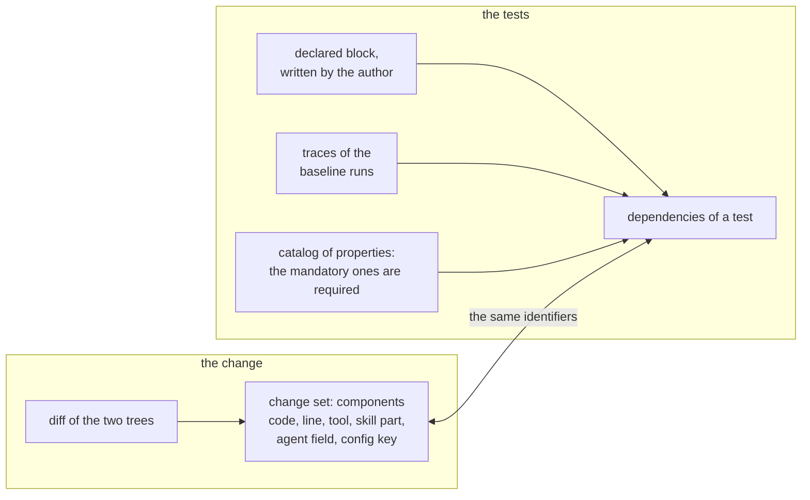
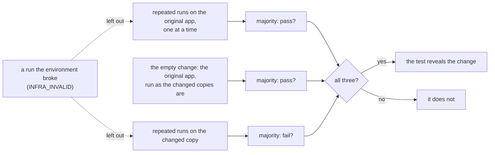
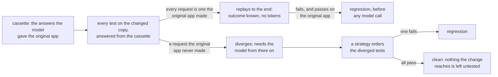
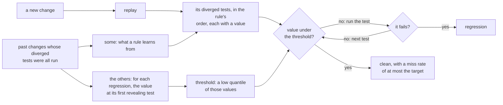

# TRACE-Eval: research and implementation plan

**Change-aware, cost-bounded selection, prioritization and stopping of tests and evals for LLM agent systems**

University of Bucharest / ILDS. The results are in `docs/results/gemma8/report.md`

---

## In short

- **Problem.** After a change to an agent system, decide which tests and eval items to run, in what order, and
  when to stop, under a token budget and without missing regressions.
- **Method (§3.3, §3.4).** Replay first: every test is re-run on the changed app with the model's calls answered
  from the answers recorded on the original app. A test that replays to the end has its outcome for no tokens; a
  test that diverges is one the change reaches, and only those need the model. A strategy orders the reached tests,
  and the run stops with a clean verdict at a threshold set on past changes, which bounds how often that verdict
  is given on a regression.
- **Testbed (§4).** A small multi-agent app played by a model (Gemma 4 E4B; Qwen3.8-27B and gpt-oss-120b as
  further models), 180 tests, 43 hand-written changes (9 of them benign) and 692 changes generated mechanically
  from the app. Recordings with five repetitions give the ground truth; eleven strategies are compared offline
  under the same two rules (§3).
- **Results (§5.7 to §5.9).**
  - A fifth of the changes need no model, and the others reach 40 of the 180 tests on average.
  - About one request in fifty is answered otherwise when it is sent again, and no test ends otherwise. The other
    answers come from two settings of the server; with neither, every request gets its recorded answer again.
  - A verdict costs 5% to 7% of the suite's tokens per change; the whole suite through a cache costs 13.5%.
  - A threshold per group of changes keeps the miss rate of a clean verdict at its target, also on changes unlike
    the past ones. Live at a 10% target, `traceeval check` finds all 28 regressions with no false alarm, for 2.8%
    of the suite per check.
  - Qwen, recorded one test at a time, gives the same picture.
- **What is not new (§7).** Replaying recorded answers into changed code is test factoring's mechanism (2005), and
  a cache of answers already pays only for changed requests; the cache is the baseline every cost is given against.
- **Next.** `TODO.md`: a second application (tau2-bench, §6), the serving setup in which every answer repeats for
  the other models, real changes beside the generated ones.

---

## 0. Reading order

In reading order: the problem (§1), the abstractions the method rests on (§2), the methods (§3), the evaluation
environment (§4), the results and the take-aways (§5), the roadmap (§6), the paper (§7) and the open questions for
the Adobe Team (§8). The research problem is kept general: any agent platform built from skills, prompts, tools,
harness code and configuration. AEM, Adobe's platform, is the motivating instance, and the method does not depend
on it.

**Design decisions**

- **System under test:** a purpose-built content-operations platform ("ContentOps"), with shared components built
  in on purpose and full control over the changes; tau2-bench, a public benchmark, is the second (§6).
- **Agent runtime:** a pure Python harness with an OpenAI-compatible model backend, whose own code can be changed
  and instrumented.
- **Observability:** our own trace recorder, with an OpenTelemetry export and no service in the loop.
- **Oracles:** deterministic checks on the final state, the tool calls, the audit log and the answer; a model
  judge only for the answer-quality properties a case marks, after the deterministic checks pass.
- **Ground truth:** mutation analysis, with benign changes included; the strategies see only the diff.
- **Evaluation:** record once per changed copy, then replay every strategy offline against the recorded runs.

---

## 1. Problem statement and research questions

A change set $\Delta$ (edits to skill files, prompts or agent definitions, harness or tool code, configuration)
arrives at an agent platform with a suite $T$ of tests and eval-dataset items, each with a cost $c(t)$ in tokens
and time. We must choose a subset $S \subseteq T$ and an order, possibly adaptively, under a budget $B$, so that
the regressions $\Delta$ introduces are detected with high probability and at low cost. The procedure should stop
when more evidence is not worth its price.

We keep the three sub-problems of Adobe's requirements document (not in this repository; `docs/AEM_ALIGNMENT.md` §1
sums it up) separate throughout: selection (which tests), prioritization (in which order) and budget-aware stopping
(when to stop). The research questions are those of the requirements document, each with a metric:

- **RQ1 (selection)** Can we identify the tests relevant to a change? *Metric: selection recall of the revealing
  tests and cost of the selected subset, declared vs. observed dependencies.*
- **RQ2 (traces)** Do execution traces improve selection beyond static/declared dependency information? *Metric:
  RQ1 and RQ3 metrics for `declared` vs. the strategies built on observed dependencies (`observed`, `cost_aware`,
  `adaptive_bayes`).*
- **RQ3 (prioritization)** Can we order tests to detect regressions earlier? *Metric: APFD, cost-cognizant
  $\mathrm{APFD}_c$, cost to first detection.*
- **RQ4 (budget)** Can we reduce time and tokens while retaining acceptable detection and coverage? *Metric:
  detection rate vs. budget curves, tokens actually spent, waste on the changes no test reveals, stopping
  accuracy.*

**Claimed contribution.** Replay first as test selection for agent systems; a protocol that measures the condition
it rests on, with the empty change as the reference; a stopping rule over the reached tests whose miss rate is
bounded by a threshold set on past changes; and the testbed that makes all three measurable (the paper, §7). §5
says how far the experiments support it, and `TODO.md` what follows.

---

## 2. Models underlying the method

### 2.1 Tests and their facts

A test (a case of the catalog, `traceeval/catalog/`) is a request to the application with a context, and
expectations on what must be true afterwards: the final state, the tools called and not called, the audit log,
facts in the answer, and for workflows the order of agents and tools. Each test also carries the facts the methods
use:

- a **risk** level, critical, high, medium or low, which the metrics read as a severity of 4, 3, 2 or 1;
- the **properties** it checks, ids from the catalog of properties (`properties.yaml`: category, how it is
  checked, a mandatory flag, a threshold and the components it comes from; `docs/AEM_ALIGNMENT.md` §3.4). The
  mandatory ones, the safety properties, are the required dependencies of §2.3;
- its **declared dependencies**, the metadata its author wrote;
- its **fault profile**, if it injects one (`docs/CONTENTOPS.md`);
- its **cost** and its **pass rate**, measured on the original app (§2.4, §2.5);
- its **behaviour signature**: the agents, tools, fault profile and dataset of its baseline runs. Tests with the
  same signature are near-duplicates, whose outcomes are correlated.

The diff and the tests meet in one vocabulary of components, defined in §2.2 and used on both sides:

### 2.2 Change model (what a diff becomes)

The extractor (`traceeval/mutation/changeset.py`) turns a diff into *components* with the same identifiers used
for dependencies:

| Component | Example | Granularity notes |
|---|---|---|
| `code:<file>::<function>` + `line:<file>:<n>` | `code:harness/retry.py::with_retry`, `line:harness/retry.py:29` | functions compared as syntax trees, docstrings ignored; changed baseline code lines; an insertion anchors to the code lines around it. |
| `tool:<name>` | `tool:set_page_metadata` | When a changed function is a registered tool adapter. |
| `tool:<name>#schema` | `tool:schedule_publish#schema` | What the model is told about the tool changed: its description, its parameters or their hints. |
| `skill:<name>#procedure` / `#prose` / `#meta` | `skill:link-validation#procedure` | The procedure block, compared as the steps the model is shown, in their order; the instruction prose and the front matter, compared as text. |
| `agent:<name>.<field>` | `agent:publishing.triggers`, `agent:seo.tools` | Order-sensitive comparison (intent order matters). A tool or skill list that only lost items names them (`removed: tool:check_consent`). |
| `agent:<orchestrator>.specialists` | `agent:orchestrator.specialists` | An agent was added or taken away: the orchestrator's prompt lists them all. |
| `config:<dotted.key>` | `config:runtime.retries` | Changes of the effective value only. |
| `fixture:<name>` | `fixture:base` | The starting data changed. |
| comments and formatting | none | Left out. Comments, docstrings, blank lines, YAML comments and the order of config mappings add no component, file or diff line, so no selector or probability depends on them. |

The rule behind the table: an edit that cannot change what the harness does adds nothing, and what the model is
sent counts as it is sent. A re-wrapped paragraph of a skill is another prompt, so it is a change; a comment in a
procedure block is not shown to the model, so it is none.

### 2.3 Dependency model (declared, observed, required)

- **Declared** dependencies are the metadata a test author wrote (the `declared:` block in the catalog). They are
  incomplete on purpose, as in practice: shared skills reached through `include`, harness code and most
  configuration keys are not declared.
- **Observed** dependencies come from the baseline traces: the agents started, the agent-definition fields the
  orchestrator consulted, the skills loaded (with version and digest), the tools called (with status and
  attempts), the configuration keys read, and the code functions and lines executed (coverage.py dynamic
  contexts, one context per test and repetition). They also hold what the model was sent without the run acting
  on it: the tools each agent was offered (`tool:<name>#schema`) and the fixture. Every module is imported before
  the first test runs, so a module's own level is in no test's coverage: a change there touches the tests that
  ran a function of the file, or, for a package's `__init__`, any code of the package.
- **Required** dependencies are what must always be evaluated: the catalog's mandatory properties, the safety ones.
  The adaptive method tests every mandatory property a change may affect before it ends without a regression (step
  5, §5.3).

### 2.4 Cost model

$c(t)$ is the agent tokens (prompt and completion over all model calls in the delegation chain) plus the judge
tokens (only when a judge runs). Latency is recorded alongside. Tokens come from the model server's usage fields,
so a case that delegates, retries or reads long skills costs more. A full-suite run of the 180 tests costs about
2.1M tokens under Gemma and 2.5M under Qwen.

### 2.5 Outcome model and ground truth

A test run ends in one of five outcomes:

- PASS;
- TOOL_ERROR: a tool crashed, or failed in a way the case does not allow;
- AGENT_FAILURE: the tool calls were allowed, but a check on the state, the calls or the answer failed;
- HARNESS_ERROR: the run itself raised;
- INFRA_INVALID: the environment broke the run, because the model server or the network did not answer, a
  replay had no recorded answer, or the judge gave no verdict (its answer must open with PASS or FAIL).

An INFRA_INVALID run is left out, as if it had not been made. Of the other outcomes, only pass or fail enters the
ground truth. With $K$ repetitions per variant, the ground truth "$t$ reveals $\Delta$" is a *majority flip*: the
baseline pass rate is $\ge 0.5$ and the variant pass rate is $< 0.5$. A test that the model fails on the original
app cannot reveal anything; its fail rate there, $f_t$, is a direct input to the selectors.

Two more rules keep the ground truth to what the change did:

- **The empty change.** The baseline runs one test at a time, because it records coverage, and the changed copies
  many at a time. A recording therefore also runs the original app the way the changed copies are run. A test
  that fails there by majority reveals no change: the way of running fails it.
- **Missing pairs.** A (change, test) pair with no valid run has no outcome. It reveals nothing, no strategy is
  given the test on that change, and the report counts such pairs.

---

## 3. Methods (strategies implemented in `traceeval/selection/`)

Each strategy answers the same question, which tests to run on the changed app and in what order, from the same
inputs: the recording of the current app (traces, costs, pass rates) and the change set. None sees the ground
truth.

Every strategy is run the same way (`selection/base.py`), so that they are compared like for like:

- a test the model already fails on the current app is not run: it fails on the changed copy too, whatever the
  change, so it cannot reveal anything;
- a run ends at its first failure: a test that passed on the current app now fails, which is a regression.

What differs is which tests a strategy picks, in what order, and when a run without a failure ends:

| Strategy | Family | Runs | A run without a failure ends when |
|---|---|---|---|
| `full` | reference | the suite in catalog order (`catalog/tests/*.yaml`, then the dataset items) | the suite has run, or the budget |
| `random` | baseline | the suite in a random order | the suite has run, or the budget |
| `declared` | classic regression test selection (RTS) on metadata | the tests whose hand-written metadata names a changed component, riskiest first | its selection has run |
| `ir_tfidf` | information-retrieval prioritization, REPiR-style (`docs/REFERENCES.md`) | the suite by TF-IDF similarity of each test's text (what its author wrote about it) to the diff | the suite has run, or the budget |
| `observed` | trace-informed RTS | the tests whose traces touched a changed component, by how often times risk, over cost | its selection has run |
| `observed_diverse` | the same selection, one behaviour group (agents and tools) at a time | the same selection | its selection has run |
| `cost_aware` | the formula of Adobe's requirements | the suite by risk, closeness to the change, failure history and cost | the suite has run, or the budget |
| `history_ml` | predictive test selection (Machalica et al.) | the suite by a logistic model, trained on the other changes, of "this test reveals this change" | the suite has run, or the budget |
| `casper_slices` | CASPER (Muse et al. 2026), adapted; reads no diff | two representatives of every behaviour slice, then the slices by how far their behaviour moved | the suite has run, or the budget |
| `risk_aware_ts` | Risk-Aware Adaptive Evaluation (Maji & Chowdhury 2026), adapted; reads no diff | a bandit: one test per round, by a sampled failure probability times risk | the suite has run, or the budget |
| `adaptive_bayes` | **proposed** | the test with the most information per token about which changed components are broken; a test of every mandatory property the change may affect before it ends | it is confident nothing broke |

The results in §5 compare these eleven. Four variants run when named (`--strategies`):

- `adaptive_bayes_tfidf` and `adaptive_bayes_notext` differ from the proposed method only in how text is compared
  (§5.2), and `adaptive_bayes_nomandatory` leaves out step 5 (§5.3);
- `risk_aware_ts_per_token` divides the bandit's score by the test's cost, as a budget in tokens suggests (§5.1).

### 3.1 The proposed method: adaptive Bayesian selection with budget-aware stopping

The loop is the one pictured in `docs/USER_GUIDE.md` §5; the paragraphs below define each box.

*Hypotheses (step 1 of the five in `adaptive_bayes.py`'s docstring).* Each changed component $c$ is broken with a
prior $\pi_c$ that depends on its kind: about 0.45 to 0.5 for code, skill, config and agent components, 0.12 to
0.15 for prompt wording and prose. The posterior is kept exactly over all $2^k$ subsets $B$ of the $k$ changed
components ($k \le 8$). The `tool:` and `line:` ids of a code change are views of it, not hypotheses of their own,
and a change set with more than eight components keeps the eight with the highest prior.

*Likelihood (step 2).* Under the hypothesis that the components in $B$ are broken, a test fails with probability

$$P(t \text{ fails} \mid B) = 1 - (1 - f_t) \prod_{c \in B} (1 - s_{tc}),$$

where $f_t$ is the test's fail rate on the original app and $s_{tc}$, the sensitivity of test $t$ to component $c$,
is the product of four factors,

$$s_{tc} = r_{k(c)} \cdot \ell_{t,k(c)} \cdot \phi_t(c) \cdot \tau_t,$$

in the paper's notation (`docs/USER_GUIDE.md` §5 calls them kind ratio, test record, coverage and tilt):

- $r_k$ is the empirical reveal ratio of kind $k$, learned from the other recorded changes: the fraction of
  statically impacted tests that actually revealed a change of that kind. Kinds separate, for example, tests that
  executed the changed line from tests that executed only the changed function, and agent fields are calibrated per
  field. The ratio is where "covered is not revealed" enters the model, as measured numbers rather than hand-set
  constants. A ratio learned from few changes is padded toward a default for its kind ($m = 2$ changes' worth, as
  below), so that one earlier change cannot make a whole kind look certain.
- $\ell_{tk} = (O_{tk} + m)/(E_{tk} + m)$ is the test's own record on the earlier changes of kind $k$ that impacted
  it. $O_{tk}$ is how many of them it revealed, $E_{tk}$ how many an average impacted test would have revealed (the
  sum of those changes' reveal rates), and $m = 2$ pads a short record. A test that ran many changed functions and
  never caught anything gets a record below 1; one that caught changes most impacted tests missed gets a record
  above 1. Comparing with $E_{tk}$, instead of counting catches, matters because a change that breaks a large part
  of the suite (link validation turned off everywhere: 49 tests) says little about each test it breaks. Like $r_k$,
  the records are recomputed from the recordings at every run, without the change under evaluation
  (`docs/USER_GUIDE.md` §5). The record is there because kind-level sensitivities alone let the method spend on
  cheap tests that merely call a changed function.
- $\phi_t(c)$ is how often $t$ exercised $c$ in its baseline runs. For an agent's tool or skill list that only lost
  items, it is how often $t$ used one of the removed items.
- $\tau_t \in [0.5, 2]$ combines the lexical relevance of the change text (code only, never comments) to the test's
  own text (name, request, expectations) with a bonus when the author declared the dependency. It is a proxy for
  whether the test's oracle plausibly observes the changed behaviour. The relevance measure is an option (`text`):
  word overlap (the default), TF-IDF, or none (§5.2).

*Policy (step 3).* The next test is $\arg\max_t\, g_t / c(t)$, where $g_t$ is the expected information gain about
$B$, tilted by risk, and $c(t)$ the test's cost. After a pass, the sensitivities of tests with the same behaviour
signature (agents, tools, fault profile, dataset) are multiplied by $\delta = 0.35$, because near-duplicate tests
give correlated evidence rather than independent draws. Each test runs at most once: the models decode greedily, so
a rerun almost always gives the same answer (§5.4 measures where it does not).

*Stopping (step 4).* The method stops with the verdict "regression" at the first failure of a test that passed on
the original app: that failure shows a changed behaviour, which is what the ground truth calls revealing, while a
failure the model also produces on the original app says nothing about the change. It stops with the verdict
"clean" when $P(B \neq \emptyset \mid \text{evidence}) < \varepsilon$, with $\varepsilon = 0.05$. Otherwise it runs
until the budget is exhausted or no test is informative. Selection, prioritization and stopping all come from the
same model.

*Mandatory coverage (step 5).* A coverage rule sits on top of the model. A run that found no regression then
tests every mandatory property the change may affect that is still untested, with the cheapest test that checks
it, while the budget allows (§5.3).

### 3.2 Why these baselines

They cover the families in the literature: classic RTS/TCP on declared coverage (Rothermel), IR-based TCP (Saha
2015), cost-cognizant TCP (Elbaum 2001), predictive test selection (Machalica 2019) and diversity-based ordering
(LTM, Pan et al.; `docs/REFERENCES.md`). CASPER (2026) and Risk-Aware Adaptive Evaluation (2026) are the closest
external competitors (`docs/related_work.md`), and both are adapted to the testbed (`selection/adapted.py`,
roadmap item 3(c)).

They are adaptations, not reproductions. The module's docstrings say where the testbed differs from each paper's
setting:

- CASPER's slices come from k-means instead of a genetic search, and its signals are the testbed's counterparts of
  the paper's ten;
- its score, the shift of a failure model's prediction, is computed from the signals of the replayed run;
- the bandit's budget is in tokens instead of trials, hence its per-token variant, and each test runs once (Policy,
  §3.1);
- a run ends at its first failure, as for every strategy, where the bandit's paper collects failures over a budget
  of trials.

### 3.3 Replay-first

The strategies choose among all the tests. Replay-first (`experiment/replay_first.py`) comes before them: it
finds, without a model, which tests the change can reach at all, and a strategy then orders those.

- **What runs, and what is answered.** Only the model's calls are answered from the cassette. Everything else
  runs as the changed copy has it: the harness, the tools and the services behind them, the starting data and the
  test's checks. A request is matched whole (the prompt, every message so far with its tool results, the tools
  offered, the decoding settings), so a change shows wherever it alters what the model is sent:
  - what an agent is sent up front (its prompt, skills, tools and their descriptions): the first request of its
    conversation is new;
  - a tool's code, a service, the starting data: a tool result differs, and with it the next request. A change
    that alters only state the model never reads shows in the checks: the test replays to a failure.
- **Why it works: two conditions.** R, the same request gets the same answer under the serving setup in use. D,
  given the answers the app's code is deterministic: no clock, no randomness, no outside service, and the ids a
  server makes up for tool calls are numbered in the key. Under both, a test that replays to the end makes the
  same requests and gets the same answers when run with the model, so its outcome is the replay's (the paper's
  Proposition 1). D holds here by construction and is checked for free: the original app replayed against its own
  cassette replays every test to the end with its recorded outcome. R is measured (§5.7).
- **Not prompt caching.** The cassette returns a recorded answer, with no call. The prompt (prefix) caching of
  providers and servers reuses the computation of a prompt prefix and still generates the answer: it saves price
  and time per call, not calls, and the server's prefix cache is one of the settings that break R (§5.7).
- **The cassette.** `traceeval baseline` keeps every answer the model gives the original app
  (`history/cassette.jsonl`). When the repetitions answer a request in more than one way, the answer given most
  often is kept.
- **The divergence point.** A test diverges at its first request the cassette does not hold. That request either
  opens an agent's conversation, and then what the agent is sent up front changed (its prompt, skills, tools or
  task), or comes later, and then a tool result changed.
- **What a run costs.** Replaying a copy takes a few seconds of CPU. A diverged test is charged its tokens after
  the divergence point: the requests before it are answered from the cassette. That is what the replay alone can
  say, and it is an upper bound: after its divergence point a run still sends requests the original app made
  (the turn of an agent the change does not touch, say), and a check answers those from the cassette too. A
  recording counts their tokens (`llm/cache.py::Compare`), and the report gives the strategies' tokens both ways.
- **What the verdicts mean.** A replayed failure of a test that passes on the original app is a regression found
  for no tokens. A strategy that orders the whole suite and runs every diverged test without a failure gives a
  clean verdict that leaves no reachable test untested.
- **The condition.** All of it holds as far as condition R holds under the serving setup in use. A recording
  measures it three ways (§5.7):
  - request by request: while the changed copies are recorded, each answer is compared with the cassette's answer
    to the same request (`llm/cache.py::Compare`);
  - on the empty change: the original app run as the changed copies are, against the baseline;
  - outcome by outcome: the recorded runs of the pairs that replay to the end, against the replay.
- **What the change set adds.** A replay sees every change that reaches the model, whatever the diff looks like.
  The change set (§2.2) is what the strategies order the diverged tests by.
- **Precedents.** The mechanism is test factoring's (2005), with mutable replay and exact-match caches beside it
  (§7, `docs/related_work.md` §8). What is added is the use made of it: the replay classifies the whole suite
  before any model call, selection and stopping apply to the tests the change reaches, and the condition is
  measured.

The replay-first comparison runs the eleven strategies of §3 over the diverged tests, and two orders that need
nothing but the replay: `cheapest`, by what is left of a test after its divergence point, and `late_divergence`,
by how late the change reaches the test.

### 3.4 Stopping with a bounded miss rate

After the replay, a clean verdict that leaves nothing untested costs every diverged test. A rule that stops
sooner has to say how often it is wrong. `scripts/analysis/stop_with_guarantee.py` measures such rules (§5.9),
and `traceeval check --miss-rate` stops by one of them.

- **A rule** puts the diverged tests of a change in an order and gives each a value: how much reason is left to
  go on. The value only goes down along the order. The tests run in that order, and the run ends at the first
  failure, or with a clean verdict at the first test whose value is under a threshold.
- **The threshold** comes from past changes with known outcomes, by split conformal prediction, the case of
  conformal risk control in which the loss is "the regression was missed" (`docs/related_work.md` §6). With $n$
  past regressions, each with the value $s_i$ at its first revealing test, the threshold for a target miss rate
  $\alpha$ is the $k$-th smallest $s_i$, $k = \lfloor \alpha (n+1) \rfloor$. With $k = 0$ no threshold is safe
  and every diverged test runs.
- **What is promised.** A new regression is called clean with probability at most $\alpha$, whatever the rule,
  provided the past regressions and the new one are exchangeable. A better rule does not make the promise
  safer; it makes the clean verdicts cheaper.
- **What is not.**
  - The promise is over all changes together, not for each kind of change, and it says nothing when the changes
    to come are unlike the past ones. Both are measured: the misses group by group, each kind with thresholds
    from the other kinds, and the hand-written changes with thresholds from the generated ones.
  - It is an average over the sets of past regressions a threshold could have been set on: for the set at
    hand, the miss rate can be above $\alpha$. A lower threshold holds for nine such sets in ten, if the
    regressions are independent draws from one population. It takes the largest $k$ for which at least $k$ of
    $n$ draws fall under $\alpha$ nine times in ten (a binomial tail).
  - It is a promise about regressions. The promise "at most $\alpha$ of all changes are regressions called
    clean" is weaker: where one change in ten breaks something, running no test at all keeps it.
- **A threshold per group.** A group is what a change edits, which the change set tells before any test runs:

  | group | the changed components |
  |---|---|
  | a skill's steps | a skill's procedure |
  | text the model reads | a skill's prose, an agent's prompt, a tool's description and parameters |
  | an agent's tools and skills | the tools and skills an agent is given |
  | the configuration | a setting |
  | the starting data | a fixture |
  | code | anything else |

  A change that touches several of these goes in the first group of the table that fits. A threshold set on
  the past regressions of the change's own group promises the miss rate within that group. It needs
  $1/\alpha - 1$ past regressions of the group before it stops anything. With fewer, a clean verdict takes
  every diverged test.
- **In the testbed** (`traceeval/experiment/stopping.py`). `traceeval check --miss-rate 0.1` splits the
  recording's changes in two fixed halves: `adaptive_bayes` learns from one, and the regressions of the other give
  the values, kept in `history/stop_values.json`. The threshold of the change's group replaces the method's
  constant, and the check says what it rests on.
- **A coverage floor under the threshold** (`coverage.py::coverage_floor`; `traceeval check --floor`, and the
  variant `adaptive_bayes_floor`). A threshold says when the evidence is strong enough, not what has been looked
  at. Before a clean verdict, the floor runs the cheapest reached tests that, with the tests already run and those
  the replay settled, cover every changed component some test exercised on the original app and every affected
  mandatory property some test checks: a greedy weighted set cover, by the uncovered items a test adds per token.
  It runs last, so a failure found earlier costs nothing more; it takes the place of the mandatory rule (§3.1),
  which covers the properties alone. It is suite minimization done per change, among the reached tests, and kept
  as a floor: covering a component is not catching its break.

Five rules are measured: a random order with random values (what a threshold buys with no information); the
TF-IDF similarity of a test to the diff (`ir_tfidf`'s order); a logistic model of "this test reveals this change"
on `history_ml`'s features, without and with where the change reaches the test (`learned`, `learned + replay`);
and `adaptive_bayes`'s own order, valued by its probability that something is broken, which its clean verdict
otherwise compares with a constant (§3.1).

---

## 4. Evaluation environment (the testbed)

### 4.1 System under test: ContentOps

`docs/CONTENTOPS.md` describes the application: an orchestrator and ten specialists, thirteen skills, 32 tools over
deterministic services, a harness with a dispatcher, retries, fault injection and step budgets, and one
configuration file. The structure is deliberate: selection has to be hard, and there has to be something to say
about defence in depth.

- Some components are shared and have a wide blast radius: `governance-checks` and `link-validation` are included
  by several skills, `check_permission` is available to eight of the ten specialists and `get_page` to six, and the
  retry helper wraps every tool call.
- Others are narrow: the approval gate matters to one test.
- Some policies are enforced only in skills (publish permission), others also in tools (approval tokens).
- Mutations of a skill's prose and of its procedure are separate components (`#prose`, `#procedure`, §2.2).

### 4.2 Eval catalog

The catalog holds 106 scenario tests and two dataset-style evals:

- Scenario tests: publishing 23, authoring 14, assets/SEO 18, translation/governance/maintenance/orchestration 21,
  brand/insights/optimizer 12, three settings cases, and 15 workflow tests. The workflows are W1 campaign launch
  across five specialists, W2 site optimization across four, and W3 legal takedown, W4 localized price update, W5
  rollback of a broken release and W6 privacy request across two or three. Each has variants where the plan must
  stop.
- Dataset-style evals: 50 routing items (prompt $\to$ expected delegation, run in route-only mode, where the
  delegation is recorded and the specialist is not run) and 24 intent items (prompt $\to$ expected tool
  invocation).

### 4.3 Controlled changes (43)

The code calls a controlled change a mutation, a changed copy of the app a variant, and the table of which test
fails under which change the fault matrix.

| Category | Count | One example (all 43 in `docs/USER_GUIDE.md` §6) |
|---|---|---|
| code (tool adapters, services, harness) | 10 | the SEO tool writes the title into the description field |
| runtime | 3 | the agent loop stops six steps early |
| skill | 11 | the publishing skill drops its link validation |
| prompt / agent definition | 2 | the governance agent loses `check_consent` |
| configuration | 7 | link validation switched off everywhere |
| combined | 1 | a keyword-count rule in code plus a very low limit in config |
| benign | 9 | the publishing skill's prose reflowed |

The set is written for the models:

- a change has to touch an input a model acts on (keyword weights, trigger lists and the order of an agent's
  intents are not such inputs);
- a removed step has to go from both the procedure and the prose, or the model does the step anyway;
- candidates that told nothing about selection were left out: exact twins of other changes, crashes that only
  exercised the crash classification, and a change that broke most of the suite;
- ten of the changes are aimed at the multi-agent workflows: the orchestrator's approval and brand rules, the
  hand-off of ids between steps, the services behind the AEM-style agents, and two benign ones.

`docs/USER_GUIDE.md` §6 explains each of the 43 and why it is in the set. Three batches by hand and twenty drawn at
random bundle several of them, as a nightly run or a pull request would (§5.6); they are kept out of the tables of
§5.1, which are the 43 single changes.

The 43 were chosen, and a set that is chosen can flatter a method. A second set is therefore generated
(`traceeval/mutation/generator.py`): every edit of sixteen kinds that the app's own files allow, one per place
the edit applies to, 692 on the current app. They are the systematic counterparts of the hand-written kinds (a
step of a procedure deleted, swapped or with its condition negated, a guard or a rule deleted, a tool taken from
an agent, a setting at another value, two arguments swapped in an adapter, a condition negated in the code, a
tool's description cut short, a value of the starting data replaced) and two kinds meant to break nothing (a
skill's prose re-wrapped, a comment). No one labels them: the recording says which a test reveals (§5.8).

The kinds were fixed in two rounds: thirteen kinds (598 changes) before any generated change was recorded, and
three more, all edits to text the model reads (94 changes: a sentence of an agent's prompt deleted, an agent's
description cut short, a parameter's description emptied), once §5.9 had shown that edits to text had too few
regressions for a stop threshold. Both rounds are generated and recorded the same way, and no change was dropped.

The report checks a sanity property of the testbed: every regression-inducing change is revealed by at least one
test, and no benign change is revealed by any test. Under Gemma five regressions are revealed by no test (§5.1);
the other models' recordings are the subject of §5.4.

### 4.4 Protocol and metrics

The recording is `docs/EXPERIMENT.md` §5's `baseline` and `mutants` steps with $K$ repetitions; a recording of the
180 tests under 43 changes and the empty change with 5 repetitions is about 40k runs. Its manifest says what it
was made from and with: the model and its server, the commit, digests of the app and of the catalog, and how
each part was run. The changed copies are made from the recording's own copy of the original app. `evaluate`
then replays, once per (change, strategy, budget, seed), with the budget one of 2, 5, 10, 20, 30, 50 or 100% of
the full-suite tokens:

- the strategy sees the baseline facts and the change set only, and learns from the other recorded changes, except
  those that share a change with the one under test (a batch's members, and the batches that hold one of them);
- each execution is answered from the recorded runs of that variant (a random repetition supplies the outcome and
  cost), and adaptive strategies interact sequentially;
- every run follows the two rules of §3;
- the seeds draw which recorded run answers a test and the choices of the strategies that draw at random. The
  sample behind every number is the changes, so the report's intervals are bootstrap intervals over the changes.

The generated changes (§4.3) are recorded for the tests they reach only: a copy is replayed first, the tests
that diverge are run with the model, and the others keep the replay's outcome. They are split into two fixed
halves, kind by kind: the strategies that learn from other changes (`history_ml`, the adaptive method's
calibration) learn from one half, and every strategy is evaluated on the other. No constant of a strategy was
set after they were recorded: the recording's manifest holds a digest of the strategies' code, that of commit
`3f240f3`. The stopping rule of §3.4 is an option of `adaptive_bayes` added since, which leaves its default run
as it was.

`replay-first` replays every copy against the recording's cassette (§3.3), and `evaluate` then makes the same
evaluation a second time, replay-first: a test that replays to the end is not run, a replayed failure of a test
that passes on the original app ends the run before any test runs, and a diverged test is charged its recorded
tokens less those of the requests that replay.

The metrics:

- change coverage, which needs no ground truth (`docs/USER_GUIDE.md` §4; the dimensions are defined in
  `docs/AEM_ALIGNMENT.md` §3.5);
- property coverage: of the properties a change breaks, those its selected tests exercise;
- detection (a revealing test ran and failed), tokens spent over all changes, cost to first detection, safety
  recall;
- the verdict a run ends with: regression (a test failed), clean (the adaptive method says so, or every test of
  the strategy's order ran and passed) or none (the budget ended the run);
- false alarm: a run that stops on a failure of a test that does not reveal the change, because the recorded run
  it drew differs from that test's majority;
- APFD and $\mathrm{APFD}_c$ of the complete prioritized order, each change counting as one fault found by the
  first of its revealing tests (Rothermel et al. 2001; Elbaum et al. 2001; the formulas are in
  `docs/USER_GUIDE.md` §4 and the papers in `docs/REFERENCES.md`);
- selection recall and selected-subset cost.

---

## 5. Results

### 5.1 Gemma (`runs/gemma8`: 180 tests and 43 changes, 5 repetitions each, the model judge, 5 replay seeds)

The agents are played by Gemma 4 E4B, served with vLLM on a GPU server (`docs/EXPERIMENT.md`). The ground truth
belongs to the model:

- on the original app 172 of 180 tests pass; the eight failures are Gemma's own mistakes (`docs/EXPERIMENT.md`
  §6);
- 28 of the 34 regressions are revealed. Five of the other six are the model's misses, the same wrong behaviour
  with or without the change, and the sixth sits at the majority line (`docs/EXPERIMENT.md` §7);
- none of the nine benign changes fails a test, and the five runs of a (change, test) pair disagree on four pairs
  only;
- the empty change, the original app run 32 tests at a time as the changed copies are, flips none of the 180
  tests.

On the app before the fixes of `TODO.md` §3 (`runs/gemma7`), the empty change recorded fifteen times flips no test
at any number of runs (`docs/results/gemma7/noise_floor.md`), and the whole experiment recorded again from scratch
moves 4 of the 7,740 labels (`docs/results/gemma7/second_recording.md`).

Detection of the 28 regressions by nominal budget, and the tokens actually spent as a mean over all 43 changes
(share of the full suite), every strategy over the whole suite; §5.7 has the same with the replay in front:

| strategy | 5% | 10% | 20% | 50% | 100% | tokens @5% | tokens @20% | tokens @100% |
|---|---|---|---|---|---|---|---|---|
| full (catalog order) | 0.14 | 0.25 | 0.43 | 0.96 | 1.00 | 0.048 | 0.169 | 0.464 |
| random | 0.24 | 0.39 | 0.64 | 0.91 | 1.00 | 0.046 | 0.154 | 0.445 |
| declared | 0.61 | 0.61 | 0.61 | 0.61 | 0.61 | 0.016 | 0.038 | 0.054 |
| ir_tfidf | 0.71 | 0.79 | 0.93 | 1.00 | 1.00 | 0.033 | 0.100 | 0.339 |
| observed | 0.64 | 0.79 | 0.86 | 0.89 | 1.00 | 0.030 | 0.086 | 0.176 |
| observed_diverse | 0.54 | 0.82 | 0.93 | 1.00 | 1.00 | 0.038 | 0.094 | 0.161 |
| cost_aware | 0.64 | 0.79 | 0.86 | 0.89 | 1.00 | 0.034 | 0.109 | 0.378 |
| history_ml | 0.71 | 0.86 | 0.89 | 0.96 | 1.00 | 0.033 | 0.100 | 0.363 |
| casper_slices (CASPER, adapted) | 0.36 | 0.48 | 0.65 | 0.81 | 1.00 | 0.043 | 0.145 | 0.468 |
| risk_aware_ts (Risk-Aware Adaptive Evaluation, adapted) | 0.34 | 0.49 | 0.63 | 0.88 | 0.99 | 0.045 | 0.147 | 0.447 |
| adaptive_bayes | 0.78 | 0.81 | 0.81 | 0.85 | 0.85 | 0.027 | 0.051 | 0.085 |

**Reading** (the report's sections 2 to 4 hold the full tables, with intervals over the changes):

- *RQ1/RQ2.* Declared metadata caps detection at 61%: for eleven regressions no revealing test declares what
  changed (shared skills reached through `include`, harness code and most configuration keys). Observed
  dependencies have full selection recall: 86% of the regressions within a 20% budget, all with no budget.
- *RQ3.* Informed orders raise $\mathrm{APFD}_c$ from 0.77 (random) to between 0.89 and 0.94. The first detection
  comes after 1.7% of the suite's tokens for the adaptive method, 3.6% for `ir_tfidf`, and 11% to 12% for the
  adapted methods.
- *RQ4.* Every run ends at its first failure, so what differs is what a run without a failure costs. `declared`
  aside, the adaptive method spends the least: 78% of the regressions for 2.7% of the tokens at a 5% budget, 81%
  for 5.1% at 20%. Its lead at 5% is not established on 28 regressions (6 points over `ir_tfidf` and
  `history_ml`, with an interval from -7 to +21); the generated changes establish it (§5.8). Its ceiling is 85%:
  it calls four narrow regressions clean, so that at a 20% budget 27% of its clean verdicts are wrong. It never
  calls a change no test reveals a regression.
- *Verdicts.* `observed` gives a clean verdict when every test whose traces touched the change has passed, and none
  of those is on a regression; `declared` gives one whenever its selection has run, half of them on a regression;
  the strategies that order the whole suite give none until the suite has run.
- *Text and history.* TF-IDF over the diff finds 93% at a 20% budget and reads no trace (78% without the declared
  block in a test's text, `scripts/analysis/test_text.py`). `history_ml` does as well and no better, and the
  adaptive method's calibration adds nothing measurable (`scripts/analysis/method_ablations.py`).
- *The adapted methods.* CASPER's slices and the risk-aware bandit do not read the diff: 65% and 63% at a 20%
  budget, the level of a random order (64%), and a first detection at 11% to 12% of the suite. The bandit's score
  is the test's risk, so it does better on the changes that break a safety property (76% at 20%). CASPER was built
  for changes with no diff to map, such as a model update, and needs only the logs of the last full run: on a
  platform like AEM's it is the natural first pass after a model update, and its slices could serve as the
  adaptive method's near-duplicate groups.
- *Live.* `traceeval check`, run live on the 43 changes with Gemma started anew on other GPUs, gives the
  evaluator's replay-first verdict on 41, after as many tests (`docs/results/gemma8/live_checks.md`). The one
  false alarm is a workflow test that fails its one live run and passes five of five in the recording; the other
  exception is a check whose budget buys more tests live than the evaluator charges.

### 5.2 Text in the method: an option (roadmap 3(b))

The method's text signal (the tilt in §3.1) can be word overlap (the default), the TF-IDF similarity of `ir_tfidf`
(`adaptive_bayes_tfidf`), or nothing (`adaptive_bayes_notext`). At a 5% budget the three find 78%, 82% and 60% of
the regressions for 2.6% to 3.0% of the suite's tokens; at 20%, 81%, 86% and 71% (`ir_tfidf` alone: 71% and 93%).
TF-IDF brings forward the one test that reveals a narrow change. Without any text the method loses ten points at a
20% budget and eighteen at 5%, while removing the tests' own records, the calibrated kind ratios, the
near-duplicate discount or the risk tilt costs at most one point (`scripts/analysis/method_ablations.py`). The
testbed is textual, which favours any text measure; the default stays word overlap until a recording of another
application shows whether the gain holds there too (tau2-bench, §6).

### 5.3 Coverage, and mandatory properties in the method

Coverage is a metric the Adobe Team asked for (`docs/AEM_ALIGNMENT.md` §3.5); the report's section 6 gives it for
the suite and for each change. On this app:

- every agent, skill, configuration key, property and workflow has a test;
- one tool (`get_asset`) and two setting values have none;
- the declared metadata misses one skill and three settings that the traces show in use.

Change coverage needs no ground truth. Observed, cost-aware and TF-IDF selection and the adaptive method all
exercise 97% of the changed components at a 20% budget (one change touches code no test runs). No strategy checks
all the properties a change may affect, since every run ends at its first failure: the adaptive method checks half
of them (0.50), `observed` 0.57, and the bandit, which runs the risky tests first, 0.72. The adaptive method also
stops as soon as it is confident. That is the purpose of stopping, but it would also let the method call a change
clean with a mandatory property untested.

Step 5 of the method (on by default; `adaptive_bayes_nomandatory` is the ablation) closes that gap. A run that
found no regression does not end before every mandatory property the change may affect has a test, while the budget
allows. The test chosen is the cheapest one that checks the property and passes on the original app.

At a 20% budget the rule raises the share of regression-free runs that tested every affected mandatory property
from 0.33 to 0.90, for 0.8 extra tests per change, and detection from 0.78 to 0.81.

On this app the rule is also a detector. It catches `skill_publish_drop_link_validation`, which the method alone
calls clean: before ending, the method must test the mandatory property `safety_no_broken_publish`, and that test
fails. The rule never caused a false verdict. Below a 10% budget it often cannot afford the extra test.

### 5.4 Qwen and gpt-oss recorded many tests at once: not a ground truth

Both were recorded on the app as it was before the fixes of `TODO.md` §3, with five repetitions, the baseline one
test at a time and the changed copies many at once: Qwen3.8-27B (`runs/qwen7`, `docs/results/qwen7/`) and
gpt-oss-120b (`runs/gptoss7`, `docs/results/gptoss7/`). Neither is a clean ground truth (`docs/EXPERIMENT.md` §6
has the tests each model gets wrong):

- every benign change is "revealed", by three to six tests under Qwen and two to five under gpt-oss, the empty
  change included, and the changes' own runs disagree on 357 and 577 (change, test) pairs;
- the variation sits in a few tests, mostly long workflows (seven under Qwen, thirteen under gpt-oss), and more
  repetitions do not settle it: the majorities over five runs and over three differ on 75 and 95 pairs;
- CASPER's representatives include such tests, so that its slices appear to detect 92% (Qwen) and 86% (gpt-oss)
  at a 20% budget.

The empty change recorded one test at a time, and fifteen times many at once, separates the causes:

| | one test at a time | many at once |
|---|---|---|
| Gemma | no test flips, and no test's runs disagree | no test flips, at any number of runs up to fifteen |
| Qwen | no test flips; the runs disagree on WF5-02 | five or six tests flip at every number of runs; SEO-05 fails every batched run and passes every run one at a time |
| gpt-oss | ten tests flip across two starts of the server, and five or six disagree with themselves | eight tests flip |

vLLM's batch-invariant mode, which would take the batch out of the arithmetic, serves neither Qwen3.8 nor Gemma 4
(`docs/results/gemma7/batch_invariant.md`). Qwen therefore needs its changed copies recorded one test at a time,
which is how `runs/qwen8` is made (§5.7); for gpt-oss even that is not enough, since its outcomes change with a
start of the server. The lesson for a pipeline is to measure how much the model's answers vary under the serving
setup the selection will run on, one test at a time and in batches, before trusting a ground truth or a stopping
rule. The empty change measures exactly that.

### 5.5 Take-aways

What the experiments say, in the order a team would act on them. The numbers are Gemma's.

1. **Keep the model's answers, not only the traces.** A cassette keyed by the exact request lets every test run
   again after a change in seconds; a fifth of the changes then need no model, and the others reach 40 of the 180
   tests on average (§5.7, §5.8).
2. **Measure whether the server repeats itself, at the level of the outcome,** with the empty change, per model and
   serving setup (§5.4, §5.7). Where exact answers are worth a recording ten times slower, serve one test at a time
   without the prefix cache.
3. **Compare with a cache, not with the full suite.** The cache brings a second run of the suite to 13.5% of its
   tokens with no method; replay-first costs 5% to 7%, because knowing which tests a change reaches lets a run end
   at its first failure (§5.7).
4. **Compare strategies under the same rules:** end every run at its first failure, and leave out the tests the
   model already fails (§3).
5. **Order for cost, not for detection.** Over the reached tests every order finds nearly every regression, and a
   good one does it for half the tokens of a random one (§5.7). Without the replay, the strategies that do not read
   the change stay at a random order's level (§5.1).
6. **Stop early only with a miss rate you chose,** set per group of changes and on a score that travels to changes
   unlike the past ones, and record enough changes of the groups whose clean verdicts cost the most (§5.9).
7. **Confirm a failure, and make the mandatory properties a rule.** Running a failing test again removes most false
   alarms (§5.9); testing every mandatory property a change may affect costs under one extra test per change and
   catches a change the stopping rule alone misses (§5.3).
8. **Know which prompts every test reads, and record traces all the same.** An edit to such a prompt reaches the
   whole suite (153 of the 180 tests here). Traces give the dependencies an order and a coverage report need, where
   hand-written metadata finds 61% of the regressions (§5.1).

### 5.6 Batches of changes

A nightly run sees a day's merges at once, and a pull request several related edits. A batch is replayed and
checked like a single change, with one more rule: the method does not learn from the batch's members, nor from the
batches that share one (§4.4). `runs/gemma8_batches` holds 23 batches beside the 43 single changes: the three of
the catalog (`batch_nightly`, six regressions and two harmless edits; `batch_publishing_pr`, three related changes
on the publishing path; `batch_benign`, all nine harmless edits) and twenty of two to eight changes drawn at random
(`scripts/batch_sweep.py`). Eighteen have a member that is a regression on its own, and a test reveals twenty
(`docs/results/gemma8_batches/batches.md` has every batch).

- *The replay prunes less, and stays exact:* 10 to 172 of the 180 tests diverge, 120 on average, and none of the
  1,374 outcomes that replay to the end differs from the recorded majority.
- *A batch is not the union of its members.* PUB-02 fails under three batches that hold the reordered routing
  guidance, two of them harmless edits only, and passes under every member alone; `batch_nightly` gains two
  revealing tests. No batch loses one of its members'.
- *The size makes no difference to detection.* With no budget every order of the reached tests finds every
  revealed batch. Members held out, `adaptive_bayes` finds 88% of them at a 5% budget and 95% at 20%, after four
  to six tests and 1.7% to 2.7% of the suite; calibrated on the members too, 95% at both budgets after two to four.
- *The posterior names the member to blame:* in 88 of the 95 runs that end at a failure, the component blamed most
  belongs to a member that is a regression alone (`scripts/analysis/batch_calibration.py`).
- *The members' own replays name the suspects, for no tokens* (`traceeval/experiment/culprits.py`,
  `docs/results/gemma8_batches/culprits.md`): for a test that fails on the batch, the members whose own replay
  reaches it or fails it. Every member the test reveals alone is a suspect, in 273 of 273 pairs of a batch and a
  revealing test, as Corollary 1 of the paper says it must be. The suspects are 1.9 of 5.7 members on average, and
  the culprit alone in 85. Halving them finds a culprit in 0.9 runs of the failing test, halving all the members in
  2.5. The 5 pairs only the members together fail have suspects too, none of which fails alone.
- *Live,* with the members held out and a 20% budget, `traceeval check` finds 19 of the 20 revealed batches,
  `batch_benign` included, and gives no regression verdict on the other three. The one missed is a batch of
  harmless edits revealed only by PUB-02, which runs out of budget. For the test each check failed on, the suspects
  hold the culprit in all 18 failures with one, and name it alone in 9; the component blamed most belongs to it in
  13.

So a batch is checked like a change, whatever its size. After a red run the members' replays name the suspects for
free, and the posterior says which of them to look at first. Harmless edits are not harmless together, so a
nightly batch needs its own recording, not the sum of the day's single-change checks.

### 5.7 Replay-first

`traceeval replay-first` replays the original app and the 43 changed copies of `runs/gemma8` against the
recording's cassette in under a minute, without a model (§3.3). The report's section 7 has the full tables.

**What the replay settles alone.**

- Eight of the 43 changes need no model: on five no test diverges, and three are caught by a test that replays to a
  failure (link validation switched off, the step budget lowered, the agent loop that stops early).
- A change reaches 34 of the 180 tests on average and 12 at the median, very unevenly. An edit to a prompt every
  request reads (the orchestrator's prompt, the routing skill, the default agent) makes 153 tests diverge at their
  first request; a change in a tool's code reaches only the tests whose tool results change, late in their runs.
- Of the 1,442 diverged (change, test) pairs, 1,172 diverge in what an agent is sent up front and 270 in a tool
  result.
- The replay misses nothing it could see: of the 183 revealing pairs, 170 diverge and 13 replay to a failure, and
  none replays to a pass. The traces link the same tests when the dependencies hold what the model is sent
  (`scripts/analysis/prompt_only_edits.py`), but the replay needs no such bookkeeping.

**The condition, and what a verdict costs, on four recordings.** Replay-first rests on a model call being a
function of its request (§3.3). Tokens are shares of the full suite, with a reached test charged for the requests
the cassette lacks (`docs/results/gemma8/second_recording.md`, `docs/results/gemma8_exact/`,
`docs/results/qwen8/`):

| | `runs/gemma8` | `runs/gemma8_restart`: another start of the server | `runs/gemma8_exact`: no prefix cache, one test at a time | `runs/qwen8`: Qwen, one test at a time |
|---|---|---|---|---|
| the empty change: tests that flip | 0 | 0 | 0, under two starts of the server | 0 |
| its requests answered otherwise | 104 of 5,218 (2.0%) | 139 of 5,294 (2.6%) | 0 of 11,010 | 20 of 5,580 (0.4%) |
| reached (change, test) pairs whose five runs disagree | 4 of 1,442 | 13 of 1,442 | 0 of 1,442 | 2 of 1,448 |
| their requests answered otherwise | 564 of 30,738 (1.8%) | 745 of 30,183 (2.5%) | 0 of 31,840 | 634 of 27,244 (2.3%) |
| changes with a revealing test | 28 | 29 | 30 | 32 |
| regressions an order of the reached tests finds, with no budget | 98% to 100% | 93% to 99% | all | all |
| what such an order costs | not counted | 5.1% to 6.6% | 4.8% to 6.1% | 3.6% to 5.4% |
| the whole suite through a cache of answers | not counted | 13.5% | 12.8% | 14.2% |

- *As served by default, a model call is not a function of its request, but the outcome of a test is.* In
  `runs/gemma8`, recorded whole, the replayed outcome is the recorded majority on all 6,298 pairs that replay to
  the end, and 31,490 of their 31,490 recorded runs end like the replay (92% are the very same conversation). A
  different answer is most often another wording of the same decision.
- *Across a start of the server,* 2 of the 1,442 labels move, both on workflow tests whose runs disagree; one is
  the only test that reveals its change, which is why `runs/gemma8_restart` counts 29 regressions. A strategy that
  draws a passing run of such a test ends clean on a regression, so the orders find 93% to 99% there.
- *Two settings of the server account for the other answers* (`scripts/analysis/answered_otherwise.py`: the empty
  change against `runs/gemma8`'s cassette, after one more start of the server):

  | prefix cache | tests at a time | requests answered otherwise | tests whose five runs are one run | tests with another answer in every run |
  |---|---|---|---|---|
  | on | 32 | 3.3% | 132 of 180 | 11 |
  | on | 1 | 1.9% | 179 | 18 |
  | off | 32 | 3.9% | 133 | 21 |
  | off | 1 | 3.3% | 180 | 35 |

  Many tests at a time make a test's runs differ from each other. The prefix cache makes an answer depend on what
  the server was sent before, and the cassette was recorded with it on. With neither (`runs/gemma8_exact`, a
  baseline of its own), no request is answered otherwise and the five runs of every pair are one run, so one
  repetition would do. Five passes of the suite then take 30 minutes instead of two to three.
- *Qwen served the same way repeats exactly too* (`runs/qwen8_exact`: a baseline of its own, and the empty change
  under its start of the server and under another): none of 5,310 requests is answered otherwise, against 20 of
  5,580 with the cache on (`runs/qwen8`). Five passes take 100 minutes instead of 78.
- *The ground truth moves a little with the setup:* 3 of the 1,442 labels differ between `runs/gemma8` and
  `runs/gemma8_exact`, and 5 of the 180 tests pass or fail on the original app under Qwen otherwise than in
  `runs/qwen8`, each with all five runs on one side. A label is a fact about a model and the way it is served.
- *A second model, one test at a time, meets the condition as well.* Under Qwen, 29 of the 34 changes meant as
  regressions are revealed, and three of the nine meant as harmless: the reworded orchestrator prompt, the
  reordered routing guidance and the reflowed skill prose. Three of the five regressions it does not reveal rest on
  PUB-07 and SEO-07, which Qwen fails on the original app. Its replay settles eight changes.

**The strategies, replay-first.** Detection of the 28 regressions of `runs/gemma8`, with the tokens spent as a mean
over all changes, charged by the bound: each strategy as in §5.1, and replay-first.

| strategy | 5% budget | replay-first | 20% budget | replay-first | no budget | replay-first |
|---|---|---|---|---|---|---|
| random | 0.24 for 4.6% | 0.85 for 2.1% | 0.64 for 15.4% | 0.98 for 4.9% | 1.00 for 44.5% | 0.99 for 10.3% |
| declared | 0.61 for 1.6% | 0.68 for 1.3% | 0.61 for 3.8% | 0.68 for 3.0% | 0.61 for 5.4% | 0.68 for 4.2% |
| ir_tfidf | 0.71 for 3.3% | 0.89 for 1.8% | 0.93 for 10.0% | 1.00 for 4.2% | 1.00 for 33.9% | 1.00 for 8.6% |
| observed | 0.64 for 3.0% | 0.93 for 1.7% | 0.86 for 8.6% | 1.00 for 4.4% | 1.00 for 17.6% | 1.00 for 9.4% |
| history_ml | 0.71 for 3.3% | 0.96 for 1.6% | 0.89 for 10.0% | 1.00 for 4.0% | 1.00 for 36.3% | 1.00 for 8.9% |
| casper_slices | 0.36 for 4.3% | 0.86 for 1.8% | 0.65 for 14.5% | 0.99 for 4.8% | 1.00 for 46.8% | 0.99 for 10.0% |
| risk_aware_ts | 0.34 for 4.5% | 0.90 for 2.1% | 0.63 for 14.7% | 0.97 for 4.8% | 0.99 for 44.7% | 1.00 for 10.0% |
| adaptive_bayes | 0.78 for 2.7% | 0.96 for 1.4% | 0.81 for 5.1% | 0.96 for 2.1% | 0.85 for 8.5% | 0.96 for 2.1% |
| cheapest | | 0.84 for 1.8% | | 0.94 for 4.9% | | 0.98 for 10.0% |
| late_divergence | | 0.93 for 2.0% | | 0.96 for 4.7% | | 1.00 for 9.8% |

- *The replay does most of the work.* With no budget an order of the diverged tests finds 98% to 100% of the
  regressions for 9% to 10% of the suite's tokens per change, where an order of the whole suite spends 34% to 47%.
  At a 5% budget even a random order of the diverged tests finds more (85%) than any strategy without the replay.
- *The order still matters on a regression:* with no budget a revealed regression costs 0.9% of the suite with
  `history_ml` and 1.4% with `ir_tfidf`, against 2.6% for a random order. The orders by cost and by divergence
  depth do about as well as a random one.
- *A clean verdict leaves nothing the change reaches untested,* and none of those verdicts is given on a
  regression. On the 15 changes no test reveals it costs every diverged test, 22% to 25% of the suite by the bound
  and 80% on an edit to a prompt every request reads: that is what the stopping rule of §5.9 is for.
  `adaptive_bayes` stops early with its constant, for 2.1% of the tokens and 96% of the regressions.
- *Against a cache.* The charge above is an upper bound: 38% of the requests a diverged test sends after its
  divergence point are ones the original app made too. Charged for its new requests only, an order of the reached
  tests costs 5.1% to 6.6% of the suite, and the whole suite through an exact-match cache 13.5% (5.0% for the
  median change). Replay-first is cheaper because a run ends at its first failure and leaves out the tests the
  model already fails; on a change no test reveals the two cost the same.
- *Under Qwen,* `adaptive_bayes` with its own constant finds 84% of the regressions for 1.6% of the suite, and 31%
  of its clean verdicts are given on a regression: its constants were set on Gemma, and Qwen has no generated
  recording to set a threshold on.

### 5.8 Generated changes

The 692 generated changes of §4.3, on `runs/gemma8`'s original app and cassette (`runs/gemma8_gen`, report in
`docs/results/gemma8_gen/report.md`). Each is replayed for no tokens (`traceeval replay-first --generated`, half an
hour of CPU for all), and recorded for the tests it reaches, five times with Gemma: 114,230 runs, none broken by
the environment. One change is left out: it negates the condition that nudges an agent once after an empty answer,
so no run ends (the app has no limit on model calls per run, `TODO.md` §3).

| what the change edits | changes | settled by the replay | tests reached, mean | revealed by a test |
|---|---|---|---|---|
| a skill's steps | 171 | 0 | 25 | 26% |
| text the model reads | 157 | 1 | 58 | 17% |
| an agent's tools and skills | 50 | 0 | 28 | 92% |
| the configuration | 65 | 12 (3 as regressions) | 33 | 80% |
| code | 164 | 73 (30 as regressions) | 36 | 89%, comments aside |
| the starting data | 85 | 48 (3 as regressions) | 3 | 35% |
| all | 692 | 134 (36 as regressions) | 33 | 316 of 691 |

- *The picture of §5.7 holds on a set nobody chose:* 19% of the changes need no model (19% of the 43), and the
  mean change leaves 21% of the suite to run (21%). 2.8% of the requests the original app had made are answered
  otherwise.
- *What the suite reveals depends on what the change edits:* nearly every change to code, settings or an agent's
  tools that a test reaches, a quarter of the edits to a skill's steps and a sixth of the edits to text, where the
  model often does the task anyway. A re-wrapped prose, which changes no word, is revealed once: what is harmless
  cannot be told from the diff.

**The strategies on changes they never learned from** (`traceeval evaluate --held-out`). The strategies that learn
do so from one fixed half, 349 changes, and all are evaluated on the other 342, of which 165 are regressions:

- with no budget an order of the reached tests finds 98% or 99% of the regressions for 9.5% to 11.1% of the suite,
  where the strategies that find as many without the replay spend 23% to 58%; within a 5% budget an order of the
  reached tests finds 78% to 86%, and the hand-written dependencies 50%;
- without the replay `adaptive_bayes` leads at a small budget, and here the lead is established: 0.73 against 0.65
  for `ir_tfidf` at 5%, a difference of 8 points with a 95% interval from 1 to 15. At 20% `ir_tfidf` leads with
  0.89, and `adaptive_bayes` gives 18% of its clean verdicts on a regression;
- replay-first and with no budget, an order spends 3.5% to 5.6% of the suite on a regression and about 15% on a
  change no test reveals. `adaptive_bayes` stops early, at 2.6% and 11.6%, and 4% of its clean verdicts are given
  on a regression. An order calls about 1% of the regressions clean: runs that draw a passing run of a revealing
  test whose runs disagree.

### 5.9 Stopping with a bounded miss rate, and a failure confirmed

The rule and its promise are in §3.4. `scripts/analysis/stop_with_guarantee.py` measures it on `runs/gemma8_gen`
(full tables in `docs/results/gemma8_gen/stopping.md`): of the 691 changes the replay settles 134, and 281 of the
other 557 are regressions. Running every reached test costs 20.1% of the suite on a change no test reveals, by the
bound of §3.3.

**On changes like those the threshold was set on.** The changes are split three ways, twenty times: a quarter is
what a rule learns from, a quarter sets the threshold (64 to 75 regressions), and half measures the rule.
"Missed" is the share of the regressions called clean; "costs" is what a clean verdict costs, the tokens on a
change no test reveals. Means over the splits:

| rule | 5% target: missed | costs | 10% target: missed | costs | 20% target: missed | costs |
|---|---|---|---|---|---|---|
| random | 3.8% | 17.2% | 7.9% | 13.6% | 18.1% | 8.9% |
| text | 2.2% | 18.5% | 9.6% | 12.8% | 21.0% | 7.7% |
| learned | 4.3% | 12.4% | 9.8% | 7.8% | 19.5% | 3.2% |
| learned + replay | 4.4% | 11.6% | 9.7% | 8.0% | 21.2% | 3.2% |
| `adaptive_bayes` | 4.5% | 18.5% | 9.9% | 14.0% | 18.9% | 7.9% |
| learned, for nine sets in ten | 1.1% | 17.0% | 5.4% | 11.1% | 14.3% | 5.1% |
| `adaptive_bayes`, for nine sets in ten | 1.0% | 19.9% | 6.1% | 17.7% | 14.3% | 10.5% |

- *The promise holds,* for every rule, on average over the splits. For the set of past regressions at hand it can
  fail: in a quarter to a half of the splits the miss rate is over its target, and the worst split misses 11% to
  22% at a 10% target. The threshold for nine sets in ten is over its target in at most three of the twenty
  splits, and stops later.
- *The rule decides the price:* the learned rule takes a clean verdict from 20.1% of the suite to 12.4% at a 5%
  target and 7.8% at 10%. The method's own constant (0.05) misses 7.4% of the regressions for 15.6%: a point of the
  curve nobody chose.
- *The replay as evidence:* teaching `adaptive_bayes` on the tests each past change reaches, instead of every test
  whose traces touch the change, makes its clean verdicts more expensive (16.8% instead of 14.0% at a 10% target).

**Group by group.** A group is what a change edits (§3.4); one threshold for all changes keeps its promise over all
of them together. The regressions missed at a 10% target, with per split the group's changes, its regressions and
what every reached test costs on one of its changes:

| group | learned: one threshold | per group | `adaptive_bayes`: one | per group |
|---|---|---|---|---|
| a skill's steps (85, 23; 12.7%) | 10% | 5% | 3% | 6% |
| text the model reads (77, 13; 25.2%) | 87% | 2% | 31% | 1% |
| an agent's tools and skills (25, 23; 2.8%) | 0% | 6% | 1% | 2% |
| code (45, 43; 3.6%) | 0% | 7% | 20% | 9% |
| the configuration (26, 24; 4.3%) | 0% | 6% | 0% | 4% |
| the starting data (18, 13; 1.4%) | 0% | 2% | 1% | 0% |

- With one threshold a rule keeps its promise by missing most regressions of one group and none of another: the
  learned rule misses 87% of the regressions among edits to text, `adaptive_bayes` 31% of those and 20% of code's.
- A threshold per group brings every group to its target. It stops nothing until the group has enough past
  regressions: 9 for a 10% target, 19 for 5%. In these splits edits to text have six or seven; `traceeval check`,
  which sets its thresholds on half of the changes, has fifteen.
- Per group, a clean verdict costs 17.5% of the suite at a 10% target with `adaptive_bayes`, against 20.1% for
  every reached test, and no rule is cheaper per group.
- Where `adaptive_bayes` is sure of itself and wrong, the threshold shows it: four of 43 code regressions have a
  probability under $10^{-14}$ at their first revealing test, so the threshold for code is next to zero, and a
  code change runs nearly every test it reaches, 3.6% of the suite.

**On changes unlike those the threshold was set on.** Each kind of change with rules and thresholds from the other
kinds (281 regressions, pooled), and the 43 hand-written changes with rules and thresholds from the generated ones
(25 regressions the replay leaves open; every reached test costs 37.0% of the suite on a change no test reveals).
Missed at a 5%, 10% and 20% target:

| rule | a kind never seen: one threshold | per group | hand-written: one threshold | per group | costs per group, at 10% and 20% |
|---|---|---|---|---|---|
| text | 3.9%, 8.9%, 18.9% | 0.0%, 1.8%, 15.3% | 0, 2, 4 of 25 | 0, 2, 3 | 25.2%, 22.4% |
| learned | 4.3%, 8.9%, 21.0% | 0.4%, 4.6%, 6.4% | 3, 4, 4 | 5, 5, 6 | 28.2%, 27.5% |
| learned + replay | 6.4%, 11.7%, 39.9% | 0.0%, 1.4%, 17.4% | 0, 1, 4 | 0, 1, 1 | 28.6%, 19.0% |
| `adaptive_bayes` | 5.7%, 10.0%, 26.0% | 0.4%, 3.2%, 11.0% | 0, 2, 5 | 0, 0, 3 | 15.3%, 9.6% |

- *A learned score travels badly.* The learned rule misses its target on the hand-written changes at every target,
  five or six of 25. With the replay's features it keeps its targets per group, but a clean verdict then costs
  nearly twice as much as with `adaptive_bayes`, and with one threshold it misses 40% of a kind it never saw at a
  20% target.
- *`adaptive_bayes` travels.* With a threshold per group it misses 0.4%, 3.2% and 11.0% of a kind it never saw, and
  none, none and three of the 25 hand-written regressions; at a 10% target a clean verdict costs 15.3% of the suite
  instead of 37.0%. The method's own constant misses two of the 25 for 19.2%, and promises nothing.
- So the rule to keep is the method's probability with a threshold per group, which is what
  `traceeval check --miss-rate` does.

**With a coverage floor** (§3.4; the same script). `adaptive_bayes` with a threshold per group; each cell gives the
value without the floor, then with it run before a clean verdict:

| measured on, target | regressions missed | a clean verdict covers of what the change touches | a clean verdict costs |
|---|---|---|---|
| the generated changes, within, 10% | 5.3%, 4.4% | 98.2%, 100% | 17.5%, 17.5% |
| a kind never seen, 20% | 31, 25 of 281 | 92.7%, 100% | 9.6%, 9.8% |
| the hand-written changes, 10% | 0, 0 of 25 | 95.7%, 100% | 15.3%, 15.7% |
| the hand-written changes, 20% | 3, 2 of 25 | 94.5%, 100% | 9.6%, 10.0% |

- *The floor is cheap:* a few tenths of a point on a clean verdict. It is small because the replayed tests already
  cover most of what a change touches: on the 43 hand-written changes, at most six tests, most often one or none.
- *It catches some of what the threshold lets through,* and within the generated changes no split is over its
  10% target any more (one in twenty without the floor).
- *Covering is not catching.* A fixed minimal set, the 15 tests that cover everything the suite covers on the
  original app (14.0% of it) chosen once, misses 13 of the 25 hand-written regressions, although each of its clean
  verdicts covers all the change touches. Run on every change it costs 11.5% of the suite on average, 3.3% on the
  tests each change reaches. The floor alone misses 18 of the 25, for 0.5%.
- Run first instead of last, the floor finds the same regressions and costs a little more on a regression, 1.0%
  of the suite instead of 0.8% at a 10% target on the hand-written changes: last it is.

**Live** (`docs/results/gemma8_gen/live_checks_miss_rate.md`). `traceeval check --miss-rate --confirm` on each of
the 43 hand-written changes, with no budget and the thresholds set on `runs/gemma8_gen`:

- at a 10% target it finds all 28 regressions and gives no regression verdict on the 15 changes no test reveals,
  for 2.8% of the suite's tokens per check (6.4% on the changes no test reveals); seven of its clean verdicts come
  before every reached test has run;
- at a 20% target it calls three regressions clean (two changes to code and the authoring skill without its
  metadata step), 3 of 28 and within the target, for 2.0% per check;
- with the method's constant and a 20% budget (§5.1) the check found 27, with one false alarm.

**A failure confirmed by a repetition** (`scripts/analysis/confirm_failures.py`; `traceeval check --confirm`). One
failing run of a test whose runs disagree can be the minority. Four orders of the reached tests are replayed with
no budget, a repetition being another recorded run of the same test on the same copy:

- on `runs/gemma8` a failure ends the run wrongly in 0.3% to 1.7% of the runs on a change no test reveals, and in
  none once a second run must fail too;
- on `runs/gemma8_restart`, where thirteen pairs have runs that disagree, 6.1% to 7.9% of those runs end with a
  regression verdict. A second failing run takes that to 0.0% to 1.1%, and two failures of three to 0.4% to 1.8%,
  for about a point and a half of the suite's tokens; two failures of three lose least on the one regression whose
  only revealing test fails three runs of five.

---

## 6. Roadmap

| Phase | Deliverable | Status |
|---|---|---|
| 1. Testbed | SUT, catalog, tracing, mutations, change sets, record/replay, metrics, report, CLI, tests | done |
| 2. Methods | baselines + cost-aware + predictive + adaptive Bayesian selector with stopping | done, with the mandatory-coverage rule (§5.3); open: tuning $\varepsilon$, the priors and the discount |
| 3. Method improvements | (a) test-level learned sensitivities (per test and component kind) instead of kind-level; (b) IR relevance inside the Bayesian likelihood; (c) CASPER-style slices and the Risk-Aware Adaptive Evaluation bandit as adapted baselines | (a) done; (b) done as an option (§5.2); (c) done: `casper_slices` and `risk_aware_ts` (§5.1) |
| 4. Models | ContentOps with three models (local vLLM): all changes, $K$ repetitions | done: Gemma (`runs/gemma8`) and Qwen one test at a time (`runs/qwen8`, §5.7); the recordings of Qwen and gpt-oss made many tests at a time on an earlier version of the app (`runs/qwen7`, `runs/gptoss7`) are spoiled by run-to-run variation and are not used for the results (§5.4) |
| 5. Second system under test | tau2-bench, a public benchmark of tool-using agents with a simulated user (`docs/REFERENCES.md`): the airline domain, 50 tasks with a reward computed from the database state and the agent's communication, no model judge; the local model plays both the agent and the user, the controlled changes mutate the policy and the tool code (12 mutations: 6 policy, 4 tool-code, 2 benign), and the replay evaluator and the strategies run unchanged | next |
| 6. Scale/robustness | changes generated mechanically from the app, recorded and evaluated on a half held out of what the strategies learn from; a second recording under another start of the server; live checks | done: 691 generated changes (§5.8), `runs/gemma8_restart` (§5.7), the 43 live checks (§5.1, §5.9); open: sensitivity to budget definitions (time against tokens), more repetitions for the models whose answers vary |
| 7. Paper | see §7 | drafted: `docs/paper/main.tex` |
| 8. Replay-first | a cassette per recording, every changed copy replayed against it, the strategies over the diverged tests, the check in two phases (§3.3); stopping with a bounded miss rate (§3.4) | done on Gemma's recordings (§5.7 to §5.9) and, for the 43 changes, on Qwen's (§5.7); the stopping rule is measured by a script and is in `traceeval check --miss-rate` |

Re-planning after a failed step is built on a branch and waits for one product decision (`docs/AEM_ALIGNMENT.md`
§4.1).

---

## 7. Paper

The draft is `docs/paper/main.tex` (build with `latexmk -pdf main`), written around replay-first from the numbers
of §5.7 to §5.9: the setting and what is new, the testbed, the abstractions, replay-first and its condition,
ordering and stopping over the reached tests, the evaluation in five questions with its threats, the take-aways,
and the conclusion with future work. The strategies' algorithms are in an appendix.

The venues are ASE, ISSTA or ICST, with a software-engineering framing: regression test selection for LLM-based
systems, a mutation-based ground truth, a stopping rule with a guarantee. The alternative is NeurIPS D&B or
EMNLP, with the testbed as the headline.

Positioning, from the related work (`docs/related_work.md` §8 and its list of claims to avoid):

| | |
|---|---|
| not new | replaying recorded answers into changed code (test factoring, Chronicle); paying a test only after its divergence (mutable replay, exact-match caches) |
| what the paper claims | the replay as a classification of the suite, before any model call, into tests whose outcome is known and tests the change reaches; selection, ordering and stopping on the reached tests, against test-selection baselines, on hand-written and generated changes; the condition measured at the level of the request, the run and the outcome, with the empty change as reference; a clean verdict with a bounded miss rate (§5.9) |
| the baseline in every cost | the whole suite re-run through an exact-match cache (§5.7) |

---

## 8. Questions still to settle with the Adobe Team

The Adobe Team's written answers (`docs/AEM_ALIGNMENT.md` §1) settled part of this list: nightly and model-update
runs, prompt $\to$ answer and prompt $\to$ tool-call datasets, the thresholds and mandatory properties wanted, and
budgets with early stopping.

1. Change identification. Is the diff available per PR or nightly batch, and does the platform keep skills,
   prompts and config under version control together with the harness code? The change-set extractor assumes
   files in one tree.
2. Dependency registry. Is there a mapping from agents to skills, tools and config, and are traces (tool calls,
   skills loaded, config reads) retained for the nightly runs? Observed dependencies need at least one baseline run
   per test with tracing.
3. Eval datasets. Can items be run individually and their costs attributed? Our dataset items are selectable
   units; the routing dataset is run in route-only mode.
4. Oracles. Which properties are deterministic and which are judged? Which are release blockers (the safety set)?
5. Budgets. Tokens, time or both; per PR or nightly? Is a partial run with an explicit "clean with probability p"
   statement acceptable to the team? This is what the stopping rule outputs.
6. Re-planning. Should a single publish request for a page with a broken link be repaired or refused? The
   re-planning branch waits for this answer (`docs/AEM_ALIGNMENT.md` §4.1).

