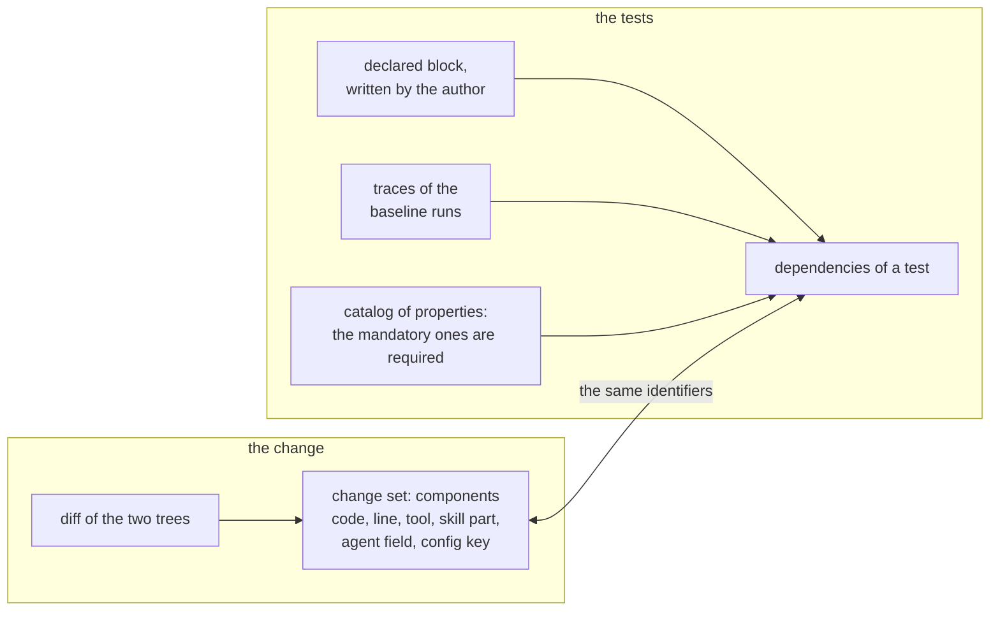
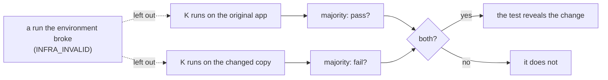

# TRACE-Eval: research and implementation plan

**Change-aware, cost-bounded selection, prioritization and stopping of tests and evals for LLM agent systems**

Ciprian Păduraru · University of Bucharest · the results are in `docs/results/gemma7/report.md`

---

## In short

- **Problem.** After a change to an agent system, decide which tests and eval items to run, in what order, and
  when to stop, under a token budget and without missing regressions.
- **Method.** Map the diff to components (code lines and functions, skill procedures, agent fields, config keys)
  and match them to tests through the dependencies observed in traces. Rank tests by expected information per
  token in a Bayesian model whose sensitivities are calibrated from history, and stop when the probability of a
  regression is low. The method is `adaptive_bayes`; eight other strategies run alongside it.
- **Testbed.** A small multi-agent app (`traceeval/sut`) whose agents are played by a model (Gemma 4 E4B;
  Qwen3.8-27B and gpt-oss-120b as further models), 180 tests and 43 controlled changes applied as file edits (9 of
  them benign). Full-suite runs with five repetitions give the ground truth, and strategies are compared by offline
  replay.
- **Results (§5, Gemma).** Trace-based selection and the adaptive method beat hand-written dependencies by a wide
  margin, and the adaptive method returns most of the budget while giving no false verdict (the README's table,
  §5.1). Qwen's and gpt-oss's recordings of the same app are not clean ground truths (§5.4).
- **Next.** The demo for the AEM team (`docs/AEM_ALIGNMENT.md` §4), then tau2-bench as the second system under test
  (§6).

---

## 0. Reading order

In reading order: the problem (§1), the abstractions the method rests on (§2), the methods (§3), the evaluation
environment (§4), the results and the take-aways (§5), the roadmap (§6), the paper (§7) and the open questions for
the AEM team (§8). The research problem is kept general: any agent platform built from skills, prompts, tools,
harness code and configuration. AEM, Adobe's platform, is the motivating instance, and the method does not depend
on it.

**Design decisions**

| Topic | Decision | Reason |
|---|---|---|
| System under test (SUT) | A purpose-built mini content-operations platform ("ContentOps": pages, assets, publishing, SEO, translation, governance, rollback) is the primary SUT. | The primary SUT gives a multi-agent structure with shared components built in on purpose (the hard case the AEM team describes) and full control over mutations. Its agents run on a local model, and recorded answers make reruns free and exact. tau2-bench, the second system under test, adds external validity (§6). |
| Agent runtime | A pure Python harness with an OpenAI-compatible LLM backend. | It is the shortest path, and the harness code must itself be mutable and instrumentable (coverage contexts). |
| Observability | Our own trace recorder with an OpenTelemetry-compatible event model (agent, skill, tool, config and llm events) and an OTLP JSON exporter (`tracing/otel.py`). | No services in the loop, and the export needs no dependency. |
| Oracles (what decides pass or fail) | Deterministic checks (final state, tool trajectories, audit log, response substrings). An LLM judge (Gemma or Qwen, against the case's rubric) runs only for explicitly marked answer-quality properties, and only after the deterministic checks pass. | Regression tracking must not depend on judge noise. |
| Ground truth | Mutation analysis: 43 controlled changes, benign ones included, applied as file edits. The selectors see only the diff. | Needed to measure the detection rate against a known answer, and to measure wasted budget. |
| Evaluation | Record, then replay: run the full suite once per variant, and evaluate all strategies offline. | Decouples method development (thousands of replays) from execution cost (one recording per variant). |

---

## 1. Problem statement and research questions

A change set Δ (edits to skill files, prompts or agent definitions, harness or tool code, configuration) arrives
at an agent platform with a suite T of tests and eval-dataset items, each with a cost c(t) in tokens and time. We
must choose a subset S ⊆ T and an order, possibly adaptively, under a budget B, so that the regressions Δ
introduces are detected with high probability and at low cost. The procedure should stop when more evidence is
not worth its price.

We keep the three sub-problems of Adobe's requirements document (not in this repository; `docs/AEM_ALIGNMENT.md` §1
sums it up) separate throughout: selection (which tests), prioritization (in which order) and budget-aware stopping
(when to stop). The research questions are those of the requirements document, each with a metric:

- **RQ1 (selection)** Can we identify the tests relevant to a change? *Metric: selection recall of the revealing
  tests and cost of the selected subset, declared vs. observed dependencies.*
- **RQ2 (traces)** Do execution traces improve selection beyond static/declared dependency information? *Metric:
  RQ1 and RQ3 metrics for `declared` vs. the strategies built on observed dependencies (`observed`, `cost_aware`,
  `adaptive_bayes`).*
- **RQ3 (prioritization)** Can we order tests to detect regressions earlier? *Metric: APFD, cost-cognizant
  APFD_c, cost to first detection.*
- **RQ4 (budget)** Can we reduce time and tokens while retaining acceptable detection and coverage? *Metric:
  detection rate vs. budget curves, tokens actually spent, waste on the changes no test reveals, stopping
  accuracy.*

**Claimed contribution.** A change-aware, trace-informed, cost-bounded method for selecting agent tests, with a
stopping rule based on the posterior probability of a regression, and a reproducible testbed (SUT, mutation
catalogue, metrics) for evaluating such methods. The contribution is the method; the testbed
is what makes it testable.

---

## 2. Models underlying the method

### 2.1 Tests and their facts

A test (a case of the catalog, `traceeval/catalog/`) is a request to the application with a context, and
expectations on what must be true afterwards: the final state, the tools called and not called, the audit log,
facts in the answer, and for workflows the order of agents and tools. Each test also carries the facts the methods
use:

- a **risk** level, critical, high, medium or low, which the metrics read as a severity of 4, 3, 2 or 1;
- the **properties** it checks, ids from the catalog of properties (`properties.yaml`: category, how it is
  checked, a mandatory flag, a threshold and the components it comes from; `docs/AEM_ALIGNMENT.md` §3.4). The
  mandatory ones, the safety properties, are the required dependencies of §2.3;
- its **declared dependencies**, the metadata its author wrote;
- its **fault profile**, if it injects one (`docs/CONTENTOPS.md`);
- its **cost** and its **pass rate**, measured on the original app (§2.4, §2.5);
- its **behaviour signature**: the agents, tools, fault profile and dataset of its baseline runs. Tests with the
  same signature are near-duplicates, whose outcomes are correlated.

The diff and the tests meet in one vocabulary of components, defined in §2.2 and used on both sides:

### 2.2 Change model (what a diff becomes)

The extractor (`traceeval/mutation/changeset.py`) turns a diff into *components* with the same identifiers used
for dependencies:

| Component | Example | Granularity notes |
|---|---|---|
| `code:<file>::<function>` + `line:<file>:<n>` | `code:harness/retry.py::with_retry`, `line:harness/retry.py:29` | functions compared as syntax trees, docstrings ignored; changed baseline code lines; an insertion anchors to the code lines around it. |
| `tool:<name>` | `tool:set_page_metadata` | When a changed function is a registered tool adapter. |
| `skill:<name>#procedure` / `#prose` / `#meta` | `skill:link-validation#procedure` | The machine-readable procedure block, the instruction prose, and the front matter. |
| `agent:<name>.<field>` | `agent:publishing.triggers`, `agent:seo.tools` | Order-sensitive comparison (intent order matters). A tool or skill list that only lost items names them (`removed: tool:check_consent`). |
| `config:<dotted.key>` | `config:runtime.retries` | Changes of the effective value only. |
| comments and formatting | — | Left out. Comments, docstrings, blank lines, YAML comments and the order of config mappings add no component, file or diff line, so no selector or probability depends on them. |

### 2.3 Dependency model (declared · observed · required)

- **Declared** dependencies are the metadata a test author wrote (the `declared:` block in the catalog). They are
  incomplete on purpose, as in practice: shared skills reached through `include`, harness code and most
  configuration keys are not declared.
- **Observed** dependencies come from the baseline traces: the agents started, the agent-definition fields the
  orchestrator consulted, the skills loaded (with version and digest), the tools called (with status and
  attempts), the configuration keys read, and the code functions and lines executed (coverage.py dynamic
  contexts, one context per test and repetition).
- **Required** dependencies are what must always be evaluated: the catalog's mandatory properties, the safety ones.
  The adaptive method tests every mandatory property a change may affect before it ends without a regression (step
  5, §5.3).

### 2.4 Cost model

c(t) = agent tokens (prompt + completion over all LLM calls in the delegation chain) + judge tokens (only when a
judge runs). Latency is recorded alongside. Tokens come from the model server's usage fields, so a case that
delegates, retries or reads long skills costs more. A full-suite run of the 180 tests costs about 2.1M tokens
under Gemma and 2.5M under Qwen.

### 2.5 Outcome model and ground truth

A test run ends in one of five outcomes:

- PASS;
- TOOL_ERROR: a tool crashed, or failed in a way the case does not allow;
- AGENT_FAILURE: the tool calls were allowed, but a check on the state, the calls or the answer failed;
- HARNESS_ERROR: the run itself raised;
- INFRA_INVALID: the environment broke the run, because the model server or the network did not answer, or a
  replay had no recorded answer.

An INFRA_INVALID run is left out, as if it had not been made. Of the other outcomes, only pass or fail enters the
ground truth. With K repetitions per variant, the ground truth "t reveals Δ" is a *majority flip*: the baseline
pass rate is ≥ 0.5 and the variant pass rate is < 0.5. A test that the model fails on the original app
(f(t) = 1 − baseline pass rate) cannot reveal anything, and f(t) is a direct input to the selectors.

---

## 3. Methods (strategies implemented in `traceeval/selection/`)

Each strategy answers the same question, which tests to run on the changed app and in what order, from the same
inputs: the recording of the current app (traces, costs, pass rates) and the change set. None sees the ground
truth. One by one:

- `full` runs the suite in catalog order, that is, as the tests are listed in `catalog/tests/*.yaml`, followed
  by the dataset items. It is the reference, not a method.
- `random` runs it in a random order, the baseline every method must beat.
- `declared` runs only the tests whose hand-written metadata names a changed component, riskiest first. This is
  classic regression test selection on what the authors declared, and the metadata is incomplete on purpose, as it
  is in practice.
- `ir_tfidf` ranks every test by how much its text (name, request, expectations) resembles the diff, with words
  weighted by TF-IDF so that a word every test uses counts little. It is information-retrieval prioritization (as
  in REPiR, listed in `docs/REFERENCES.md`) and uses no traces.
- `observed` runs only the tests whose recorded traces touched a changed component (an agent, a skill, a tool, a
  setting read, a code line executed), ordered by how often they touched it times their risk, divided by cost. This
  is the trace-informed selection the project argues for.
- `cost_aware` ranks the whole suite by risk, closeness to the change, failure history and cost, affected tests
  first and cheap ones before expensive ones. It never stops early, so it always spends the budget.
- `casper_slices` reproduces CASPER. It groups the tests into slices that behave alike on the current app (tool
  calls, hand-offs, skills, size of the run), runs two representatives of every slice on the changed app, and then
  runs first the slices whose representatives failed more than before. It does not read the diff.
- `risk_aware_ts` reproduces Risk-Aware Adaptive Evaluation. It is a bandit: after each test it refits a model of
  which tests fail, draws a failure probability for every test still to run, and runs the one whose draw times its
  risk is highest. It does not read the diff either, and any failure counts as a find.
- `adaptive_bayes` is the proposed method. For every changed component it keeps the probability that the component
  is broken, and for every test the probability that the test fails if it is, calibrated on the other recorded
  changes and on the test's own record. It runs the test with the most information per token and updates after each
  outcome. It stops at the first failure of a test that passed on the current app, or when the probability that
  anything is broken is small; before it ends without a regression it runs a test of every mandatory property the
  change may affect. It is the only strategy that stops, and the only one with a verdict.

The same strategies, placed in the literature:

| Strategy | Family | Selects? | Stops? |
|---|---|---|---|
| `full` | reference | no | no |
| `random` | baseline | no | no |
| `declared` | classic regression test selection (RTS) on metadata | yes | n/a |
| `ir_tfidf` | information-retrieval test case prioritization (TCP), REPiR-style (`docs/REFERENCES.md`) | no (ranks all) | no |
| `observed` | trace-informed RTS | yes | n/a |
| `observed_diverse` (optional) | the observed selection, one behaviour group at a time | yes | n/a |
| `cost_aware` | the formula of Adobe's requirements (`cost_aware` above) | ranks all (affected first) | no |
| `history_ml` (optional) | predictive test selection (Machalica et al.) | ranks all | no |
| `casper_slices` | CASPER (Muse et al. 2026), reproduced | ranks slices (runs all) | no |
| `risk_aware_ts` | Risk-Aware Adaptive Evaluation (Maji & Chowdhury 2026), reproduced | no (ranks all) | no |
| `adaptive_bayes` | **proposed** | yes | yes |

The two optional baselines run only with `--strategies all`; the results in §5 compare the other nine. Two
variants of the proposed method differ from it only in how text is compared (§5.2): `adaptive_bayes_tfidf` and
`adaptive_bayes_notext`. A third, `adaptive_bayes_nomandatory`, leaves out step 5 (§5.3).

### 3.1 The proposed method: adaptive Bayesian selection with budget-aware stopping

The loop is the one pictured in `docs/USER_GUIDE.md` §5; the paragraphs below define each box.

*Hypotheses (step 1 of the five in `adaptive_bayes.py`'s docstring).* Each changed component c is broken with a
prior π_c that depends on its kind: ≈ 0.45–0.5 for code, skill, config and agent components, ≈ 0.12–0.15 for prompt
wording and prose. The posterior is kept exactly over all 2^k subsets B of the changed components (k ≤ 8
components).

*Likelihood (step 2).* P(t fails | B) = 1 − (1 − f_t) ∏_{c∈B} (1 − s_tc). The sensitivity s_tc of test t to
component c is s_tc = r_kind(c) · lift_t,kind(c) · freq_t(c) · tilt_t, where

- r_kind is the empirical reveal ratio learned from the other recorded changes: the fraction of statically impacted
  tests that actually revealed a change of that kind. Kinds separate, for example, tests that executed the changed
  line from tests that executed only the changed function, and agent fields are calibrated per field. The ratio is
  where "covered is not revealed" enters the model, as measured numbers rather than hand-set constants. A ratio
  learned from few changes is padded toward a default for its kind (m = 2 changes' worth, as below), so that one
  earlier change cannot make a whole kind look certain.
- lift_t,k = (O_tk + m) / (E_tk + m) is the test's own record on the earlier changes of kind k that impacted it.
  O_tk is how many of them it revealed, E_tk how many an average impacted test would have revealed (the sum of
  those changes' reveal rates), and m = 2 pads a short record. A test that ran many changed functions and never
  caught anything gets a lift below 1; one that caught changes most impacted tests missed gets a lift above 1.
  Comparing with E, instead of counting catches, matters because a change that breaks a large part of the suite
  (link validation turned off everywhere: 49 tests) says little about each test it breaks. Like r_kind, the records
  are recomputed from the recordings at every run, without the change under evaluation (`docs/USER_GUIDE.md` §5).
  The record is there because kind-level sensitivities alone let the method spend on cheap tests that merely call a
  changed function.
- freq_t(c) is how often t exercised c in its baseline runs. For an agent's tool or skill list that only lost
  items, it is how often t used one of the removed items.
- tilt_t ∈ [0.5, 2.0] combines the lexical relevance of the change text (code only, never comments) to the test's
  own text (name, request, expectations) with a bonus when the author declared the dependency. It is a proxy for
  whether the test's oracle plausibly observes the changed behaviour. The relevance measure is an option
  (`text`): word overlap (the default), TF-IDF, or none (§5.2).

*Policy (step 3).* The next test is the argmax over t of (expected information gain about B, tilted by risk) /
c(t). After a pass, the sensitivities of tests with the same behaviour signature (agents, tools, fault profile,
dataset) are discounted (×0.35), because near-duplicate tests give correlated evidence rather than independent
draws. Each test runs at most once: the models decode greedily, so a rerun almost always gives the same answer
(§5.4 measures where it does not).

*Stopping (step 4).* The method stops with the verdict "regression" at the first failure of a test that passed on
the original app: that failure shows a changed behaviour, which is what the ground truth calls revealing, while a
failure the model also produces on the original app says nothing about the change. It stops with the verdict
"clean" when P(any component broken | evidence) < ε_clean (0.05). Otherwise it runs until the budget is exhausted
or no test is informative. Selection, prioritization and stopping all come from the same model.

*Mandatory coverage (step 5).* A coverage rule sits on top of the model. A run that found no regression then
tests every mandatory property the change may affect that is still untested, with the cheapest test that checks
it, while the budget allows (§5.3).

### 3.2 Why these baselines

They cover the families in the literature: classic RTS/TCP on declared coverage (Rothermel), IR-based TCP (Saha
2015), cost-cognizant TCP (Elbaum 2001), predictive test selection (Machalica 2019) and diversity-based ordering
(LTM, Pan et al.; `docs/REFERENCES.md`). CASPER (2026) and Risk-Aware Adaptive Evaluation (2026) are the closest
external competitors (`docs/related_work.md`), and both are reproduced on the testbed (`selection/reproduced.py`,
roadmap item 3(c)).

The module's docstrings say where the testbed forced an adaptation:
the replay oracle returns an outcome and a cost, not a trace, so CASPER's slices are scored by their failure rate
rather than by a model of the signals; the budget is in tokens; and each test runs once (Policy, §3.1).

---

## 4. Evaluation environment (the testbed)

### 4.1 System under test: ContentOps

`docs/CONTENTOPS.md` describes the application: an orchestrator and ten specialists, thirteen skills, 32 tools over
deterministic services, a harness with a dispatcher, retries, fault injection and step budgets, and one
configuration file. The structure is deliberate: selection has to be hard, and there has to be something to say
about defence in depth.

- Some components are shared and have a wide blast radius: `governance-checks` and `link-validation` are included
  by several skills, `check_permission` is available to eight of the ten specialists and `get_page` to six, and the
  retry helper wraps every tool call.
- Others are narrow: the approval gate matters to one test.
- Some policies are enforced only in skills (publish permission), others also in tools (approval tokens).
- Mutations of a skill's prose and of its procedure are separate components (`#prose`, `#procedure`, §2.2).

### 4.2 Eval catalog

The catalog holds 106 scenario tests and two dataset-style evals:

- Scenario tests: publishing 23, authoring 14, assets/SEO 18, translation/governance/maintenance/orchestration 21,
  brand/insights/optimizer 12, three settings cases, and 15 workflow tests. The workflows are W1 campaign launch
  across five specialists, W2 site optimization across four, and W3 legal takedown, W4 localized price update, W5
  rollback of a broken release and W6 privacy request across two or three. Each has variants where the plan must
  stop.
- Dataset-style evals: 50 routing items (prompt → expected delegation, run in route-only mode, where the delegation
  is recorded and the specialist is not run) and 24 intent items (prompt → expected tool invocation).

### 4.3 Controlled changes (43)

The code calls a controlled change a mutation, a changed copy of the app a variant, and the table of which test
fails under which change the fault matrix.

| Category | Count | One example (all 43 in `docs/USER_GUIDE.md` §6) |
|---|---|---|
| code (tool adapters, services, harness) | 10 | the SEO tool writes the title into the description field |
| runtime | 3 | the agent loop stops six steps early |
| skill | 11 | the publishing skill drops its link validation |
| prompt / agent definition | 2 | the governance agent loses `check_consent` |
| configuration | 7 | link validation switched off everywhere |
| combined | 1 | a keyword-count rule in code plus a very low limit in config |
| benign | 9 | the publishing skill's prose reflowed |

The set is written for the models:

- a change has to touch an input a model acts on (keyword weights, trigger lists and the order of an agent's
  intents are not such inputs);
- a removed step has to go from both the procedure and the prose, or the model does the step anyway;
- candidates that told nothing about selection were left out: exact twins of other changes, crashes that only
  exercised the crash classification, and a change that broke most of the suite;
- ten of the changes are aimed at the multi-agent workflows: the orchestrator's approval and brand rules, the
  hand-off of ids between steps, the services behind the AEM-style agents, and two benign ones.

`docs/USER_GUIDE.md` §6 explains each of the 43 and why it is in the set. Three batches bundle several of them, as
a nightly run or a pull request would (`docs/USER_GUIDE.md` §6, "Batches"); they are recorded on request and kept
out of the tables of §5.1, which are the 43 single changes.

The report checks a sanity property of the testbed: every regression-inducing change is revealed by ≥ 1 test, and
no benign change is revealed by any test. Under Gemma five regressions are revealed by no test (§5.1); the
other models' recordings are the subject of §5.4.

### 4.4 Protocol and metrics

The recording is `docs/EXPERIMENT.md` §5's `baseline` and `mutants` steps with K repetitions; a 43-change × 5-rep
recording of the 180 tests is about 39k runs. `evaluate` then replays, once per (change, strategy, budget, seed),
with the budget one of 2, 5, 10, 20, 30, 50 or 100% of the full-suite tokens. The strategy sees the baseline facts
and the change set only. Each execution is answered from the recorded runs of that variant (a random repetition
supplies the outcome and cost), and adaptive strategies interact sequentially. The metrics:

   - change coverage, which needs no ground truth (`docs/USER_GUIDE.md` §4; the dimensions are defined in
     `docs/AEM_ALIGNMENT.md` §3.5);
   - property coverage: of the properties a change breaks, those its selected tests exercise;
   - detection (≥ 1 revealing test executed and failed), recall of revealing tests, tokens actually spent, cost
     to first detection, false alarms, safety recall, stop reason and stop correctness;
   - APFD and APFD_c of the complete prioritized order (Rothermel et al. 2001; Elbaum et al. 2001; the formulas
     are in `docs/USER_GUIDE.md` §4 and the papers in `docs/REFERENCES.md`);
   - selection recall and selected-subset cost.

---

## 5. Results

### 5.1 Gemma (`runs/gemma7`: 180 tests × 5 reps, 43 changes × 5 reps, the model judge, 5 replay seeds)

The agents are played by Gemma 4 E4B, served with vLLM on a GPU server (`docs/EXPERIMENT.md`). §5.4 covers Qwen's
and gpt-oss's recordings of the same app. The ground truth belongs to the model:

- On the original app, 172 of 180 tests pass; the eight failures are Gemma's own mistakes (`docs/EXPERIMENT.md`
  §6). Its five runs of each test always agreed.
- 29 of the 34 regressions are revealed; the five that are not are the model's misses, the same wrong behaviour
  with or without the change (`docs/EXPERIMENT.md` §7).
- None of the nine benign changes fails a test. Across all 43 changes, the five runs disagreed on only four
  (change, test) pairs, and the majority vote absorbs them.

Detection of the 29 regressions Gemma reveals, by nominal budget, and tokens actually spent (the last column on the
14 changes no test reveals):

| strategy | 5% | 10% | 20% | 50% | 100% | spent @20% | spent @100% | spent on unrevealed @100% |
|---|---|---|---|---|---|---|---|---|
| full (catalog order) | 0.14 | 0.24 | 0.34 | 0.90 | 1.00 | 0.20 | 0.98 | 1.00 |
| random | 0.22 | 0.37 | 0.56 | 0.86 | 1.00 | 0.20 | 0.98 | 1.00 |
| declared | 0.59 | 0.55 | 0.62 | 0.62 | 0.62 | 0.07 | 0.11 | 0.14 |
| ir_tfidf | 0.69 | 0.76 | 0.93 | 1.00 | 1.00 | 0.20 | 0.98 | 0.99 |
| observed | 0.62 | 0.69 | 0.86 | 0.86 | 1.00 | 0.15 | 0.49 | 0.33 |
| cost_aware | 0.55 | 0.62 | 0.86 | 0.86 | 1.00 | 0.20 | 0.98 | 0.99 |
| casper_slices (CASPER, reproduced) | 0.28 | 0.52 | 0.59 | 0.90 | 1.00 | 0.20 | 0.98 | 1.00 |
| risk_aware_ts (Risk-Aware Adaptive Evaluation, reproduced) | 0.28 | 0.35 | 0.57 | 0.83 | 1.00 | 0.20 | 0.98 | 1.00 |
| adaptive_bayes | 0.74 | 0.78 | 0.78 | 0.81 | 0.81 | 0.03 | 0.03 | 0.20 |

APFD_c of the full prioritized order runs from 0.54 (random) to 0.76–0.81 for the strategies that use the change,
the adaptive method's 0.81 the best; its first detection comes after 1.7% of the suite's tokens, the reproduced
methods' after 12–14%. The report's sections 2 and 4 hold the full tables; time spent follows tokens closely.

**Reading.**
- *RQ1/RQ2.* Declared metadata caps detection at 62%, because shared skills reached through `include`, harness
  code and most configuration keys are not declared. Observed dependencies recover full selection recall and
  reach 86% within a 20% budget. The main argument for trace-informed selection holds.
- *RQ3.* Informed strategies raise APFD_c from 0.54 (random) to 0.76–0.81. The adaptive method's order is the
  best, and it finds the first regression soonest.
- *RQ4.* The adaptive method is the only one that returns budget: it catches 74% of the regressions at a 5% budget
  and 78% at 20%, for under 3% of the tokens. Its ceiling is 81%. On narrow regressions, revealed by one to five
  tests, it can stop with a "clean" verdict before reaching them (145 of 1,015 replays of regressions). The changes
  it misses at a 20% budget: the delegation that drops the ids of earlier steps; the agent loop that stops six
  steps early; retries without idempotency keys; the routing skill without its brand gate; the authoring skill
  without its metadata step; the combined change, where it runs out of tests that could still move its estimate.
  The governance skill without its consent step it catches in three of five seeds.
- *Critical regressions.* Of the 21 changes that break a safety property, the adaptive method catches 84% from a
  10% budget on, `observed` 81% and TF-IDF all of them at 20% (spending the whole 20%).
- *Red tests on the original app.* Gemma's eight failing tests fail on nearly every changed copy too, so a strategy
  that runs one sees a failure the change did not cause. On the 14 changes no test reveals, `full` sees such a
  failure in 72% of replays, `ir_tfidf` in 71%, `cost_aware` in 94%, `observed` and `declared` in 58%, `random` in
  69%, the bandit in 76% and CASPER's slices in 57%. The adaptive method discounts a test by its failures on the
  original app and gives no "regression" verdict on any of these changes (0 of 490 replays).
- *IR.* TF-IDF over the diff is the strongest selector at 20% (93%) but spends the whole budget. At 5% the
  adaptive method leads (74% against 69%).
- *The reproduced methods.* CASPER's slices and the risk-aware bandit do not look at the diff, and it shows: 59%
  and 57% of the regressions at a 20% budget, close to random (56%) and far from the strategies that read the diff
  and the traces (78–93%; hand-written dependencies alone 62%); an order no better than random's (APFD_c 0.52 and
  0.60); and a first detection at 12–14% of the suite, where the change-aware strategies need 2–6%. The bandit's
  impact score is the test's risk, so it does better on the changes that break a safety property (71% at 20%, 98%
  at 50%). It rewards any failure, so it also runs Gemma's red tests early (the *Red tests* bullet). Neither stops:
  both spend the whole budget on every change.
- *Where CASPER fits.* The numbers above measure what the diff is worth, not CASPER in its own setting.
  - CASPER was built for changes that have no diff a test can be mapped to: a model upgrade, a provider's silent
    update, a prompt-level change whose effect spreads through the model's behaviour. It needs only the logs of the
    last full run, so it applies to a system whose code the testing team does not own, and its cost does not grow
    with the suite: a fixed number of representatives per slice samples a suite of a thousand tests as cheaply as
    one of a hundred, and the slices themselves are a map of the suite's behaviours that the team can read.
  - A platform like AEM's sees both kinds of change. The change-aware strategies cover the edits to skills, code
    and settings; CASPER's representatives are the natural first pass after a model update, when every test is
    affected and the question is which behaviours drifted.
  - The two could also be combined: the slices can serve as the near-duplicate groups of the adaptive method, and a
    slice whose representatives drifted can enter the model as a changed component.
  - On this testbed every change is an edit with a diff and the suite is small (180 tests, which the reproduction
    cuts into twelve slices), which is the case slicing has least to offer.
- *Live against replay.* `traceeval check`, run live on all 43 changes, gives the replayed verdict on 42, with the
  same tests and tokens; the exception is one live false alarm on a benign change, from a one-off difference in the
  model's answer (`docs/EXPERIMENT.md` §5). The replay is a faithful stand-in for the live prototype.

### 5.2 Text in the method: an option (roadmap 3(b))

The method's text signal (the tilt in §3.1) can be word overlap (the default), the TF-IDF similarity of the
`ir_tfidf` strategy (`adaptive_bayes_tfidf`), or nothing (`adaptive_bayes_notext`, an ablation). Detection, with
the tokens spent in parentheses, on the Gemma recording of §5.1 (5 seeds):

| budget | overlap (default) | TF-IDF | no text | `ir_tfidf` alone |
|---|---|---|---|---|
| 5% | 0.74 (2.1%) | 0.79 (1.9%) | 0.57 (2.4%) | 0.69 (5%) |
| 20% | 0.78 (2.9%) | 0.83 (2.4%) | 0.68 (3.5%) | 0.93 (20%) |
| 50% | 0.81 (2.9%) | 0.83 (2.4%) | 0.68 (4.6%) | 1.00 (50%) |

The TF-IDF variant also stops correctly most often (0.88 at 20%, against 0.86 for the default and 0.79 without
text), and no variant gives a "regression" verdict on a change no test reveals.

**Reading.** TF-IDF brings forward the one test that reveals a narrow change, and gains up to five points while
spending less. Without any text the method loses ten points, so text matters, but coverage and history carry most
of the result. The testbed is textual: tests, skills and config keys share vocabulary, which favours any text
measure (a threat the paper notes). The default stays word overlap until a recording of another application, where
tests and changes are worded differently (tau2-bench, §6), shows whether the gain holds there too.

### 5.3 Coverage, and mandatory properties in the method

Coverage is a metric the AEM team asked for (`docs/AEM_ALIGNMENT.md` §3.5); the report's section 6 gives it for the
suite and for each change. On this app:

- every agent, skill, configuration key, property and workflow has a test;
- one tool (`get_asset`) and two setting values have none;
- the declared metadata misses one skill and three settings that the traces show in use.

Change coverage needs no ground truth. Observed, cost-aware and TF-IDF selection and the adaptive method all
exercise 97% of the changed components at a 20% budget (one change touches code no test runs). The adaptive
method checks about half of the properties a change may affect (0.50, against 0.85 for `observed`), because it
stops at the first real failure or as soon as it is confident. That is the purpose of stopping, but it would also
let the method call a change clean with a mandatory property untested.

Step 5 of the method (on by default; `adaptive_bayes_nomandatory` is the ablation) closes that gap. A run that
found no regression does not end before every mandatory property the change may affect has a test, while the budget
allows. The test chosen is the cheapest one that checks the property and passes on the original app.

At a 20% budget the rule raises the share of regression-free runs that tested every affected mandatory property
from 0.33 to 0.90, for 0.8 extra tests per change, and detection from 0.74 to 0.78.

On this app the rule is also a detector. It catches `skill_publish_drop_link_validation`, which the method alone
calls clean: before ending, the method must test the mandatory property `safety_no_broken_publish`, and that test
fails. The rule never caused a false verdict. Below a 10% budget it often cannot afford the extra test.

### 5.4 Qwen and gpt-oss: why their recordings are not a ground truth

Both were recorded on the same app as Gemma, with five repetitions, Qwen3.8-27B on two SLURM GPUs (`runs/qwen7`,
report in `docs/results/qwen7/`) and gpt-oss-120b on both of fmi0's GPUs (`runs/gptoss7`, `docs/results/gptoss7/`):
180 tests, 43 changes, the baseline one test at a time and the changed copies in batches. The question the five
repetitions answer is whether a majority over five runs settles what a majority over the first three does not. It
does not, for either model.

Gemma gives the opposite picture (§5.1): its vote is stable, and the votes over the first three and over all five
runs differ on two labels only, the two pairs at the majority line (DS-INTENTS/i20 under
`skill_governance_drop_consent`, WF4-01 under `skill_translation_wrong_default`).

Neither recording is a clean ground truth (`docs/EXPERIMENT.md` §6 has the tests each model gets wrong):

| | Qwen | gpt-oss |
|---|---|---|
| tests passing on the original app | 173 of 180 | 153 of 180 |
| regressions revealed | all 34 | all 34 |
| benign changes "revealed", majority over five runs | every one, by three to six tests, the empty change (`benign_code_comment_docstring`, whose change set is empty) included | every one, by two to five tests |
| the same under the first three runs | by two to four tests | by one to four tests |
| (change, test) pairs on which the two votes differ | 75, and the revealing sets of 40 of the 43 changes | 95 |
| pairs on which a change's own runs disagree | 357 | 577 |
| tests that carry the variation | seven: one of the two cases a model judges against a rubric (PUB-20), the 60-character boundary (SEO-05), four long workflows (WF2-01, WF2-02, WF4-02, WF5-02) and AUT-05 | thirteen, mostly the long workflows: WF1-01 and WF1-03 pass on the original app and fail on nearly every changed copy, whichever the change, the empty one included; MNT-05 flips on twenty changes |
| regressions with a revealing test outside those | 29 of 34 | 25 of 34 |
| CASPER's representatives | include SEO-05, WF5-02 and WF2-02, which "reveal" 40, 34 and 15 of the 43 changes, so its slices appear to detect 90% of the changes at a 20% budget | include the three unstable tests, so its slices appear to detect 98% at a 20% budget |

Two remedies fall short:

- vLLM's batch-invariant mode, which makes greedy decoding exactly repeatable, does not support Qwen3.8: the server
  refuses it for the model's linear-attention layers ("not supported for GDN_ATTN");
- recording the baseline the way the changes are recorded is not enough either: with the empty change, recorded
  exactly like the others, as the reference, every one of the eight other benign changes still flips tests, two to
  five under Qwen (WF4-01 and WF5-02 in nearly all of them) and one to four under gpt-oss.

Recording the empty change one test at a time, as the baseline is recorded, separates the two causes
(`docs/results/qwen7/one_at_a_time.md`). Under Qwen, five repetitions one at a time disagree with themselves on one
test, WF5-02, which sits at the majority line and splits in the baseline too, and flip no other test against the
baseline; the same change recorded 64 tests at a time has nine tests whose runs disagree and six that flip. Qwen's
variation is batching, not the model; its runs one at a time are as repeatable as Gemma's. gpt-oss was not recorded
one at a time. A ground truth for Qwen therefore needs the changed copies recorded one test at a time, at about 1.2
hours per repetition per server, or vLLM's batch-invariant mode, which Qwen3.8 does not support.

Qwen and gpt-oss are used as they are served, like Gemma. Their recordings are kept for this finding; the results
are Gemma's. The lesson for a pipeline is to measure how much the model's answers vary from run to run under the
serving setup the selection will run on, before trusting a ground truth or a stopping rule, and to measure it one
test at a time and in batches. The empty change measures exactly that.

### 5.5 Take-aways

What the experiments say, in the order a team would act on them. The numbers are Gemma's (§5.1), at a budget of 20%
of the suite's tokens unless said otherwise.

1. **Record traces; do not maintain a map.** Hand-written dependency metadata misses what shared skills, harness
   code and settings reach; dependencies read from traces recover it (§5.1). One instrumentation of the agent
   runtime (the testbed exports OpenTelemetry spans) replaces a test-to-component map that nobody keeps current.
2. **Read the diff.** The strategies that read the diff and the traces find most regressions early; the two that do
   not, CASPER's slices and the risk-aware bandit, sit near a random order and find their first revealing test late
   (§5.1).
3. **Stop when confident, with a safety net.** The adaptive method finds more than any other strategy at equal
   tokens spent, and most of what the best full-budget strategy finds, for a small fraction of its tokens; it
   returns the rest. Its price is a ceiling on narrow regressions (§5.1). The mandatory rule covers the safety
   properties for under one extra test per change and catches a change the stopping rule alone misses (§5.3). The
   catalog of properties is where that decision lives: whoever sets the mandatory flag decides what the pipeline
   never skips.
4. **Discount the tests the model already fails.** The tests Gemma fails on the current app fail on nearly every
   changed copy too, and every other strategy reports some of those failures as the change's; the adaptive method
   keeps each test's pass rate and acts only on a flip (§5.1). A pipeline should do the same rather than treat
   every red test as a regression.
5. **Measure the model's noise before trusting a verdict.** Gemma's vote is stable; Qwen's and gpt-oss's are not.
   Qwen's noise is batching: recorded one test at a time its runs agree, and the changed copies, recorded many
   tests at once, do not (§5.4). An empty change, recorded like the others, measures the noise floor; record it per
   model and per serving setup.
6. **CASPER and the bandit have their place.** CASPER needs no diff and is the natural first pass after a model
   update; the bandit learns from outcomes and, without history, has only the tests' risk to go on (*Where CASPER
   fits*, §5.1). The change-aware strategies cover edits to skills, code and settings; the two kinds combine.
7. **Text is a strong, cheap baseline.** TF-IDF similarity between the diff and the tests' text has the best
   detection when the whole budget is spent, and it never stops (§5.1, §5.2); it is the fallback order to keep in
   any pipeline.

### 5.6 Batches of changes

A nightly run sees a day's merges at once, and a pull request several related edits. Three batches of catalog
changes, recorded with Gemma like the single changes (`docs/results/gemma7/batches.md`), show what the strategies
make of that:

- `batch_nightly` (six regressions and two harmless edits, 28 revealing tests): every change-aware strategy finds
  it within a 5% budget; the adaptive method after one test, 0.3% of the suite, and the live check blames the SEO
  agent's lost tool at 0.77 while the other members stay near their prior, untested, because the check stops at the
  first failure.
- `batch_publishing_pr` (three related changes on the publishing path, 9 revealing tests): the adaptive method
  after two tests, 1.2% of the suite, blaming the link check and the publishing skill's procedure; `full`,
  CASPER's slices and the bandit miss it at 5%.
- `batch_benign` (all nine benign changes): revealed by one test, PUB-02, which fails in all five runs under the
  batch and passes under every member alone. Two prompt edits do it together, the orchestrator's prompt reworded
  and its routing guidance reordered: the orchestrator then drops the broken link from the answer it relays. The
  adaptive method spends the whole 20% budget on 34 tests without reaching PUB-02 and ends without a clean verdict
  (0.32), since one member adds a tool no agent may use, which no test can reach and nothing can clear.

Two lessons. A batch is checked like a change, and the posterior names the member to blame, which is what a nightly
pipeline needs after a red run. And harmless edits are not harmless together: the ground truth of a batch is not
the union of its members', so a nightly batch needs its own recording, not the sum of the day's single-change
checks.

---

## 6. Roadmap

| Phase | Deliverable | Status |
|---|---|---|
| 1. Testbed | SUT, catalog, tracing, mutations, change sets, record/replay, metrics, report, CLI, tests | done |
| 2. Methods | baselines + cost-aware + predictive + adaptive Bayesian selector with stopping | done, with the mandatory-coverage rule (§5.3); open: tuning ε, the priors and the discount |
| 3. Method improvements | (a) test-level learned sensitivities (per test × component-kind reveal history) instead of kind-level; (b) IR relevance inside the Bayesian likelihood; (c) CASPER-style slices and the Risk-Aware Adaptive Evaluation bandit as reproduced baselines | (a) done; (b) done as an option (§5.2); (c) done: `casper_slices` and `risk_aware_ts` (§5.1) |
| 4. Models | ContentOps with three models (local vLLM): all changes × K reps | done: Gemma (`runs/gemma7`); Qwen's (`runs/qwen7`) and gpt-oss's (`runs/gptoss7`) recordings of the same app are spoiled by run-to-run variation and are not used for the results (§5.4) |
| 5. Second system under test | tau2-bench, a public benchmark of tool-using agents with a simulated user (`docs/REFERENCES.md`): the airline domain, 50 tasks with a reward computed from the database state and the agent's communication, no model judge; the local model plays both the agent and the user, the controlled changes mutate the policy and the tool code (12 mutations: 6 policy, 4 tool-code, 2 benign), and the replay evaluator and the strategies run unchanged | after the demo for the AEM team |
| 6. Scale/robustness | more mutations (mutation operators generated systematically: step deletion/swap/condition negation in procedures, argument swaps in adapters, config boundary values), equivalent-mutant analysis, sensitivity to K and to budget definitions (time vs. tokens), ablations of each model ingredient, more repetitions for the models whose answers vary (five recorded for all three models, §5.4) | with the paper |
| 7. Paper | see §7 | drafting can start from this document and the report |

Re-planning after a failed step is built on a branch and waits for one product decision (`docs/AEM_ALIGNMENT.md`
§4.1).

---

## 7. Paper

The draft is `docs/paper/main.tex` (build with `latexmk -pdf main`): what a team needs, how the testbed was built,
the abstractions, the methods, the evaluation with its threats, the take-aways, and the conclusion with future
work. The venues are ASE, ISSTA or ICST, with a software-engineering framing: regression test selection and
prioritization for LLM-based systems, a mutation-based ground truth, APFD_c. The alternative is NeurIPS D&B or
EMNLP, with the testbed as the headline.

---

## 8. Questions still to settle with the AEM team

The AEM team's written answers (`docs/AEM_ALIGNMENT.md` §1) settled part of this list: nightly and model-update
runs, prompt → answer and prompt → tool-call datasets, the thresholds and mandatory properties wanted, and budgets
with early stopping.

1. Change identification. Is the diff available per PR or nightly batch, and does the platform keep skills,
   prompts and config under version control together with the harness code? The change-set extractor assumes
   files in one tree.
2. Dependency registry. Is there a mapping from agents to skills, tools and config, and are traces (tool calls,
   skills loaded, config reads) retained for the nightly runs? Observed dependencies need ≥ 1 baseline run per
   test with tracing.
3. Eval datasets. Can items be run individually and their costs attributed? Our dataset items are selectable
   units; the routing dataset is run in route-only mode.
4. Oracles. Which properties are deterministic and which are judged? Which are release blockers (the safety set)?
5. Budgets. Tokens, time or both; per PR or nightly? Is a partial run with an explicit "clean with probability p"
   statement acceptable to the team? This is what the stopping rule outputs.
6. Re-planning. Should a single publish request for a page with a broken link be repaired or refused? The
   re-planning branch waits for this answer (`docs/AEM_ALIGNMENT.md` §4.1).

