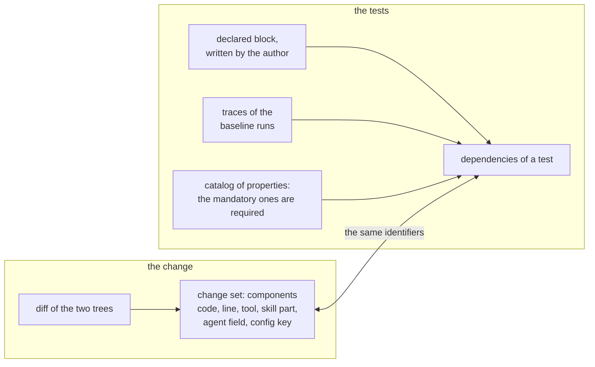
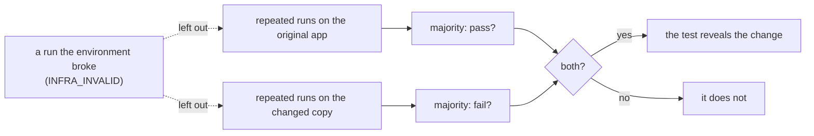
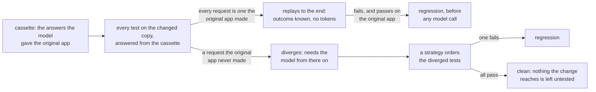

# TRACE-Eval: research and implementation plan

**Change-aware, cost-bounded selection, prioritization and stopping of tests and evals for LLM agent systems**

University of Bucharest / ILDS. The results are in `docs/results/gemma7/report.md`

---

## In short

- **Problem.** After a change to an agent system, decide which tests and eval items to run, in what order, and
  when to stop, under a token budget and without missing regressions.
- **Method.** Map the diff to components (code lines and functions, skill procedures, agent fields, config keys)
  and match them to tests through the dependencies observed in traces. Rank tests by expected information per
  token in a Bayesian model whose sensitivities are calibrated from history, and stop when the probability of a
  regression is low. The method is `adaptive_bayes`; ten other strategies run alongside it, all under the same two
  rules (§3).
- **Testbed.** A small multi-agent app (`traceeval/sut`) whose agents are played by a model (Gemma 4 E4B;
  Qwen3.8-27B and gpt-oss-120b as further models), 180 tests and 43 controlled changes applied as file edits (9 of
  them benign). Full-suite runs with five repetitions give the ground truth, and strategies are compared by offline
  replay.
- **Results (§5, Gemma).** Reading the change pays: the strategies that read the diff or the traces find 85% to 94%
  of the regressions for a tenth of the suite's tokens, hand-written dependencies 62%. The adaptive method finds
  the most at a small budget (74% for 2.7% of the tokens), a lead the 29 regressions do not establish, and stays
  near 80% however large the budget, because a third of its clean verdicts are given on a regression (the
  README's table, §5.1). Qwen's and gpt-oss's recordings of the same app are not clean ground truths (§5.4).
- **Replay-first (§3.3, §5.7).** A change is first replayed against the answers the model gave the original app,
  in seconds and without a model. The tests that replay to the end are settled; any order of the others then
  finds every regression, with no wrong clean verdict, for 7% to 10% of the suite's tokens per change.
- **Next.** The plan is `TODO.md`: what a clean verdict costs on a change that reaches most tests is the open
  problem. Re-planning after a failed step waits for a product decision (`docs/AEM_ALIGNMENT.md` §4.1);
  tau2-bench is the second system under test (§6).

---

## 0. Reading order

In reading order: the problem (§1), the abstractions the method rests on (§2), the methods (§3), the evaluation
environment (§4), the results and the take-aways (§5), the roadmap (§6), the paper (§7) and the open questions for
the Adobe Team (§8). The research problem is kept general: any agent platform built from skills, prompts, tools,
harness code and configuration. AEM, Adobe's platform, is the motivating instance, and the method does not depend
on it.

**Design decisions**

| Topic | Decision | Reason |
|---|---|---|
| System under test (SUT) | A purpose-built mini content-operations platform ("ContentOps": pages, assets, publishing, SEO, translation, governance, rollback) is the primary SUT. | The primary SUT gives a multi-agent structure with shared components built in on purpose (the hard case the Adobe Team describes) and full control over mutations. Its agents run on a local model, and recorded answers make reruns free and exact. tau2-bench, the second system under test, adds external validity (§6). |
| Agent runtime | A pure Python harness with an OpenAI-compatible LLM backend. | It is the shortest path, and the harness code must itself be mutable and instrumentable (coverage contexts). |
| Observability | Our own trace recorder with an OpenTelemetry-compatible event model (agent, skill, tool, config and llm events) and an OTLP JSON exporter (`tracing/otel.py`). | No services in the loop, and the export needs no dependency. |
| Oracles (what decides pass or fail) | Deterministic checks (final state, tool trajectories, audit log, response substrings). An LLM judge (Gemma or Qwen, against the case's rubric) runs only for explicitly marked answer-quality properties, and only after the deterministic checks pass. | Regression tracking must not depend on judge noise. |
| Ground truth | Mutation analysis: 43 controlled changes, benign ones included, applied as file edits. The selectors see only the diff. | Needed to measure the detection rate against a known answer, and to measure wasted budget. |
| Evaluation | Record, then replay: run the full suite once per variant, and evaluate all strategies offline. | Decouples method development (thousands of replays) from execution cost (one recording per variant). |

---

## 1. Problem statement and research questions

A change set $\Delta$ (edits to skill files, prompts or agent definitions, harness or tool code, configuration)
arrives at an agent platform with a suite $T$ of tests and eval-dataset items, each with a cost $c(t)$ in tokens
and time. We must choose a subset $S \subseteq T$ and an order, possibly adaptively, under a budget $B$, so that
the regressions $\Delta$ introduces are detected with high probability and at low cost. The procedure should stop
when more evidence is not worth its price.

We keep the three sub-problems of Adobe's requirements document (not in this repository; `docs/AEM_ALIGNMENT.md` §1
sums it up) separate throughout: selection (which tests), prioritization (in which order) and budget-aware stopping
(when to stop). The research questions are those of the requirements document, each with a metric:

- **RQ1 (selection)** Can we identify the tests relevant to a change? *Metric: selection recall of the revealing
  tests and cost of the selected subset, declared vs. observed dependencies.*
- **RQ2 (traces)** Do execution traces improve selection beyond static/declared dependency information? *Metric:
  RQ1 and RQ3 metrics for `declared` vs. the strategies built on observed dependencies (`observed`, `cost_aware`,
  `adaptive_bayes`).*
- **RQ3 (prioritization)** Can we order tests to detect regressions earlier? *Metric: APFD, cost-cognizant
  $\mathrm{APFD}_c$, cost to first detection.*
- **RQ4 (budget)** Can we reduce time and tokens while retaining acceptable detection and coverage? *Metric:
  detection rate vs. budget curves, tokens actually spent, waste on the changes no test reveals, stopping
  accuracy.*

**Claimed contribution.** A change-aware, trace-informed, cost-bounded method for selecting agent tests, with a
stopping rule based on the posterior probability of a regression, and a reproducible testbed (SUT, mutation
catalogue, metrics) for evaluating such methods. The contribution is the method; the testbed
is what makes it testable. §5.1 says how far the experiments support that claim, and `TODO.md` what follows from
them.

---

## 2. Models underlying the method

### 2.1 Tests and their facts

A test (a case of the catalog, `traceeval/catalog/`) is a request to the application with a context, and
expectations on what must be true afterwards: the final state, the tools called and not called, the audit log,
facts in the answer, and for workflows the order of agents and tools. Each test also carries the facts the methods
use:

- a **risk** level, critical, high, medium or low, which the metrics read as a severity of 4, 3, 2 or 1;
- the **properties** it checks, ids from the catalog of properties (`properties.yaml`: category, how it is
  checked, a mandatory flag, a threshold and the components it comes from; `docs/AEM_ALIGNMENT.md` §3.4). The
  mandatory ones, the safety properties, are the required dependencies of §2.3;
- its **declared dependencies**, the metadata its author wrote;
- its **fault profile**, if it injects one (`docs/CONTENTOPS.md`);
- its **cost** and its **pass rate**, measured on the original app (§2.4, §2.5);
- its **behaviour signature**: the agents, tools, fault profile and dataset of its baseline runs. Tests with the
  same signature are near-duplicates, whose outcomes are correlated.

The diff and the tests meet in one vocabulary of components, defined in §2.2 and used on both sides:

### 2.2 Change model (what a diff becomes)

The extractor (`traceeval/mutation/changeset.py`) turns a diff into *components* with the same identifiers used
for dependencies:

| Component | Example | Granularity notes |
|---|---|---|
| `code:<file>::<function>` + `line:<file>:<n>` | `code:harness/retry.py::with_retry`, `line:harness/retry.py:29` | functions compared as syntax trees, docstrings ignored; changed baseline code lines; an insertion anchors to the code lines around it. |
| `tool:<name>` | `tool:set_page_metadata` | When a changed function is a registered tool adapter. |
| `skill:<name>#procedure` / `#prose` / `#meta` | `skill:link-validation#procedure` | The machine-readable procedure block, the instruction prose, and the front matter. |
| `agent:<name>.<field>` | `agent:publishing.triggers`, `agent:seo.tools` | Order-sensitive comparison (intent order matters). A tool or skill list that only lost items names them (`removed: tool:check_consent`). |
| `config:<dotted.key>` | `config:runtime.retries` | Changes of the effective value only. |
| comments and formatting | — | Left out. Comments, docstrings, blank lines, YAML comments and the order of config mappings add no component, file or diff line, so no selector or probability depends on them. |

### 2.3 Dependency model (declared, observed, required)

- **Declared** dependencies are the metadata a test author wrote (the `declared:` block in the catalog). They are
  incomplete on purpose, as in practice: shared skills reached through `include`, harness code and most
  configuration keys are not declared.
- **Observed** dependencies come from the baseline traces: the agents started, the agent-definition fields the
  orchestrator consulted, the skills loaded (with version and digest), the tools called (with status and
  attempts), the configuration keys read, and the code functions and lines executed (coverage.py dynamic
  contexts, one context per test and repetition).
- **Required** dependencies are what must always be evaluated: the catalog's mandatory properties, the safety ones.
  The adaptive method tests every mandatory property a change may affect before it ends without a regression (step
  5, §5.3).

### 2.4 Cost model

$c(t)$ is the agent tokens (prompt and completion over all model calls in the delegation chain) plus the judge
tokens (only when a judge runs). Latency is recorded alongside. Tokens come from the model server's usage fields,
so a case that delegates, retries or reads long skills costs more. A full-suite run of the 180 tests costs about
2.1M tokens under Gemma and 2.5M under Qwen.

### 2.5 Outcome model and ground truth

A test run ends in one of five outcomes:

- PASS;
- TOOL_ERROR: a tool crashed, or failed in a way the case does not allow;
- AGENT_FAILURE: the tool calls were allowed, but a check on the state, the calls or the answer failed;
- HARNESS_ERROR: the run itself raised;
- INFRA_INVALID: the environment broke the run, because the model server or the network did not answer, or a
  replay had no recorded answer.

An INFRA_INVALID run is left out, as if it had not been made. Of the other outcomes, only pass or fail enters the
ground truth. With $K$ repetitions per variant, the ground truth "$t$ reveals $\Delta$" is a *majority flip*: the
baseline pass rate is $\ge 0.5$ and the variant pass rate is $< 0.5$. A test that the model fails on the original
app cannot reveal anything; its fail rate there, $f_t$, is a direct input to the selectors.

---

## 3. Methods (strategies implemented in `traceeval/selection/`)

Each strategy answers the same question, which tests to run on the changed app and in what order, from the same
inputs: the recording of the current app (traces, costs, pass rates) and the change set. None sees the ground
truth.

Every strategy is run the same way (`selection/base.py`), so that they are compared like for like:

- a test the model already fails on the current app is not run: it fails on the changed copy too, whatever the
  change, so it cannot reveal anything;
- a run ends at its first failure: a test that passed on the current app now fails, which is a regression.

What differs is which tests a strategy picks, in what order, and when a run without a failure ends. One by one:

- `full` runs the suite in catalog order, that is, as the tests are listed in `catalog/tests/*.yaml`, followed
  by the dataset items. It is the reference, not a method.
- `random` runs it in a random order, the baseline every method must beat.
- `declared` runs only the tests whose hand-written metadata names a changed component, riskiest first. This is
  classic regression test selection on what the authors declared, and the metadata is incomplete on purpose, as it
  is in practice.
- `ir_tfidf` ranks every test by how much its text resembles the diff, with words weighted by TF-IDF so that a
  word every test uses counts little. A test's text is everything its author wrote about it: id, name, request,
  context, the properties it checks and the dependencies it declares. It is information-retrieval prioritization
  (as in REPiR, listed in `docs/REFERENCES.md`) and uses no traces.
- `observed` runs only the tests whose recorded traces touched a changed component (an agent, a skill, a tool, a
  setting read, a code line executed), ordered by how often they touched it times their risk, divided by cost. This
  is the trace-informed selection the project argues for.
- `observed_diverse` runs the same selection one behaviour group at a time (the tests with the same agents and
  tools), so that a small budget covers many behaviours before it repeats one.
- `cost_aware` ranks the whole suite by risk, closeness to the change, failure history and cost, affected tests
  first and cheap ones before expensive ones; when the affected tests pass it goes on to the others.
- `history_ml` is predictive test selection: a logistic regression, trained on the other recorded changes, gives
  every test a probability of revealing this change from how its traces meet the change set, its cost and its
  risk, and the suite is ranked by that probability times risk per token. It is the one baseline that learns from
  the same history as the proposed method.
- `casper_slices` adapts CASPER. It groups the tests into slices that behave alike on the current app (tool
  calls, hand-offs, skills, size of the run), runs two representatives of every slice on the changed app, and then
  runs the slices in the order of how much the representatives' behaviour moved: the rise of a failure model's
  prediction from the signals of their runs on the current app to those on the changed app. It does not read the
  diff.
- `risk_aware_ts` adapts Risk-Aware Adaptive Evaluation. It is a bandit: after each test it refits a model of
  which tests fail, draws a failure probability for every test still to run, and runs the one whose draw times its
  risk is highest. It does not read the diff either.
- `adaptive_bayes` is the proposed method. For every changed component it keeps the probability that the component
  is broken, and for every test the probability that the test fails if it is, calibrated on the other recorded
  changes and on the test's own record. It runs the test with the most information per token and updates after each
  outcome. Besides ending at the first failure, it ends when the probability that anything is broken is small;
  before it ends without a regression it runs a test of every mandatory property the change may affect. It is the
  only strategy that can call a change clean before its tests run out.

The same strategies, placed in the literature:

| Strategy | Family | Runs | A run without a failure ends when |
|---|---|---|---|
| `full` | reference | the suite, in catalog order | the suite has run, or the budget |
| `random` | baseline | the suite, in a random order | the suite has run, or the budget |
| `declared` | classic regression test selection (RTS) on metadata | the tests whose declared dependencies name the change | its selection has run |
| `ir_tfidf` | information-retrieval test case prioritization (TCP), REPiR-style (`docs/REFERENCES.md`) | the suite, by text similarity | the suite has run, or the budget |
| `observed` | trace-informed RTS | the tests whose traces touched the change | its selection has run |
| `observed_diverse` | the observed selection, one behaviour group at a time | the same selection | its selection has run |
| `cost_aware` | the formula of Adobe's requirements | the suite, affected tests first | the suite has run, or the budget |
| `history_ml` | predictive test selection (Machalica et al.) | the suite, by learned probability | the suite has run, or the budget |
| `casper_slices` | CASPER (Muse et al. 2026), adapted | representatives, then slices by behavioural shift | the suite has run, or the budget |
| `risk_aware_ts` | Risk-Aware Adaptive Evaluation (Maji & Chowdhury 2026), adapted | one test per round, by a sampled failure probability | the suite has run, or the budget |
| `adaptive_bayes` | **proposed** | the test with the most information per token | it is confident nothing broke |

The results in §5 compare these eleven. Four variants run when named (`--strategies`):

- `adaptive_bayes_tfidf` and `adaptive_bayes_notext` differ from the proposed method only in how text is compared
  (§5.2), and `adaptive_bayes_nomandatory` leaves out step 5 (§5.3);
- `risk_aware_ts_per_token` divides the bandit's score by the test's cost, as a budget in tokens suggests (§5.1).

### 3.1 The proposed method: adaptive Bayesian selection with budget-aware stopping

The loop is the one pictured in `docs/USER_GUIDE.md` §5; the paragraphs below define each box.

*Hypotheses (step 1 of the five in `adaptive_bayes.py`'s docstring).* Each changed component $c$ is broken with a
prior $\pi_c$ that depends on its kind: about 0.45 to 0.5 for code, skill, config and agent components, 0.12 to
0.15 for prompt wording and prose. The posterior is kept exactly over all $2^k$ subsets $B$ of the $k$ changed
components ($k \le 8$). The `tool:` and `line:` ids of a code change are views of it, not hypotheses of their own,
and a change set with more than eight components keeps the eight with the highest prior.

*Likelihood (step 2).* Under the hypothesis that the components in $B$ are broken, a test fails with probability

$$P(t \text{ fails} \mid B) = 1 - (1 - f_t) \prod_{c \in B} (1 - s_{tc}),$$

where $f_t$ is the test's fail rate on the original app and $s_{tc}$, the sensitivity of test $t$ to component $c$,
is the product of four factors,

$$s_{tc} = r_{k(c)} \cdot \ell_{t,k(c)} \cdot \phi_t(c) \cdot \tau_t,$$

in the paper's notation (`docs/USER_GUIDE.md` §5 calls them kind ratio, test record, coverage and tilt):

- $r_k$ is the empirical reveal ratio of kind $k$, learned from the other recorded changes: the fraction of
  statically impacted tests that actually revealed a change of that kind. Kinds separate, for example, tests that
  executed the changed line from tests that executed only the changed function, and agent fields are calibrated per
  field. The ratio is where "covered is not revealed" enters the model, as measured numbers rather than hand-set
  constants. A ratio learned from few changes is padded toward a default for its kind ($m = 2$ changes' worth, as
  below), so that one earlier change cannot make a whole kind look certain.
- $\ell_{tk} = (O_{tk} + m)/(E_{tk} + m)$ is the test's own record on the earlier changes of kind $k$ that impacted
  it. $O_{tk}$ is how many of them it revealed, $E_{tk}$ how many an average impacted test would have revealed (the
  sum of those changes' reveal rates), and $m = 2$ pads a short record. A test that ran many changed functions and
  never caught anything gets a record below 1; one that caught changes most impacted tests missed gets a record
  above 1. Comparing with $E_{tk}$, instead of counting catches, matters because a change that breaks a large part
  of the suite (link validation turned off everywhere: 49 tests) says little about each test it breaks. Like $r_k$,
  the records are recomputed from the recordings at every run, without the change under evaluation
  (`docs/USER_GUIDE.md` §5). The record is there because kind-level sensitivities alone let the method spend on
  cheap tests that merely call a changed function.
- $\phi_t(c)$ is how often $t$ exercised $c$ in its baseline runs. For an agent's tool or skill list that only lost
  items, it is how often $t$ used one of the removed items.
- $\tau_t \in [0.5, 2]$ combines the lexical relevance of the change text (code only, never comments) to the test's
  own text (name, request, expectations) with a bonus when the author declared the dependency. It is a proxy for
  whether the test's oracle plausibly observes the changed behaviour. The relevance measure is an option (`text`):
  word overlap (the default), TF-IDF, or none (§5.2).

*Policy (step 3).* The next test is $\arg\max_t\, g_t / c(t)$, where $g_t$ is the expected information gain about
$B$, tilted by risk, and $c(t)$ the test's cost. After a pass, the sensitivities of tests with the same behaviour
signature (agents, tools, fault profile, dataset) are multiplied by $\delta = 0.35$, because near-duplicate tests
give correlated evidence rather than independent draws. Each test runs at most once: the models decode greedily, so
a rerun almost always gives the same answer (§5.4 measures where it does not).

*Stopping (step 4).* The method stops with the verdict "regression" at the first failure of a test that passed on
the original app: that failure shows a changed behaviour, which is what the ground truth calls revealing, while a
failure the model also produces on the original app says nothing about the change. It stops with the verdict
"clean" when $P(B \neq \emptyset \mid \text{evidence}) < \varepsilon$, with $\varepsilon = 0.05$. Otherwise it runs
until the budget is exhausted or no test is informative. Selection, prioritization and stopping all come from the
same model.

*Mandatory coverage (step 5).* A coverage rule sits on top of the model. A run that found no regression then
tests every mandatory property the change may affect that is still untested, with the cheapest test that checks
it, while the budget allows (§5.3).

### 3.2 Why these baselines

They cover the families in the literature: classic RTS/TCP on declared coverage (Rothermel), IR-based TCP (Saha
2015), cost-cognizant TCP (Elbaum 2001), predictive test selection (Machalica 2019) and diversity-based ordering
(LTM, Pan et al.; `docs/REFERENCES.md`). CASPER (2026) and Risk-Aware Adaptive Evaluation (2026) are the closest
external competitors (`docs/related_work.md`), and both are adapted to the testbed (`selection/adapted.py`,
roadmap item 3(c)).

They are adaptations, not reproductions. The module's docstrings say where the testbed differs from each paper's
setting:

- CASPER's slices come from k-means instead of a genetic search, and its signals are the testbed's counterparts of
  the paper's ten;
- its score, the shift of a failure model's prediction, is computed from the signals of the replayed run;
- the bandit's budget is in tokens instead of trials, hence its per-token variant, and each test runs once (Policy,
  §3.1);
- a run ends at its first failure, as for every strategy, where the bandit's paper collects failures over a budget
  of trials.

### 3.3 Replay-first

The strategies choose among all the tests. Replay-first (`experiment/replay_first.py`) comes before them: it
finds, without a model, which tests the change can reach at all, and a strategy then orders those.

- **Why it works.** The models decode greedily and the app has no clock and no randomness, so a model call is a
  function of its request. A test whose every request on the changed copy is one the original app made gets the
  same answers, and its outcome follows without the model. The change can still alter that outcome through the
  code that runs between the calls: such a test replays to a failure.
- **The cassette.** `traceeval baseline` keeps every answer the model gives the original app
  (`history/cassette.jsonl`). When the repetitions answer a request in more than one way, the answer given most
  often is kept.
- **The divergence point.** A test diverges at its first request the cassette does not hold. That request either
  opens an agent's conversation, and then what the agent is sent up front changed (its prompt, skills, tools or
  task), or comes later, and then a tool result changed.
- **What a run costs.** Replaying a copy takes a few seconds of CPU. A diverged test is charged its tokens after
  the divergence point: the requests before it are answered from the cassette.
- **What the verdicts mean.** A replayed failure of a test that passes on the original app is a regression found
  for no tokens. A strategy that orders the whole suite and runs every diverged test without a failure gives a
  clean verdict that leaves no reachable test untested.
- **The condition.** All of it holds as far as a model call is a function of its request under the serving setup
  in use. §5.7 measures that on the recording.

The replay-first comparison runs the eleven strategies of §3 over the diverged tests, and two orders that need
nothing but the replay: `cheapest`, by what is left of a test after its divergence point, and `late_divergence`,
by how late the change reaches the test.

---

## 4. Evaluation environment (the testbed)

### 4.1 System under test: ContentOps

`docs/CONTENTOPS.md` describes the application: an orchestrator and ten specialists, thirteen skills, 32 tools over
deterministic services, a harness with a dispatcher, retries, fault injection and step budgets, and one
configuration file. The structure is deliberate: selection has to be hard, and there has to be something to say
about defence in depth.

- Some components are shared and have a wide blast radius: `governance-checks` and `link-validation` are included
  by several skills, `check_permission` is available to eight of the ten specialists and `get_page` to six, and the
  retry helper wraps every tool call.
- Others are narrow: the approval gate matters to one test.
- Some policies are enforced only in skills (publish permission), others also in tools (approval tokens).
- Mutations of a skill's prose and of its procedure are separate components (`#prose`, `#procedure`, §2.2).

### 4.2 Eval catalog

The catalog holds 106 scenario tests and two dataset-style evals:

- Scenario tests: publishing 23, authoring 14, assets/SEO 18, translation/governance/maintenance/orchestration 21,
  brand/insights/optimizer 12, three settings cases, and 15 workflow tests. The workflows are W1 campaign launch
  across five specialists, W2 site optimization across four, and W3 legal takedown, W4 localized price update, W5
  rollback of a broken release and W6 privacy request across two or three. Each has variants where the plan must
  stop.
- Dataset-style evals: 50 routing items (prompt $\to$ expected delegation, run in route-only mode, where the
  delegation is recorded and the specialist is not run) and 24 intent items (prompt $\to$ expected tool
  invocation).

### 4.3 Controlled changes (43)

The code calls a controlled change a mutation, a changed copy of the app a variant, and the table of which test
fails under which change the fault matrix.

| Category | Count | One example (all 43 in `docs/USER_GUIDE.md` §6) |
|---|---|---|
| code (tool adapters, services, harness) | 10 | the SEO tool writes the title into the description field |
| runtime | 3 | the agent loop stops six steps early |
| skill | 11 | the publishing skill drops its link validation |
| prompt / agent definition | 2 | the governance agent loses `check_consent` |
| configuration | 7 | link validation switched off everywhere |
| combined | 1 | a keyword-count rule in code plus a very low limit in config |
| benign | 9 | the publishing skill's prose reflowed |

The set is written for the models:

- a change has to touch an input a model acts on (keyword weights, trigger lists and the order of an agent's
  intents are not such inputs);
- a removed step has to go from both the procedure and the prose, or the model does the step anyway;
- candidates that told nothing about selection were left out: exact twins of other changes, crashes that only
  exercised the crash classification, and a change that broke most of the suite;
- ten of the changes are aimed at the multi-agent workflows: the orchestrator's approval and brand rules, the
  hand-off of ids between steps, the services behind the AEM-style agents, and two benign ones.

`docs/USER_GUIDE.md` §6 explains each of the 43 and why it is in the set. Three batches by hand and twenty drawn at
random bundle several of them, as a nightly run or a pull request would (§5.6); they are kept out of the tables of
§5.1, which are the 43 single changes.

The report checks a sanity property of the testbed: every regression-inducing change is revealed by at least one
test, and no benign change is revealed by any test. Under Gemma five regressions are revealed by no test (§5.1);
the other models' recordings are the subject of §5.4.

### 4.4 Protocol and metrics

The recording is `docs/EXPERIMENT.md` §5's `baseline` and `mutants` steps with $K$ repetitions; a recording of the
180 tests under 43 changes with 5 repetitions is about 39k runs. `evaluate` then replays, once per (change,
strategy, budget, seed), with the budget one of 2, 5, 10, 20, 30, 50 or 100% of the full-suite tokens:

- the strategy sees the baseline facts and the change set only, and learns from the other recorded changes, except
  those that share a change with the one under test (a batch's members, and the batches that hold one of them);
- each execution is answered from the recorded runs of that variant (a random repetition supplies the outcome and
  cost), and adaptive strategies interact sequentially;
- every run follows the two rules of §3;
- the seeds draw which recorded run answers a test and the choices of the strategies that draw at random. The
  sample behind every number is the changes, so the report's intervals are bootstrap intervals over the changes.

`replay-first` replays every copy against the recording's cassette (§3.3), and `evaluate` then makes the same
evaluation a second time, replay-first: a test that replays to the end is not run, a replayed failure of a test
that passes on the original app ends the run before any test runs, and a diverged test is charged its recorded
tokens less those of the requests that replay.

The metrics:

- change coverage, which needs no ground truth (`docs/USER_GUIDE.md` §4; the dimensions are defined in
  `docs/AEM_ALIGNMENT.md` §3.5);
- property coverage: of the properties a change breaks, those its selected tests exercise;
- detection (a revealing test ran and failed), tokens spent over all changes, cost to first detection, safety
  recall;
- the verdict a run ends with: regression (a test failed), clean (the adaptive method says so, or every test of
  the strategy's order ran and passed) or none (the budget ended the run);
- false alarm: a run that stops on a failure of a test that does not reveal the change, because the recorded run
  it drew differs from that test's majority;
- APFD and $\mathrm{APFD}_c$ of the complete prioritized order, each change counting as one fault found by the
  first of its revealing tests (Rothermel et al. 2001; Elbaum et al. 2001; the formulas are in
  `docs/USER_GUIDE.md` §4 and the papers in `docs/REFERENCES.md`);
- selection recall and selected-subset cost.

---

## 5. Results

### 5.1 Gemma (`runs/gemma7`: 180 tests and 43 changes, 5 repetitions each, the model judge, 5 replay seeds)

The agents are played by Gemma 4 E4B, served with vLLM on a GPU server (`docs/EXPERIMENT.md`). §5.4 covers Qwen's
and gpt-oss's recordings of the same app. The ground truth belongs to the model:

- On the original app, 172 of 180 tests pass; the eight failures are Gemma's own mistakes (`docs/EXPERIMENT.md`
  §6). Its five runs of each test always agreed.
- 29 of the 34 regressions are revealed; the five that are not are the model's misses, the same wrong behaviour
  with or without the change (`docs/EXPERIMENT.md` §7).
- None of the nine benign changes fails a test. Across all 43 changes, the five runs disagreed on only four
  (change, test) pairs, and the majority vote absorbs them.
- The noise floor is zero: the empty change recorded fifteen times, 32 tests at a time, flips no test against the
  baseline and has no test whose runs disagree, at any number of runs from three to fifteen
  (`docs/results/gemma7/noise_floor.md`); three repetitions say what fifteen say.
- The whole experiment recorded a second time from scratch, on a cluster job with the model on two GPUs instead of
  the GPU server (`docs/results/gemma7/second_recording.md`), gives the same original app run for run, and 4 of the
  7,740 (change, test) labels move: each recording counts 29 regressions, 28 of them the same. The regression
  revealed by a single test (`skill_routing_drop_brand_gate`, WF1-02) loses it, and one benign change
  (`benign_routing_guidance_reordered`) is "revealed" by PUB-02, with two of five runs passing, the test the nine
  benign changes break together (§5.6). Detection at 20% moves by at most one change for the strategies that read
  the diff or the traces: the adaptive method stays at 0.78, and `declared`, `ir_tfidf`, `observed_diverse` and
  `history_ml` lose the one-test regression (0.59, 0.90, 0.92, 0.86). CASPER's slices fall from 0.65 to 0.54,
  because they are drawn from behavioural signals of the baseline runs, which differ slightly on 37 tests, so that
  3 of the 12 slices come out the same. What moves between two recordings rests on one test.

Detection of the 29 regressions Gemma reveals, by nominal budget, and the tokens actually spent, as a mean over all
43 changes (share of the full suite):

| strategy | 5% | 10% | 20% | 50% | 100% | tokens @5% | tokens @20% | tokens @100% |
|---|---|---|---|---|---|---|---|---|
| full (catalog order) | 0.14 | 0.24 | 0.41 | 0.97 | 1.00 | 0.048 | 0.169 | 0.454 |
| random | 0.24 | 0.38 | 0.63 | 0.89 | 1.00 | 0.046 | 0.152 | 0.435 |
| declared | 0.59 | 0.62 | 0.62 | 0.62 | 0.62 | 0.015 | 0.033 | 0.046 |
| ir_tfidf | 0.69 | 0.76 | 0.93 | 1.00 | 1.00 | 0.033 | 0.099 | 0.330 |
| observed | 0.61 | 0.74 | 0.85 | 0.85 | 0.99 | 0.029 | 0.084 | 0.168 |
| observed_diverse | 0.52 | 0.83 | 0.94 | 1.00 | 1.00 | 0.039 | 0.092 | 0.144 |
| cost_aware | 0.61 | 0.74 | 0.85 | 0.85 | 0.99 | 0.033 | 0.106 | 0.369 |
| history_ml | 0.69 | 0.83 | 0.90 | 0.94 | 1.00 | 0.032 | 0.098 | 0.347 |
| casper_slices (CASPER, adapted) | 0.28 | 0.54 | 0.65 | 0.88 | 1.00 | 0.044 | 0.144 | 0.434 |
| risk_aware_ts (Risk-Aware Adaptive Evaluation, adapted) | 0.34 | 0.50 | 0.63 | 0.89 | 1.00 | 0.045 | 0.145 | 0.427 |
| adaptive_bayes | 0.74 | 0.78 | 0.78 | 0.81 | 0.81 | 0.027 | 0.051 | 0.084 |

The sample behind each number is the 29 regressions, so the report gives a 95% bootstrap interval over them and
each strategy's paired difference to the best one, at the 5% and the 20% budget:

| budget | best | the others whose difference to the best has an interval that holds 0 |
|---|---|---|
| 5% | `adaptive_bayes`, 0.74 (0.59 to 0.90) | `ir_tfidf` and `history_ml` (both −0.06), `observed`, `cost_aware` (−0.14), `declared` (−0.16) |
| 20% | `observed_diverse`, 0.94 (0.86 to 1.00) | `ir_tfidf` (−0.01), `history_ml` (−0.04), `observed`, `cost_aware` (−0.09), `adaptive_bayes` (−0.16, from −0.32 to +0.01) |

$\mathrm{APFD}_c$ of the complete order runs from 0.73 (catalog order) and 0.76 (random) to 0.88–0.94 for the
strategies that use the change: `ir_tfidf` 0.94, the adaptive method 0.93, `observed_diverse` 0.92, `history_ml`
0.91. The first detection comes after 1.7% of the suite's tokens for the adaptive method, 3.8% for `ir_tfidf` and
`history_ml`, and 12% for the adapted methods. The report's sections 2 to 4 hold the full tables; time spent
follows tokens closely.

**Reading.**
- *RQ1/RQ2.* Declared metadata caps detection at 62%: for eleven regressions no revealing test declares what
  changed, because shared skills reached through `include`, harness code and most configuration keys are not
  declared. Observed dependencies have full selection recall, with a selection that costs 44% of the suite for a
  revealed regression on average: 85% of the regressions within a 20% budget, 99% with no budget. The main argument
  for trace-informed selection holds.
- *RQ3.* Informed orders raise $\mathrm{APFD}_c$ from 0.76 (random) to 0.88–0.94. The text order and the adaptive
  method's are the best, and the adaptive method finds the first regression soonest.
- *RQ4.* Every run ends at its first failure, so every strategy returns budget on a regression; what differs is
  what a run without a failure costs. `declared` aside, the adaptive method spends the least: 74% of the
  regressions for 2.7% of the tokens at a 5% budget, 78% for 5.1% at 20%. Two limits:
  - at 5% its lead over `ir_tfidf` and `history_ml` (69% for 3.3%) is 6 points, with an interval from −8 to +19;
  - its ceiling is 81%, where `observed_diverse`, `ir_tfidf` and `history_ml` reach 90% to 94% at a 20% budget
    for about twice its tokens. It stops with a "clean" verdict before reaching five narrow regressions (145 of
    1,015 replays of regressions): the delegation that drops the ids of earlier steps, the agent loop that stops
    six steps early, retries without idempotency keys, the routing skill without its brand gate and the authoring
    skill without its metadata step. On the combined change it runs out of tests that could still move its
    estimate.
- *Verdicts.* The report's section 3 says how each strategy's runs end. At a 20% budget:
  - the adaptive method calls 17% of the runs on a regression clean, so a third of its clean verdicts are wrong
    (40% at a 5% budget). It never calls a change no test reveals a regression (0 of 490 replays);
  - `declared` gives a clean verdict whenever its selection has run: half of them are on a regression;
  - `observed` gives one when every test whose traces touched the change has run and passed, and none of those is
    on a regression. Within a 20% budget that settles half of the runs on the changes no test reveals; with no
    budget all of them, for 27% of the suite on those changes;
  - the strategies that order the whole suite give no verdict until the suite has run.
- *One run against the majority.* The governance skill without its consent step is "found" by the adaptive method,
  `observed` and `cost_aware` in three seeds of five. In the two others the run ends on DS-INTENTS/i20, which fails
  in two of its five runs under the change and is therefore not a revealing test. The verdict tables count such a
  run as a regression found, the detection tables do not. On the changes no test reveals the same thing is a false
  alarm: PUB-02 fails once in five under the routing guidance reordered, so 0.4% to 1.2% of the replays of the
  strategies that reach it end with a regression verdict.
- *Critical regressions.* Of the 21 changes that break a safety property, `ir_tfidf` and `observed_diverse` catch
  all at a 20% budget, `history_ml` 86%, the adaptive method 84% from a 10% budget on, `observed` 79%.
- *Tests the model already fails.* Gemma's eight failing tests fail on nearly every changed copy too. No strategy
  runs them (§3): they cannot reveal a change, and a failure of one says nothing about it. They hold a tenth of the
  suite's tokens, which is why a strategy that orders the whole suite spends at most 90% of it.
- *Text.* TF-IDF over the diff finds 93% at a 20% budget and reads no trace. Part of that comes from the declared
  block, which is in a test's text: without it `ir_tfidf` finds 79% (`scripts/analysis/test_text.py`).
- *History.* `history_ml`, trained on the other recorded changes, does as well as the text order and no better.
  The adaptive method's calibration adds nothing measurable either: with no earlier change to learn from it finds
  81% at a 20% budget, for 5.9% of the tokens (`scripts/analysis/method_ablations.py`).
- *The adapted methods.* CASPER's slices and the risk-aware bandit do not look at the diff, and it shows: 65% and
  63% of the regressions at a 20% budget, the level of a random order (63%) and far from the strategies that read
  the diff or the traces (78–94%; hand-written dependencies alone 62%); an order close to random's
  ($\mathrm{APFD}_c$ 0.81 and 0.75, against 0.76); and a first detection at 12% of the suite, where the
  change-aware strategies need 2–6%. The bandit's impact score is the test's risk, so it does better on the changes
  that break a safety property (76% at 20%, 98% at 50%). Its per-token variant does worse, 48% at 20%: per token
  the cheapest tests come first, and those are the dataset items, which seldom reveal a change.
- *Where CASPER fits.* The numbers above measure what the diff is worth, not CASPER in its own setting.
  - CASPER was built for changes that have no diff a test can be mapped to: a model upgrade, a provider's silent
    update, a prompt-level change whose effect spreads through the model's behaviour. It needs only the logs of the
    last full run, so it applies to a system whose code the testing team does not own, and its cost does not grow
    with the suite: a fixed number of representatives per slice samples a suite of a thousand tests as cheaply as
    one of a hundred, and the slices themselves are a map of the suite's behaviours that the team can read.
  - A platform like AEM's sees both kinds of change. The change-aware strategies cover the edits to skills, code
    and settings; CASPER's representatives are the natural first pass after a model update, when every test is
    affected and the question is which behaviours drifted.
  - The two could also be combined: the slices can serve as the near-duplicate groups of the adaptive method, and a
    slice whose representatives drifted can enter the model as a changed component.
  - On this testbed every change is an edit with a diff and the suite is small (180 tests, which the adaptation
    cuts into twelve slices), which is the case slicing has least to offer.
- *Live against the evaluator.* The method alone, run live on all 43 changes, gives the evaluator's verdict on 42,
  with the same tests and tokens; the exception is one live false alarm on a benign change, from a one-off
  difference in the model's answer (`docs/EXPERIMENT.md` §5). The change recorded five more times one test at a
  time, as the check runs, does not repeat it, and no test's majority moves under the change in any of its
  recordings (`docs/results/gemma7/false_alarm_one_at_a_time.md`): the live check reads one run where the
  evaluator reads the majority of five. Looking up recorded runs is a faithful stand-in for running the method
  live.

### 5.2 Text in the method: an option (roadmap 3(b))

The method's text signal (the tilt in §3.1) can be word overlap (the default), the TF-IDF similarity of the
`ir_tfidf` strategy (`adaptive_bayes_tfidf`), or nothing (`adaptive_bayes_notext`, an ablation). Detection, with
the tokens spent over all changes in parentheses, on the Gemma recording of §5.1 (5 seeds):

| budget | overlap (default) | TF-IDF | no text | `ir_tfidf` alone |
|---|---|---|---|---|
| 5% | 0.74 (2.7%) | 0.79 (2.6%) | 0.57 (3.0%) | 0.69 (3.3%) |
| 20% | 0.78 (5.1%) | 0.83 (5.3%) | 0.68 (5.6%) | 0.93 (9.9%) |
| 50% | 0.81 (6.9%) | 0.83 (7.6%) | 0.68 (8.3%) | 1.00 (20%) |

No variant gives a "regression" verdict on a change no test reveals. Of their clean verdicts at a 20% budget, 33%
(default), 36% (TF-IDF) and 42% (no text) are given on a regression.

**Reading.** TF-IDF brings forward the one test that reveals a narrow change (the combined change, and the
governance skill in every seed), and gains five points for the same tokens. Without any text the method loses ten
points at a 20% budget and seventeen at 5%: text is the ingredient the method cannot do without. Removing the
tests' own records, the calibrated kind ratios, the near-duplicate discount or the risk tilt costs no detection at
a 20% budget (`scripts/analysis/method_ablations.py`). The testbed is textual: tests, skills and config keys share
vocabulary, which favours any text measure (a threat the paper notes). The default stays word overlap until a
recording of another application, where tests and changes are worded differently (tau2-bench, §6), shows whether
the gain holds there too.

### 5.3 Coverage, and mandatory properties in the method

Coverage is a metric the Adobe Team asked for (`docs/AEM_ALIGNMENT.md` §3.5); the report's section 6 gives it for
the suite and for each change. On this app:

- every agent, skill, configuration key, property and workflow has a test;
- one tool (`get_asset`) and two setting values have none;
- the declared metadata misses one skill and three settings that the traces show in use.

Change coverage needs no ground truth. Observed, cost-aware and TF-IDF selection and the adaptive method all
exercise 97% of the changed components at a 20% budget (one change touches code no test runs). No strategy checks
all the properties a change may affect, since every run ends at its first failure: the adaptive method checks half
of them (0.50), `observed` 0.57, and the bandit, which runs the risky tests first, 0.71. The adaptive method also
stops as soon as it is confident. That is the purpose of stopping, but it would also let the method call a change
clean with a mandatory property untested.

Step 5 of the method (on by default; `adaptive_bayes_nomandatory` is the ablation) closes that gap. A run that
found no regression does not end before every mandatory property the change may affect has a test, while the budget
allows. The test chosen is the cheapest one that checks the property and passes on the original app.

At a 20% budget the rule raises the share of regression-free runs that tested every affected mandatory property
from 0.33 to 0.90, for 0.8 extra tests per change, and detection from 0.74 to 0.78.

On this app the rule is also a detector. It catches `skill_publish_drop_link_validation`, which the method alone
calls clean: before ending, the method must test the mandatory property `safety_no_broken_publish`, and that test
fails. The rule never caused a false verdict. Below a 10% budget it often cannot afford the extra test.

### 5.4 Qwen and gpt-oss: why their recordings are not a ground truth

Both were recorded on the same app as Gemma, with five repetitions, Qwen3.8-27B on two SLURM GPUs (`runs/qwen7`,
report in `docs/results/qwen7/`) and gpt-oss-120b on both of fmi0's GPUs (`runs/gptoss7`, `docs/results/gptoss7/`):
180 tests, 43 changes, the baseline one test at a time and the changed copies in batches. The question the five
repetitions answer is whether a majority over five runs settles what a majority over the first three does not. It
does not, for either model.

Gemma gives the opposite picture (§5.1): its vote is stable, and the votes over the first three and over all five
runs differ on two labels only, the two pairs at the majority line (DS-INTENTS/i20 under
`skill_governance_drop_consent`, WF4-01 under `skill_translation_wrong_default`).

Neither recording is a clean ground truth (`docs/EXPERIMENT.md` §6 has the tests each model gets wrong):

| | Qwen | gpt-oss |
|---|---|---|
| tests passing on the original app | 173 of 180 | 153 of 180 |
| regressions revealed | all 34 | all 34 |
| benign changes "revealed", majority over five runs | every one, by three to six tests, the empty change (`benign_code_comment_docstring`, whose change set is empty) included | every one, by two to five tests |
| the same under the first three runs | by two to four tests | by one to four tests |
| (change, test) pairs on which the two votes differ | 75, and the revealing sets of 40 of the 43 changes | 95 |
| pairs on which a change's own runs disagree | 357 | 577 |
| tests that carry the variation | seven: PUB-20 (judged against a rubric), SEO-05 (the 60-character title boundary), AUT-05 and four long workflows (WF2-01, WF2-02, WF4-02, WF5-02) | thirteen, mostly long workflows; WF1-01 and WF1-03 pass on the original app and fail on nearly every changed copy, the empty one included; MNT-05 flips on twenty changes |
| regressions with a revealing test outside those | 29 of 34 | 25 of 34 |
| CASPER's representatives | include SEO-05, WF5-02 and WF2-02, which "reveal" 40, 34 and 15 of the 43 changes: its slices appear to detect 92% at a 20% budget | include WF1-01, WF1-03 and MNT-05, which "reveal" 43, 42 and 20: 86% at a 20% budget, and every one of its runs ends with a regression verdict |

Two remedies fall short:

- vLLM's batch-invariant mode, which makes greedy decoding exactly repeatable, does not support Qwen3.8: the server
  refuses it for the model's linear-attention layers ("not supported for GDN_ATTN"), nor Gemma 4, whose
  full-attention heads of 512 dimensions are more than the FlashAttention version the mode falls back to takes
  (`docs/results/gemma7/batch_invariant.md`);
- recording the baseline the way the changes are recorded is not enough either: with the empty change, recorded
  exactly like the others, as the reference, every one of the eight other benign changes still flips tests, two to
  five under Qwen (WF4-01 and WF5-02 in nearly all of them) and one to four under gpt-oss.

Recording the empty change one test at a time, as the baseline is recorded, separates the two causes, and recording
it fifteen times in batches says whether more runs settle the vote:

- **Gemma.** One test at a time: no test flips and no test's runs disagree (five runs of a benign change,
  `docs/results/gemma7/false_alarm_one_at_a_time.md`). In batches: no test flips, at any number of runs from three
  to fifteen (`docs/results/gemma7/noise_floor.md`). The runs are not bit-exact, but no difference changes an
  outcome.
- **Qwen.** One test at a time: no test flips; the runs disagree on one test, WF5-02, which sits at the majority
  line in the baseline too (`docs/results/qwen7/one_at_a_time.md`). In batches: five or six tests flip at every
  number of runs from three to fifteen, three of them from pass to fail; two of the five are a shift, not noise:
  SEO-05 fails every batched run and passes every run one at a time, DS-ROUTING/r40 the reverse
  (`docs/results/qwen7/noise_floor.md`). The variation is batching: one test at a time Qwen is as repeatable as
  Gemma, and more batched runs converge to the batch's labels, not the baseline's.
- **gpt-oss.** One test at a time: ten tests flip between the baseline and a new start of the server, six of them
  with every run agreeing on each side, and five or six tests disagree with themselves within a recording
  (`docs/results/gptoss7/one_at_a_time.md`). In batches: eight tests flip, and two tests that fail in every run one
  at a time pass in batches. The variation is the model and the server: a test's outcome can hold for the life of
  one server and change with the next start, and batching adds flips of its own.

A ground truth for Qwen therefore needs the changed copies recorded one test at a time, at about 1.2 hours per
repetition per server: neither more batched runs nor vLLM's batch-invariant mode, which Qwen3.8 cannot use, gives
the baseline's labels. For gpt-oss one test at a time is not enough: the baseline and the changes would have to
come from one start of the server, and even then five or six tests disagree with themselves.

Qwen and gpt-oss are used as they are served, like Gemma. Their recordings are kept for this finding; the results
are Gemma's. The lesson for a pipeline is to measure how much the model's answers vary from run to run under the
serving setup the selection will run on, before trusting a ground truth or a stopping rule, and to measure it one
test at a time and in batches. The empty change measures exactly that.

### 5.5 Take-aways

What the experiments say, in the order a team would act on them. The numbers are Gemma's (§5.1), at a budget of 20%
of the suite's tokens unless said otherwise.

1. **Record traces; do not maintain a map.** Hand-written dependency metadata misses what shared skills, harness
   code and settings reach; dependencies read from traces recover it (§5.1). One instrumentation of the agent
   runtime (the testbed exports OpenTelemetry spans) replaces a test-to-component map that nobody keeps current.
2. **Read the diff.** The strategies that read the diff or the traces find most regressions early; the two that do
   not, CASPER's slices and the risk-aware bandit, sit at a random order and find their first revealing test late
   (§5.1).
3. **Compare strategies under the same rules.** End every run at its first failure and leave out the tests the
   model already fails (§3). Every strategy then returns budget on a regression, and what separates them is the
   order and what a run without a failure costs.
4. **A clean verdict needs evidence.** The adaptive method's clean verdict rests on its model's confidence and is
   wrong one time in three; a verdict from hand-written dependencies one time in two (§5.1). The verdicts that
   hold come from running everything the change can reach: the tests whose traces touched it, or, cheaper, the
   tests that diverge when the change is replayed (§5.7).
5. **Replay before choosing.** Keep the answers the model gives the current app. Replaying a change against them
   costs seconds, settles the tests whose requests do not change, and leaves a set small enough that the order
   matters little. What remains expensive is the change that reaches most tests and breaks none: there, stopping
   before every diverged test has run, with a bounded miss rate, is the open problem (§5.7, `TODO.md` §5).
6. **Make the mandatory properties a rule.** Testing every mandatory property a change may affect costs under one
   extra test per change and catches a change the stopping rule alone misses (§5.3). The catalog of properties is
   where that decision lives: whoever sets the mandatory flag decides what the pipeline never skips.
7. **Text is a strong, cheap order; history adds nothing here.** TF-IDF similarity between the diff and the tests'
   text is among the best orders at every budget and needs no trace. A model trained on the other changes does no
   better, and the adaptive method does as well without its calibration (§5.1, §5.2). With 43 changes that says as
   much about the size of the history as about its worth.
8. **Measure the model's noise before trusting a verdict.** Gemma's vote is stable: fifteen runs of the empty
   change flip nothing, and the whole experiment recorded a second time moves 4 of 7,740 labels, the ones that rest
   on one test (§5.1). Qwen's noise is batching: recorded one test at a time its runs agree, and the changed
   copies, recorded many tests at once, do not, however many runs are taken. gpt-oss's is the model and the server:
   its outcomes change with a restart (§5.4). An empty change, recorded like the others, one test at a time and in
   batches, measures the noise floor; record it per model and per serving setup. And expect a single run to differ
   from the majority of a recording now and then (§5.1).
9. **CASPER and the bandit have their place.** CASPER needs no diff and is the natural first pass after a model
   update; the bandit learns from outcomes and, without history, has only the tests' risk to go on (*Where CASPER
   fits*, §5.1). The change-aware strategies cover edits to skills, code and settings; the two kinds combine.

### 5.6 Batches of changes

A nightly run sees a day's merges at once, and a pull request several related edits. A batch is replayed like a
single change, with one more rule: the method does not learn from the batch's members, nor from the batches that
share one (§4.4). Three batches of catalog changes, recorded with Gemma like the single changes
(`docs/results/gemma7/batches.md`), show what the strategies make of that:

- `batch_nightly` (six regressions and two harmless edits, 28 revealing tests): every strategy that reads the diff
  or the traces ends at a failure within a 5% budget. The adaptive method needs one test, 0.3% of the suite, and
  blames the SEO agent's lost tool; the other members stay near their prior, untested, because the run ends at the
  first failure.
- `batch_publishing_pr` (three related changes on the publishing path, 9 revealing tests): `declared` and
  `observed` find it with their first test, the adaptive method after four tests, 1.9% of the suite, blaming the
  link check. `full` and CASPER's slices miss it at 5%, `random` finds it in one seed of five.
- `batch_benign` (all nine benign changes): revealed by one test, PUB-02, which fails in all five runs under the
  batch and passes under every member alone. Two prompt edits do it together, the orchestrator's prompt reworded
  and its routing guidance reordered: the orchestrator then drops the broken link from the answer it relays. Only
  the bandit, which runs the risky tests first, reaches PUB-02 within a 20% budget, in four seeds of five. The
  adaptive method spends the budget on 37 tests and ends without a verdict: one member adds a tool no agent may
  use, which no test can reach and nothing can clear.

Twenty more batches drawn at random (`scripts/batch_sweep.py`: three of each size from two to seven and two of
eight, members editing disjoint files, four batches from the harmless changes only), recorded the same way
(`docs/results/gemma7/batch_sweep.md`):

| batch size | batches | with a regression member | found by the adaptive method at 5% and at 20% |
|---|---|---|---|
| 2 | 3 | 2 | 2, in every seed |
| 3 | 3 | 2 | 2, in every seed |
| 4 | 3 | 3 | 3, in every seed |
| 5 | 3 | 3 | 3, in every seed |
| 6 | 3 | 1 | 1, in every seed |
| 7 | 3 | 3 | 3, in every seed |
| 8 | 2 | 2 | 2, in every seed |

- The size makes no difference: every batch with a regression member is found in all five seeds at 5% and at 20%,
  after one to eleven tests, for 1.4% of the suite on average and 6.3% at most.
- At a 20% budget `ir_tfidf`, `observed`, `cost_aware` and `history_ml` find the same sixteen, for 3% to 5% of the
  suite on those batches against the adaptive method's 1.5%. At 5% they find 62% to 88% of them.
- Holding the members out costs tests, not detection: with the members among the changes it learns from, the
  method needs 3.4 tests per batch at a 5% budget instead of 4.1 (`scripts/analysis/batch_calibration.py`).
- The blame is right: in 79 of the 80 runs that end at a failure, the component blamed most belongs to a member
  that is a regression on its own, and in 65 the failed test is one that reveals that very member alone. The others
  are a tie between two members' components, a test that reveals another member, and PUB-02 under a batch whose
  members do not reveal it alone.
- Harmless edits harmful together, again: one of the four harmless batches fails PUB-02 in all five runs, with the
  same pair of prompt edits among its members as `batch_benign`; only the bandit reaches the test, in four seeds
  of five.
- Batches also hide what their members reveal: in two of the 20, a test that reveals a member alone passes under
  the batch (WF4-01 under one batch of eight, WF1-02 under the other, where it is the one test that reveals the
  routing skill's lost brand gate). Sixteen of the 20 have exactly the union of their members' revealing tests.
- Each batch was also checked live (`traceeval check`), with its members still among the changes the check learned
  from: all eighteen batches with a regression member were found, after one to five tests. Those checks are to be
  repeated with the members held out (`TODO.md` §4).

Three lessons. A batch is checked like a change, whatever its size, and the posterior names the member to blame,
which is what a nightly pipeline needs after a red run. Harmless edits are not harmless together, and a batch can
hide what a member alone reveals: the ground truth of a batch is not the union of its members', so a nightly batch
needs its own recording, not the sum of the day's single-change checks.

### 5.7 Replay-first

`traceeval replay-first` replays the original app and the 43 changed copies of `runs/gemma7` against the
recording's cassette in under a minute, without a model (§3.3). The report's section 7 has the full tables.

**What the replay settles alone**, by kind of change (tokens as shares of the full suite):

| kind of change | changes | no test diverges | a replayed test fails | diverged tests, mean | their tokens after the divergence |
|---|---|---|---|---|---|
| code | 10 | 1 | 0 | 11 | 0.068 |
| runtime | 3 | 0 | 1 | 32 | 0.167 |
| skill | 11 | 0 | 0 | 50 | 0.325 |
| prompt | 2 | 0 | 0 | 12 | 0.079 |
| config | 7 | 0 | 2 | 40 | 0.245 |
| combined | 1 | 0 | 0 | 2 | 0.004 |
| benign | 9 | 4 | 0 | 42 | 0.250 |
| all | 43 | 5 | 3 | 33 | 0.207 |

- Eight of the 43 changes need no model: on five no test diverges, and three are caught by a test that replays to a
  failure (link validation switched off, the step budget lowered, the agent loop that stops early).
- What a change costs depends on where it reaches the model. An edit to a prompt every request reads (the
  orchestrator's prompt, the routing skill, the default agent) makes 153 of the 180 tests diverge at their first
  request. A change in a tool's code reaches only the tests whose tool results change, late in their runs. The
  median change leaves 8% of the suite's tokens to run.
- Of the 1,438 diverged (change, test) pairs, 1,172 diverge in what an agent is sent up front (its prompt, skills,
  tools or task) and 266 in a tool result.
- The traces do not see every change the replay sees: a tool's description reworded, or a skill's prose re-wrapped,
  links to at most six tests by their traces and makes 46 to 153 diverge (`scripts/analysis/prompt_only_edits.py`).

**The replay against the recording.**

- The replayed outcome differs from the recorded majority on 1 of 6,302 (change, test) pairs: WF3-01 under the
  lowered step budget, a test whose runs take two paths on the original app, of which the cassette holds one.
- Of the 184 revealing pairs, 170 diverge, 13 replay to a failure and that one replays to a pass. Every one of the
  29 regressions keeps a revealing test that diverges or fails in the replay, and no change that no test reveals
  has a replayed failure.
- The condition of §3.3, run by run: all 900 recorded runs of the original app end like the replay, and so do
  31,506 of the 31,510 recorded runs of the pairs that replay to the end. 777 and 27,312 of them (86% and 87%) are
  the replay's very conversation, with the same tool calls, final answer, final state and token count. Gemma's
  answers are not identical from one start of the server to the next, and the differences almost never change an
  outcome.
- The same cassette against the second recording, made on other GPUs (§5.1): 2 of 6,302 replayed outcomes differ
  from that recording's majority (WF3-01 and WF3-02 under the lowered step budget), 31,500 of its 31,510 runs end
  like the replay, and all 29 of its regressions keep a revealing test that diverges or fails in the replay.

**The strategies, replay-first.** Detection of the 29 regressions, with the tokens spent as a mean over all
changes: each strategy as in §5.1, and replay-first.

| strategy | 5% budget | replay-first | 20% budget | replay-first | no budget | replay-first |
|---|---|---|---|---|---|---|
| random | 0.24 for 4.6% | 0.83 for 2.0% | 0.63 for 15.2% | 0.95 for 4.8% | 1.00 for 43.5% | 0.99 for 9.3% |
| declared | 0.59 for 1.5% | 0.66 for 1.2% | 0.62 for 3.3% | 0.69 for 2.6% | 0.62 for 4.6% | 0.69 for 3.4% |
| ir_tfidf | 0.69 for 3.3% | 0.86 for 1.8% | 0.93 for 9.9% | 1.00 for 4.1% | 1.00 for 33.0% | 1.00 for 7.9% |
| observed | 0.61 for 2.9% | 0.90 for 1.5% | 0.85 for 8.4% | 0.97 for 4.3% | 0.99 for 16.8% | 1.00 for 8.7% |
| history_ml | 0.69 for 3.2% | 0.93 for 1.5% | 0.90 for 9.8% | 1.00 for 3.8% | 1.00 for 34.7% | 1.00 for 7.3% |
| casper_slices | 0.28 for 4.4% | 0.86 for 1.7% | 0.65 for 14.4% | 1.00 for 4.3% | 1.00 for 43.4% | 1.00 for 8.0% |
| risk_aware_ts | 0.34 for 4.5% | 0.88 for 2.0% | 0.63 for 14.5% | 0.97 for 4.6% | 1.00 for 42.7% | 1.00 for 7.9% |
| adaptive_bayes | 0.74 for 2.7% | 0.93 for 1.4% | 0.78 for 5.1% | 0.93 for 1.9% | 0.81 for 8.4% | 0.93 for 1.9% |
| cheapest | | 0.83 for 1.7% | | 0.93 for 4.7% | | 1.00 for 9.7% |
| late_divergence | | 0.90 for 1.9% | | 0.93 for 4.6% | | 1.00 for 9.5% |

**Reading.**

- *The replay does most of the work.* With no budget, every order of the diverged tests finds all 29 regressions
  for 7% to 10% of the suite's tokens per change, where an order of the whole suite spends 33% to 45% without the
  replay. A random order of the diverged tests at a 5% budget finds more (83%) than any strategy of §5.1 does at
  that budget.
- *A clean verdict that holds.* A strategy that orders the whole suite ends "exhausted" once every diverged test
  has run and passed. None of those verdicts is given on a regression, at any budget. The traced selection of
  §5.1 gives the same guarantee for about twice the tokens (16.8% against 8.7%).
- *The order still matters on a regression.* With no budget, the tokens spent on a revealed regression run from
  1.3% (`history_ml`) and 1.7% (`ir_tfidf`) to 4.2% (`random`) and 4.5% (catalog order). The two orders that use
  only the replay, by cost and by divergence depth, do about as well as a random one.
- *What stays expensive is the change that breaks nothing.* On the 14 changes no test reveals, a clean verdict
  costs every diverged test: 20% of the suite on average, and about 80% on the two edits to a prompt that every
  request reads. That is where stopping early would pay.
- *The adaptive method.* It stops early there, and spends 1.9% of the tokens for 93% of the regressions. Its clean
  verdict is now wrong 12% of the time instead of 33%: it still calls two regressions clean, the routing skill
  without its brand gate and the authoring skill without its metadata step, each revealed by one test.
- *Prefix reuse.* Charging a diverged test from its divergence point on, instead of whole, takes the no-budget
  cost of `ir_tfidf` from 9.3% to 7.9%; most of the saving comes from the replay itself.
- *Batches.* A batch reaches more tests than a single change: on the twenty batches drawn at random (§5.6), 10 to
  172 of the 180 tests diverge, so the replay prunes less. It stays exact: none of its 1,115 replayed outcomes
  differs from the recorded one. With no budget every order finds the 17 batches a test reveals, the harmless edits
  that break PUB-02 together included, which no strategy but the bandit reached within a 20% budget. The adaptive
  method finds the sixteen with a regression member after 2.9 tests on average instead of 3.6, for 1.0% of the
  suite (`docs/results/gemma7/batch_sweep.md`).
- *The other models.* Qwen's and gpt-oss's recordings were made before the baseline kept its answers, so they
  cannot be replayed; whether the condition holds under their serving setups is measured the same way once their
  baselines are recorded again (`TODO.md` §4).

---

## 6. Roadmap

| Phase | Deliverable | Status |
|---|---|---|
| 1. Testbed | SUT, catalog, tracing, mutations, change sets, record/replay, metrics, report, CLI, tests | done |
| 2. Methods | baselines + cost-aware + predictive + adaptive Bayesian selector with stopping | done, with the mandatory-coverage rule (§5.3); open: tuning $\varepsilon$, the priors and the discount |
| 3. Method improvements | (a) test-level learned sensitivities (per test and component kind) instead of kind-level; (b) IR relevance inside the Bayesian likelihood; (c) CASPER-style slices and the Risk-Aware Adaptive Evaluation bandit as adapted baselines | (a) done; (b) done as an option (§5.2); (c) done: `casper_slices` and `risk_aware_ts` (§5.1) |
| 4. Models | ContentOps with three models (local vLLM): all changes, $K$ repetitions | done: Gemma (`runs/gemma7`); Qwen's (`runs/qwen7`) and gpt-oss's (`runs/gptoss7`) recordings of the same app are spoiled by run-to-run variation and are not used for the results (§5.4) |
| 5. Second system under test | tau2-bench, a public benchmark of tool-using agents with a simulated user (`docs/REFERENCES.md`): the airline domain, 50 tasks with a reward computed from the database state and the agent's communication, no model judge; the local model plays both the agent and the user, the controlled changes mutate the policy and the tool code (12 mutations: 6 policy, 4 tool-code, 2 benign), and the replay evaluator and the strategies run unchanged | next |
| 6. Scale/robustness | more mutations (mutation operators generated systematically: step deletion/swap/condition negation in procedures, argument swaps in adapters, config boundary values), equivalent-mutant analysis, sensitivity to budget definitions (time vs. tokens), ablations of each model ingredient, more repetitions for the models whose answers vary (five recorded for all three models; the noise floor against the number of runs is measured, §5.4) | with the paper |
| 7. Paper | see §7 | drafted: `docs/paper/main.tex` |
| 8. Replay-first | a cassette per recording, every changed copy replayed against it, the strategies over the diverged tests, the check in two phases (§3.3) | done on Gemma's recordings (§5.7); Qwen's and gpt-oss's need their baselines recorded again; stopping before every diverged test has run is open (`TODO.md` §5) |

Re-planning after a failed step is built on a branch and waits for one product decision (`docs/AEM_ALIGNMENT.md`
§4.1).

---

## 7. Paper

The draft is `docs/paper/main.tex` (build with `latexmk -pdf main`): what a team needs, how the testbed was built,
the abstractions, the methods, the evaluation with its threats, the take-aways, and the conclusion with future
work. The venues are ASE, ISSTA or ICST, with a software-engineering framing: regression test selection and
prioritization for LLM-based systems, a mutation-based ground truth, $\mathrm{APFD}_c$. The alternative is NeurIPS
D&B or EMNLP, with the testbed as the headline.

The draft's tables and claims come from a comparison in which only the adaptive method ended at its first failure;
they are to be rewritten from §5.1 (`TODO.md` §6).

---

## 8. Questions still to settle with the Adobe Team

The Adobe Team's written answers (`docs/AEM_ALIGNMENT.md` §1) settled part of this list: nightly and model-update
runs, prompt $\to$ answer and prompt $\to$ tool-call datasets, the thresholds and mandatory properties wanted, and
budgets with early stopping.

1. Change identification. Is the diff available per PR or nightly batch, and does the platform keep skills,
   prompts and config under version control together with the harness code? The change-set extractor assumes
   files in one tree.
2. Dependency registry. Is there a mapping from agents to skills, tools and config, and are traces (tool calls,
   skills loaded, config reads) retained for the nightly runs? Observed dependencies need at least one baseline run
   per test with tracing.
3. Eval datasets. Can items be run individually and their costs attributed? Our dataset items are selectable
   units; the routing dataset is run in route-only mode.
4. Oracles. Which properties are deterministic and which are judged? Which are release blockers (the safety set)?
5. Budgets. Tokens, time or both; per PR or nightly? Is a partial run with an explicit "clean with probability p"
   statement acceptable to the team? This is what the stopping rule outputs.
6. Re-planning. Should a single publish request for a page with a broken link be repaired or refused? The
   re-planning branch waits for this answer (`docs/AEM_ALIGNMENT.md` §4.1).

