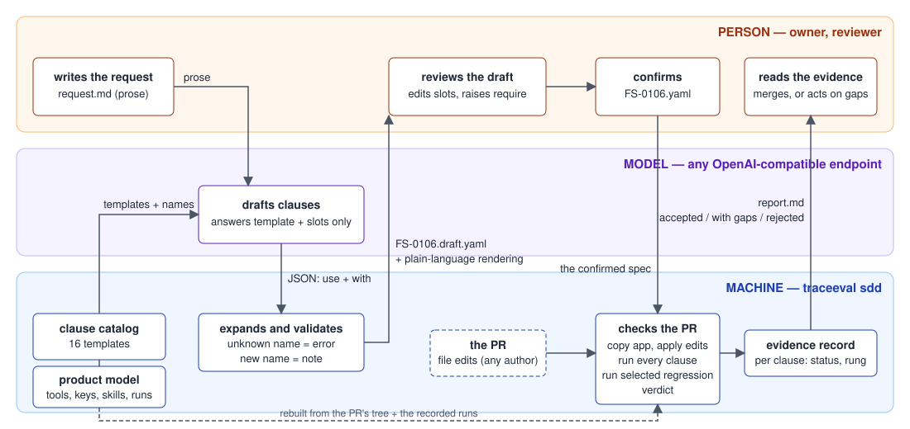
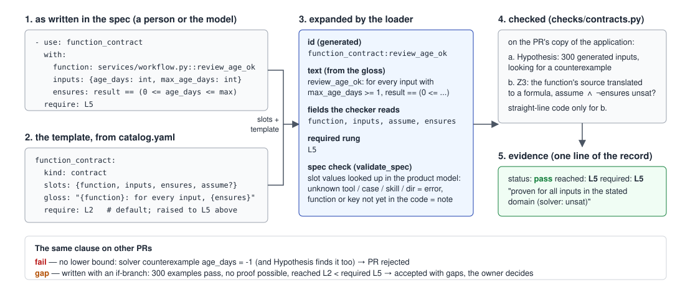
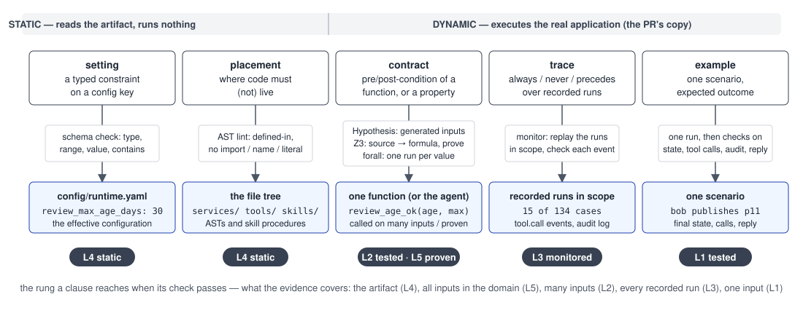
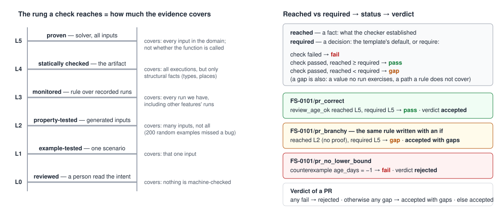

# Spec-driven development here

This page explains the SDD layer of the repository: what a spec
is, where its clauses come from (the catalog), how a spec gets written (by a model, confirmed by a
person), how a PR is judged against it, and what the assurance rungs mean. For the demo results see
[SDD_DEMO.md](SDD_DEMO.md); for the architecture of the whole repository see [STUDY_GUIDE.md](STUDY_GUIDE.md);
for the application the specs talk about see [CONTENTOPS.md](CONTENTOPS.md).

## 1. The idea in one paragraph

A change request is usually prose: "approvals should expire after 30 days". Prose cannot be checked by
a machine. A *spec* keeps the prose (as the *intent*, which a person reviews) and adds *clauses*: small,
typed statements that a machine can check against a pull request — a configuration key must be in a
range, a function must satisfy a pre/post-condition, something must always or never happen in recorded
runs, a concrete scenario must end a given way, a piece of code must live in a given layer. Each clause
is checked by exactly one checker, and each check produces evidence with a rung: how strong the evidence
is. A PR is accepted when every clause holds and the required rungs are reached.



*Who does what. The person only ever writes prose and confirms; the model can only pick templates and
fill slots; the machine validates, checks and reports. Nothing enters the spec that the catalog and the
product model do not know.*

## 2. A spec file

Specs live in `traceeval/specs/FS-*.yaml` (the `FS` ids are just "feature spec" numbers). A spec is:

```yaml
id: FS-0104
title: The SEO title limit is a setting, raised to 70
intent: |
  The maximum length of an SEO title is a platform setting. Raise it from 60 to 70 characters. ...

clauses:
  - use: setting_in_range                      # a template from the catalog ...
    with: {key: seo.max_title_length, min: 10, max: 120, value: 70}     # ... and its slots
  - use: property_over_range
    with:
      var: n
      min: 1
      max: 120
      scenario: {case: SEO-01, context: {seo_title: "=title_of_length(n)"}}
      ensures: applied(run, 'set_page_metadata') == (n <= config('seo.max_title_length'))
  - use: forbid_literal_in
    with: {value: 70, dirs: [tools, services, skills]}
```

Nobody writes ids, kinds or checker fields: a clause is a **template name plus slot values**. The loader
(`traceeval/spec/model.py`) expands it, generates the id (`setting_in_range:seo.max_title_length`) and
the one-line reading (`seo.max_title_length is an integer between 10 and 120`) from the template, and
hands the result to the checker of that kind. A clause may carry `require: L5` to raise the rung it must
reach (see §5); otherwise the template's default applies.



*One clause from FS-0101, end to end: what the author writes, the template it refers to, what the
loader makes of it, what the checker does with it, and the one line of evidence that comes out.*

## 3. The catalog of clause templates

The catalog is one file, `traceeval/spec/catalog.yaml`. It is the closed menu of what a spec may say.
Slot types are checked against the product model (§6) before anything runs.

| template | kind | slots | reads as | default rung |
|---|---|---|---|---|
| `setting_in_range` | setting | key, min, max, [value] | *key* is an integer between *min* and *max* | L4 |
| `setting_equals` | setting | key, value, [type] | *key* is set to *value* | L4 |
| `setting_contains` | setting | key, items | *key* contains *items* | L4 |
| `function_contract` | contract | function, inputs, ensures, [assume], [examples] | for every input with *assume*, *ensures* | L2 (ask L5 for plain arithmetic) |
| `property_over_set` | contract | var, set, scenario, ensures | for every *var* in *set*, *ensures* holds after running *scenario* | L2 |
| `property_over_range` | contract | var, min, max, scenario, ensures, [examples] | for every *var* in *min*..*max*, *ensures* holds after running *scenario* | L2 |
| `always_on_calls` | trace | tools, where | every successful call of *tools* satisfies *where* | L3 |
| `never_on_calls` | trace | tools, where | no call of *tools* ever happens with *where* | L3 |
| `always_in_audit` | trace | actions, where | every audit entry *actions* satisfies *where* | L3 |
| `precedes_in_audit` | trace | actions, before, same, [before_where], [must_cover_except] | every *actions* is preceded, for the same *same*, by *before*; completeness checked against the code paths that change a page status | L3 |
| `scenario` | example | case, [context], [fixture_patch], [expect], [fault_profile] | scenario *case* ends as expected | L1 |
| `function_in_layer` | placement | function, file | *function* is defined in *file* | L4 |
| `forbid_import_in` | placement | module, dirs | nothing under *dirs* imports *module* | L4 |
| `forbid_name_in` | placement | name, dirs | nothing under *dirs* uses the name *name* | L4 |
| `forbid_literal_in` | placement | value, dirs | nothing under *dirs* hard-codes *value* | L4 |
| `skill_step_order` | placement | skill, first, then | in skill *skill*, step *first* comes before step *then* | L4 |



*What each kind looks at. Two kinds are static and run nothing; three execute the PR's copy of the
real application. The badge is the rung a passing check reaches.*

Slot types: `config_key`, `function` (`file.py::name`), `file`, `tool`/`tools`, `skill`, `case` (a catalog
case id or an inline case with `agent`, `request`, `context`), `dirs`, `module`, `expr`, `inputs`, `set`
(`write_tools`, `catalog_cases`, `{skill_write_tools: <skill>}` or a literal list), `int`, `str`, `any`.

Expressions (`where`, `ensures`) are Python expressions over a small vocabulary: `config('key')`,
`approval_age(run, page_id)`, `expected_broken(run, page_id)`, `audit_count(run, action, ...)`,
`applied(run, tool)`, `token_owner(run, token)`, `title_of_length(n)`, `first_case_calling(tool)`,
`baseline_run(test_id)`; `event.<field>` for the call or audit entry being checked and `run.<field>` for
the run (all in `traceeval/spec/context.py`). Adding a template is adding ten lines to the catalog; adding
a helper is adding a function to `context.py`.

## 4. How a spec gets written: model drafts, person confirms

```
traceeval sdd draft --request request.md --id FS-0106 [--save-response answer.json]
traceeval sdd draft --request request.md --id FS-0106 --replay answer.json      # no model needed
```

The model (any OpenAI-compatible endpoint, configured with `TRACEEVAL_LLM_BASE_URL`, `TRACEEVAL_LLM_API_KEY`,
`TRACEEVAL_LLM_MODEL`) receives the catalog, a *slice of the product model* (every tool with its kind and
the service functions behind it, every configuration key with its value, every skill with the tools it
calls, the code paths that change a page status, every recorded case) and the request, and must answer
with JSON: template names and slot values only. The answer is expanded through the catalog (clauses that
do not fit a template are dropped and reported), validated against the product model (an unknown tool,
case, skill or directory is an *error*; a function or configuration key the request introduces is a
*note*), and written as `FS-0106.draft.yaml` with a plain-language rendering `FS-0106.draft.md`:

```
1. publishing.review_max_age_days is an integer between 1 and 365
   setting_in_range:publishing.review_max_age_days - setting, must reach L4
2. services/workflow.py::review_age_ok: for every input with max_age_days >= 1, result == (0 <= age_days <= max_age_days)
   function_contract:review_age_ok - contract, must reach L5
...
```

The owner reads the rendering, edits the YAML (drop, add, change a slot, raise a `require`), and renames
the file to `.yaml`: that is the confirmation. A worked example — request, the model's answer, the
generated draft and rendering — is in [sdd/draft_example/](sdd/draft_example/) (the answer there was
written by hand in the model's format because no endpoint was reachable when the example was made;
`--save-response` on a live run replaces it).

## 5. Rungs: achieved vs required

Every check reports the rung it **reached** — a fact about what the checker could establish:

| rung | meaning | the check behind it |
|---|---|---|
| L0 reviewed | a person read the intent | none |
| L1 example-tested | one scenario ran and ended as expected | one run |
| L2 property-tested | a property held over many generated inputs or an enumerated set | Hypothesis, or one run per value of the set |
| L3 monitored | a rule held over every recorded run in scope | the monitor over the catalog runs |
| L4 statically checked | a fact about the artifact itself (config, code structure) | schema check, AST lint |
| L5 proven | a solver showed no input (within `assume`) violates `ensures` | Z3 on the function's source |



*Left: what the evidence at each rung covers. Right: the comparison that turns a check into a status,
with the three FS-0101 PRs that show each outcome.*

A clause also has a **required** rung — a decision, not a fact: the template's default, or `require:`
in the spec. The verdict compares the two: a clause that holds but reaches less than required is reported
as a *gap* ("reached L2, L5 required"), and the PR is "accepted with gaps" rather than "accepted". The
demo has one such case: FS-0101's rule written with an if-branch is correct (300 examples pass) but the
proof backend only translates straight-line code, so the owner sees the gap and decides — simplify the
code, add a proof backend, or accept L2.

## 6. How a PR is judged

`traceeval sdd` evaluates every PR of every spec:

1. The application is copied, the PR's edits are applied, and the *change set* is computed (which files,
   functions, lines, config keys, skills changed).
2. The product model is rebuilt from the changed tree (static facts) and the recorded baseline runs
   (dynamic facts: which case touches which tool and function).
3. The spec is validated against the product model (§4's errors and notes).
4. Every clause runs through its checker; the result carries status (pass / fail / gap), reached rung,
   required rung, a one-line summary and details (the counterexample, the violating run, the misplaced
   file).
5. The catalog cases whose recorded traces touch the change set are run as regression tests (this is the
   earlier work on test selection, reused).
6. Verdict: **rejected** if any clause or regression test fails; **accepted with gaps** if something
   holds but below its required rung, or a quantifier value had no recorded run, or a rule does not cover
   every path the product model found; **accepted** otherwise. The evidence record (JSON) and the report
   keep all of it.

## 7. Related tools we looked at, and why none of them is the answer alone

| tool / family | what it does | why it is not enough here |
|---|---|---|
| nl2spec (Cosler et al., 2023) | LLM turns natural language into LTL formulas, with sub-translations a person can correct | output is temporal logic over abstract propositions: someone still has to bind each proposition to a real event, and it covers only the temporal kind of clause — no settings, examples, contracts or placement |
| SpecGen, AutoSpec (2024) | LLM generates JML / ACSL contracts for existing Java / C code, refined until a verifier accepts them | they describe what the *code already does* (code → spec), not what a *request wants*; function-level only; verifier languages for Java/C, while this system is Python, prompts and YAML |
| Hypothesis ghostwriter | writes property-based test skeletons from a function's signature (round-trip, idempotence, equivalence) | properties are generic, not derived from a requirement; function-level; a person still has to make them meaningful |
| ArchUnit, import-linter, Semgrep rule packs | assert structural rules: layers, dependency direction, forbidden imports, naming | static only and written by developers; nothing about behaviour, settings, examples or run-time evidence; no link to a change request |
| Dafny, Verus, F*, Lean, Alloy, TLA+ (the note's Q1) | whole-program or model proofs | the system would have to be rewritten in the proof language; agents, prompts and skills have no counterpart there — so here proofs are confined to pure functions (via Z3) and the rest is monitored or tested |
| Spec Kit, Kiro-style "spec-driven" agent workflows | prose specs that guide a coding agent | prose only: nothing is machine-checked, so there is no evidence and no rung |

What this layer takes from them: nl2spec's idea of a constrained translation a person confirms;
SpecGen's loop of generating and checking; the ghostwriter's property templates; the architecture
linters' rule shapes; the solver from the proof world — behind one catalog, one evidence record.

## 8. Questions people ask

*Why YAML and not a proof language?* Because the clauses are of five different natures and only one of
them (a pure-function contract) is a proof obligation; the YAML is the intermediate representation the
note asks for, and each kind is compiled to the right checker.

*What stops the model from inventing things?* The catalog (it can only pick templates and fill slots),
the validation against the product model (unknown names are errors), and the person who confirms.

*Can a PR change the spec to make itself pass?* Specs live outside the application folder that a PR
edits, under their own review; the spec check also reports what a spec references that the current code
does not have, so a PR that silently removes a function is visible.

*What does "proven" prove?* That the function satisfies its post-condition for every input in the stated
domain. Not that it is called: that is what the trace rule and the scenarios are for, and the demo has a
PR that passes the proof and fails them.
