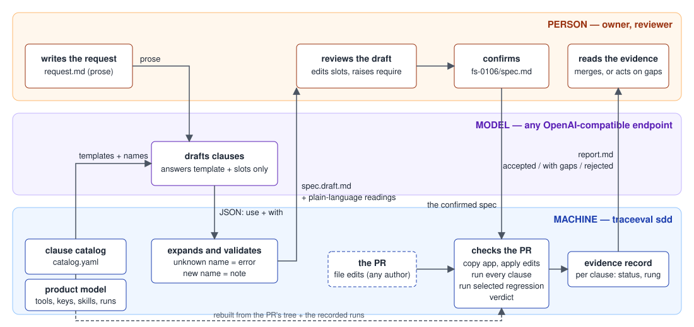
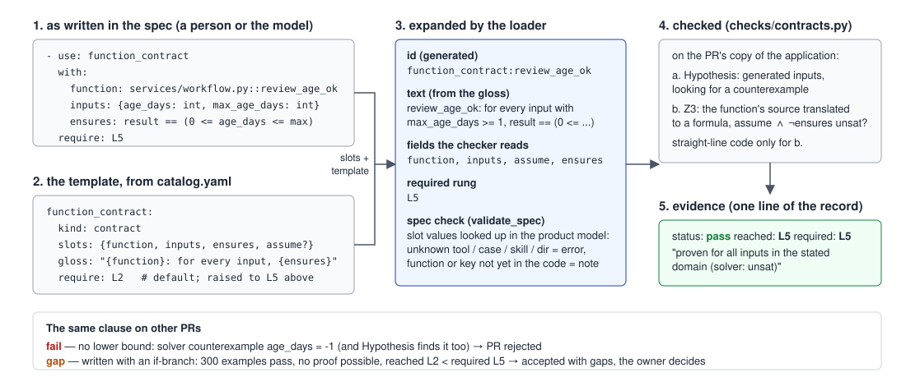
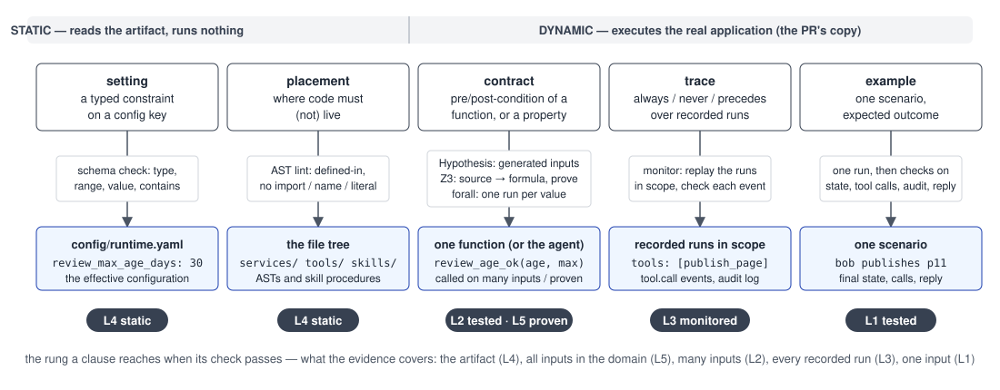
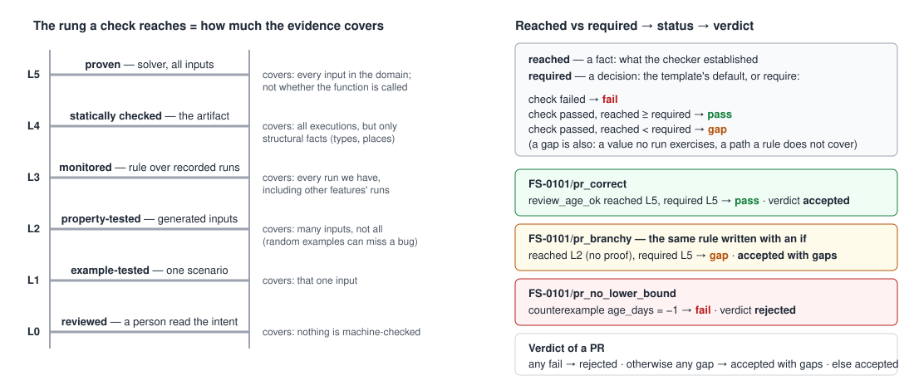

# Spec-driven development in TRACE-Eval

The reference for the spec-driven development (SDD) layer. [SDD_DEMO.md](SDD_DEMO.md) has the demo results,
[STUDY_GUIDE.md](STUDY_GUIDE.md) a reading plan of the layer's code, and [CONTENTOPS.md](CONTENTOPS.md) the
application the specs describe.

## 1. The idea

A change request is usually prose, such as "approvals should expire after 30 days", and a machine cannot
check prose. A *spec* keeps the prose as the *intent*, which a person reviews, and adds *clauses*: small,
typed statements that a machine can check against a pull request. A clause can say that:

- a configuration key must be in a range;
- a function must satisfy a pre/post-condition;
- something must always or never happen in recorded runs;
- a concrete scenario must end a given way;
- a piece of code must live in a given layer.

Each clause is checked by exactly one checker. Each check produces evidence with a *rung*, a level that says how
strong the evidence is. A PR is accepted when every clause holds and reaches its required rung.



*Who does what. The person only writes prose and confirms. The model can only pick templates and fill
slots. The machine validates, checks and reports. Nothing enters the spec that the catalog and the
product model do not know.*

## 2. A spec file

Specs live in `traceeval/specs/FS-*.yaml`; an `FS` id is a feature spec number. A spec looks like this:

```yaml
id: FS-0104
title: The SEO title limit is a setting, raised to 70
intent: |
  The maximum length of an SEO title is a platform setting. Raise it from 60 to 70 characters. ...

clauses:
  - use: setting_in_range                      # a template from the catalog ...
    with: {key: seo.max_title_length, min: 10, max: 120, value: 70}     # ... and its slots
  - use: property_over_range
    with:
      var: n
      min: 1
      max: 120
      scenario: {case: SEO-01, context: {seo_title: "=title_of_length(n)"}}
      ensures: applied(run, 'set_page_metadata') == (n <= config('seo.max_title_length'))
  - use: forbid_literal_in
    with: {value: 70, dirs: [tools, services, skills]}
```

A clause is a template name plus slot values; the author never writes ids, kinds or checker fields. The
loader (`traceeval/spec/model.py`) expands the clause from its template, generates its id
(`setting_in_range:seo.max_title_length`) and its one-line reading
(`seo.max_title_length is an integer between 10 and 120`), and hands the result to the checker of that kind.
A clause may carry `require: L5` to raise the rung it must reach (see §5); otherwise the template's default
applies.



*A different clause, FS-0101's function contract, end to end: what the author writes, the template it refers to,
what the loader makes of it, what the checker does with it, and the one line of evidence that comes out.*

## 3. The catalog of clause templates

The catalog is one file, `traceeval/spec/catalog.yaml`. It is the closed menu of what a spec may say.
Slot types are checked against the product model before anything runs. The product model is a
description of the application built from its code (files, functions, tools, skills, configuration) and from
its recorded runs (which cases exercise which tools and functions).

| template | kind | slots | reads as | default rung |
|---|---|---|---|---|
| `setting_in_range` | setting | key, min, max, [value] | *key* is an integer between *min* and *max* | L4 |
| `setting_equals` | setting | key, value, [type] | *key* is set to *value* | L4 |
| `setting_contains` | setting | key, items | *key* contains *items* | L4 |
| `function_contract` | contract | function, inputs, ensures, [assume], [examples] | for every input with *assume*, *ensures* | L2; `require: L5` for straight-line arithmetic |
| `property_over_set` | contract | var, set, scenario, ensures | for every *var* in *set*, *ensures* holds after running *scenario* | L2 |
| `property_over_range` | contract | var, min, max, scenario, ensures, [examples] | for every *var* in *min*..*max*, *ensures* holds after running *scenario* | L2 |
| `always_on_calls` | trace | tools, where | every successful call of *tools* satisfies *where* | L3 |
| `never_on_calls` | trace | tools, where | no call of *tools* ever happens with *where* | L3 |
| `always_in_audit` | trace | actions, where | every audit entry *actions* satisfies *where* | L3 |
| `precedes_in_audit` | trace | actions, before, same, [before_where], [must_cover_except] | every *actions* is preceded, for the same *same*, by *before*; completeness checked against the code paths that change a page status | L3 |
| `scenario` | example | case, [context], [fixture_patch], [expect], [fault_profile] | scenario *case* ends as expected | L1 |
| `function_in_layer` | placement | function, file | *function* is defined in *file* | L4 |
| `forbid_import_in` | placement | module, dirs | nothing under *dirs* imports *module* | L4 |
| `forbid_name_in` | placement | name, dirs | nothing under *dirs* uses the name *name* | L4 |
| `forbid_literal_in` | placement | value, dirs | nothing under *dirs* hard-codes *value* | L4 |
| `skill_step_order` | placement | skill, first, then | in skill *skill*, step *first* comes before step *then* | L4 |



*What each kind looks at. Two kinds are static and run nothing. The other three execute the PR's copy
of the application itself. The badge is the rung a passing check reaches.*

Slot types: `config_key`, `function` (`file.py::name`), `file`, `tool`/`tools`, `skill`, `case` (a catalog case id
or an inline case with `agent`, `request`, `context`; `fixture_patch` edits the starting data before the run, as in
a test), `dirs`, `module`, `expr`, `inputs`, `set` (`write_tools`, `catalog_cases`, `{skill_write_tools: <skill>}`
or a literal list), `int`, `str`, `any`.

Expressions (`where`, `ensures`) are Python expressions over a small vocabulary of helpers: `config('key')`,
`approval_age(run, page_id)`, `expected_broken(run, page_id)`, `audit_count(run, action, ...)`,
`applied(run, tool)`, `token_owner(run, token)`, `call_token(run, event)` (the token a call was made with,
also when a step of a plan received it), `title_of_length(n)`, `first_case_calling(tool)` and
`baseline_run(test_id)`. In an expression, `event.<field>` reads the call or audit entry being checked and
`run.<field>` reads the run. All of these are defined in `traceeval/spec/context.py`.

A new template takes ten lines in the catalog; [STUDY_GUIDE.md](STUDY_GUIDE.md) §4 says what a new kind, helper or
proof backend takes.

## 4. How a spec gets written: model drafts, person confirms

```
traceeval sdd draft --request request.md --id FS-0106 [--save-response answer.json]
traceeval sdd draft --request request.md --id FS-0106 --replay answer.json      # no model needed
```

The `llm` backend's model does the drafting ([EXPERIMENT.md](EXPERIMENT.md) §3). It receives the catalog, the
request and a *slice of the product model*:

- every tool with its kind and the service functions behind it;
- every configuration key with its value;
- every skill with the tools it calls;
- the code paths that change a page status;
- every recorded case.

It must answer in JSON, with template names and slot values only.

The answer is expanded through the catalog, and clauses that do not fit a template are dropped and reported.
The result is validated against the product model: an unknown tool, case, skill or directory is an *error*, and a
function or configuration key that the request introduces is a *note*. The draft is written as `<id>.draft.yaml`,
with a plain-language rendering in `<id>.draft.md`. The worked example in [sdd/draft_example/](sdd/draft_example/)
(the request, Qwen's answer, the generated draft and its rendering) begins:

```
1. publishing.approval_validity_days is an integer between 1 and 365
   setting_in_range:publishing.approval_validity_days - setting, must reach L4
2. services/workflow.py::approval_is_valid: for every input with approval_age(run, page_id) is not None, ...
   function_contract:approval_is_valid - contract, must reach L5
...
```

The spec owner reads the rendering, edits the YAML (drops or adds a clause, changes a slot, raises a `require`) and
confirms the spec by renaming the file to `.yaml`. The example shows the validation at work: one slot the model
wrote as prose is reported as an error for the owner to fix.

## 5. Rungs: achieved vs required

Every check reports the rung it **reached**, a fact about what the checker could establish:

| rung | meaning | the check behind it |
|---|---|---|
| L0 reviewed | a person read the intent | none |
| L1 example-tested | one scenario ran and ended as expected | one run |
| L2 property-tested | a property held over many generated inputs or an enumerated set | Hypothesis (a property-based testing library), or one run per value of the set |
| L3 monitored | a rule held over every recorded run in scope | the monitor over the catalog runs |
| L4 statically checked | a fact about the artifact itself (config, code structure) | schema check, lint of the parsed code (AST) |
| L5 proven | a solver showed no input (within `assume`) violates `ensures` | the Z3 solver (an SMT solver: it decides whether a formula can be satisfied) on the function's source |



*Left: what the evidence at each rung covers. Right: the comparison that turns a check into a status,
with the three FS-0101 PRs that show each outcome.*

A clause also has a **required** rung. Unlike the reached rung, it is a decision: the template's default, or
`require:` in the spec. The verdict compares the two. A clause that holds but reaches less than its required
rung is reported as a *gap* ("reached L2, L5 required"), and the PR is then "accepted with gaps" instead of
"accepted". The demo has one such case: FS-0101's rule written with an if-branch. It is correct (300 examples
pass), but the proof backend only translates straight-line code, that is, code without branches. The owner
sees the gap and decides whether to simplify the code, add a proof backend or accept L2.

## 6. How a PR is judged

`traceeval sdd` evaluates every PR of every spec:

1. The application is copied, the PR's edits are applied, and the *change set* is computed: which files,
   functions, lines, config keys and skills changed.
2. The product model is rebuilt from the changed tree (static facts) and the recorded baseline runs
   (dynamic facts: which case touches which tool and function).
3. The spec is validated against the product model, with the errors and notes described in §4.
4. Every clause runs through its checker. The result carries the status (pass / fail / gap), the reached
   rung, the required rung, a one-line summary and the details: the counterexample, the violating run or the
   misplaced file.
5. The catalog cases whose recorded traces touch the change set are run as regression tests. This step
   reuses the `observed` strategy of [RESEARCH_PLAN.md](RESEARCH_PLAN.md) §3.
6. The verdict is:
   - **rejected** if any clause or regression test fails;
   - **accepted with gaps** if a clause holds but below its required rung, a quantifier value (one of the
     values a clause ranges over) had no recorded run, or a rule does not cover every path the product model
     found;
   - **accepted** otherwise.

   The evidence record (JSON) and the report keep all of it.

For each spec the runner also writes an *agent brief*: the files and functions a coding agent would read for the
change (the tool adapters, the services behind them, the skills that call them, the configuration keys), with their
share of the repository's tokens.

## 7. Related tools, and what each lacks

- **nl2spec** turns natural language into temporal-logic formulas (LTL), with sub-translations a person can
  correct. Its output is logic over abstract propositions that someone still has to bind to actual events, and it
  covers only the temporal kind of clause: no settings, examples, contracts or placement.
- **SpecGen, AutoSpec** generate JML or ACSL contracts (specification languages for Java and C) for existing code,
  refined until a verifier accepts them. They describe what the code already does (code $\to$ spec), not what a
  request wants, at function level, for Java and C; this system is Python, prompts and YAML.
- **Hypothesis ghostwriter** writes property-based test skeletons from a function's signature (round-trip,
  idempotence, equivalence). The properties are generic rather than derived from a requirement, and function-level.
- **ArchUnit, import-linter, Semgrep rule packs** assert structural rules: layers, dependency direction, forbidden
  imports, naming. Static only and written by developers, with nothing about behaviour, settings, examples or
  run-time evidence, and no link to a change request.
- **Dafny, Verus, F\*, Lean, Alloy, TLA+** prove whole programs or models, which would mean rewriting the system in
  the proof language, where agents, prompts and skills have no counterpart. Here proofs are confined to pure
  functions (via Z3); the rest is monitored or tested.
- **Spec Kit and Kiro-style spec-driven agent workflows** are prose specs that guide a coding agent. Nothing is
  machine-checked, so there is no evidence and no rung.

This layer takes something from each and puts it behind one catalog and one evidence record: nl2spec's
idea of a constrained translation that a person confirms, SpecGen's loop of generating and checking, the
ghostwriter's property templates, the rule shapes of the architecture linters, and the solver from the
proof world.

## 8. Questions people ask

*Why YAML and not a proof language?* The clauses are of five different kinds, and only one of them (a pure-function
contract) is a proof obligation. The YAML is the intermediate representation, and each kind compiles to its own
checker.

*What stops the model from inventing things?* The catalog (it can only pick templates and fill slots),
the validation against the product model (unknown names are errors), and the person who confirms.

*Can a PR change the spec to make itself pass?* Specs live outside the application folder that a PR
edits, and they are reviewed separately. The spec check also reports anything a spec references that the
current code does not have, so a PR that silently removes a function shows up.

*What does "proven" prove?* That the function satisfies its post-condition for every input in the stated domain. It
does not prove that the function is called; the trace rule and the scenarios check that.
