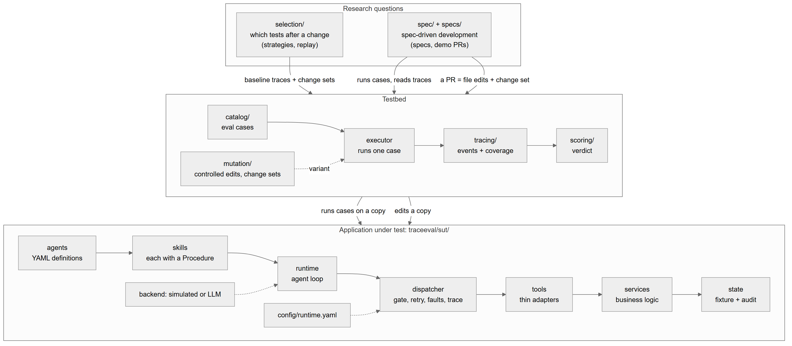
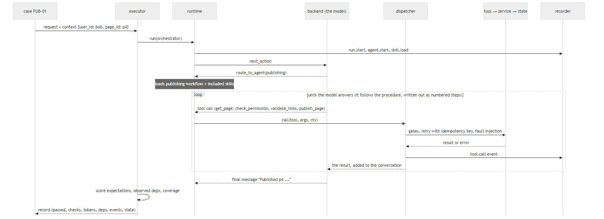
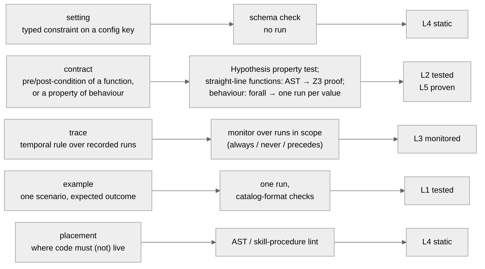
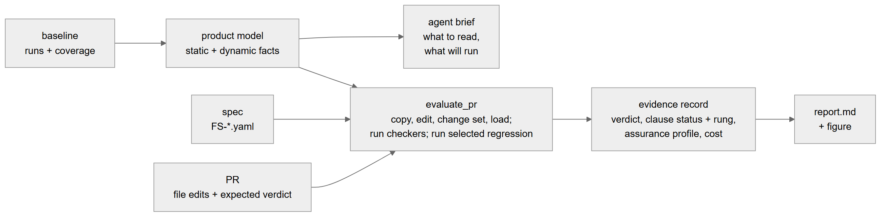

# TRACE-Eval and the SDD layer — a study guide

A plan for reading the repository in two to three hours, with the focus on the spec-driven
development (SDD) work. Paths are relative to the repository root (`trace-eval/`); short ones such as `spec/model.py` or
`specs/FS-0101.yaml` are under `traceeval/`.
The diagrams are images rendered from the Mermaid sources in `docs/diagrams/`.

## 1. What is in the repository

The repository has three layers. The bottom one is a small, working multi-agent application
("ContentOps"). The middle one is the testbed: it runs the application, records what each run touched,
and applies controlled changes to it. The top one holds the two research questions that use the testbed:
test selection (the earlier work) and spec-driven development.

A run of a case produces a trace. The trace records which agents, skills, tools, configuration keys and
code functions the run touched. Test selection, the mutation ground truth and the SDD layer are all built
on these runs and traces and on controlled edits of the application.

### 1.1 One run, end to end

Open these three files side by side as you read: `traceeval/catalog/tests/publishing.yaml`
(PUB-01), `traceeval/sut/skills/publishing-workflow/SKILL.md` (the Procedure the model reads as numbered steps)
and `traceeval/sut/harness/dispatcher.py` (where every tool call is governed and recorded).

### 1.2 The earlier work in one paragraph

After a change (a skill, a prompt, harness code, a config key), which of the cases should run and
when can we stop? The 43 mutations give the ground truth (which change breaks which case), and the
baseline traces give observed dependencies. The strategies in `traceeval/selection/` rank cases under a
token budget and are compared by replaying recorded outcomes (`docs/results/gemma5/report.md`). The SDD
layer reuses the executor, the catalog, the recorder with coverage, the mutation machinery, the
change-set extraction and the `observed` selection.

## 2. How SDD connects to it

### 2.1 Conceptually

The direction note on spec-driven development (the request this layer answers; it is kept outside the
repository) asks for a spec that machines can check (and prove where possible), an up-to-date
product model that drives generation and verification, generation of only the needed code in the right
place, and an evidence record. The testbed already had the raw material for three of the four.

| the note wants | trace-eval already had | the SDD layer adds |
|---|---|---|
| an up-to-date product model | static: files, functions (AST), tool registry, skill procedures, config; dynamic: traces = which runs exercise which tool / function | `spec/product.py` puts both behind queries: `locate(tools)`, `cases_calling(tools)`, `status_setters()`, `skill_write_tools(skill)` |
| a formal-enough spec | — | `specs/FS-*.yaml`: prose intent + clauses of five kinds; `spec/checks/` = one checker per kind |
| run only what a change touches | the `observed` strategy on a change set | reused as the regression line of every evidence record |
| generate only the needed code, in the right place, passing tests | the mutation machinery: a PR is a set of file edits applied to a copy of the app | `spec/prs.py` (25 PRs with expected verdicts), `spec/runner.py` (evidence record + agent brief), `spec/report.py` |

A clause is a compiler target: the spec author writes *what* must hold, and the clause kind decides *how*
it is checked and which assurance rung the result can reach.

L0 (reviewed) is the prose `intent`. The demo uses the ladder to show that one rung does not stand in for
another. A unit-level proof is not a system-level guarantee: FS-0101's "proven but never wired in" PR
passes the proof and fails the stale-approval example. A run-time check is not an architectural guarantee:
FS-0102's token lookup written inside the dispatcher passes every run-time check and fails only placement.

### 2.2 What happens when `traceeval sdd` runs

A PR is evaluated against a *variant* of the application (the baseline copied and edited), loaded
under a fresh module name so several variants can coexist. The checkers never see the expected verdict.
The report compares the two and flags any disagreement; all 25 agree.

### 2.3 Design decisions you will be asked about

No single proof language: the YAML clause file is the intermediate representation, and the
languages sit behind the checkers (Z3 today; a Dafny or TLA+ backend would be another `contract`
checker). Proofs are attempted only for pure, straight-line functions, and the record says when a proof
was not attempted and why. Everything else is property-tested, monitored or linted. "Spec is not intent"
is handled by keeping the prose as L0 and by reporting gaps (a quantifier value no recorded run
exercises, a code path a rule does not cover) instead of hiding them. "Model is not code" is handled by
executing the system itself for every run-time rung (L1–L3). Monitors run over recorded runs here and would run
over production traces unchanged, since they only need the event format.

## 3. The five examples

The five requests, their correct PRs and what each one demonstrates are in [SDD_DEMO.md](SDD_DEMO.md) ("The five
requests"); the verdicts are in `docs/sdd/report.md`.

### 3.1 FS-0101 in detail

`traceeval/specs/FS-0101.yaml` has ten clauses written against the catalog (`use: <template>`,
`with: {slots}`; ids and texts are generated). The first section of `traceeval/spec/prs.py` has the
correct PR, four wrong ones and one correct-but-branchy one. In the matrix below (from `docs/sdd/report.md`),
each wrong PR fails a different combination of clauses.

| clause (kind) | pr_correct | no lower bound | off by one (`<`) | logic in adapter | not wired in |
|---|---|---|---|---|---|
| `setting_in_range:publishing.review_max_age_days` (setting) | pass | pass | pass | pass | pass |
| `function_contract:review_age_ok` (contract, proof) | **L5** | fail: age = −1 | fail: age = max | fail: not in the service | **L5** |
| `always_on_calls:publish_page+schedule_publish` (trace) | pass | pass | pass | **fail** (PUB-10) | **fail** (PUB-10) |
| `scenario:please-publish-the-staleapproval` (p11, 45 days) | pass | pass | pass | pass | **fail: published** |
| `scenario:PUB-01` (an approval exactly 30 days old) | pass | pass | **fail** | pass | pass |
| `scenario:PUB-01#2` (a fresh approval) | pass | pass | pass | pass | pass |
| placement (`function_in_layer` ×2, `forbid_import_in`, `forbid_literal_in`) | pass | pass | pass | **fail** (three) | pass |
| `regression-tests` (the change-selected cases) | pass | pass | pass | pass | pass |

The trace monitor's failures come from Gemma: in PUB-10 it schedules a page with no approved review, which the
service version of the rule refuses and the other two let through.

The sixth PR, `pr_branchy`, writes the same rule with an `if`. Every check passes, but the contract only
reaches L2 (the prover translates straight-line code only) while the clause requires L5. The verdict is
"accepted with gaps", and the owner decides.

How the proof works: `review_age_ok`'s source is parsed and its single `return` expression is rewritten
into Z3 operators (`and`/`or`/`not` and chained comparisons become `z3.And/Or/Not`). The inputs become
`z3.Int` symbols, and the solver is asked for an input that satisfies `assume ∧ ¬ensures`. `unsat` is
the proof; a model is the counterexample. Loops, branches and calls are not translated. In that case the
clause stays at L2 and the record says so.

## 4. The code, in reading order

| file | lines | role |
|---|---|---|
| `traceeval/spec/catalog.yaml` + `model.py` | 164 + 261 | the clause templates; `Spec`, `Clause`, `ClauseResult`; expansion of `use/with` clauses, generated ids and texts; `validate_spec` against the product model |
| `traceeval/spec/draft.py` | 229 | `traceeval sdd draft`: product-model slice + catalog → prompt → model answer → expanded, validated draft spec and its plain-language rendering |
| `traceeval/spec/product.py` | 187 | the product model: files and token counts, functions (AST), tool registry (from decorators), skill procedures, config; queries `locate`, `cases_calling`, `status_setters`, `skill_write_tools`, `model_set` |
| `traceeval/spec/context.py` | 206 | `CheckContext`: runs cases on the variant with cost accounting (in parallel when asked), builds the expression environment; the helpers usable in clauses (`config`, `approval_age`, `expected_broken`, `audit_count`, `applied`, `token_owner`, `call_token`, `title_of_length`, `first_case_calling`, `baseline_run`) |
| `traceeval/spec/checks/settings.py` | 48 | schema check |
| `traceeval/spec/checks/examples.py` | 32 | one run, catalog-format expectations, `=expr` values |
| `traceeval/spec/checks/placement.py` | 117 | the five lint rules |
| `traceeval/spec/checks/traces.py` | 140 | `always` / `never` / `precedes`, `must_cover`; `cases_in_scope` resolves a clause's scope to catalog cases |
| `traceeval/spec/checks/contracts.py` | 329 | Hypothesis `find`; `_ToZ3` AST rewriter, `_symbolic_call`, `_prove`; behavioural `forall` |
| `traceeval/spec/runner.py` | 241 | `record_baseline`, `agent_brief`, `evaluate_pr`, `run_demo` |
| `traceeval/spec/report.py` | 195 | markdown report and the figure |
| `traceeval/spec/prs.py` | 764 | the PR table; open it only to see how a PR is written (a `Mutation` with literal-anchor edits) |
| `traceeval/cli.py::cmd_sdd`, `tests/test_sdd.py` | | the command and the tests that pin the expected verdicts |

Where to extend: a new clause kind is one checker module, one line in `checks/__init__.py`, its name in `KINDS` in
`model.py` and a template in `catalog.yaml`; a new
proof backend is another branch in `contracts._prove`; a new product-model query is a method on
`ProductModel`; a new helper for clause expressions is a function in `context.py`, added to
`CheckContext.env`.

The clause catalog (specs are template + slots), the drafting command (`traceeval sdd draft`) and the required
rung of each clause are explained in [SDD_GUIDE.md](SDD_GUIDE.md).

## 5. Suggested two to three hours

1. (30 min) Section 1 with `README.md` and `docs/USER_GUIDE.md`; PUB-01, the publishing skill and the
   dispatcher open side by side; run `traceeval run --test PUB-01 --backend replay` and look at the printed trace.
2. (30 min) `docs/SDD_DEMO.md`, then `docs/sdd/report.md`: the verdict table, the resources table, and
   FS-0101's section in full (brief + the six PR records).
3. (60 min) The code in the order of section 4, with `specs/FS-0101.yaml` next to `checks/contracts.py`
   and `checks/traces.py`; then `specs/FS-0105.yaml` next to the behavioural `forall` branch.
4. (30 min) The questions to expect: what counts as "formal" here; why no Dafny/TLA+ yet; what the proof
   proves (a pure function, within `assume`) and what it does not (that the function is called); what a
   monitor needs to run on production traces (the event format); what is missing (the generation and
   repair loop, a real repository, first-pass-acceptance numbers).

## 6. What is not there yet

See [SDD_DEMO.md](SDD_DEMO.md), "What is not here yet".
