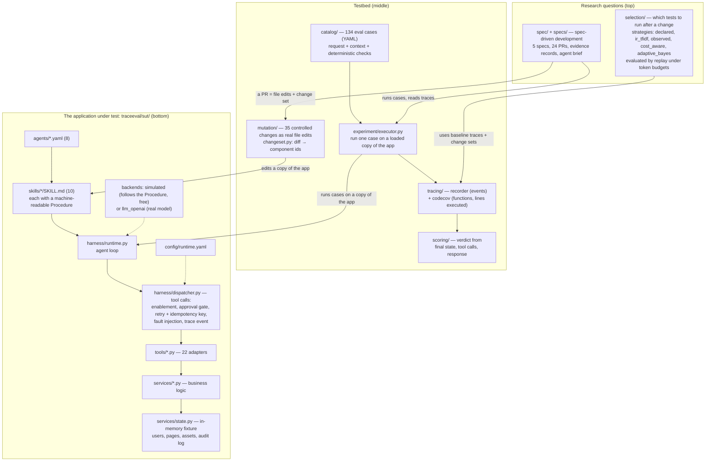
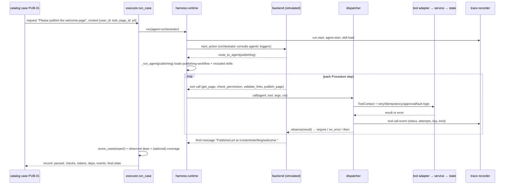
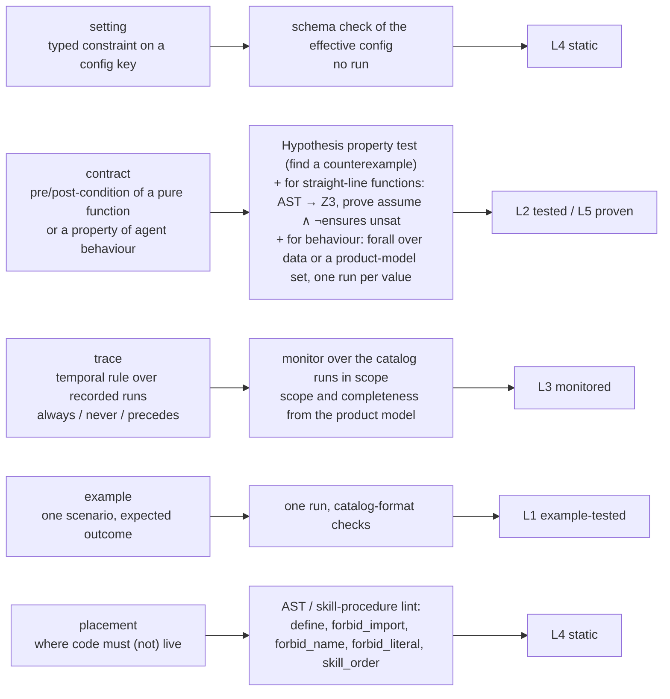
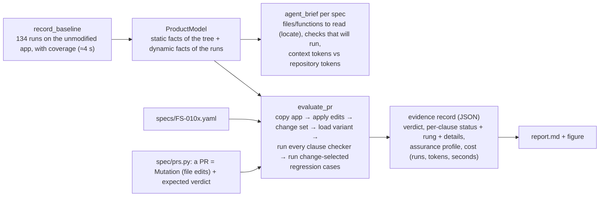

# TRACE-Eval and the SDD layer — a study guide

A road-map for reading the repository in two to three hours, oriented towards the spec-driven
development (SDD) work. Paths are relative to the repository root (`C:\Work\trace-eval`).
Diagrams are Mermaid: they render on GitHub and in VS Code with the Mermaid extension.

## 1. What is in the repository

Three layers. The bottom one is a small but real multi-agent application ("ContentOps"); the middle
one is the testbed that runs it, records what each run touched, and applies controlled changes to it;
the top one holds the two research questions that use the testbed: test selection (the earlier work)
and spec-driven development (this week).

The single idea to internalise: **a run of a case produces a trace**, and the trace says which agents,
skills, tools, configuration keys and code functions that run touched. Selection, the mutation ground
truth and the SDD layer are all built on "runs + traces + controlled edits of the application".

### 1.1 One run, end to end

Open these three files side by side while reading this: `traceeval/catalog/tests/publishing.yaml`
(PUB-01), `traceeval/sut/skills/publishing-workflow/SKILL.md` (the Procedure the backend executes)
and `traceeval/sut/harness/dispatcher.py` (where every tool call is governed and recorded).

### 1.2 The earlier work in one paragraph

After a change (a skill, a prompt, harness code, a config key), which of the 134 cases should run and
when can we stop? The 35 mutations give the ground truth (which change breaks which case); the
baseline traces give observed dependencies; the strategies in `traceeval/selection/` rank cases under a
token budget and are compared by replaying recorded outcomes (`docs/results/exp1/report.md`). What the
SDD layer reuses from this: the executor, the catalog, the recorder with coverage, the mutation
machinery, the change-set extraction and the `observed` selection.

## 2. How SDD connects to it

### 2.1 Conceptually

The direction note asks for a spec that machines can check (and prove where possible), an up-to-date
product model that drives generation and verification, generation of only the needed code in the right
place, and an evidence record. The testbed already had the raw material for three of the four.

| the note wants | trace-eval already had | the SDD layer adds |
|---|---|---|
| an up-to-date product model | static: files, functions (AST), tool registry, skill procedures, config; dynamic: traces = which runs exercise which tool / function | `spec/product.py` puts both behind queries: `locate(tools)`, `cases_calling(tools)`, `status_setters()`, `skill_write_tools(skill)` |
| a formal-enough spec | — | `specs/FS-*.yaml`: prose intent + clauses of five kinds; `spec/checks/` = one checker per kind |
| run only what a change touches (Q12) | the `observed` strategy on a change set | reused as the regression line of every evidence record |
| generate only the needed code, in the right place, passing tests | the mutation machinery: a PR is a set of file edits applied to a copy of the app | `spec/prs.py` (24 PRs with expected verdicts), `spec/runner.py` (evidence record + agent brief), `spec/report.py` |

The central idea is that **a clause is a compiler target**: the spec author writes *what* must hold,
the clause kind decides *how* it is checked and which assurance rung the result can reach.

L0 (reviewed) is the prose `intent`. The rung ladder is the argument of the whole demo: a unit-level
proof is not a system-level truth (FS-0101's "proven but never wired in" PR passes the proof and
fails the monitor), and a run-time check is not an architectural truth (the "right behaviour, wrong
layer" PRs pass every run and fail only placement).

### 2.2 What happens when `traceeval sdd` runs

A PR is evaluated against a *variant* of the application (the baseline copied and edited), loaded
under a fresh module name so several variants can coexist. The checkers never see the expected verdict;
the report compares and flags any disagreement. All 24 agree.

### 2.3 Design decisions you will be asked about

No single proof language (Q1): the YAML clause file is the intermediate representation; the languages
sit behind the checkers (Z3 today; a Dafny or TLA+ backend would be another `contract` checker).
Proofs are attempted only for pure, straight-line functions and the record says when a proof was not
attempted and why; everything else is property-tested, monitored or linted. "Spec is not intent" is
handled by keeping the prose as L0 and by reporting gaps (a quantifier value no recorded run exercises,
a code path a rule does not cover) instead of hiding them. "Model is not code" is handled by executing
the real system for every rung above L4. Monitors run over recorded runs here, and would run over
production traces unchanged: they only need the event format.

## 3. The five examples

| request | accepted PR | what it demonstrates |
|---|---|---|
| FS-0101 an approval is valid for 30 days | feature: config, workflow service, publish adapters, skill prose (4 files, 55 lines) | the rule `review_age_ok` is **proven** for all inputs; the proof alone catches a future-dated approval; an off-by-one is caught by proof and boundary example; the logic in the adapter fails only placement; the proven-but-unwired function fails only the monitor and the example |
| FS-0102 a guarded operation needs a *valid* token and records the approver | security fix: permissions service, dispatcher (2 files, 17 lines) | the spec run against the **current** code finds that any made-up token passes; a "self-approved" fallback is caught by property, monitor and example; the lookup written inside the harness is caught only by placement |
| FS-0103 nothing goes live without a clean link check of its current version | defence in depth: links service, workflow service (2 files, 28 lines) | the rule moves from a skill procedure (a prompt) into the service and `links_clean` is **proven**; the version-ignoring gate is missed by 200 random examples and found by the solver; a `precedes` rule over the audit log with completeness against the product model's status-changing paths; a skill reordering is stopped by the service gate and still rejected |
| FS-0104 the SEO title limit is a setting, raised to 70 | configuration only (1 file, 2 lines) | a property over **agent behaviour** (titles of every length 1..120); boundary examples computed from config; a hard-coded 70 caught only by placement |
| FS-0105 a retried publishing write never duplicates | bug fix: workflow service, publish adapters (2 files, 22 lines) | quantified over the write tools of the publishing skill (from the product model), the spec finds that two of them duplicate on a lost acknowledgement **before any PR exists**; a partial fix is caught by the same quantifier |

### 3.1 FS-0101 in detail — read this one fully

`traceeval/specs/FS-0101.yaml` has seven clauses; `traceeval/spec/prs.py` (first section) has the
correct PR and four wrong ones. The matrix below is the heart of the demo: every wrong PR fails a
*different kind* of clause.

| clause (kind) | pr_correct | no lower bound | off by one (`<`) | logic in adapter | not wired in |
|---|---|---|---|---|---|
| window-setting (setting) | pass | pass | pass | pass | pass |
| age-rule (contract, proof) | **L5** | fail: age = −1 | fail: age = max | fail: function not in the service | **L5** |
| no-stale-go-live (trace) | pass | pass | pass | pass | pass |
| stale-refused (example p11, 45 days) | pass | pass | pass | pass | **fail: published** |
| boundary-publishes (example, exactly 30 days) | pass | pass | **fail** | pass | pass |
| fresh-publishes (example PUB-01) | pass | pass | pass | pass | pass |
| lives-in-service (placement) | pass | pass | pass | **fail** | pass |
| regression (31 change-selected cases) | pass | pass | pass | pass | pass |

How the proof works, in one sentence: `review_age_ok`'s source is parsed, its single `return`
expression is rewritten into Z3 operators (`and`/`or`/`not` and chained comparisons become
`z3.And/Or/Not`), the inputs become `z3.Int` symbols, and the solver is asked for an input satisfying
`assume ∧ ¬ensures`; `unsat` is the proof, a model is the counterexample. Loops, branches and calls are
not translated — the clause then stays at L2 and the record says so.

## 4. The code, in reading order

| file | lines | role |
|---|---|---|
| `traceeval/spec/model.py` | 92 | `Spec`, `Clause`, `ClauseResult`, the rung names, `load_spec` |
| `traceeval/spec/product.py` | 182 | the product model: files and token counts, functions (AST), tool registry (from decorators), skill procedures, config; queries `locate`, `cases_calling`, `status_setters`, `skill_write_tools`, `model_set` |
| `traceeval/spec/context.py` | 181 | `CheckContext`: runs cases on the variant with cost accounting, resolves scopes, builds the expression environment; the helpers usable in clauses (`config`, `approval_age`, `expected_broken`, `audit_count`, `applied`, `token_owner`, `title_of_length`, `first_case_calling`, `baseline_run`) |
| `traceeval/spec/checks/settings.py` | 47 | schema check |
| `traceeval/spec/checks/examples.py` | 31 | one run, catalog-format expectations, `=expr` values |
| `traceeval/spec/checks/placement.py` | 120 | the five lint rules |
| `traceeval/spec/checks/traces.py` | 124 | `always` / `never` / `precedes`, `must_cover` |
| `traceeval/spec/checks/contracts.py` | 338 | Hypothesis `find`; `_ToZ3` AST rewriter, `_symbolic_call`, `_prove`; behavioural `forall` |
| `traceeval/spec/runner.py` | 218 | `record_baseline`, `agent_brief`, `evaluate_pr`, `run_demo` |
| `traceeval/spec/report.py` | 182 | markdown report and the figure |
| `traceeval/spec/prs.py` | 710 | the PR table; open it only to see how a PR is written (a `Mutation` with literal-anchor edits) |
| `traceeval/cli.py::cmd_sdd`, `tests/test_sdd.py` | | the command and seven tests that pin the expected verdicts |

Where things would be extended: a new clause kind = one checker module + one line in
`checks/__init__.py`; a new proof backend = another branch in `contracts._prove`; a new product-model
query = a method on `ProductModel`; a new helper for clause expressions = a function in `context.py`
added to `CheckContext.env`.

## 5. Suggested two to three hours

1. (30 min) Section 1 with `README.md` and `docs/USER_GUIDE.md`; PUB-01, the publishing skill and the
   dispatcher open side by side; run `traceeval run --test PUB-01` and look at the printed trace.
2. (30 min) `docs/SDD_DEMO.md`, then `docs/sdd/report.md`: the verdict table, the resources table, and
   FS-0101's section fully (brief + the five PR records).
3. (60 min) The code in the order of section 4, with `specs/FS-0101.yaml` next to `checks/contracts.py`
   and `checks/traces.py`; then `specs/FS-0105.yaml` next to the behavioural `forall` branch.
4. (30 min) The questions to expect: what counts as "formal" here; why no Dafny/TLA+ yet; what the proof
   proves (a pure function, within `assume`) and what it does not (that the function is called); what a
   monitor needs to run on production traces (the event format); what is missing (the generation and
   repair loop, the LLM backend for the agents, a real repository, first-pass-acceptance numbers).

## 6. What is not there yet

The generation side (an agent that reads the brief and writes the PR, with a repair loop against the
evidence), the LLM backend for the application's own agents (the simulated backend follows the skills),
a real repository (this is a testbed), a second proof backend, and the measurements the note asks for
(first-pass acceptance, placement, minimality, cost) on the same requests done with and without a spec.
