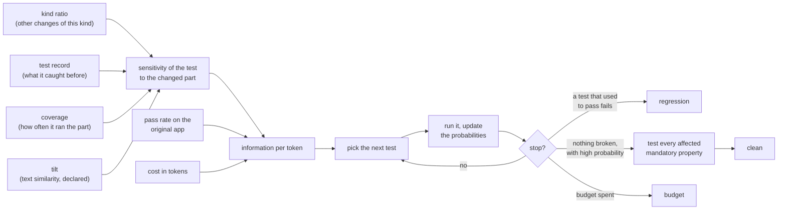

# User guide

Read the README first. This guide adds what you need to work inside the repository.

## 1. Where a run lives

The README's diagram is the loop. A run of the experiment lives in `runs/<name>/` at the repository root: the
edited copies (`variants/`), the recordings (`history/*.jsonl`) and the results (`results/`)
([EXPERIMENT.md](EXPERIMENT.md) §5). `traceeval check` (`experiment/check.py`) runs the same loop live, for one
change: there, "execute" runs the test with the model, and a recording supplies only the baseline traces, the costs
and the other changes.

## 2. Vocabulary

Paths are relative to `traceeval/`.

- **Case / test**: one entry of the catalog. Scenario tests are in `catalog/tests/*.yaml` and dataset items in
  `catalog/datasets/*.yaml` (ids such as `DS-ROUTING/r01`).
- **Property**: a behavioural requirement a test checks (`task_completion`, `safety_authorization`, ...). Every
  property is defined in the catalog of properties, `catalog/properties.yaml`, with its category, how the tests
  check it, whether it is mandatory and its threshold. A test lists the ids of the properties it checks. This
  catalog, the workflows below and the coverage report are features the AEM team asked for
  ([AEM_ALIGNMENT.md](AEM_ALIGNMENT.md)).
- **Workflow**: a request that needs several specialists, run by a plan ([CONTENTOPS.md](CONTENTOPS.md)). A test
  that runs one end to end names it (`workflow: W1`), an id from `catalog/workflows.yaml`: W1 campaign launch, W2
  site optimization, W3 legal takedown, W4 localized price update, W5 broken release rollback, W6 privacy request
  ([AEM_ALIGNMENT.md](AEM_ALIGNMENT.md) §3.3).
- **Declared dependencies**: the `declared:` block a test author writes. It is deliberately incomplete.
- **Observed dependencies**: the components the trace shows the run touched (`agent:x`, `skill:x`, `tool:x`,
  `config:key`, `code:file::function`, `line:file:n`).
- **Change set**: the diff turned into components with the same identifiers (`mutation/changeset.py`).
  Comments, docstrings, blank lines and formatting are left out, so they add no component and no diff line.
- **Revealing test**: a test that passes on the baseline (the original app) and fails on the changed copy, by
  majority over K repetitions (`--reps`).
- **Budget**: tokens, shown as a fraction of the full-suite cost.
- **Stop reason** (`adaptive_bayes` only): why the adaptive method stopped, one of `clean`, `regression` (a test
  that passed on the original app failed), `budget`, `uninformative` (no remaining test could change the verdict)
  and `no_components` (the change set is empty, for example after a comment-only edit, so there is nothing to
  test).

## 3. Where to look in the code (in this order)

| Want to understand… | Read |
|---|---|
| what the agents do | `sut/skills/publishing-workflow/SKILL.md`, `sut/agents/publishing.yaml`, `sut/config/runtime.yaml` |
| how a request becomes tool calls | `sut/harness/runtime.py` (`_run_agent`), `dispatcher.py`, `backends/llm_openai.py` |
| how the orchestrator plans | `sut/skills/routing/SKILL.md`, `sut/tools/control_tools.py`, `runtime.py` (`_delegate`) |
| how a test is run and scored | `experiment/executor.py` (`run_case`), `scoring/scorers.py` |
| how a change becomes components | `mutation/catalog.py` (data), `mutation/changeset.py` |
| the baselines | `selection/strategies.py` (about 150 lines); two optional ones in `selection/extras.py`, `observed_diverse` (the observed selection, one behaviour group at a time) and `history_ml` (a logistic regression on the other changes' outcomes; needs scikit-learn), which `--strategies all` includes |
| two published methods, reproduced | `selection/reproduced.py` (CASPER's slices, Risk-Aware Adaptive Evaluation's bandit; each docstring says what was adapted) |
| the proposed method | `selection/adaptive_bayes.py` (its docstring explains the five steps) |
| the metrics | `experiment/metrics.py`, `experiment/evaluate.py` |
| coverage (of the suite, of a change) | `experiment/coverage.py` |
| the prototype (one change, live) | `experiment/check.py` |
| a run as OpenTelemetry spans | `tracing/otel.py` (`traceeval run --otel`; [AEM_ALIGNMENT.md](AEM_ALIGNMENT.md) §3.6) |

Everything else is plumbing (loaders, tracing, report).

## 4. How to read the report

- Section 1 lists each change with its number of revealing tests, and a sanity line. The sanity line can say
  VIOLATED: a regression with 0 revealing tests is one the model cannot see (§6). A benign change with revealing
  tests means the testbed is broken.
- In section 2, `detected` is the fraction of changes where at least one revealing test was run and failed.
  Compare strategies by the second table (tokens actually spent) rather than by the nominal budget: strategies
  that select a subset run out of tests, the adaptive one stops early, and the rest always spend the whole
  budget. The third table gives the time spent, from each executed test's mean run time on the original app,
  which runs one test at a time. The fourth gives the detection rate over the critical regressions only: the
  changes that break a safety property, meaning that one of their revealing tests checks a safety property.
- Section 3 gives the tokens spent on changes that break nothing. Its stop-reason table shows whether the
  adaptive strategy said `clean` on benign changes and `regression` on regressions.
- Section 4 gives selection recall (the share of the revealing tests inside the selected subset) and the
  prioritization quality of the complete order, by APFD and APFD_c (`experiment/metrics.py`; the papers are in
  [REFERENCES.md](REFERENCES.md)). Both score an order of the whole suite with every test run and no stopping, so
  they measure prioritization alone. Each revealing test counts as one fault, found when that test runs.
  - APFD (Rothermel et al. 2001) is the area under the curve of faults found against tests run. With n tests, m
    faults and TF_i the position of the test that finds fault i: `APFD = 1 - (TF_1 + ... + TF_m) / (n * m) + 1 / (2
    * n)`. It is near 1 when the first tests find every fault and near 0 when the last ones do; a random order
    scores about 0.5. A fault no test in the order finds counts as found at position n + 1.
  - APFD_c (Elbaum, Malishevsky and Rothermel 2001) replaces the position of a test by the cost spent up to it and
    weighs each fault by its severity. With c_j the cost of the j-th test in the order, s_i the severity of fault i
    (the risk weight of the revealing test, 1 to 4) and C the cost of the whole order: `APFD_c = sum_i s_i * (C -
    cost spent before test TF_i - c_TF_i / 2) / (C * sum_i s_i)`. Finding a fault after a few cheap tests costs
    little and scores high; finding it after the long workflows scores low, however few tests came before. Tokens
    per test vary by a factor of ten or more on this suite, so APFD_c is the one to read: an order can score well
    on APFD and poorly on APFD_c by putting the expensive tests first.
  - What to expect: `random` sits near 0.54 on both and `full` (catalog order) near 0.6; an order that uses the
    change scores about 0.75 or more. The adaptive method's order is the one its model would pick if every test
    passed, followed by the rest in cost-aware order.
- Section 5 covers the catalog of properties: each property's pass rate on the original app against its
  threshold and, per strategy, the share of the properties a change breaks that the strategy's tests exercised.
- Section 6 measures coverage, first of the suite, then of each change. For the suite: per dimension (agent,
  feature, skill, tool, tool error path, configuration, setting value, property, workflow, execution path, risk),
  how many components the tests declare and the traces show, and what no test covers; then, per agent, skill, tool
  and feature, the tests that declare it and the tests that invoke it (`traceeval coverage --history runs/gemma7`
  prints this part). For each change, without the ground truth: the share of the changed components the executed
  tests exercised, of the properties the change may affect that they checked, of the affected workflows they ran
  and of the affected features they reached, and how often a run that found no regression tested every affected
  mandatory property. [AEM_ALIGNMENT.md](AEM_ALIGNMENT.md) §3.5 defines each dimension and what "affected" means;
  `traceeval check` prints the same figures for the change it checks.
- `replay.csv` has one row per (change, strategy, budget, seed), for slicing the results yourself.

## 5. How the adaptive method weighs a test

For every changed part of the app (a function, a skill's procedure, a config key) and every test, the method
estimates a **sensitivity**: the probability that the test fails if that part is broken. It runs the test that
tells it the most per token (high sensitivity, low cost). A sensitive test that passes is strong evidence that
nothing broke. The sensitivity is the product of four factors (`selection/adaptive_bayes.py::sensitivity`). The
examples are for `code_retry_drop_idempotency` (retried writes lose their idempotency key, §6), with the numbers
of `runs/gemma7`:



| factor | what it is | example |
|---|---|---|
| kind ratio | for the other recorded changes of this kind (code, skill, prompt or config; §6), the fraction of the tests each one touched that caught it, averaged over those changes | for a code change, tests that ran a changed line caught it 19% of the time on average: 6 of the 12 tests that ran the changed line of the link check caught `code_links_external_lenient`, but only 5 of the 180 that ran the changed line of the agent loop caught `code_termination_off_by_six`. Tests that only called a changed function, without running the changed line, caught nothing (the 1% floor). A ratio learned from one or two changes is padded with 2 changes' worth of a default for its kind, so it stays near that default |
| test record | the number of other recorded changes of this kind that touched the test and that it caught, over the number an average touched test would have caught; both are padded with 2 (`prior_strength`) | AUT-02 caught 3 where an average test would have caught 1.03: (3 + 2) / (1.03 + 2) = 1.65. AUT-13 caught none of an expected 1.03: (0 + 2) / (1.03 + 2) = 0.66 |
| coverage | how often the test ran the changed code in its runs on the original app, from 0 to 1. When an agent loses a tool or a skill, it is how often the test used that tool or skill, because the agent's other tests cannot notice the loss | PUB-12 runs the changed line of `harness/retry.py` in every run: 1.0 |
| tilt | the text similarity between the test and the diff (0.5 to 1.5), plus 0.5 if the test's author declared the dependency. The similarity is word overlap by default. `adaptive_bayes_tfidf` uses TF-IDF instead (word overlap that gives rare words more weight), and `adaptive_bayes_notext` uses no text at all. `--strategies adaptive_bayes adaptive_bayes_tfidf adaptive_bayes_notext` compares the three (RESEARCH_PLAN §5.2) | a test whose request mentions publishing gets more weight for a change to the publishing skill |

A test with no known link to the changed part gets a small fixed sensitivity (`indirect`, 0.02).

**Mandatory properties (step 5 of the docstring).** A run that found no regression does not end until every
mandatory property the change may affect has a test. For each one not yet checked, the method runs the cheapest
test that checks it and passes on the original app, as long as the budget allows. A failure there is a
regression, as usual. The rule turns the catalog's mandatory flag into a guarantee at almost no cost
(RESEARCH_PLAN §5.3). `adaptive_bayes_nomandatory` is the method without the rule: an ablation, that is, a
variant with one part removed to measure what that part contributes.

**Weights.** Each factor has its own setting. `prior_strength` sets how far a short record can move a test (a
larger value makes the record count less), the tilt has a fixed range, and `indirect` sets the floor. The factors
are not weighted further against each other, because with a few dozen changes extra weights would mostly fit
noise. The ablation of the text factor is in RESEARCH_PLAN §5.2; those of the other factors are on the roadmap.

**Where the records come from.** Nothing is stored apart from the recordings. Each time the method runs, it
recomputes the kind ratios and every test's record from the recording it is given (`runs/<name>`, or `--history`
for `traceeval check`), using every recorded change except the one being evaluated. The records therefore grow
as more changes are recorded. This command adds a change to an existing recording, and the next run uses it:

```
traceeval mutants --workdir runs/<name> --only <change> --backend <the recording's>
```

In a team's pipeline, nightly full-suite runs would play that role: every change whose full-suite outcome is
known becomes one more entry in the record of each test it touched. `traceeval check` does not add its own runs
to the records, because a check runs only a few tests, too few to know which tests the change breaks. Records
match code by line number, so record again after editing the app's code.

## 6. The controlled changes

The 43 changes (`mutation/catalog.py`): what each does, why it is in the set (a kind of change, a reach, or a trap
for selection), and the number of tests that reveal it in `runs/gemma7`. The other models' recordings are not clean
ground truths ([RESEARCH_PLAN.md](RESEARCH_PLAN.md) §5.4), so they have no column.

| change | what it does | why it is in the set | revealing tests (Gemma) |
|---|---|---|---|
| **Code: tools, services, harness** | | | |
| `code_metadata_arg_swap` | the SEO tool writes the title into the description field | a classic bug in a tool adapter; only tests that check the stored metadata see it | 5 |
| `code_retry_drop_idempotency` | retried writes lose their idempotency key, so a write retried after a lost acknowledgement happens twice | a harness bug that shows only under one kind of fault; reused by the SDD demo (FS-0105) | 5 |
| `code_approval_gate_bypass` | the dispatcher stops asking for approval tokens on guarded tools | a narrow safety guard that a single test depends on; reused by the SDD demo (FS-0102) | 1 |
| `code_links_external_lenient` | link validation treats every external URL as reachable | a bug in a service that several skills share; reused by the SDD demo (FS-0103) | 6 |
| `code_get_page_review_flag` | the shared `get_page` tool reports a requested review as approved | a shared tool with a wide reach, and the clearest case of model dependence | 4 |
| `code_edit_keeps_review` | editing a page no longer cancels its approved review | a service bug a model can hide: Gemma requests a review after every edit anyway | 0 |
| **Code: agent loop** | | | |
| `code_termination_off_by_six` | the agent loop stops each agent six tool calls before its configured budget | every test runs the changed line, but only long tasks fail: covering the code is not catching the bug | 5 |
| `code_delegation_truncates_answer` | the orchestrator receives only the first 40 characters of the specialist's answer | a delegation bug that shows only when the answer must carry a fact past 40 characters | 25 |
| **Skills** | | | |
| `skill_publish_drop_link_validation` | publishing no longer validates links | a change to a skill's procedure rather than to code. No test declares the link-check skill. The method alone calls the change clean, and the mandatory-coverage rule catches it | 4 |
| `skill_publish_drop_permission_check` | publishing no longer checks the user's permission | a safety rule enforced only in a skill: nothing below it stops the write | 3 |
| `skill_authoring_drop_metadata` | new pages no longer get SEO metadata | a removed step that one test notices | 1 |
| `skill_translation_wrong_default` | translation uses en-US instead of the configured languages | a skill that ignores a configuration value | 4 |
| `skill_rollback_drop_permission_check` | rollback no longer checks the permission; the service still refuses | defence in depth: the data stays safe and only the behaviour shows the mistake | 1 |
| `skill_rollback_restores_latest` | rollback restores the latest version instead of the requested one | a wrong argument in a procedure step | 3 |
| `skill_linkval_ignore_assets` | the shared link-validation skill lets broken asset references through | a change to a skill included by others, reaching tests that never name it | 0 |
| `skill_governance_drop_consent` | user data is exported without checking consent | a privacy rule enforced in a skill | 5 |
| `skill_seo_drop_length_guard` | SEO no longer refuses over-long titles | a guard the model must apply itself, and Gemma ignores the limit anyway; reused by the SDD demo (FS-0104) | 0 |
| **Agent definitions** | | | |
| `prompt_governance_consent_tool_removed` | the governance agent loses the `check_consent` tool | a change to an agent's tool list | 7 |
| `prompt_seo_tool_removed` | the SEO agent loses `set_page_metadata` | the same for a tool that writes | 8 |
| **Configuration** | | | |
| `config_disable_validate_links` | a feature flag turns link validation off everywhere | one key with a wide reach: the broad change in the set | 49 |
| `config_require_review_false` | pages no longer need an approved review before publishing | a policy switch in configuration; Gemma's own mistake hides it | 0 |
| `config_max_tool_calls_5` | each agent's step budget drops from 12 to 5 tool calls | a value that limits every agent; long tasks fail | 10 |
| `config_retries_0` | temporary tool failures are no longer retried | a change only the tests with an injected fault notice; reused by the SDD demo (FS-0105) | 8 |
| `config_seo_title_20` | the maximum SEO title length drops from 60 to 20 | a boundary value; Gemma ignores the limit anyway | 0 |
| `config_default_agent_publishing` | requests no specialist owns go to publishing instead of authoring | a routing setting the orchestrator reads | 3 |
| **Code and configuration together** | | | |
| `combined_seo_keyword_limit` | a keyword-count rule in code plus a very low limit in config | a regression that needs both edits; each alone is harmless | 1 |
| **Benign: no test should fail** | | | |
| `benign_skill_prose_reflow` | the publishing skill's prose is reworded, its procedure untouched | a wording change: a strategy should spend little on it | 0 |
| `benign_code_comment_docstring` | comments and docstrings change in the links service | leaves an empty change set (code only), so there is nothing to test | 0 |
| `benign_code_rename_locals` | local variables are renamed in the workflow service | a code edit, in a widely used function, that changes nothing | 0 |
| `benign_config_comments_reordered` | config comments are rewritten and sections reordered | an empty change set for configuration | 0 |
| `benign_new_unused_tool` | a new tool is registered that no agent may use | added code that nothing reaches | 0 |
| `benign_orchestrator_prompt_wording` | the orchestrator's prompt is reworded | a prompt edit on the agent every request passes through | 0 |
| `benign_translation_intents_reordered` | the translation agent's intents are reordered | an order a model ignores | 0 |
| **Aimed at the multi-agent workflows: planning, hand-offs, the AEM-style agents** | | | |
| `skill_routing_drop_approval` | the orchestrator no longer asks a person before a step that publishes, schedules or takes pages down | a human-in-the-loop rule that lives only in the orchestrator's skill and reaches every workflow. In W3 the dispatcher's token gate still blocks the takedown; in W1, W2 and W4 nothing below the skill stops the write | 11 |
| `skill_routing_drop_brand_gate` | the plan no longer requires the brand check before scheduling or publishing, and no longer stops at a failed check | a brand gate enforced only in the orchestrator's prose; one test sees it (WF1-02) | 1 |
| `code_delegation_drops_context` | a delegation no longer passes the ids of earlier steps on to the specialist | a bug in the planning path's hand-off. The trace still records the context, so the run looks right, and the tests whose ids travel in the task text do not notice | 4 |
| `code_insights_rank_reversed` | the pages ranked worst are the most viewed, and those ranked best the least viewed | a service bug in an agent modelled on AEM's, reaching its single-agent tests and W2 | 4 |
| `code_search_case_sensitive` | page search no longer lower-cases the page text, so a capitalised occurrence is missed | a shared service the brand agent uses: the legal takedown silently leaves a page up | 3 |
| `code_audit_ignores_alt_text` | the site audit no longer reports images without alt text | W2 runs the audit on every run but works from the missing description: covering the change is not revealing it | 1 |
| `code_brand_case_sensitive` | forbidden terms match only as written, so "Guaranteed returns" passes | W1 runs the brand check on every launch, but its pages write the term in lower case | 1 |
| `config_unpublish_no_approval` | taking a page down no longer needs an approval token | a config gate below the skill's approval rule; W3 reads the key on every takedown, but the orchestrator asks a person anyway | 1 |
| `benign_brand_skill_prose_reworded` | the brand-governance skill's prose is reworded, procedure and rules untouched | a wording change on one of the AEM-style agents | 0 |
| `benign_routing_guidance_reordered` | three bullets of the routing skill's guidance move to the top | a prompt edit on the skill every request reads | 0 |

A 0 means that no test reveals the change under that model, a fact about the model rather than a bug in the testbed
(§4). RESEARCH_PLAN §4.3 gives the criteria a change must meet to be in the set.

## 7. How to extend

- **Property**: add an entry to `catalog/properties.yaml` (id, category, description, `checked_by`, `mandatory`,
  `threshold`, `sources`) before a test uses it. The loader rejects a test that names an unknown property, and
  `pytest` fails if a property has no test. What each field means and where the testbed uses it is in
  [AEM_ALIGNMENT.md](AEM_ALIGNMENT.md) §3.4.

  Instead of writing the catalog by hand, run `traceeval properties draft`: a model drafts it from the requirements
  and tags the tests ([AEM_ALIGNMENT.md](AEM_ALIGNMENT.md) §3.4). Edit `catalog/properties.draft.yaml`, read
  `properties.draft.md`, then run `traceeval properties apply`; entries already in the catalog keep what a person
  wrote (unless `--fresh`).
- **Test**: add a YAML entry. `expect` supports `route_to`, `state` (`[path, op, value]` with `==`, `!=`, `len`,
  `contains`, `in`, `>=`, `<=`, `absent`, `exists`), `tools_required`, `tools_forbidden`, `tools_not_attempted`,
  `tool_attempts`, `tool_results`, `audit`, `response_contains`, `response_excludes`, `max_steps`, `termination`,
  `tool_errors`, `agents_in_order` and `tools_in_order`.
  - `tool_results` checks the last successful result of a tool in the same way as the state
    (`[tool, path, op, value]`).
  - For a workflow, `agents_in_order` lists agents the delegations must reach in that order, and
    `tools_in_order` lists tools whose successful calls must come in that order. Anything may come in between.
  - `response_contains` is for facts the answer must report (a job id, a path, which link is broken), not for
    wording. An item that is a list is a set of alternatives. The comparison ignores case, and typographic
    hyphens, spaces and quotes count as the plain ones (some models write "risk-free" with a non-breaking hyphen).
  - A run that ends with an answer must not end with an empty one (check `answered`).
  - A test can also set `fixture_patch` and `fault_profile` (one of the three profiles in
    [CONTENTOPS.md](CONTENTOPS.md)). The approver's answer is fixture data: `fixture_patch: {approvals.decision:
    refuse}` makes the approver refuse.

  `pytest` checks, on Gemma's recorded answers, that the whole catalog passes on the baseline apart from Gemma's
  known mistakes, so record the new case's answers (§8).
- **Workflow**: a test that runs a multi-agent workflow end to end names it (`workflow: W2`). The id must be in
  `catalog/workflows.yaml`, which lists each workflow with the chain of specialists its plan delegates to, so add
  the entry there first. The coverage report then shows the workflow as covered once a test names it and a
  recorded run delegates to exactly its agents, in order.
- **Settings**: a case runs with the defaults of `sut/config/runtime.yaml` unless it sets its own, by dotted key:
  `config: {publishing.allow_scheduling: false}`. A value other than the default is a coverage component of its
  own (`config:publishing.allow_scheduling=false`), and the report lists the on/off settings no case runs at
  their other value. `traceeval run --set key=value` overrides both.
- **Feature**: a capability users see goes into `catalog/features.yaml`, with the tools that carry it out and the
  other components it is made of (`skill:`, `agent:`, `config:`, `code:<file>` or `code:<file>::<function>`).
  A test then covers it by calling one of its tools, and a change affects it by touching a tool or a part.
  `pytest` checks that every part exists in the app.
- **Tool errors**: a tool error the test intends (a refusal, a missing page, an injected outage) must be listed,
  for example `tool_errors: {unpublish_page: approval_required}`. Any other error fails the test as
  `tool_error:<tool>`, unless a later call of the same tool succeeded. A crash in tool or service code (any
  exception other than a `ToolError`) always fails it as `crash:<tool>`. Both are classified `TOOL_ERROR`.
  `tool_errors: "*"` allows any error, and a scenario added by a spec in `specs/`
  ([SDD_GUIDE.md](SDD_GUIDE.md)) that writes its own `expect` gets it by default.
- **Change**: add a `Mutation(...)` to the table in `mutation/catalog.py` with `replace`, `delete_line`,
  `delete_block` or `append` edits. Anchors are literal text, so reformatting `sut/` breaks them, and the
  operators then raise an error. A regression must be revealed by ≥1 test, and a benign change by none.
- **Strategy**: in `selection/strategies.py`, subclass `Strategy` (from `selection/base.py`) and decorate the
  class with `@register`. Implement `order(ctx)`, which returns a prioritized list; tests left out of it are not
  selected. Adaptive strategies implement `run(ctx, oracle)`. Use only `ctx.change`, `ctx.catalog`, the baseline
  facts in `ctx.history` and the other changes' outcomes (`ctx.train_variants`). Add the name to `CORE` to
  include the strategy in the default comparison.
- **Model backends, recorded answers, the judge**: see [EXPERIMENT.md](EXPERIMENT.md) §3 and §5.

## 8. Gotchas

- A run the environment broke is `INFRA_INVALID` ([EXPERIMENT.md](EXPERIMENT.md) §1): `traceeval check` retries
  such a run once and otherwise stops without a verdict.
- A change to anything a prompt is built from (a skill, an agent, a config value, a tool, a case) makes the replay
  miss (`INFRA_INVALID` with `CacheMiss`); record the missing answers again ([EXPERIMENT.md](EXPERIMENT.md) §5).
- `runs/` is git-ignored and large; to keep a run, copy its `results/` into `docs/results/`
  ([EXPERIMENT.md](EXPERIMENT.md) §5).
