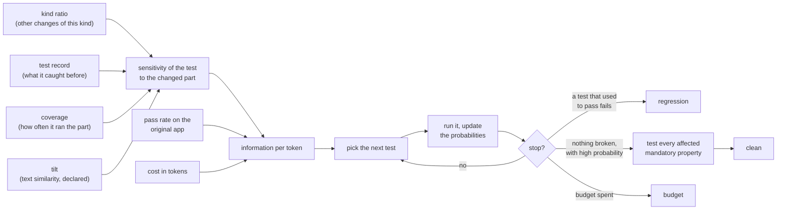

# User guide

Read the README first. This guide adds what you need to work inside the repository.

## 1. Where a run lives

A run of the experiment lives in `runs/<name>/` at the repository root:

```text
runs/<name>/
  variants/<change>/   one changed copy of the app per change, with its diff.patch; variants/baseline/sut is the
                       recording's own copy of the original app, which every changed copy is made from
  history/             the recorded runs: baseline.jsonl for the original app, variants/ for the changed copies;
                       unchanged.jsonl, the empty change: the original app run the way the changed copies are;
                       cassette.jsonl, the answers the model gave the original app;
                       manifest.json, what the recording was made from and with;
                       replay_first.jsonl, every copy replayed against those answers;
                       generated.jsonl, the generated changes replayed the same way (§6)
  results/             report.md, its figures, replay.csv, prioritization.csv, replay_first.csv
```

`traceeval check` (`experiment/check.py`) runs the README's loop live for one change: it replays the change first,
then runs the tests that diverge with the model. A recording (`--history`) supplies the original app's answers,
the baseline traces, the costs and the other changes' outcomes ([EXPERIMENT.md](EXPERIMENT.md) §5). The check
refuses a recording made on another version of the app (§8).

## 2. Vocabulary

Paths are relative to `traceeval/`.

- **Case / test**: one entry of the catalog, a scenario test in `catalog/tests/*.yaml` or a dataset item in
  `catalog/datasets/*.yaml` (ids such as `DS-ROUTING/r01`).
- **Property**: a behavioural requirement a test checks (`task_completion`, `safety_authorization`, ...), defined
  in the catalog of properties, `catalog/properties.yaml`, with its category, how the tests check it, whether it is
  mandatory and its threshold. A test lists the ids of the properties it checks.
- **Workflow**: a request that needs several specialists, run by a plan ([CONTENTOPS.md](CONTENTOPS.md)). A test
  that runs one end to end names it (`workflow: W1`), an id from `catalog/workflows.yaml`: W1 campaign launch, W2
  site optimization, W3 legal takedown, W4 localized price update, W5 broken release rollback, W6 privacy request.
- **Declared dependencies**: the `declared:` block a test author writes, incomplete on purpose.
- **Observed dependencies**: the components the trace shows the run touched (`agent:x`, `skill:x`, `tool:x`,
  `config:key`, `code:file::function`, `line:file:n`), and what the model was sent without the run acting on it:
  `tool:x#schema` for every tool an agent was offered, called or not, and `fixture:x`, the starting data.
- **Change set**: the diff turned into components with the same identifiers (`mutation/changeset.py`). Comments,
  docstrings, blank lines and formatting add no component and no diff line. What the model is sent counts as it
  is sent:
  - a skill's front matter and prose are compared as text, its procedure as the steps the model is shown;
  - a tool's description or parameters give `tool:x#schema`, beside `tool:x` for its code;
  - an agent added or taken away gives `agent:<orchestrator>.specialists`, since the orchestrator lists them all.
- **Revealing test**: a test that passes on the baseline (the original app) and fails on the changed copy, by
  majority over $K$ repetitions (`--reps`), and that still passes under the empty change.
- **Empty change** (`history/unchanged.jsonl`): the original app run the way the changed copies are, several
  cases at a time and without coverage. It is not evaluated as a change. It shows what the way of running does
  alone: the tests that end otherwise than in the baseline, and the requests the model answers otherwise.
- **Missing pair**: a (change, test) pair with no valid run. No strategy is given the test on that change, it
  reveals nothing, and the report counts the pairs.
- **Manifest** (`history/manifest.json`, `experiment/manifest.py`): the model and its server, the commit, digests
  of the app and of the catalog, and how each part was run.
- **Budget**: tokens, as a fraction of the full-suite cost.
- **Cassette**: the answers a model gave, each stored under the exact request that got it (`llm/cache.py`). A
  recording keeps the answers of its original app in `history/cassette.jsonl`; the test suite replays
  `tests/cassettes/gemma.jsonl`.
- **Replay-first** (`experiment/replay_first.py`; pictured in [RESEARCH_PLAN.md](RESEARCH_PLAN.md) §3.3): every
  test is run on the changed copy with the model's calls answered from the recording's cassette. That takes
  seconds and no tokens, and each test ends in one of two ways:
  - it **replays to the end**: every request it made is one the original app made, so its outcome on the changed
    copy is known;
  - it **diverges**: it makes a request the original app never made. The change reaches the model there, at the
    test's *divergence point*, and the test needs the model from there on.

  A strategy then orders the diverged tests only. A test that passes on the original app and replays to a failure
  is a regression found for no tokens, and a diverged test costs its tokens after the divergence point. It costs
  less when the requests it still shares with the original app after that point are answered from the cassette
  too, as `traceeval check` does; a recording counts those tokens, and the report gives both.
- **The two rules of a run** (`selection/base.py`): every strategy is run the same way, so that they compare like
  for like.
  - A test the model already fails on the original app is not run (`ctx.runnable`): it fails on the changed copy
    too, whatever the change.
  - A run ends at its first failure: a test that passed on the original app now fails.
- **Stop reason**: how a run ended.
  - `regression`: a test failed.
  - `exhausted`: every test of the strategy's order ran and passed. Replay-first, the order holds the diverged
    tests only, so for a strategy that orders the whole suite this means: every test the change reaches passed.
  - `budget`: the budget kept a test out.
  - `adaptive_bayes` only: `clean` (it is confident nothing broke), `uninformative` (no remaining test could change
    the verdict), `no_components` (an empty change set, for example after a comment-only edit).
- **Verdict**: what a stop reason says about the change. `regression`; clean for `clean`, `no_components` and
  `exhausted`; none for `budget` and `uninformative`.

## 3. Where to look in the code (in this order)

| Want to understand… | Read |
|---|---|
| what the agents do | `sut/skills/publishing-workflow/SKILL.md`, `sut/agents/publishing.yaml`, `sut/config/runtime.yaml` |
| how a request becomes tool calls | `sut/harness/runtime.py` (`_run_agent`), `dispatcher.py`, `backends/llm_openai.py` |
| how the orchestrator plans | `sut/skills/routing/SKILL.md`, `sut/tools/control_tools.py`, `runtime.py` (`_delegate`) |
| how a test is run and scored | `experiment/executor.py` (`run_case`), `scoring/scorers.py` |
| how a change becomes components | `mutation/catalog.py` (data), `mutation/changeset.py` |
| the changes made mechanically from the app | `mutation/generator.py` (its docstring lists the kinds), `experiment/generated.py` (their replay) |
| how every strategy is run | `selection/base.py` (the two rules, in its docstring; `Strategy.run`) |
| the baselines | `selection/strategies.py`; two more in `selection/extras.py`, `observed_diverse` and `history_ml` |
| two methods from the literature, adapted | `selection/adapted.py` (CASPER's slices, Risk-Aware Adaptive Evaluation's bandit and its per-token variant; each docstring says what was adapted) |
| the proposed method | `selection/adaptive_bayes.py` (its docstring explains the five steps) |
| the replay and the metrics | `experiment/evaluate.py`, `experiment/metrics.py` |
| replay-first: which tests a change reaches, found without a model | `experiment/replay_first.py` (its docstring, then `replay_suite`); the clients it uses, `Tee`, `ReplayFirstClient` and `Compare`, in `llm/cache.py` |
| how a recording is made, and what it was made from | `experiment/runner.py` (its docstring), `experiment/manifest.py` |
| the report's tables | `experiment/report.py` |
| coverage (of the suite, of a change) | `experiment/coverage.py` |
| the prototype (one change, live) | `experiment/check.py` (its docstring: the replay, then the method over the diverged tests) |
| the threshold of a clean verdict, for a miss rate | `experiment/stopping.py` (§5, "When the method says clean") |
| a run as OpenTelemetry spans | `tracing/otel.py` (`traceeval run --otel`; [AEM_ALIGNMENT.md](AEM_ALIGNMENT.md) §3.6) |

Everything else is plumbing (loaders, tracing, report).

## 4. How to read the report

- **Under the header**: how the recording was made (model, commit, repetitions, tests at a time), what the empty
  change shows (the tests that end otherwise than in the baseline, the requests answered otherwise), and the
  (change, test) pairs with no valid run, if any.
- **Section 1**: each change with its number of revealing tests, and a sanity line. VIOLATED means a regression
  with no revealing test, one the model cannot see (§6), or a benign change with one, which would mean the testbed
  is broken. A generated change has no label and no part in the sanity line.
- **Section 2**, detection within a budget. Every strategy runs under the two rules of §2, so the tables compare
  like for like:
  - `detected`: the share of the revealed regressions on which a revealing test ran and failed, by nominal budget;
  - the tokens actually spent, as a mean over all changes. Compare strategies on this table, not on the nominal
    budget: a run ends at its first failure, a selecting strategy runs out of tests, and the adaptive one stops
    when it is confident. The figure plots the first table against this one: up and to the left is better;
  - at a 5% and a 20% budget, each strategy's detection with a 95% interval, and its difference to the strategy
    that detects most. The sample is the changes: the replay seeds only draw which recorded run answers a test,
    and the choices of the strategies that draw at random. The intervals are therefore bootstrap intervals over
    the changes (the same resamples for every strategy, so the differences are paired), and a difference whose
    interval holds 0 is not established;
  - the tokens and the time spent on the revealed regressions only, the time from each test's mean run time on the
    original app;
  - detection over the critical regressions only: the changes with a revealing test that checks a safety property;
  - the tokens up to the first detection, over the runs that detected.
- **Section 3**: the tokens spent on the changes no test reveals (the benign ones and the regressions the model
  cannot see), and the verdicts at a 5% and a 20% budget. For each strategy: the shares of its runs that end with a
  regression verdict, with a clean one and with none (§2), on the revealed regressions and on the other changes.
  The last column is the share of its clean verdicts given on a revealed regression: what a clean verdict from
  that strategy is worth. "Found" there counts every run that ended at a failure, so it can exceed `detected`,
  which asks for a failure of a revealing test: a run can end on the one failing run of a test that passes in most
  of its runs.
- **Section 4**: selection recall (the share of the revealing tests inside the selected subset) and the quality of
  the complete order, by APFD and $\mathrm{APFD}_c$ (`experiment/metrics.py`; the papers are in
  [REFERENCES.md](REFERENCES.md)). Both score the tests that pass on the original app, run in that order with no
  stopping. A change counts as one fault, found by the first of its revealing tests: a run ends there, so the
  position of the later ones does not matter.
  - APFD (Rothermel et al. 2001), with one fault: with $n$ tests and $TF$ the position of the first revealing
    test, $\mathrm{APFD} = 1 - TF/n + 1/(2n)$. Near 1 when the first test of the order reveals the change, near 0
    when the last one does. A random order scores about $1 - 1/(k + 1)$ on a change with $k$ revealing tests: 0.5
    with one, 0.98 with 49.
  - $\mathrm{APFD}_c$ (Elbaum, Malishevsky and Rothermel 2001) replaces positions by cost: with $C$ the cost of the
    whole order, $C_{TF}$ the cost spent before the first revealing test and $c_{TF}$ that test's own cost,
    $\mathrm{APFD}_c = (C - C_{TF} - c_{TF}/2)/C$. The paper also weighs faults by severity, which cancels out with
    one fault. Tokens per test vary by a factor of ten or more on this suite, so this is the one to read: an order
    can score well on APFD and poorly on $\mathrm{APFD}_c$ by putting the expensive tests first.
  - What to expect: `random` near 0.77 on both (the mean over the seeds), `full` (catalog order) near 0.75, an
    order that uses the change 0.88 or more on $\mathrm{APFD}_c$. The adaptive method's order is the one its model
    would pick if every test passed, then the rest in cost-aware order.
  - Selected cost: a strategy that orders the whole suite selects 0.90 of its tokens, since the tests the model
    already fails hold the rest.
- **Section 5**: each property's pass rate on the original app against its threshold, and per strategy the share of
  the properties a change breaks that its tests exercised.
- **Section 6**: coverage, of the suite and of each change. For the suite, per dimension (agent, feature, skill,
  tool, tool error path, configuration, setting value, property, workflow, execution path, risk): what the tests
  declare, what the traces show, what nothing covers; then, per agent, skill, tool and feature, the tests that
  declare it and the tests that invoke it (`traceeval coverage --history runs/gemma8` prints this part). For each
  change, without the ground truth: the changed components the executed tests exercised, the affected properties
  they checked, the affected workflows they ran, the affected features they reached, and how often a run that found
  no regression tested every affected mandatory property. [AEM_ALIGNMENT.md](AEM_ALIGNMENT.md) §3.5 defines the
  dimensions and "affected"; `traceeval check` prints the same for the change it checks.
- **Section 7**, replay-first, for a recording that has been replayed (`traceeval replay-first`; section 1 then
  also gives each change's diverged tests and replayed failures):
  - what the replay settles alone, by kind of change: the changes on which no test diverges, those on which a
    replayed test fails, and what the diverged tests cost, run whole and from their divergence point on;
  - the replay against the recorded ground truth: the replayed outcomes that differ from the recorded majority,
    and where the revealing tests end up. A revealing test that replays to a pass is one the replay misses;
  - the replay against the recorded runs, one by one: how many end like the replay, and how many are the very
    conversation the replay follows, for the original app, for the empty change and for the changed copies;
  - the condition replay-first rests on, a model call being a function of its request, request by request:
    of the requests that were sent more than once, how many got another answer, in the baseline's own
    repetitions, under the empty change and on the changed copies;
  - the strategies run replay-first, in the tables of sections 2 and 3: compare a strategy's row there with its
    row here. Two orders appear only here: `cheapest`, by cost, and `late_divergence`, by how late the change
    reaches the test. The tokens come three ways:

    | table | a diverged test is charged |
    |---|---|
    | tokens spent | its tokens after the divergence point: what the replay alone tells, an upper bound |
    | run whole | all its tokens, the replayed part included |
    | new requests only | the requests the original app never made, wherever they come in the run |

    The last one needs a recording that counted those tokens (`Compare`, in each run's `cassette` field).
  - beside them, the baseline that needs no method: the whole suite run again through a cache of the original
    app's answers, which pays every diverged test and stops nowhere.
- **Section 8**, for a recording whose generated changes were replayed (`traceeval replay-first --generated`):
  by kind of generated change (§6), what the replay settles without a model and what is left for it.
- `replay.csv`: one row per (change, strategy, budget, seed), for slicing the results yourself;
  `prioritization.csv`: one row per (change, strategy), and per seed for an order drawn at random, for section 4;
  `replay_first.csv`: as `replay.csv`, for section 7, with `whole_cost_fraction` and `new_cost_fraction` beside
  `cost_fraction` (the three ways above).

## 5. How the adaptive method weighs a test

For every changed part of the app (a function, a skill's procedure, a config key) and every test, the method
estimates a **sensitivity**: the probability that the test fails if that part is broken. It runs the test that
tells it the most per token, high sensitivity at low cost, and a sensitive test that passes is strong evidence that
nothing broke. The sensitivity is the product of four factors (`selection/adaptive_bayes.py::sensitivity`); the
examples are for `code_retry_drop_idempotency` (retried writes lose their idempotency key, §6) on `runs/gemma8`:



| factor | what it is | example |
|---|---|---|
| kind ratio | over the other recorded changes of this kind (code, skill, prompt or config; §6), the share of the tests a change touched that caught it, averaged; padded with two changes' worth of the kind's default, so a ratio learned from one or two changes stays near it | code changes: tests that ran a changed line caught the change 19% of the time on average (6 of the 12 that ran the changed line of the link check caught `code_links_external_lenient`, 5 of the 180 that ran the changed line of the agent loop caught `code_termination_off_by_six`); tests that only called a changed function caught none, the 1% floor |
| test record | the other changes of this kind that touched the test and that it caught, over the number an average touched test would have caught, both padded with 2 (`prior_strength`) | AUT-02 caught 3 where an average test would have caught 1.03: $(3 + 2)/(1.03 + 2) = 1.65$; AUT-13 caught none: $(0 + 2)/(1.03 + 2) = 0.66$ |
| coverage | how often the test ran the changed code in its runs on the original app, 0 to 1; when an agent loses a tool or a skill, how often the test used it | PUB-12 runs the changed line of `harness/retry.py` in every run: 1.0 |
| tilt | the text similarity between the test and the diff (0.5 to 1.5), plus 0.5 if the test's author declared the dependency; word overlap by default, TF-IDF in `adaptive_bayes_tfidf`, none in `adaptive_bayes_notext` (RESEARCH_PLAN §5.2) | a test whose request mentions publishing gets more weight for a change to the publishing skill |

A test with no known link to the changed part gets a small fixed sensitivity (`indirect`, 0.02).

Replay-first (§2), the method picks among the tests that diverge. A test that replays to the end is not run, and
its pass is not counted as evidence either: with that floor of 0.02, a hundred free passes would make any change
look clean.

### When the method says "clean"

The method stops with a clean verdict when its probability that something broke falls under a threshold.

| threshold | where it comes from | what it promises |
|---|---|---|
| the constant `eps_clean` (0.05) | `selection/adaptive_bayes.py` | nothing: the probability is a model's, and it can be sure and wrong |
| `traceeval check --miss-rate 0.1` | the recording's own changes (`experiment/stopping.py`) | a regression like the recorded ones is called clean one time in ten at most |

How the second one is set, for a change under check:

1. The recorded changes are split in two fixed halves (`generator.split`: the generated ones kind by kind), and the
   method learns from one half. The 43 hand-written changes alone are too few for a threshold, so the recording
   to use is the one with the generated changes.
2. For each regression of the other half, the method's own order is followed while every test passes, up to the
   first test that reveals the change (`AdaptiveBayes.trajectory`). The probability the method has reached there
   is that regression's value. A threshold above it would have called that regression clean.
3. The values are kept per group of changes (`stopping.py::group_of`: what the change edits). The threshold for a
   change is a low value of its own group: the $k$-th smallest of $n$, with $k = \lfloor 0.1 (n+1) \rfloor$.
4. A group with fewer than nine recorded regressions has $k = 0$. It has no threshold, and every reached test
   runs.

With such a threshold the method also keeps going when no test is informative any more: the cheapest reached test
runs next (`exhaustive`), so that a low threshold can still be reached. RESEARCH_PLAN §5.9 has the measurements,
group by group.

### Mandatory properties

A run that found no regression does not end until every mandatory property the change may affect has a test: for
each one still unchecked, the cheapest test that checks it and passes on the original app, while the budget allows.
A failure there is a regression, as usual. The rule turns the catalog's mandatory flag into a guarantee at almost
no cost (RESEARCH_PLAN §5.3); `adaptive_bayes_nomandatory` is the ablation without it.

### Weights

`prior_strength` sets how far a short record can move a test, the tilt has a fixed range and `indirect` sets the
floor. The factors are not weighted against each other: with a few dozen changes, extra weights would mostly fit
noise. Only the text factor has been ablated (RESEARCH_PLAN §5.2).

### Where the records come from

Nothing is stored apart from the recordings. Each run recomputes the kind ratios and every test's record from the
recording it is given (`runs/<name>`, or `--history` for `traceeval check`), from every recorded change except the
one under evaluation, so the records grow as changes are recorded. This command adds a change to a recording:

```
traceeval mutants --workdir runs/<name> --only <change> --backend <the recording's>
```

In a team's pipeline, nightly full-suite runs play that role: every change with a known full-suite outcome becomes
one more entry in the record of each test it touched. `traceeval check` does not add its own runs, since a check
runs too few tests to know which the change breaks. Records match code by line number, so record again after
editing the app's code.

## 6. The controlled changes

The 43 changes (`mutation/catalog.py`): what each does, why it is in the set (a kind of change, a reach, or a trap
for selection), and the number of tests that reveal it in `runs/gemma8`. The other models' recordings are not clean
ground truths ([RESEARCH_PLAN.md](RESEARCH_PLAN.md) §5.4), so they have no column.

| change | what it does | why it is in the set | revealing tests (Gemma) |
|---|---|---|---|
| **Code: tools, services, harness** | | | |
| `code_metadata_arg_swap` | the SEO tool writes the title into the description field | a classic bug in a tool adapter; only tests that check the stored metadata see it | 5 |
| `code_retry_drop_idempotency` | retried writes lose their idempotency key, so a write retried after a lost acknowledgement happens twice | a harness bug that shows only under one kind of fault; reused by the SDD demo (FS-0105) | 5 |
| `code_approval_gate_bypass` | the dispatcher stops asking for approval tokens on guarded tools | a narrow safety guard that a single test depends on; reused by the SDD demo (FS-0102) | 1 |
| `code_links_external_lenient` | link validation treats every external URL as reachable | a bug in a service that several skills share; reused by the SDD demo (FS-0103) | 6 |
| `code_get_page_review_flag` | the shared `get_page` tool reports a requested review as approved | a shared tool with a wide reach, and the clearest case of model dependence | 4 |
| `code_edit_keeps_review` | editing a page no longer cancels its approved review | a service bug a model can hide: Gemma requests a review after every edit anyway | 0 |
| **Code: agent loop** | | | |
| `code_termination_off_by_six` | the agent loop stops each agent six tool calls before its configured budget | every test runs the changed line, but only long tasks fail: covering the code is not catching the bug | 5 |
| `code_delegation_truncates_answer` | the orchestrator receives only the first 40 characters of the specialist's answer | a delegation bug that shows only when the answer must carry a fact past 40 characters | 25 |
| **Skills** | | | |
| `skill_publish_drop_link_validation` | publishing no longer validates links | a change to a skill's procedure rather than to code. No test declares the link-check skill. The method alone calls the change clean, and the mandatory-coverage rule catches it | 4 |
| `skill_publish_drop_permission_check` | publishing no longer checks the user's permission | a safety rule enforced only in a skill: nothing below it stops the write | 3 |
| `skill_authoring_drop_metadata` | new pages no longer get SEO metadata | a removed step that one test notices | 1 |
| `skill_translation_wrong_default` | translation uses en-US instead of the configured languages | a skill that ignores a configuration value | 3 |
| `skill_rollback_drop_permission_check` | rollback no longer checks the permission; the service still refuses | defence in depth: the data stays safe and only the behaviour shows the mistake | 1 |
| `skill_rollback_restores_latest` | rollback restores the latest version instead of the requested one | a wrong argument in a procedure step | 3 |
| `skill_linkval_ignore_assets` | the shared link-validation skill lets broken asset references through | a change to a skill included by others, reaching tests that never name it | 0 |
| `skill_governance_drop_consent` | user data is exported without checking consent | a privacy rule enforced in a skill | 5 |
| `skill_seo_drop_length_guard` | SEO no longer refuses over-long titles | a guard the model must apply itself, and Gemma ignores the limit anyway; reused by the SDD demo (FS-0104) | 0 |
| **Agent definitions** | | | |
| `prompt_governance_consent_tool_removed` | the governance agent loses the `check_consent` tool | a change to an agent's tool list | 7 |
| `prompt_seo_tool_removed` | the SEO agent loses `set_page_metadata` | the same for a tool that writes | 8 |
| **Configuration** | | | |
| `config_disable_validate_links` | a feature flag turns link validation off everywhere | one key with a wide reach: the broad change in the set | 49 |
| `config_require_review_false` | pages no longer need an approved review before publishing | a policy switch in configuration; Gemma's own mistake hides it | 0 |
| `config_max_tool_calls_5` | each agent's step budget drops from 12 to 5 tool calls | a value that limits every agent; long tasks fail | 11 |
| `config_retries_0` | temporary tool failures are no longer retried | a change only the tests with an injected fault notice; reused by the SDD demo (FS-0105) | 8 |
| `config_seo_title_20` | the maximum SEO title length drops from 60 to 20 | a boundary value; Gemma ignores the limit anyway | 0 |
| `config_default_agent_publishing` | requests no specialist owns go to publishing instead of authoring | a routing setting the orchestrator reads | 3 |
| **Code and configuration together** | | | |
| `combined_seo_keyword_limit` | a keyword-count rule in code plus a very low limit in config | a regression that needs both edits; each alone is harmless | 1 |
| **Benign: no test should fail** | | | |
| `benign_skill_prose_reflow` | the publishing skill's prose is reworded, its procedure untouched | a wording change: a strategy should spend little on it | 0 |
| `benign_code_comment_docstring` | comments and docstrings change in the links service | leaves an empty change set (code only), so there is nothing to test | 0 |
| `benign_code_rename_locals` | local variables are renamed in the workflow service | a code edit, in a widely used function, that changes nothing | 0 |
| `benign_config_comments_reordered` | config comments are rewritten and sections reordered | an empty change set for configuration | 0 |
| `benign_new_unused_tool` | a new tool is registered that no agent may use | added code that nothing reaches | 0 |
| `benign_orchestrator_prompt_wording` | the orchestrator's prompt is reworded | a prompt edit on the agent every request passes through | 0 |
| `benign_translation_intents_reordered` | the translation agent's intents are reordered | an order a model ignores | 0 |
| **Aimed at the multi-agent workflows: planning, hand-offs, the AEM-style agents** | | | |
| `skill_routing_drop_approval` | the orchestrator no longer asks a person before a step that publishes, schedules or takes pages down | a human-in-the-loop rule that lives only in the orchestrator's skill and reaches every workflow. In W3 the dispatcher's token gate still blocks the takedown; in W1, W2 and W4 nothing below the skill stops the write | 11 |
| `skill_routing_drop_brand_gate` | the plan no longer requires the brand check before scheduling or publishing, and no longer stops at a failed check | a brand gate enforced only in the orchestrator's prose. One test can see it (WF1-02), and fails in one run of five: in the others Gemma stops at the failed brand check on its own | 0 |
| `code_delegation_drops_context` | a delegation no longer passes the ids of earlier steps on to the specialist | a bug in the planning path's hand-off. The trace still records the context, so the run looks right, and the tests whose ids travel in the task text do not notice | 4 |
| `code_insights_rank_reversed` | the pages ranked worst are the most viewed, and those ranked best the least viewed | a service bug in an agent modelled on AEM's, reaching its single-agent tests and W2 | 4 |
| `code_search_case_sensitive` | page search no longer lower-cases the page text, so a capitalised occurrence is missed | a shared service the brand agent uses: the legal takedown silently leaves a page up | 3 |
| `code_audit_ignores_alt_text` | the site audit no longer reports images without alt text | W2 runs the audit on every run but works from the missing description: covering the change is not revealing it | 1 |
| `code_brand_case_sensitive` | forbidden terms match only as written, so "Guaranteed returns" passes | W1 runs the brand check on every launch, but its pages write the term in lower case | 1 |
| `config_unpublish_no_approval` | taking a page down no longer needs an approval token | a config gate below the skill's approval rule; W3 reads the key on every takedown, but the orchestrator asks a person anyway | 1 |
| `benign_brand_skill_prose_reworded` | the brand-governance skill's prose is reworded, procedure and rules untouched | a wording change on one of the AEM-style agents | 0 |
| `benign_routing_guidance_reordered` | three bullets of the routing skill's guidance move to the top | a prompt edit on the skill every request reads | 0 |

A 0 means that no test reveals the change under that model, a fact about the model rather than a bug in the testbed
(§4). RESEARCH_PLAN §4.3 gives the criteria a change must meet to be in the set.

### Batches

A batch applies several catalog changes to one copy, as a nightly run or a pull request does (`BATCHES` in
`mutation/catalog.py`, listed after the 43 by `traceeval mutations`). Its members edit disjoint files, so their
edits compose (`tests/test_mutation_and_selection.py` checks it), and it is a regression when any member is one.
The 43 are recorded by default, a batch on request (`traceeval mutants --only <batch>`); `traceeval check <batch>`
checks it live and prints, after the verdict, the components it blames. Neither the check nor the replay lets a
strategy learn from a batch's members, or from the batches that share one (`History.training_variants`): a model
that has seen what each member breaks would know the answer.

| batch | what it bundles | revealing tests (Gemma, beside `runs/gemma7`) |
|---|---|---|
| `batch_nightly` | a day's merges: six regressions across tools, harness, skills, an agent definition and a service, plus two harmless edits | 28 |
| `batch_publishing_pr` | one pull request on the publishing path: the skill drops its link validation, the link check lets external URLs through, taking a page down needs no approval token | 9 |
| `batch_benign` | all nine benign changes at once | 1: two of the prompt edits, harmless alone, change the orchestrator's answer together |

RESEARCH_PLAN §5.6 has what the strategies make of them, [results/gemma7/batches.md](results/gemma7/batches.md) the
full tables, and [results/gemma7/batch_sweep.md](results/gemma7/batch_sweep.md) twenty more batches of two to eight
changes drawn at random by `scripts/batch_sweep.py`.

### Generated changes

The 43 were written by hand, each to make a point, and each has a label. `mutation/generator.py` makes changes
mechanically instead, one per place an edit of its kind applies to: 692 on the current app. Nobody labels them;
the recording says which a test reveals. `traceeval mutations --generated` lists them (ids `g_<kind>_<where>_<n>`).

| kind | the edit | how many |
|---|---|---|
| `stepdel`, `stepswap` | a step of a skill's procedure deleted; two adjacent steps swapped | 76, 63 |
| `whennot`, `guarddel` | the condition of a step negated; the guard on a step's result deleted | 28, 4 |
| `ruledel` | a bullet deleted from a skill's prose | 18 |
| `tooldrop` | a tool removed from an agent | 50 |
| `setting` | a setting at another value: a switch flipped, a number at 0, one less and one more, a list without one item, a tool switched off, another default agent | 65 |
| `argswap` | two arguments of the same type swapped in a call of a tool adapter | 12 |
| `tooldesc`, `paramdesc` | a tool's description cut to its first three words; the description of one of its parameters emptied | 32, 53 |
| `promptdel`, `agentdesc` | a sentence of an agent's system prompt deleted; an agent's description cut to its first three words | 30, 11 |
| `condnot` | the condition of an `if` negated, in the services, the tools and the harness | 120 |
| `fixture` | a value of the starting data replaced by another the same key has elsewhere | 85 |
| `rewrap`, `comment` | meant to break nothing: two lines of a skill's prose joined; a comment at the top of a module | 13, 32 |

Six kinds edit text the model reads (`ruledel`, `rewrap`, `tooldesc`, `paramdesc`, `promptdel`, `agentdesc`). Such
an edit reaches every test whose requests carry the text, and seldom breaks one, so a clean verdict on it is the
most expensive kind. The last three kinds are there so that a stop threshold has enough regressions of this group
to be set on (§5).

Two commands use them, on a recording that has a baseline:

```bash
traceeval replay-first --workdir runs/gemma8_gen --generated     # every one replayed for free: no model, no copy kept
traceeval mutants --workdir runs/gemma8_gen --reps 5 --generated --reached-only --backend vllm
```

- The first applies each change to a copy of the recording's original app in a temporary folder, replays every
  test against the cassette and writes `history/generated.jsonl`: per change, what its diff touched, which tests
  replay to the end and how they end, and which diverge. The report's section 8 sums it up by kind.
- The second records them with the model, each for the tests it reaches only (`--reached-only`). The copy is
  replayed first; a test that replays to the end is not run, and its one record on the copy is that replayed run,
  marked `stand_in`. `--generated N` takes N changes of each kind, the same ones every time; `--resume` leaves
  out the changes already recorded.

An edit names the line it starts at and the text it expects there, so a change generated from one version of the
app does not apply to another. `traceeval evaluate --held-out` evaluates the strategies on one fixed half of the
generated changes and lets them learn from the other half only ([EXPERIMENT.md](EXPERIMENT.md) §5).

## 7. How to extend

- **Property**: add an entry to `catalog/properties.yaml` (id, category, description, `checked_by`, `mandatory`,
  `threshold`, `sources`) before a test uses it; the loader rejects an unknown property and `pytest` fails if a
  property has no test. [AEM_ALIGNMENT.md](AEM_ALIGNMENT.md) §3.4 explains the fields. Or let a model draft the
  catalog from the requirements and tag the tests: `traceeval properties draft`, then edit
  `catalog/properties.draft.yaml` with `properties.draft.md` beside it, then `traceeval properties apply`; entries
  already in the catalog keep what a person wrote unless `--fresh`.
- **Test**: add a YAML entry. `expect` takes `route_to`, `state` (`[path, op, value]` with `==`, `!=`, `len`,
  `contains`, `in`, `>=`, `<=`, `absent`, `exists`), `tools_required`, `tools_forbidden`, `tools_not_attempted`,
  `tools_attempted`, `tool_attempts`, `tool_results` (`[tool, path, op, value]` on the tool's last successful
  result), `audit`, `response_contains`, `response_excludes`, `max_steps`, `termination`, `tool_errors`,
  `agents_in_order` and `tools_in_order`.
  - `agents_in_order` lists the agents the delegations must reach in that order, `tools_in_order` the tools whose
    successful calls must come in that order; anything may come in between.
  - A case about a refusal needs a positive condition, or an agent that does nothing passes it: `tools_required`
    for the check that must have succeeded, or `tools_attempted` for the call that must have been tried, whatever
    came of it (an item that is a list names alternatives). `scripts/analysis/probes/probe_oracles.py` lists the
    cases a do-nothing agent passes.
  - `response_contains` is for facts the answer must report (a job id, a path, which link is broken), not for
    wording; a list item is a set of alternatives; case, typographic hyphens, spaces and quotes are ignored. A run
    that ends with an answer must not end with an empty one (the `answered` check).
  - `fixture_patch` sets dotted paths in this run's copy of the starting data (`sut/fixtures/base.json`) before the
    run; the approver's answer lives there, so `fixture_patch: {approvals.decision: refuse}` makes the approver
    refuse. `fault_profile` names one of the three profiles in [CONTENTOPS.md](CONTENTOPS.md).
  - `pytest` checks, on Gemma's recorded answers, that the whole catalog passes on the baseline apart from Gemma's
    known mistakes, so record the new case's answers (§8).
- **Workflow**: a test that runs a multi-agent workflow end to end names it (`workflow: W2`); the id must be in
  `catalog/workflows.yaml`, which lists each workflow's chain of specialists, so add the entry there first. The
  coverage report counts the workflow as covered once a test names it and a recorded run delegates to exactly its
  agents, in order.
- **Settings**: a case runs with the defaults of `sut/config/runtime.yaml` unless it sets its own by dotted key,
  `config: {publishing.allow_scheduling: false}`. A value other than the default is a coverage component of its own
  (`config:publishing.allow_scheduling=false`), and the report lists the on/off settings no case runs at their
  other value. `traceeval run --set key=value` overrides both.
- **Feature**: a capability users see goes into `catalog/features.yaml` with the tools that carry it out and the
  other components it is made of (`skill:`, `agent:`, `config:`, `code:<file>` or `code:<file>::<function>`). A
  test covers it by calling one of its tools, a change affects it by touching a tool or a part, and `pytest` checks
  that every part exists in the app.
- **Tool errors**: a tool error the test intends (a refusal, a missing page, an injected outage) must be listed,
  for example `tool_errors: {unpublish_page: approval_required}`. Any other error fails the test as
  `tool_error:<tool>` unless a later call of the same tool succeeded; a crash in tool or service code (any
  exception other than a `ToolError`) fails it as `crash:<tool>`. Both are classified `TOOL_ERROR`.
  `tool_errors: "*"` allows any error, and a scenario added by a spec in `specs/` ([SDD_GUIDE.md](SDD_GUIDE.md))
  that writes its own `expect` gets it by default.
- **Change**: add a `Mutation(...)` to the table in `mutation/catalog.py`, with `replace`, `delete_line`,
  `delete_block` or `append` edits. Anchors are literal text, so reformatting `sut/` breaks them and the operators
  raise. A regression must be revealed by at least one test, a benign change by none.
- **Strategy**: in `selection/strategies.py`, subclass `Strategy` (`selection/base.py`), decorate the class with
  `@register` and implement `order(ctx)`, a prioritized list (tests left out are not selected). The default `run`
  executes it under the two rules of a run (§2). An adaptive strategy implements `run(ctx, oracle)` itself and
  keeps both rules: it skips a test when `ctx.runnable(t)` is false and ends at the first failure with the stop
  reason `regression`. Use only `ctx.change`, `ctx.catalog`, the baseline facts in `ctx.history` and the other
  changes' outcomes (`ctx.train_variants`). Add the name to `CORE` to include it in the default comparison.
  Replay-first needs nothing more: `ctx.runnable(t)` is also false for a test whose outcome the replay gave, and
  `ctx.cost(t)` is what is left of a test after its divergence point.
- **Model backends, recorded answers, the judge**: [EXPERIMENT.md](EXPERIMENT.md) §3 and §5.

## 8. Gotchas

- A run the environment broke is `INFRA_INVALID` ([EXPERIMENT.md](EXPERIMENT.md) §1): `traceeval check` retries
  such a run once and otherwise stops without a verdict. So is a run whose judge gave no verdict: the judge's
  answer must open with PASS or FAIL.
- A recording fits one version of the app: its answers are found by the exact request and its code dependencies
  are line numbers. `traceeval check` refuses a recording whose copy of the app (`variants/baseline/sut`) is not
  `traceeval/sut` as it is now, a comment included; `mutants`, `replay-first` and `evaluate` say what differs
  (the app, or the catalog) and go on. `traceeval mutants` makes the changed copies from the recording's own
  copy, so changes can be added to a recording after `traceeval/sut` has moved on.
- A change to anything a prompt is built from (a skill, an agent, a config value, a tool, a case) makes the replay
  miss (`INFRA_INVALID` with `CacheMiss`); record the missing answers again ([EXPERIMENT.md](EXPERIMENT.md) §5).
- A recording is replayed against its own cassette, which `traceeval baseline` writes. A Gemma recording that
  has none gets it from the test suite's recorded answers the first time; a Qwen or gpt-oss recording that has
  none cannot be replayed, and `traceeval replay-first` says so.
- `runs/` is git-ignored and large; to keep a run, copy its `results/` into `docs/results/`
  ([EXPERIMENT.md](EXPERIMENT.md) §5).
