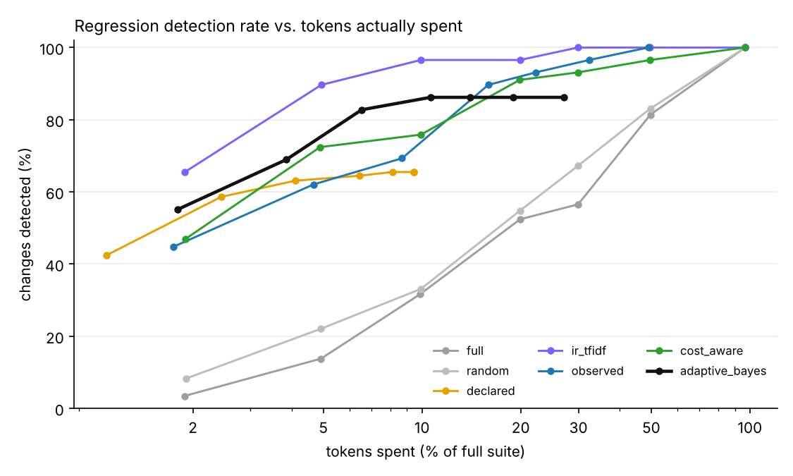
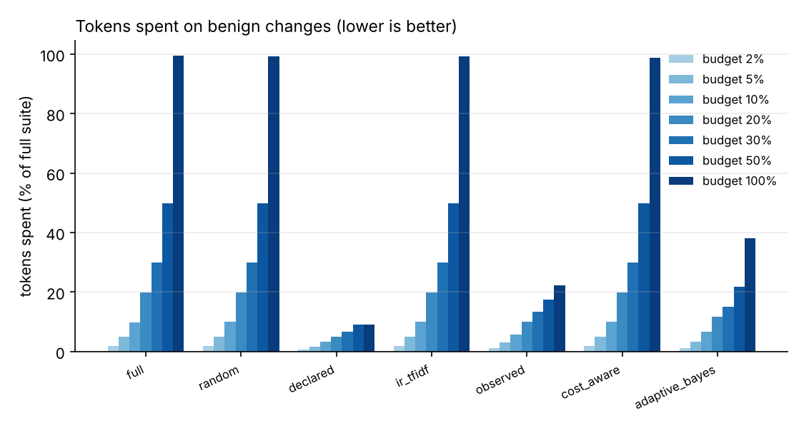
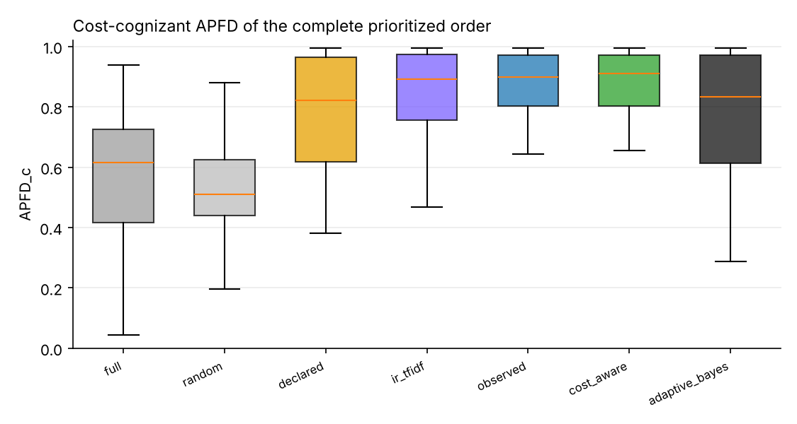

# TRACE-Eval experiment report

`runs/exp2_flaky` · 134 tests · 35 changes · 5 baseline repetitions · full suite = 463,038 tokens · 19 flaky tests at baseline

## 1. Ground truth — which changes are revealed by how many tests

| change | category | expected | revealing tests |
|---|---|---|---|
| `benign_code_comment_docstring` | benign | benign | 0 |
| `benign_code_rename_locals` | benign | benign | 0 |
| `benign_config_comments_reordered` | benign | benign | 0 |
| `benign_new_unused_tool` | benign | benign | 0 |
| `benign_orchestrator_prompt_wording` | benign | benign | 0 |
| `benign_skill_prose_reflow` | benign | benign | 0 |
| `code_approval_gate_bypass` | code | regression | 1 |
| `code_edit_keeps_review` | code | regression | 1 |
| `code_get_page_review_flag` | code | regression | 15 |
| `code_links_external_lenient` | code | regression | 5 |
| `code_metadata_arg_swap` | code | regression | 4 |
| `code_retry_disabled` | code | regression | 4 |
| `code_retry_drop_idempotency` | code | regression | 5 |
| `code_router_phrase_weight` | code | regression | 3 |
| `combined_seo_keyword_limit` | combined | regression | 1 |
| `config_approval_drop_unpublish` | config | regression | 1 |
| `config_default_agent_publishing` | config | regression | 3 |
| `config_disable_validate_links` | config | regression | 32 |
| `config_max_tool_calls_5` | config | regression | 11 |
| `config_require_review_false` | config | regression | 3 |
| `config_retries_0` | config | regression | 4 |
| `config_seo_title_20` | config | regression | 1 |
| `prompt_publishing_triggers_removed` | prompt | regression | 6 |
| `prompt_seo_tool_removed` | prompt | regression | 5 |
| `prompt_translation_intents_reordered` | prompt | regression | 1 |
| `code_delegation_depth_zero` | runtime | regression | 107 |
| `code_termination_off_by_six` | runtime | regression | 2 |
| `skill_authoring_drop_metadata` | skill | regression | 3 |
| `skill_governance_drop_consent` | skill | regression | 4 |
| `skill_linkval_ignore_assets` | skill | regression | 2 |
| `skill_publish_drop_link_validation` | skill | regression | 7 |
| `skill_publish_drop_permission_check` | skill | regression | 3 |
| `skill_rollback_restores_latest` | skill | regression | 3 |
| `skill_seo_drop_length_guard` | skill | regression | 1 |
| `skill_translation_wrong_default` | skill | regression | 2 |

Testbed sanity (every regression revealed by ≥1 test, no benign change revealed): **OK**.

## 2. Detection within a budget

Fraction of regression-inducing changes detected, by nominal budget (% of full-suite tokens):

| strategy | 2% | 5% | 10% | 20% | 30% | 50% | 100% |
|---|---|---|---|---|---|---|---|
| full | 0.03 | 0.14 | 0.32 | 0.52 | 0.57 | 0.81 | 1.00 |
| random | 0.08 | 0.22 | 0.33 | 0.55 | 0.67 | 0.83 | 1.00 |
| declared | 0.42 | 0.59 | 0.63 | 0.64 | 0.66 | 0.66 | 0.66 |
| ir_tfidf | 0.66 | 0.90 | 0.97 | 0.97 | 1.00 | 1.00 | 1.00 |
| observed | 0.45 | 0.62 | 0.69 | 0.90 | 0.93 | 0.97 | 1.00 |
| cost_aware | 0.47 | 0.72 | 0.76 | 0.91 | 0.93 | 0.97 | 1.00 |
| adaptive_bayes | 0.55 | 0.69 | 0.83 | 0.86 | 0.86 | 0.86 | 0.86 |

Tokens actually spent on those changes (fraction of the full suite):

| strategy | 2% | 5% | 10% | 20% | 30% | 50% | 100% |
|---|---|---|---|---|---|---|---|
| full | 0.019 | 0.049 | 0.099 | 0.199 | 0.299 | 0.497 | 0.968 |
| random | 0.019 | 0.049 | 0.099 | 0.199 | 0.299 | 0.497 | 0.967 |
| declared | 0.011 | 0.024 | 0.041 | 0.065 | 0.081 | 0.094 | 0.094 |
| ir_tfidf | 0.019 | 0.049 | 0.099 | 0.199 | 0.299 | 0.497 | 0.965 |
| observed | 0.017 | 0.047 | 0.087 | 0.159 | 0.222 | 0.323 | 0.489 |
| cost_aware | 0.019 | 0.049 | 0.099 | 0.199 | 0.298 | 0.496 | 0.964 |
| adaptive_bayes | 0.018 | 0.039 | 0.065 | 0.106 | 0.140 | 0.189 | 0.271 |

Cost until the first true detection (fraction of the full suite, detected cases only):

| strategy | cost_to_first_detection |
|---|---|
| full | 0.162 |
| random | 0.148 |
| declared | 0.023 |
| ir_tfidf | 0.023 |
| observed | 0.052 |
| cost_aware | 0.046 |
| adaptive_bayes | 0.026 |

## 3. Benign changes — wasted budget and stopping

| strategy | 2% | 5% | 10% | 20% | 30% | 50% | 100% |
|---|---|---|---|---|---|---|---|
| full | 0.019 | 0.049 | 0.099 | 0.199 | 0.299 | 0.499 | 0.995 |
| random | 0.019 | 0.049 | 0.099 | 0.199 | 0.299 | 0.499 | 0.993 |
| declared | 0.006 | 0.016 | 0.032 | 0.050 | 0.066 | 0.091 | 0.091 |
| ir_tfidf | 0.018 | 0.049 | 0.099 | 0.199 | 0.299 | 0.499 | 0.993 |
| observed | 0.011 | 0.030 | 0.056 | 0.100 | 0.133 | 0.176 | 0.224 |
| cost_aware | 0.018 | 0.049 | 0.100 | 0.199 | 0.298 | 0.498 | 0.989 |
| adaptive_bayes | 0.013 | 0.033 | 0.066 | 0.117 | 0.150 | 0.217 | 0.380 |

Stop reasons of `adaptive_bayes` (rows: is the change a regression?):

| is_regression | budget | clean | regression | uninformative |
|---|---|---|---|---|
| False | 196 | 221 | 0 | 3 |
| True | 845 | 267 | 917 | 1 |

## 4. Prioritization and selection quality

APFD / cost-cognizant APFD of the complete order; selection recall = revealing tests inside the selected subset; selected cost = what that subset costs:

| strategy | apfd | apfdc | selection_recall | selected_cost_fraction |
|---|---|---|---|---|
| full | 0.679 | 0.583 | 1.000 | 1.000 |
| random | 0.541 | 0.545 | 1.000 | 1.000 |
| declared | 0.812 | 0.771 | 0.531 | 0.100 |
| ir_tfidf | 0.824 | 0.826 | 1.000 | 1.000 |
| observed | 0.800 | 0.830 | 1.000 | 0.519 |
| cost_aware | 0.804 | 0.834 | 1.000 | 1.000 |
| adaptive_bayes | 0.807 | 0.775 | 1.000 | 1.145 |

## How to read this

`detected` counts *changes* (one failing revealing test is enough). Compare strategies at equal tokens *spent*, not equal nominal budget: `declared`/`observed` select and run out of tests, `adaptive_bayes` stops when it is confident, the others always spend the whole budget. A good strategy is high in section 2 and low in section 3.
