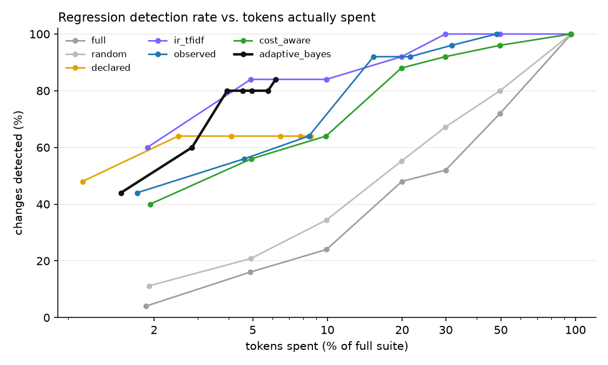
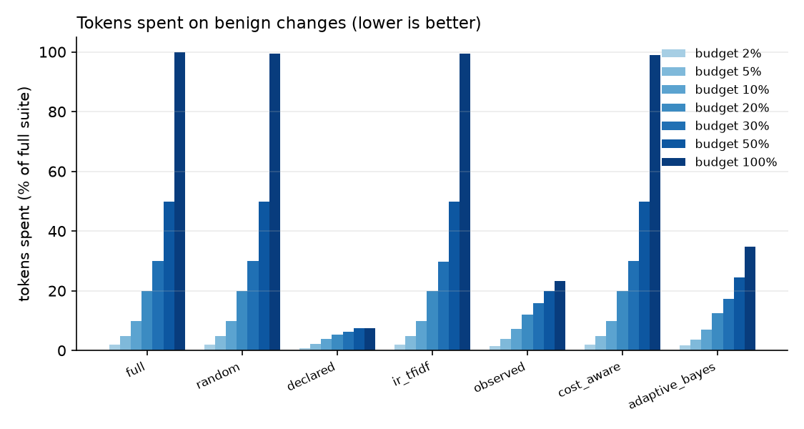
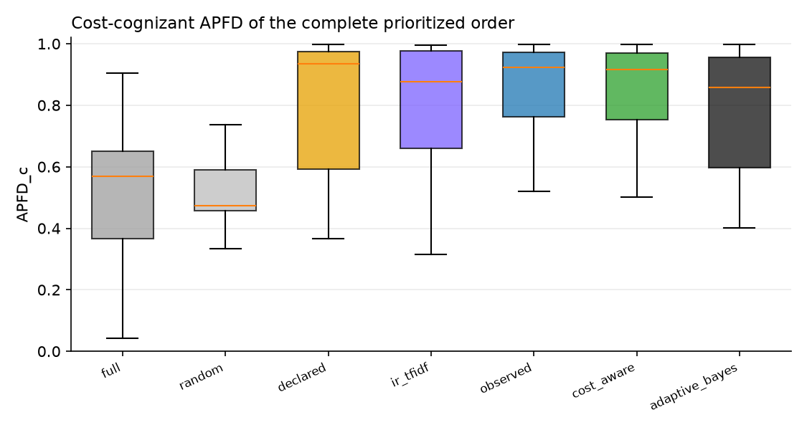

# TRACE-Eval experiment report

`runs/gemma2` · 136 tests · 38 changes · 3 baseline repetitions · full suite = 960,944 tokens · tests failing on the original app: 3

## 1. Ground truth — which changes are revealed by how many tests

| change | category | expected | revealing tests |
|---|---|---|---|
| `benign_code_comment_docstring` | benign | benign | 0 |
| `benign_code_rename_locals` | benign | benign | 0 |
| `benign_config_comments_reordered` | benign | benign | 0 |
| `benign_new_unused_tool` | benign | benign | 0 |
| `benign_orchestrator_prompt_wording` | benign | benign | 0 |
| `benign_skill_prose_reflow` | benign | benign | 0 |
| `benign_translation_intents_reordered` | benign | benign | 0 |
| `code_approval_gate_bypass` | code | regression | 1 |
| `code_edit_keeps_review` | code | regression | 0 |
| `code_get_page_review_flag` | code | regression | 1 |
| `code_links_external_lenient` | code | regression | 6 |
| `code_links_unknown_url_crash` | code | regression | 1 |
| `code_metadata_arg_swap` | code | regression | 5 |
| `code_metadata_keywords_crash` | code | regression | 0 |
| `code_retry_disabled` | code | regression | 8 |
| `code_retry_drop_idempotency` | code | regression | 5 |
| `combined_seo_keyword_limit` | combined | regression | 1 |
| `config_approval_drop_unpublish` | config | regression | 1 |
| `config_default_agent_publishing` | config | regression | 3 |
| `config_disable_validate_links` | config | regression | 40 |
| `config_max_tool_calls_5` | config | regression | 8 |
| `config_require_review_false` | config | regression | 0 |
| `config_retries_0` | config | regression | 8 |
| `config_seo_title_20` | config | regression | 0 |
| `prompt_governance_consent_tool_removed` | prompt | regression | 6 |
| `prompt_seo_tool_removed` | prompt | regression | 6 |
| `code_delegation_depth_zero` | runtime | regression | 106 |
| `code_delegation_truncates_answer` | runtime | regression | 8 |
| `code_termination_off_by_six` | runtime | regression | 2 |
| `skill_authoring_drop_metadata` | skill | regression | 1 |
| `skill_governance_drop_consent` | skill | regression | 5 |
| `skill_linkval_ignore_assets` | skill | regression | 0 |
| `skill_publish_drop_link_validation` | skill | regression | 6 |
| `skill_publish_drop_permission_check` | skill | regression | 3 |
| `skill_rollback_drop_permission_check` | skill | regression | 1 |
| `skill_rollback_restores_latest` | skill | regression | 3 |
| `skill_seo_drop_length_guard` | skill | regression | 0 |
| `skill_translation_wrong_default` | skill | regression | 2 |

Testbed sanity (every regression revealed by ≥1 test, no benign change revealed): **VIOLATED**.

## 2. Detection within a budget

Fraction of regression-inducing changes detected, by nominal budget (% of full-suite tokens):

| strategy | 2% | 5% | 10% | 20% | 30% | 50% | 100% |
|---|---|---|---|---|---|---|---|
| full | 0.04 | 0.16 | 0.24 | 0.48 | 0.52 | 0.72 | 1.00 |
| random | 0.11 | 0.21 | 0.34 | 0.55 | 0.67 | 0.80 | 1.00 |
| declared | 0.48 | 0.64 | 0.64 | 0.64 | 0.64 | 0.64 | 0.64 |
| ir_tfidf | 0.60 | 0.84 | 0.84 | 0.92 | 1.00 | 1.00 | 1.00 |
| observed | 0.44 | 0.56 | 0.64 | 0.92 | 0.92 | 0.96 | 1.00 |
| cost_aware | 0.40 | 0.56 | 0.64 | 0.88 | 0.92 | 0.96 | 1.00 |
| adaptive_bayes | 0.44 | 0.60 | 0.80 | 0.80 | 0.80 | 0.80 | 0.84 |

Tokens actually spent on those changes (fraction of the full suite):

| strategy | 2% | 5% | 10% | 20% | 30% | 50% | 100% |
|---|---|---|---|---|---|---|---|
| full | 0.019 | 0.049 | 0.099 | 0.200 | 0.300 | 0.497 | 0.963 |
| random | 0.019 | 0.049 | 0.099 | 0.199 | 0.299 | 0.496 | 0.961 |
| declared | 0.010 | 0.025 | 0.041 | 0.065 | 0.078 | 0.086 | 0.086 |
| ir_tfidf | 0.019 | 0.049 | 0.099 | 0.199 | 0.299 | 0.496 | 0.959 |
| observed | 0.017 | 0.046 | 0.084 | 0.153 | 0.215 | 0.317 | 0.481 |
| cost_aware | 0.019 | 0.049 | 0.099 | 0.199 | 0.298 | 0.495 | 0.959 |
| adaptive_bayes | 0.015 | 0.028 | 0.039 | 0.046 | 0.050 | 0.058 | 0.062 |

Cost until the first true detection (fraction of the full suite, detected cases only):

| strategy | cost_to_first_detection |
|---|---|
| full | 0.173 |
| random | 0.143 |
| declared | 0.016 |
| ir_tfidf | 0.030 |
| observed | 0.055 |
| cost_aware | 0.059 |
| adaptive_bayes | 0.033 |

## 3. Benign changes — wasted budget and stopping

| strategy | 2% | 5% | 10% | 20% | 30% | 50% | 100% |
|---|---|---|---|---|---|---|---|
| full | 0.019 | 0.049 | 0.099 | 0.200 | 0.299 | 0.500 | 0.998 |
| random | 0.019 | 0.049 | 0.099 | 0.199 | 0.299 | 0.499 | 0.995 |
| declared | 0.009 | 0.021 | 0.039 | 0.054 | 0.063 | 0.074 | 0.074 |
| ir_tfidf | 0.019 | 0.049 | 0.099 | 0.199 | 0.298 | 0.499 | 0.993 |
| observed | 0.014 | 0.040 | 0.072 | 0.121 | 0.159 | 0.198 | 0.233 |
| cost_aware | 0.019 | 0.049 | 0.099 | 0.199 | 0.299 | 0.499 | 0.990 |
| adaptive_bayes | 0.016 | 0.037 | 0.069 | 0.125 | 0.172 | 0.246 | 0.347 |

Stop reasons of `adaptive_bayes` (rows: is the change a regression?):

| is_regression | budget | clean | no_components | regression | uninformative |
|---|---|---|---|---|---|
| False | 212 | 152 | 70 | 6 | 15 |
| True | 130 | 110 | 0 | 635 | 0 |

## 4. Prioritization and selection quality

APFD / cost-cognizant APFD of the complete order; selection recall = revealing tests inside the selected subset; selected cost = what that subset costs:

| strategy | apfd | apfdc | selection_recall | selected_cost_fraction |
|---|---|---|---|---|
| full | 0.669 | 0.545 | 1.000 | 1.000 |
| random | 0.470 | 0.470 | 1.000 | 1.000 |
| declared | 0.841 | 0.793 | 0.567 | 0.095 |
| ir_tfidf | 0.773 | 0.794 | 1.000 | 1.000 |
| observed | 0.786 | 0.826 | 1.000 | 0.516 |
| cost_aware | 0.784 | 0.820 | 1.000 | 1.000 |
| adaptive_bayes | 0.796 | 0.777 | 1.000 | 1.000 |

## How to read this

`detected` counts *changes* (one failing revealing test is enough). Compare strategies at equal tokens *spent*, not equal nominal budget: `declared`/`observed` select and run out of tests, `adaptive_bayes` stops when it is confident, the others always spend the whole budget. A good strategy is high in section 2 and low in section 3.
