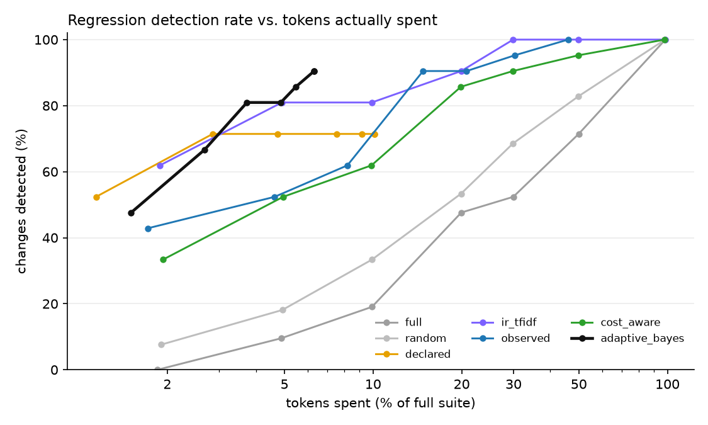
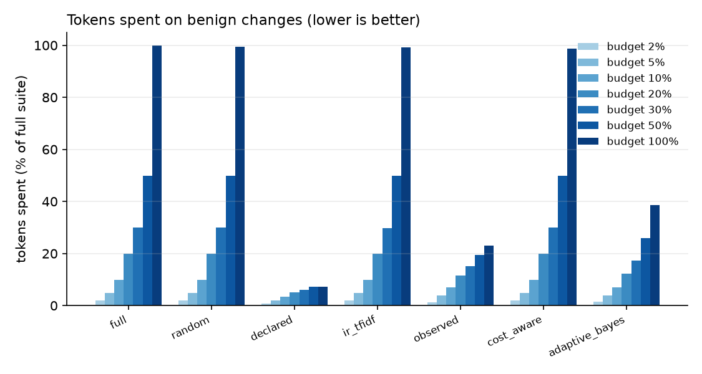
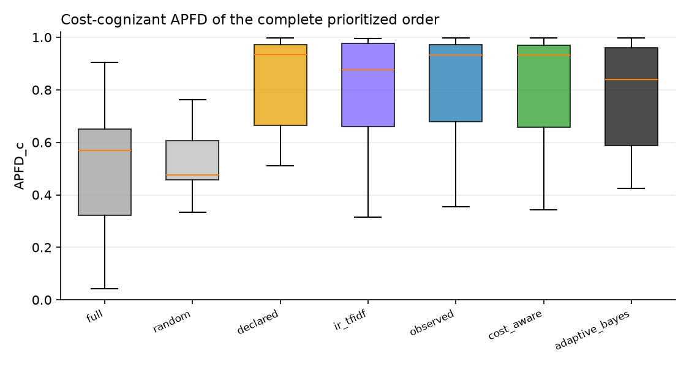

# TRACE-Eval experiment report

`runs/gemma4` · 136 tests · 33 changes · 3 baseline repetitions · full suite = 960,220 tokens · tests failing on the original app: 3

## 1. Ground truth — which changes are revealed by how many tests

| change | category | expected | revealing tests |
|---|---|---|---|
| `benign_code_comment_docstring` | benign | benign | 0 |
| `benign_code_rename_locals` | benign | benign | 0 |
| `benign_config_comments_reordered` | benign | benign | 0 |
| `benign_new_unused_tool` | benign | benign | 0 |
| `benign_orchestrator_prompt_wording` | benign | benign | 0 |
| `benign_skill_prose_reflow` | benign | benign | 0 |
| `benign_translation_intents_reordered` | benign | benign | 0 |
| `code_approval_gate_bypass` | code | regression | 1 |
| `code_edit_keeps_review` | code | regression | 0 |
| `code_get_page_review_flag` | code | regression | 2 |
| `code_links_external_lenient` | code | regression | 6 |
| `code_metadata_arg_swap` | code | regression | 5 |
| `code_retry_drop_idempotency` | code | regression | 5 |
| `combined_seo_keyword_limit` | combined | regression | 1 |
| `config_default_agent_publishing` | config | regression | 3 |
| `config_disable_validate_links` | config | regression | 40 |
| `config_max_tool_calls_5` | config | regression | 8 |
| `config_require_review_false` | config | regression | 0 |
| `config_retries_0` | config | regression | 8 |
| `config_seo_title_20` | config | regression | 0 |
| `prompt_governance_consent_tool_removed` | prompt | regression | 6 |
| `prompt_seo_tool_removed` | prompt | regression | 6 |
| `code_delegation_truncates_answer` | runtime | regression | 8 |
| `code_termination_off_by_six` | runtime | regression | 2 |
| `skill_authoring_drop_metadata` | skill | regression | 1 |
| `skill_governance_drop_consent` | skill | regression | 4 |
| `skill_linkval_ignore_assets` | skill | regression | 0 |
| `skill_publish_drop_link_validation` | skill | regression | 6 |
| `skill_publish_drop_permission_check` | skill | regression | 3 |
| `skill_rollback_drop_permission_check` | skill | regression | 1 |
| `skill_rollback_restores_latest` | skill | regression | 3 |
| `skill_seo_drop_length_guard` | skill | regression | 0 |
| `skill_translation_wrong_default` | skill | regression | 2 |

Testbed sanity (every regression revealed by ≥1 test, no benign change revealed): **VIOLATED**.

## 2. Detection within a budget

Fraction of regression-inducing changes detected, by nominal budget (% of full-suite tokens):

| strategy | 2% | 5% | 10% | 20% | 30% | 50% | 100% |
|---|---|---|---|---|---|---|---|
| full | 0.00 | 0.10 | 0.19 | 0.48 | 0.52 | 0.71 | 1.00 |
| random | 0.08 | 0.18 | 0.33 | 0.53 | 0.69 | 0.83 | 1.00 |
| declared | 0.52 | 0.71 | 0.71 | 0.71 | 0.71 | 0.71 | 0.71 |
| ir_tfidf | 0.62 | 0.81 | 0.81 | 0.90 | 1.00 | 1.00 | 1.00 |
| observed | 0.43 | 0.52 | 0.62 | 0.90 | 0.90 | 0.95 | 1.00 |
| cost_aware | 0.33 | 0.52 | 0.62 | 0.86 | 0.90 | 0.95 | 1.00 |
| adaptive_bayes | 0.48 | 0.67 | 0.81 | 0.81 | 0.86 | 0.90 | 0.90 |

Tokens actually spent on those changes (fraction of the full suite):

| strategy | 2% | 5% | 10% | 20% | 30% | 50% | 100% |
|---|---|---|---|---|---|---|---|
| full | 0.019 | 0.049 | 0.099 | 0.199 | 0.299 | 0.499 | 0.984 |
| random | 0.019 | 0.049 | 0.099 | 0.199 | 0.299 | 0.499 | 0.982 |
| declared | 0.011 | 0.029 | 0.047 | 0.075 | 0.092 | 0.101 | 0.101 |
| ir_tfidf | 0.019 | 0.049 | 0.099 | 0.199 | 0.299 | 0.499 | 0.981 |
| observed | 0.017 | 0.046 | 0.082 | 0.148 | 0.208 | 0.303 | 0.460 |
| cost_aware | 0.019 | 0.049 | 0.099 | 0.199 | 0.299 | 0.498 | 0.979 |
| adaptive_bayes | 0.015 | 0.027 | 0.037 | 0.049 | 0.055 | 0.063 | 0.063 |

Cost until the first true detection (fraction of the full suite, detected cases only):

| strategy | cost_to_first_detection |
|---|---|
| full | 0.191 |
| random | 0.148 |
| declared | 0.016 |
| ir_tfidf | 0.033 |
| observed | 0.060 |
| cost_aware | 0.066 |
| adaptive_bayes | 0.036 |

## 3. Benign changes — wasted budget and stopping

| strategy | 2% | 5% | 10% | 20% | 30% | 50% | 100% |
|---|---|---|---|---|---|---|---|
| full | 0.019 | 0.049 | 0.099 | 0.200 | 0.300 | 0.500 | 0.998 |
| random | 0.019 | 0.049 | 0.099 | 0.199 | 0.299 | 0.499 | 0.994 |
| declared | 0.008 | 0.019 | 0.034 | 0.050 | 0.060 | 0.072 | 0.072 |
| ir_tfidf | 0.019 | 0.049 | 0.099 | 0.199 | 0.298 | 0.499 | 0.993 |
| observed | 0.013 | 0.039 | 0.069 | 0.115 | 0.152 | 0.194 | 0.231 |
| cost_aware | 0.019 | 0.049 | 0.099 | 0.199 | 0.299 | 0.498 | 0.988 |
| adaptive_bayes | 0.016 | 0.038 | 0.070 | 0.123 | 0.174 | 0.258 | 0.386 |

Stop reasons of `adaptive_bayes` (rows: is the change a regression?):

| is_regression | budget | clean | no_components | regression | uninformative |
|---|---|---|---|---|---|
| False | 205 | 130 | 70 | 0 | 15 |
| True | 115 | 50 | 0 | 570 | 0 |

## 4. Prioritization and selection quality

APFD / cost-cognizant APFD of the complete order; selection recall = revealing tests inside the selected subset; selected cost = what that subset costs:

| strategy | apfd | apfdc | selection_recall | selected_cost_fraction |
|---|---|---|---|---|
| full | 0.671 | 0.551 | 1.000 | 1.000 |
| random | 0.482 | 0.477 | 1.000 | 1.000 |
| declared | 0.856 | 0.823 | 0.604 | 0.112 |
| ir_tfidf | 0.774 | 0.787 | 1.000 | 1.000 |
| observed | 0.778 | 0.812 | 1.000 | 0.473 |
| cost_aware | 0.774 | 0.805 | 1.000 | 1.000 |
| adaptive_bayes | 0.795 | 0.781 | 1.000 | 1.000 |

## 5. Properties

The catalog of properties (`traceeval/catalog/properties.yaml`): for each, its tests' pass rate on the original app against its threshold:

| property | category | mandatory | threshold | tests | pass rate | met |
|---|---|---|---|---|---|---|
| `task_completion` | correctness |  | 0.95 | 48 | 0.94 | **no** |
| `correct_routing` | correctness |  | 0.95 | 50 | 1.00 | yes |
| `tool_trajectory` | correctness |  | 0.95 | 40 | 0.97 | yes |
| `answer_quality` | quality |  | 0.90 | 2 | 1.00 | yes |
| `safety_authorization` | safety | yes | 1.00 | 8 | 1.00 | yes |
| `safety_guarded_mutation` | safety | yes | 1.00 | 2 | 1.00 | yes |
| `safety_no_broken_publish` | safety | yes | 1.00 | 3 | 1.00 | yes |
| `safety_privacy` | safety | yes | 1.00 | 1 | 1.00 | yes |
| `resilience_retry` | resilience |  | 0.95 | 3 | 1.00 | yes |
| `resilience_idempotency` | resilience |  | 0.95 | 5 | 1.00 | yes |
| `resilience_fail_safe` | resilience |  | 0.95 | 1 | 1.00 | yes |
| `efficiency` | efficiency |  | 0.90 | 1 | 1.00 | yes |

Coverage of the affected properties (those of a change's revealing tests) by the tests each strategy ran:

| strategy | 2% | 5% | 10% | 20% | 30% | 50% | 100% |
|---|---|---|---|---|---|---|---|
| full | 0.61 | 0.74 | 0.74 | 0.80 | 0.84 | 0.93 | 1.00 |
| random | 0.44 | 0.65 | 0.71 | 0.79 | 0.85 | 0.91 | 1.00 |
| declared | 0.50 | 0.61 | 0.65 | 0.66 | 0.66 | 0.66 | 0.66 |
| ir_tfidf | 0.62 | 0.82 | 0.85 | 0.89 | 0.96 | 0.97 | 1.00 |
| observed | 0.43 | 0.61 | 0.77 | 0.90 | 0.94 | 0.94 | 1.00 |
| cost_aware | 0.45 | 0.61 | 0.76 | 0.90 | 0.91 | 0.94 | 1.00 |
| adaptive_bayes | 0.51 | 0.57 | 0.67 | 0.68 | 0.69 | 0.71 | 0.71 |

## How to read this

`detected` counts *changes* (one failing revealing test is enough). Compare strategies at equal tokens *spent*, not equal nominal budget: `declared`/`observed` select and run out of tests, `adaptive_bayes` stops when it is confident, the others always spend the whole budget. A good strategy is high in section 2 and low in section 3.
