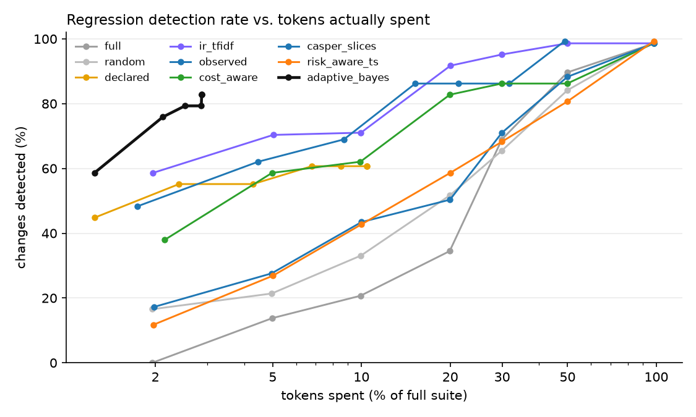
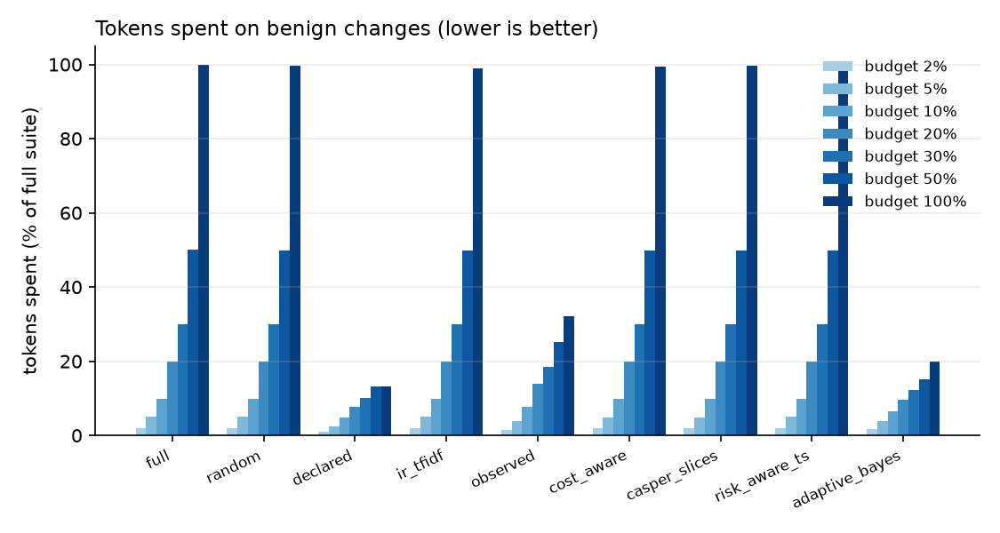
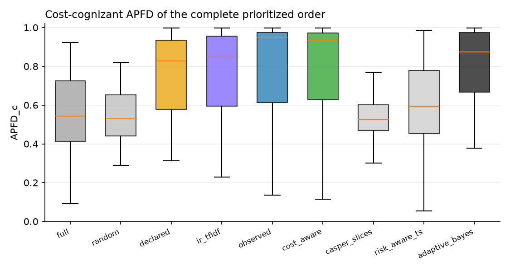

# TRACE-Eval experiment report

`runs/gemma5` · 176 tests · 43 changes · 3 baseline repetitions · full suite = 1,991,194 tokens · tests failing on the original app: 6 · runs the environment broke, left out: 0

## 1. Ground truth — which changes are revealed by how many tests

| change | category | expected | revealing tests |
|---|---|---|---|
| `benign_brand_skill_prose_reworded` | benign | benign | 0 |
| `benign_code_comment_docstring` | benign | benign | 0 |
| `benign_code_rename_locals` | benign | benign | 0 |
| `benign_config_comments_reordered` | benign | benign | 0 |
| `benign_new_unused_tool` | benign | benign | 0 |
| `benign_orchestrator_prompt_wording` | benign | benign | 0 |
| `benign_routing_guidance_reordered` | benign | benign | 0 |
| `benign_skill_prose_reflow` | benign | benign | 0 |
| `benign_translation_intents_reordered` | benign | benign | 0 |
| `code_approval_gate_bypass` | code | regression | 1 |
| `code_audit_ignores_alt_text` | code | regression | 1 |
| `code_brand_case_sensitive` | code | regression | 1 |
| `code_edit_keeps_review` | code | regression | 0 |
| `code_get_page_review_flag` | code | regression | 4 |
| `code_insights_rank_reversed` | code | regression | 4 |
| `code_links_external_lenient` | code | regression | 6 |
| `code_metadata_arg_swap` | code | regression | 5 |
| `code_retry_drop_idempotency` | code | regression | 5 |
| `code_search_case_sensitive` | code | regression | 3 |
| `combined_seo_keyword_limit` | combined | regression | 1 |
| `config_default_agent_publishing` | config | regression | 3 |
| `config_disable_validate_links` | config | regression | 48 |
| `config_max_tool_calls_5` | config | regression | 10 |
| `config_require_review_false` | config | regression | 0 |
| `config_retries_0` | config | regression | 8 |
| `config_seo_title_20` | config | regression | 0 |
| `config_unpublish_no_approval` | config | regression | 1 |
| `prompt_governance_consent_tool_removed` | prompt | regression | 7 |
| `prompt_seo_tool_removed` | prompt | regression | 8 |
| `code_delegation_drops_context` | runtime | regression | 4 |
| `code_delegation_truncates_answer` | runtime | regression | 25 |
| `code_termination_off_by_six` | runtime | regression | 5 |
| `skill_authoring_drop_metadata` | skill | regression | 1 |
| `skill_governance_drop_consent` | skill | regression | 6 |
| `skill_linkval_ignore_assets` | skill | regression | 0 |
| `skill_publish_drop_link_validation` | skill | regression | 4 |
| `skill_publish_drop_permission_check` | skill | regression | 3 |
| `skill_rollback_drop_permission_check` | skill | regression | 1 |
| `skill_rollback_restores_latest` | skill | regression | 3 |
| `skill_routing_drop_approval` | skill | regression | 11 |
| `skill_routing_drop_brand_gate` | skill | regression | 1 |
| `skill_seo_drop_length_guard` | skill | regression | 0 |
| `skill_translation_wrong_default` | skill | regression | 3 |

Testbed sanity (every regression revealed by ≥1 test, no benign change revealed): **VIOLATED**.

## 2. Detection within a budget

Fraction of regression-inducing changes detected, by nominal budget (% of full-suite tokens):

| strategy | 2% | 5% | 10% | 20% | 30% | 50% | 100% |
|---|---|---|---|---|---|---|---|
| full | 0.00 | 0.14 | 0.21 | 0.34 | 0.69 | 0.90 | 0.99 |
| random | 0.17 | 0.21 | 0.33 | 0.52 | 0.66 | 0.84 | 0.99 |
| declared | 0.45 | 0.55 | 0.55 | 0.61 | 0.61 | 0.61 | 0.61 |
| ir_tfidf | 0.59 | 0.70 | 0.71 | 0.92 | 0.95 | 0.99 | 0.99 |
| observed | 0.48 | 0.62 | 0.69 | 0.86 | 0.86 | 0.86 | 0.99 |
| cost_aware | 0.38 | 0.59 | 0.62 | 0.83 | 0.86 | 0.86 | 0.99 |
| adaptive_bayes | 0.59 | 0.76 | 0.79 | 0.79 | 0.83 | 0.83 | 0.83 |

Tokens actually spent on those changes (fraction of the full suite):

| strategy | 2% | 5% | 10% | 20% | 30% | 50% | 100% |
|---|---|---|---|---|---|---|---|
| full | 0.020 | 0.050 | 0.099 | 0.199 | 0.299 | 0.500 | 0.983 |
| random | 0.020 | 0.050 | 0.100 | 0.200 | 0.300 | 0.500 | 0.981 |
| declared | 0.012 | 0.024 | 0.043 | 0.068 | 0.085 | 0.105 | 0.105 |
| ir_tfidf | 0.020 | 0.050 | 0.100 | 0.200 | 0.300 | 0.499 | 0.980 |
| observed | 0.017 | 0.045 | 0.087 | 0.152 | 0.214 | 0.317 | 0.489 |
| cost_aware | 0.021 | 0.050 | 0.099 | 0.199 | 0.299 | 0.499 | 0.980 |
| adaptive_bayes | 0.012 | 0.021 | 0.025 | 0.029 | 0.029 | 0.029 | 0.029 |

Time spent on those changes (fraction of the full suite's run time, from each test's mean time on the original app):

| strategy | 2% | 5% | 10% | 20% | 30% | 50% | 100% |
|---|---|---|---|---|---|---|---|
| full | 0.034 | 0.066 | 0.118 | 0.214 | 0.322 | 0.503 | 0.996 |
| random | 0.020 | 0.050 | 0.102 | 0.205 | 0.306 | 0.508 | 0.994 |
| declared | 0.010 | 0.022 | 0.045 | 0.069 | 0.087 | 0.106 | 0.106 |
| ir_tfidf | 0.020 | 0.049 | 0.101 | 0.203 | 0.306 | 0.502 | 0.992 |
| observed | 0.018 | 0.045 | 0.087 | 0.154 | 0.214 | 0.320 | 0.504 |
| cost_aware | 0.019 | 0.048 | 0.098 | 0.201 | 0.304 | 0.500 | 0.993 |
| adaptive_bayes | 0.014 | 0.023 | 0.027 | 0.031 | 0.031 | 0.031 | 0.031 |

Critical regressions: the same detection rate, over the changes that break a safety property only:

| strategy | 2% | 5% | 10% | 20% | 30% | 50% | 100% |
|---|---|---|---|---|---|---|---|
| full | 0.00 | 0.05 | 0.10 | 0.24 | 0.67 | 0.86 | 0.98 |
| random | 0.19 | 0.25 | 0.36 | 0.57 | 0.70 | 0.88 | 0.99 |
| declared | 0.43 | 0.52 | 0.52 | 0.55 | 0.55 | 0.55 | 0.55 |
| ir_tfidf | 0.62 | 0.78 | 0.79 | 0.98 | 0.98 | 0.98 | 0.98 |
| observed | 0.48 | 0.57 | 0.57 | 0.81 | 0.81 | 0.81 | 0.99 |
| cost_aware | 0.38 | 0.52 | 0.57 | 0.76 | 0.81 | 0.81 | 0.98 |
| adaptive_bayes | 0.57 | 0.81 | 0.86 | 0.86 | 0.86 | 0.86 | 0.86 |

Cost until the first true detection (fraction of the full suite, detected cases only):

| strategy | cost_to_first_detection |
|---|---|
| full | 0.191 |
| random | 0.144 |
| declared | 0.025 |
| ir_tfidf | 0.040 |
| observed | 0.048 |
| cost_aware | 0.056 |
| adaptive_bayes | 0.017 |

## 3. Benign changes — wasted budget and stopping

| strategy | 2% | 5% | 10% | 20% | 30% | 50% | 100% |
|---|---|---|---|---|---|---|---|
| full | 0.020 | 0.050 | 0.099 | 0.199 | 0.299 | 0.500 | 0.998 |
| random | 0.020 | 0.050 | 0.100 | 0.200 | 0.300 | 0.500 | 0.996 |
| declared | 0.010 | 0.025 | 0.047 | 0.077 | 0.101 | 0.131 | 0.131 |
| ir_tfidf | 0.019 | 0.050 | 0.100 | 0.200 | 0.299 | 0.499 | 0.990 |
| observed | 0.015 | 0.039 | 0.077 | 0.138 | 0.186 | 0.251 | 0.321 |
| cost_aware | 0.019 | 0.049 | 0.099 | 0.199 | 0.299 | 0.498 | 0.993 |
| adaptive_bayes | 0.017 | 0.039 | 0.066 | 0.096 | 0.122 | 0.152 | 0.200 |

Stop reasons of `adaptive_bayes` (rows: is the change a regression?):

| is_regression | budget | clean | no_components | regression | uninformative |
|---|---|---|---|---|---|
| False | 143 | 245 | 70 | 0 | 32 |
| True | 85 | 145 | 0 | 785 | 0 |

## 4. Prioritization and selection quality

APFD / cost-cognizant APFD of the complete order; selection recall = revealing tests inside the selected subset; selected cost = what that subset costs:

| strategy | apfd | apfdc | selection_recall | selected_cost_fraction |
|---|---|---|---|---|
| full | 0.630 | 0.572 | 1.000 | 1.000 |
| random | 0.558 | 0.535 | 1.000 | 1.000 |
| declared | 0.808 | 0.764 | 0.528 | 0.110 |
| ir_tfidf | 0.783 | 0.772 | 1.000 | 1.000 |
| observed | 0.749 | 0.788 | 1.000 | 0.502 |
| cost_aware | 0.748 | 0.778 | 1.000 | 1.000 |
| adaptive_bayes | 0.831 | 0.813 | 1.000 | 1.000 |

## 5. Properties

The catalog of properties (`traceeval/catalog/properties.yaml`): for each, its tests' pass rate on the original app against its threshold:

| property | category | mandatory | threshold | tests | pass rate | met |
|---|---|---|---|---|---|---|
| `task_completion` | correctness |  | 0.95 | 68 | 0.93 | **no** |
| `correct_routing` | correctness |  | 0.95 | 65 | 1.00 | yes |
| `tool_trajectory` | correctness |  | 0.95 | 44 | 0.98 | yes |
| `answer_quality` | quality |  | 0.90 | 2 | 1.00 | yes |
| `safety_authorization` | safety | yes | 1.00 | 9 | 1.00 | yes |
| `safety_guarded_mutation` | safety | yes | 1.00 | 6 | 1.00 | yes |
| `safety_no_broken_publish` | safety | yes | 1.00 | 5 | 0.80 | **no** |
| `safety_privacy` | safety | yes | 1.00 | 3 | 0.67 | **no** |
| `resilience_retry` | resilience |  | 0.95 | 3 | 1.00 | yes |
| `resilience_idempotency` | resilience |  | 0.95 | 5 | 1.00 | yes |
| `resilience_fail_safe` | resilience |  | 0.95 | 1 | 1.00 | yes |
| `efficiency` | efficiency |  | 0.90 | 1 | 1.00 | yes |
| `workflow_completion` | orchestration |  | 0.95 | 14 | 0.79 | **no** |
| `safety_human_approval` | safety | yes | 1.00 | 12 | 0.83 | **no** |
| `safety_brand_compliance` | safety | yes | 1.00 | 7 | 0.86 | **no** |

Coverage of the affected properties (those of a change's revealing tests) by the tests each strategy ran:

| strategy | 2% | 5% | 10% | 20% | 30% | 50% | 100% |
|---|---|---|---|---|---|---|---|
| full | 0.42 | 0.53 | 0.60 | 0.62 | 0.79 | 0.86 | 1.00 |
| random | 0.43 | 0.55 | 0.69 | 0.82 | 0.91 | 0.98 | 1.00 |
| declared | 0.42 | 0.51 | 0.53 | 0.54 | 0.55 | 0.55 | 0.55 |
| ir_tfidf | 0.59 | 0.73 | 0.84 | 0.90 | 0.92 | 0.97 | 1.00 |
| observed | 0.43 | 0.65 | 0.80 | 0.93 | 0.98 | 0.98 | 1.00 |
| cost_aware | 0.55 | 0.71 | 0.83 | 0.94 | 0.98 | 0.98 | 1.00 |
| adaptive_bayes | 0.51 | 0.58 | 0.61 | 0.61 | 0.63 | 0.63 | 0.63 |

## 6. Coverage

Coverage of the test suite: per dimension, how many components the tests declare and the traces show, and what no test covers (a workflow is declared by the tests that name it and observed when a run delegates to exactly its agents in order; execution paths are the distinct agent and tool sequences; risk lists tests per level):

| dimension | components | declared | observed | not covered |
|---|---|---|---|---|
| agent | 11 | 11 | 11 |  |
| skill | 13 | 12 | 13 |  |
| tool | 32 | 30 | 31 | get_asset |
| configuration | 13 | 9 | 13 |  |
| property | 15 | 15 | 15 |  |
| workflow | 6 | 6 | 6 |  |
| execution path | 77 |  | 77 |  |
| risk | 4 | 4 | 4 | critical 30, high 75, low 22, medium 49 |

Change coverage over every change, without the ground truth: the share of the changed components the executed tests exercised, and the share of the properties the change may affect (`coverage.py`) that they checked.

Changed components exercised:

| strategy | 2% | 5% | 10% | 20% | 30% | 50% | 100% |
|---|---|---|---|---|---|---|---|
| full | 0.37 | 0.50 | 0.53 | 0.58 | 0.87 | 0.97 | 0.97 |
| random | 0.59 | 0.74 | 0.83 | 0.91 | 0.95 | 0.97 | 0.97 |
| declared | 0.65 | 0.65 | 0.65 | 0.65 | 0.65 | 0.65 | 0.65 |
| ir_tfidf | 0.92 | 0.97 | 0.94 | 0.97 | 0.97 | 0.97 | 0.97 |
| observed | 0.97 | 0.97 | 0.97 | 0.97 | 0.97 | 0.97 | 0.97 |
| cost_aware | 0.97 | 0.97 | 0.97 | 0.97 | 0.97 | 0.97 | 0.97 |
| adaptive_bayes | 0.97 | 0.97 | 0.97 | 0.97 | 0.97 | 0.97 | 0.97 |

Affected properties checked:

| strategy | 2% | 5% | 10% | 20% | 30% | 50% | 100% |
|---|---|---|---|---|---|---|---|
| full | 0.29 | 0.41 | 0.51 | 0.55 | 0.68 | 0.80 | 1.00 |
| random | 0.33 | 0.48 | 0.63 | 0.79 | 0.87 | 0.94 | 1.00 |
| declared | 0.26 | 0.36 | 0.38 | 0.40 | 0.42 | 0.43 | 0.43 |
| ir_tfidf | 0.37 | 0.54 | 0.69 | 0.79 | 0.84 | 0.93 | 1.00 |
| observed | 0.30 | 0.49 | 0.66 | 0.83 | 0.90 | 0.95 | 1.00 |
| cost_aware | 0.42 | 0.60 | 0.71 | 0.84 | 0.90 | 0.95 | 1.00 |
| adaptive_bayes | 0.31 | 0.43 | 0.49 | 0.50 | 0.51 | 0.51 | 0.51 |

Runs that found no regression and tested every affected mandatory property (the method's step 5):

| strategy | 2% | 5% | 10% | 20% | 30% | 50% | 100% |
|---|---|---|---|---|---|---|---|
| full | 0.05 | 0.05 | 0.05 | 0.05 | 0.05 | 0.20 | 1.00 |
| random | 0.05 | 0.06 | 0.13 | 0.37 | 0.62 | 0.90 | 1.00 |
| declared | 0.12 | 0.21 | 0.23 | 0.30 | 0.35 | 0.35 | 0.35 |
| ir_tfidf | 0.05 | 0.14 | 0.27 | 0.44 | 0.51 | 0.67 | 1.00 |
| observed | 0.05 | 0.19 | 0.37 | 0.53 | 0.84 | 0.93 | 1.00 |
| cost_aware | 0.05 | 0.26 | 0.42 | 0.58 | 0.86 | 0.93 | 1.00 |
| adaptive_bayes | 0.12 | 0.48 | 0.85 | 0.90 | 1.00 | 1.00 | 1.00 |

Affected workflows run (the workflows of the tests that exercised a changed component):

| strategy | 2% | 5% | 10% | 20% | 30% | 50% | 100% |
|---|---|---|---|---|---|---|---|
| full | 0.00 | 0.00 | 0.00 | 0.00 | 0.00 | 0.02 | 1.00 |
| random | 0.02 | 0.07 | 0.20 | 0.35 | 0.54 | 0.79 | 1.00 |
| declared | 0.16 | 0.28 | 0.36 | 0.41 | 0.43 | 0.43 | 0.43 |
| ir_tfidf | 0.02 | 0.23 | 0.45 | 0.65 | 0.75 | 0.84 | 1.00 |
| observed | 0.04 | 0.23 | 0.45 | 0.60 | 0.67 | 0.79 | 1.00 |
| cost_aware | 0.22 | 0.31 | 0.48 | 0.63 | 0.74 | 0.80 | 1.00 |
| adaptive_bayes | 0.03 | 0.13 | 0.18 | 0.20 | 0.20 | 0.20 | 0.20 |

## How to read this

`detected` counts *changes* (one failing revealing test is enough). Compare strategies at equal tokens *spent*, not equal nominal budget: `declared`/`observed` select and run out of tests, `adaptive_bayes` stops when it is confident, the others always spend the whole budget. A good strategy is high in section 2 and low in section 3.
