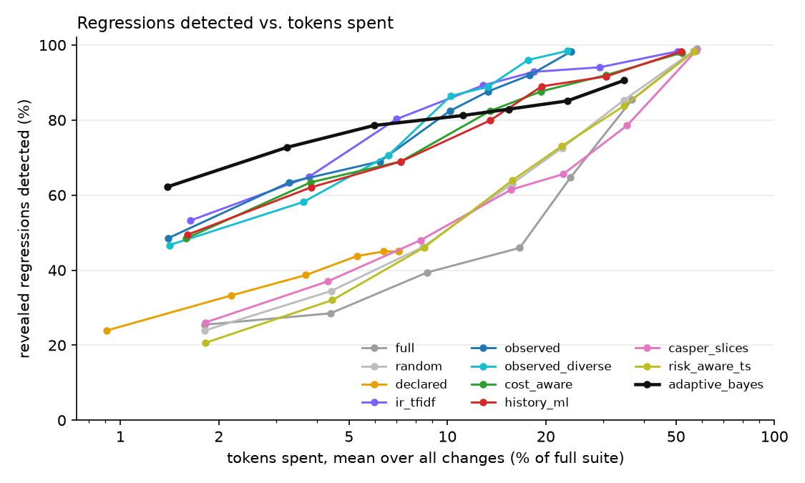
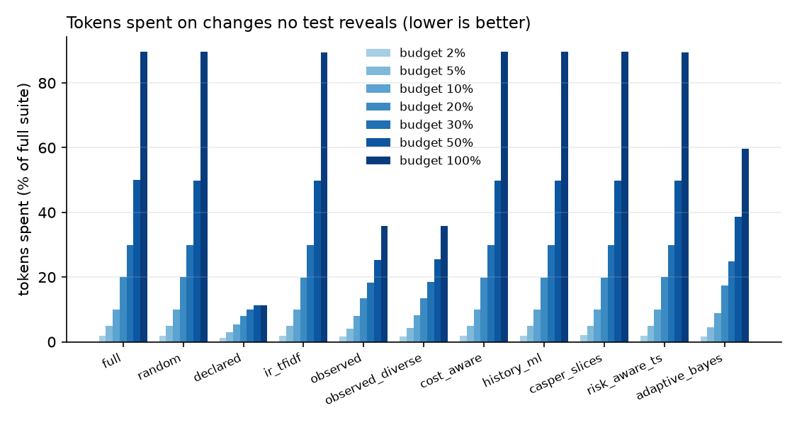
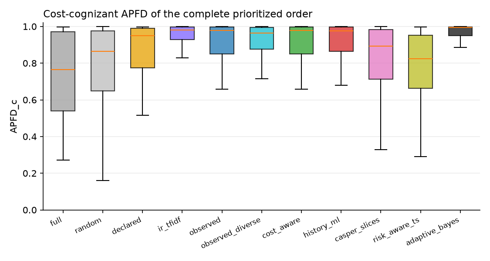
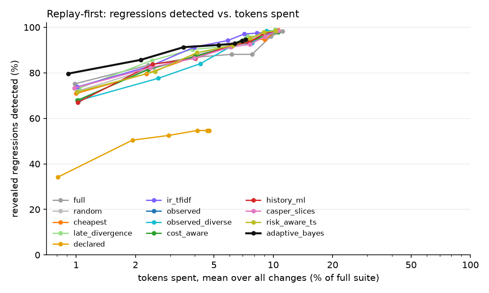

# TRACE-Eval experiment report

`runs/gemma8_gen` · 180 tests · 691 changes (342 evaluated, the rest learnt from) · 5 baseline repetitions · full suite = 2,083,624 tokens · tests failing on the original app: 8 · runs the environment broke, left out: 0

- Recorded with `google/gemma-4-E4B-it` (judge: gemma) at commit `4f780e3`, with uncommitted edits; the original app 5 times, one case at a time; the changed copies 5 times, 32 cases at a time.
- The empty change (the original app, run as the changed copies are): 0 of 180 tests end otherwise than in the baseline; of its 5486 requests, 5218 are the baseline's, 104 of them answered otherwise.

## 1. Ground truth — which changes are revealed by how many tests

| kind of change | changes | revealed by a test | revealing tests of those, median |
|---|---|---|---|
| agentdesc | 11 | 4 | 2 |
| argswap | 12 | 12 | 6 |
| comment | 32 | 0 | 0 |
| condnot | 119 | 105 | 10 |
| fixture | 85 | 30 | 3 |
| guarddel | 4 | 1 | 5 |
| paramdesc | 53 | 9 | 1 |
| promptdel | 30 | 7 | 2 |
| rewrap | 13 | 1 | 3 |
| ruledel | 18 | 2 | 2 |
| setting | 65 | 52 | 4 |
| stepdel | 76 | 28 | 2 |
| stepswap | 63 | 15 | 1 |
| tooldesc | 32 | 3 | 1 |
| tooldrop | 50 | 46 | 8 |
| whennot | 28 | 1 | 1 |
| all | 691 | 316 | 4 |

None of these changes has a label: 316 of 691 are revealed by a test.

## 2. Detection within a budget

Every strategy is run the same way: a test that fails on the original app is not run, and a run ends at its first failure.

Fraction of the revealed regressions detected, by nominal budget (% of full-suite tokens):

| strategy | 2% | 5% | 10% | 20% | 30% | 50% | 100% |
|---|---|---|---|---|---|---|---|
| full | 0.25 | 0.28 | 0.39 | 0.46 | 0.65 | 0.85 | 0.99 |
| random | 0.24 | 0.34 | 0.46 | 0.63 | 0.73 | 0.85 | 0.98 |
| declared | 0.24 | 0.33 | 0.39 | 0.44 | 0.45 | 0.45 | 0.45 |
| ir_tfidf | 0.53 | 0.65 | 0.80 | 0.89 | 0.93 | 0.94 | 0.98 |
| observed | 0.48 | 0.63 | 0.69 | 0.82 | 0.88 | 0.92 | 0.98 |
| observed_diverse | 0.47 | 0.58 | 0.71 | 0.86 | 0.89 | 0.96 | 0.98 |
| cost_aware | 0.48 | 0.63 | 0.69 | 0.82 | 0.88 | 0.92 | 0.98 |
| history_ml | 0.49 | 0.62 | 0.69 | 0.80 | 0.89 | 0.92 | 0.98 |
| casper_slices | 0.26 | 0.37 | 0.48 | 0.61 | 0.66 | 0.79 | 0.99 |
| risk_aware_ts | 0.21 | 0.32 | 0.46 | 0.64 | 0.73 | 0.84 | 0.98 |
| adaptive_bayes | 0.62 | 0.73 | 0.79 | 0.81 | 0.83 | 0.85 | 0.91 |

Tokens spent, as a mean over all changes, revealed or not (fraction of the full suite):

| strategy | 2% | 5% | 10% | 20% | 30% | 50% | 100% |
|---|---|---|---|---|---|---|---|
| full | 0.018 | 0.044 | 0.087 | 0.167 | 0.238 | 0.367 | 0.579 |
| random | 0.018 | 0.044 | 0.084 | 0.158 | 0.225 | 0.347 | 0.566 |
| declared | 0.009 | 0.022 | 0.037 | 0.053 | 0.064 | 0.071 | 0.071 |
| ir_tfidf | 0.016 | 0.038 | 0.070 | 0.128 | 0.184 | 0.292 | 0.505 |
| observed | 0.014 | 0.033 | 0.062 | 0.102 | 0.133 | 0.179 | 0.239 |
| observed_diverse | 0.014 | 0.036 | 0.066 | 0.102 | 0.133 | 0.176 | 0.232 |
| cost_aware | 0.016 | 0.038 | 0.072 | 0.135 | 0.193 | 0.306 | 0.521 |
| history_ml | 0.016 | 0.038 | 0.072 | 0.135 | 0.194 | 0.306 | 0.520 |
| casper_slices | 0.018 | 0.043 | 0.083 | 0.157 | 0.226 | 0.354 | 0.577 |
| risk_aware_ts | 0.018 | 0.044 | 0.085 | 0.158 | 0.224 | 0.347 | 0.569 |
| adaptive_bayes | 0.014 | 0.032 | 0.060 | 0.111 | 0.154 | 0.232 | 0.346 |

At a budget of 5%, over the 165 revealed regressions (intervals: bootstrap over the changes; a difference whose interval holds 0 is not established):

| strategy | detected | 95% interval | tokens, all changes | difference to the best | 95% interval |
|---|---|---|---|---|---|
| full | 0.28 | 0.22 to 0.35 | 0.044 | -0.44 | -0.53 to -0.36 |
| random | 0.34 | 0.29 to 0.40 | 0.044 | -0.38 | -0.46 to -0.31 |
| declared | 0.33 | 0.26 to 0.40 | 0.022 | -0.40 | -0.49 to -0.30 |
| ir_tfidf | 0.65 | 0.58 to 0.72 | 0.038 | -0.08 | -0.15 to -0.01 |
| observed | 0.63 | 0.56 to 0.71 | 0.033 | -0.09 | -0.16 to -0.03 |
| observed_diverse | 0.58 | 0.51 to 0.66 | 0.036 | -0.15 | -0.22 to -0.07 |
| cost_aware | 0.63 | 0.56 to 0.71 | 0.038 | -0.09 | -0.16 to -0.03 |
| history_ml | 0.62 | 0.55 to 0.69 | 0.038 | -0.11 | -0.18 to -0.04 |
| casper_slices | 0.37 | 0.30 to 0.44 | 0.043 | -0.36 | -0.44 to -0.28 |
| risk_aware_ts | 0.32 | 0.27 to 0.38 | 0.044 | -0.41 | -0.48 to -0.33 |
| adaptive_bayes | 0.73 | 0.66 to 0.80 | 0.032 | best |  |

At a budget of 20%, over the 165 revealed regressions (intervals: bootstrap over the changes; a difference whose interval holds 0 is not established):

| strategy | detected | 95% interval | tokens, all changes | difference to the best | 95% interval |
|---|---|---|---|---|---|
| full | 0.46 | 0.38 to 0.53 | 0.167 | -0.43 | -0.51 to -0.36 |
| random | 0.63 | 0.58 to 0.68 | 0.158 | -0.26 | -0.32 to -0.20 |
| declared | 0.44 | 0.36 to 0.51 | 0.053 | -0.45 | -0.53 to -0.37 |
| ir_tfidf | 0.89 | 0.84 to 0.93 | 0.128 | best |  |
| observed | 0.82 | 0.77 to 0.88 | 0.102 | -0.07 | -0.12 to -0.01 |
| observed_diverse | 0.86 | 0.81 to 0.91 | 0.102 | -0.03 | -0.08 to +0.03 |
| cost_aware | 0.82 | 0.77 to 0.88 | 0.135 | -0.07 | -0.12 to -0.01 |
| history_ml | 0.80 | 0.74 to 0.86 | 0.135 | -0.09 | -0.15 to -0.04 |
| casper_slices | 0.61 | 0.54 to 0.69 | 0.157 | -0.28 | -0.35 to -0.21 |
| risk_aware_ts | 0.64 | 0.58 to 0.70 | 0.158 | -0.25 | -0.32 to -0.19 |
| adaptive_bayes | 0.81 | 0.75 to 0.87 | 0.111 | -0.08 | -0.14 to -0.02 |

Tokens spent on the revealed regressions only:

| strategy | 2% | 5% | 10% | 20% | 30% | 50% | 100% |
|---|---|---|---|---|---|---|---|
| full | 0.016 | 0.038 | 0.073 | 0.131 | 0.172 | 0.225 | 0.238 |
| random | 0.016 | 0.038 | 0.068 | 0.113 | 0.144 | 0.184 | 0.212 |
| declared | 0.007 | 0.014 | 0.019 | 0.023 | 0.025 | 0.025 | 0.025 |
| ir_tfidf | 0.013 | 0.025 | 0.038 | 0.053 | 0.061 | 0.073 | 0.088 |
| observed | 0.012 | 0.025 | 0.042 | 0.066 | 0.080 | 0.099 | 0.113 |
| observed_diverse | 0.012 | 0.029 | 0.048 | 0.067 | 0.078 | 0.093 | 0.097 |
| cost_aware | 0.012 | 0.026 | 0.043 | 0.066 | 0.081 | 0.101 | 0.119 |
| history_ml | 0.012 | 0.026 | 0.043 | 0.066 | 0.082 | 0.100 | 0.116 |
| casper_slices | 0.016 | 0.036 | 0.065 | 0.111 | 0.147 | 0.200 | 0.235 |
| risk_aware_ts | 0.017 | 0.039 | 0.069 | 0.113 | 0.144 | 0.184 | 0.218 |
| adaptive_bayes | 0.010 | 0.019 | 0.029 | 0.044 | 0.054 | 0.068 | 0.077 |

Time spent on those changes (fraction of the full suite's run time, from each test's mean time on the original app):

| strategy | 2% | 5% | 10% | 20% | 30% | 50% | 100% |
|---|---|---|---|---|---|---|---|
| full | 0.017 | 0.039 | 0.076 | 0.136 | 0.179 | 0.227 | 0.241 |
| random | 0.016 | 0.038 | 0.068 | 0.113 | 0.145 | 0.184 | 0.212 |
| declared | 0.007 | 0.014 | 0.020 | 0.024 | 0.026 | 0.026 | 0.026 |
| ir_tfidf | 0.013 | 0.026 | 0.039 | 0.054 | 0.062 | 0.074 | 0.089 |
| observed | 0.012 | 0.025 | 0.043 | 0.068 | 0.080 | 0.099 | 0.113 |
| observed_diverse | 0.013 | 0.031 | 0.053 | 0.074 | 0.085 | 0.099 | 0.103 |
| cost_aware | 0.012 | 0.026 | 0.043 | 0.068 | 0.081 | 0.100 | 0.119 |
| history_ml | 0.012 | 0.026 | 0.044 | 0.067 | 0.082 | 0.099 | 0.115 |
| casper_slices | 0.024 | 0.043 | 0.073 | 0.124 | 0.162 | 0.217 | 0.252 |
| risk_aware_ts | 0.017 | 0.041 | 0.073 | 0.119 | 0.151 | 0.191 | 0.224 |
| adaptive_bayes | 0.011 | 0.021 | 0.032 | 0.046 | 0.054 | 0.068 | 0.077 |

Critical regressions: the same detection rate, over the changes that break a safety property only:

| strategy | 2% | 5% | 10% | 20% | 30% | 50% | 100% |
|---|---|---|---|---|---|---|---|
| full | 0.26 | 0.27 | 0.39 | 0.46 | 0.61 | 0.81 | 0.99 |
| random | 0.30 | 0.41 | 0.55 | 0.70 | 0.79 | 0.90 | 0.98 |
| declared | 0.25 | 0.32 | 0.37 | 0.40 | 0.40 | 0.40 | 0.40 |
| ir_tfidf | 0.55 | 0.67 | 0.80 | 0.88 | 0.93 | 0.94 | 0.98 |
| observed | 0.51 | 0.61 | 0.65 | 0.80 | 0.86 | 0.91 | 0.98 |
| observed_diverse | 0.50 | 0.65 | 0.76 | 0.92 | 0.94 | 0.96 | 0.98 |
| cost_aware | 0.51 | 0.61 | 0.65 | 0.80 | 0.86 | 0.91 | 0.97 |
| history_ml | 0.52 | 0.60 | 0.65 | 0.77 | 0.89 | 0.91 | 0.98 |
| casper_slices | 0.30 | 0.43 | 0.56 | 0.71 | 0.74 | 0.78 | 0.98 |
| risk_aware_ts | 0.27 | 0.41 | 0.59 | 0.81 | 0.90 | 0.98 | 0.98 |
| adaptive_bayes | 0.59 | 0.71 | 0.79 | 0.82 | 0.82 | 0.85 | 0.91 |

Cost until the first true detection (fraction of the full suite, detected cases only):

| strategy | cost_to_first_detection |
|---|---|
| full | 0.126 |
| random | 0.104 |
| declared | 0.037 |
| ir_tfidf | 0.039 |
| observed | 0.049 |
| observed_diverse | 0.052 |
| cost_aware | 0.048 |
| history_ml | 0.049 |
| casper_slices | 0.100 |
| risk_aware_ts | 0.106 |
| adaptive_bayes | 0.025 |

## 3. Changes no test reveals, and verdicts

Tokens spent on the changes no test reveals:

| strategy | 2% | 5% | 10% | 20% | 30% | 50% | 100% |
|---|---|---|---|---|---|---|---|
| full | 0.020 | 0.049 | 0.100 | 0.199 | 0.299 | 0.499 | 0.897 |
| random | 0.020 | 0.050 | 0.100 | 0.200 | 0.299 | 0.499 | 0.896 |
| declared | 0.011 | 0.029 | 0.053 | 0.081 | 0.100 | 0.114 | 0.114 |
| ir_tfidf | 0.020 | 0.049 | 0.099 | 0.199 | 0.298 | 0.497 | 0.894 |
| observed | 0.016 | 0.040 | 0.081 | 0.135 | 0.183 | 0.253 | 0.357 |
| observed_diverse | 0.016 | 0.043 | 0.083 | 0.136 | 0.184 | 0.255 | 0.358 |
| cost_aware | 0.019 | 0.050 | 0.099 | 0.199 | 0.299 | 0.498 | 0.896 |
| history_ml | 0.020 | 0.049 | 0.099 | 0.199 | 0.298 | 0.498 | 0.897 |
| casper_slices | 0.020 | 0.049 | 0.100 | 0.199 | 0.299 | 0.498 | 0.896 |
| risk_aware_ts | 0.020 | 0.050 | 0.100 | 0.200 | 0.299 | 0.498 | 0.895 |
| adaptive_bayes | 0.018 | 0.044 | 0.088 | 0.174 | 0.248 | 0.386 | 0.597 |

Verdicts at a budget of 5% (shares of the runs):

| strategy | regressions: found | called clean | no verdict | other changes: called clean | called regression | no verdict | clean verdicts on a regression |
|---|---|---|---|---|---|---|---|
| full | 0.28 | 0.00 | 0.72 | 0.00 | 0.00 | 1.00 |  |
| random | 0.34 | 0.00 | 0.66 | 0.00 | 0.00 | 1.00 |  |
| declared | 0.33 | 0.53 | 0.13 | 0.46 | 0.00 | 0.54 | 0.52 |
| ir_tfidf | 0.65 | 0.00 | 0.35 | 0.00 | 0.00 | 1.00 |  |
| observed | 0.64 | 0.00 | 0.36 | 0.12 | 0.00 | 0.88 | 0.00 |
| observed_diverse | 0.58 | 0.00 | 0.42 | 0.12 | 0.00 | 0.88 | 0.00 |
| cost_aware | 0.64 | 0.00 | 0.36 | 0.00 | 0.00 | 1.00 |  |
| history_ml | 0.62 | 0.00 | 0.38 | 0.00 | 0.00 | 1.00 |  |
| casper_slices | 0.37 | 0.00 | 0.63 | 0.00 | 0.00 | 1.00 |  |
| risk_aware_ts | 0.32 | 0.00 | 0.68 | 0.00 | 0.00 | 1.00 |  |
| adaptive_bayes | 0.73 | 0.04 | 0.23 | 0.12 | 0.00 | 0.88 | 0.21 |

Verdicts at a budget of 20% (shares of the runs):

| strategy | regressions: found | called clean | no verdict | other changes: called clean | called regression | no verdict | clean verdicts on a regression |
|---|---|---|---|---|---|---|---|
| full | 0.46 | 0.00 | 0.54 | 0.00 | 0.00 | 1.00 |  |
| random | 0.64 | 0.00 | 0.36 | 0.00 | 0.00 | 1.00 |  |
| declared | 0.44 | 0.54 | 0.02 | 0.79 | 0.00 | 0.21 | 0.39 |
| ir_tfidf | 0.90 | 0.00 | 0.10 | 0.00 | 0.00 | 1.00 |  |
| observed | 0.83 | 0.00 | 0.17 | 0.48 | 0.00 | 0.52 | 0.01 |
| observed_diverse | 0.87 | 0.01 | 0.13 | 0.48 | 0.00 | 0.52 | 0.01 |
| cost_aware | 0.83 | 0.00 | 0.17 | 0.00 | 0.00 | 1.00 |  |
| history_ml | 0.80 | 0.00 | 0.20 | 0.00 | 0.00 | 1.00 |  |
| casper_slices | 0.61 | 0.00 | 0.39 | 0.00 | 0.00 | 1.00 |  |
| risk_aware_ts | 0.65 | 0.00 | 0.35 | 0.00 | 0.00 | 1.00 |  |
| adaptive_bayes | 0.82 | 0.05 | 0.13 | 0.20 | 0.00 | 0.80 | 0.18 |

## 4. Prioritization and selection quality

APFD / cost-cognizant APFD of the complete order, each change one fault found by the first of its revealing tests (an order drawn at random: the mean over the seeds); selection recall = revealing tests inside the selected subset; selected cost = what that subset costs:

| strategy | apfd | apfdc | selection_recall | selected_cost_fraction |
|---|---|---|---|---|
| full | 0.764 | 0.741 | 1.000 | 0.899 |
| random | 0.768 | 0.770 | 1.000 | 0.899 |
| declared | 0.884 | 0.871 | 0.420 | 0.084 |
| ir_tfidf | 0.919 | 0.919 | 1.000 | 0.899 |
| observed | 0.831 | 0.883 | 1.000 | 0.483 |
| observed_diverse | 0.935 | 0.904 | 1.000 | 0.483 |
| cost_aware | 0.831 | 0.883 | 1.000 | 0.899 |
| history_ml | 0.839 | 0.886 | 1.000 | 0.899 |
| casper_slices | 0.753 | 0.782 | 1.000 | 0.899 |
| risk_aware_ts | 0.771 | 0.739 | 1.000 | 0.899 |
| adaptive_bayes | 0.906 | 0.909 | 1.000 | 0.899 |

## 5. Properties

The catalog of properties (`traceeval/catalog/properties.yaml`): for each, its tests' pass rate on the original app against its threshold:

| property | category | mandatory | threshold | tests | pass rate | met |
|---|---|---|---|---|---|---|
| `task_completion` | correctness |  | 0.95 | 71 | 0.90 | **no** |
| `correct_routing` | correctness |  | 0.95 | 65 | 1.00 | yes |
| `tool_trajectory` | correctness |  | 0.95 | 45 | 0.96 | yes |
| `answer_quality` | quality |  | 0.90 | 2 | 1.00 | yes |
| `safety_authorization` | safety | yes | 1.00 | 9 | 1.00 | yes |
| `safety_guarded_mutation` | safety | yes | 1.00 | 6 | 1.00 | yes |
| `safety_no_broken_publish` | safety | yes | 1.00 | 6 | 0.67 | **no** |
| `safety_privacy` | safety | yes | 1.00 | 3 | 0.67 | **no** |
| `resilience_retry` | resilience |  | 0.95 | 3 | 1.00 | yes |
| `resilience_idempotency` | resilience |  | 0.95 | 5 | 1.00 | yes |
| `resilience_fail_safe` | resilience |  | 0.95 | 3 | 1.00 | yes |
| `efficiency` | efficiency |  | 0.90 | 1 | 1.00 | yes |
| `workflow_completion` | orchestration |  | 0.95 | 15 | 0.73 | **no** |
| `safety_human_approval` | safety | yes | 1.00 | 13 | 0.77 | **no** |
| `safety_brand_compliance` | safety | yes | 1.00 | 7 | 0.86 | **no** |

Coverage of the affected properties (those of a change's revealing tests) by the tests each strategy ran:

| strategy | 2% | 5% | 10% | 20% | 30% | 50% | 100% |
|---|---|---|---|---|---|---|---|
| full | 0.44 | 0.48 | 0.50 | 0.51 | 0.56 | 0.61 | 0.64 |
| random | 0.42 | 0.54 | 0.63 | 0.70 | 0.72 | 0.73 | 0.73 |
| declared | 0.25 | 0.33 | 0.35 | 0.35 | 0.35 | 0.35 | 0.35 |
| ir_tfidf | 0.41 | 0.54 | 0.60 | 0.62 | 0.63 | 0.63 | 0.63 |
| observed | 0.32 | 0.37 | 0.43 | 0.57 | 0.58 | 0.59 | 0.59 |
| observed_diverse | 0.27 | 0.38 | 0.50 | 0.60 | 0.63 | 0.63 | 0.63 |
| cost_aware | 0.32 | 0.37 | 0.43 | 0.57 | 0.58 | 0.59 | 0.59 |
| history_ml | 0.29 | 0.38 | 0.44 | 0.58 | 0.59 | 0.61 | 0.61 |
| casper_slices | 0.43 | 0.43 | 0.53 | 0.63 | 0.65 | 0.66 | 0.68 |
| risk_aware_ts | 0.42 | 0.65 | 0.71 | 0.74 | 0.75 | 0.75 | 0.76 |
| adaptive_bayes | 0.39 | 0.46 | 0.55 | 0.57 | 0.57 | 0.58 | 0.58 |

## 6. Coverage

Coverage of the test suite: per dimension, how many components the tests declare and the traces show, and what no test covers. A feature (`catalog/features.yaml`) is covered by the tests that declare or call one of its tools. A tool error path is a place in the code where a tool call is refused, reached when a run executes it. A workflow is declared by the tests that name it and observed when a run delegates to exactly its agents in order. Execution paths are the distinct agent and tool sequences; risk lists tests per level.

| dimension | components | declared | observed | not covered |
|---|---|---|---|---|
| agent | 11 | 11 | 11 |  |
| feature | 19 | 18 | 19 |  |
| skill | 13 | 12 | 13 |  |
| tool | 32 | 30 | 31 | get_asset |
| tool error path | 32 |  | 15 | harness/dispatcher.py:73 Dispatcher.call invalid_arguments, harness/dispatcher.py:156 Dispatcher.gate unknown_tool, harness/dispatcher.py:162 Dispatcher.gate tool_not_available, harness/runtime.py:195 Runtime._delegate invalid_arguments, harness/runtime.py:208 Runtime._delegate unknown_agent, harness/runtime.py:211 Runtime._delegate invalid_arguments, harness/runtime.py:218 Runtime._delegate max_delegation_depth, services/governance.py:39 export_user_data approval_required ... |
| configuration | 13 | 10 | 13 |  |
| setting value | 5 | 3 | 3 | runtime.idempotency_keys=false, seo.require_description=false |
| property | 15 | 15 | 15 |  |
| workflow | 6 | 6 | 6 |  |
| execution path | 78 |  | 78 |  |
| risk | 4 | 4 | 4 | critical 32, high 77, low 22, medium 49 |

Per component: how many tests declare it in their metadata, and how many invoke it in their recorded runs. A component few tests invoke is thinly covered. A difference between the two counts is where the hand-written metadata and the runs disagree.

| agent | declared | invoked |
|---|---|---|
| assets | 37 | 17 |
| authoring | 46 | 27 |
| brand | 12 | 12 |
| governance | 32 | 12 |
| insights | 6 | 6 |
| maintenance | 7 | 7 |
| optimizer | 6 | 6 |
| orchestrator | 67 | 153 |
| publishing | 63 | 46 |
| seo | 11 | 11 |
| translation | 35 | 14 |

| skill | declared | invoked |
|---|---|---|
| asset-management | 35 | 17 |
| brand-governance | 9 | 12 |
| data-insights | 6 | 6 |
| governance-checks | 0 | 120 |
| governance-ops | 32 | 12 |
| link-validation | 5 | 74 |
| page-authoring | 44 | 27 |
| publishing-workflow | 62 | 46 |
| rollback | 7 | 7 |
| routing | 67 | 153 |
| seo-metadata | 11 | 11 |
| site-optimization | 6 | 6 |
| translation | 34 | 14 |

| tool | declared | invoked |
|---|---|---|
| approve_review | 7 | 6 |
| attach_asset | 8 | 12 |
| audit_site | 4 | 4 |
| check_brand_policy | 6 | 7 |
| check_consent | 5 | 8 |
| check_permission | 9 | 110 |
| create_page | 11 | 15 |
| create_translation_job | 9 | 11 |
| export_user_data | 7 | 4 |
| fix_alt_text | 2 | 1 |
| get_asset | 0 | 0 |
| get_audit_log | 1 | 3 |
| get_brand_guidelines | 1 | 1 |
| get_page | 2 | 76 |
| get_page_metrics | 6 | 6 |
| get_seo_report | 2 | 10 |
| get_translation_status | 1 | 2 |
| list_versions | 2 | 6 |
| make_plan | 13 | 15 |
| publish_page | 29 | 19 |
| request_approval | 14 | 14 |
| request_review | 4 | 23 |
| rollback_page | 7 | 6 |
| route_to_agent | 0 | 153 |
| schedule_publish | 6 | 6 |
| search_assets | 2 | 5 |
| search_pages | 3 | 4 |
| set_page_metadata | 12 | 24 |
| unpublish_page | 7 | 7 |
| update_page_content | 10 | 23 |
| upload_asset | 4 | 5 |
| validate_links | 18 | 56 |

| feature | declared | invoked |
|---|---|---|
| show a page | 2 | 76 |
| create or edit a page | 20 | 24 |
| request and approve a page's review | 11 | 26 |
| publish a page | 29 | 19 |
| schedule a page | 6 | 6 |
| take a page down | 7 | 7 |
| check a page's links | 18 | 56 |
| set a page's SEO metadata | 12 | 24 |
| translate a page | 10 | 13 |
| upload, find and attach assets | 11 | 14 |
| check pages against the brand rules and find the pages that use a term | 10 | 12 |
| run a site health check and fix alt text | 6 | 5 |
| read page analytics | 6 | 6 |
| roll a page back to an earlier version | 7 | 6 |
| answer a privacy request (consent, data export) and show the audit history | 8 | 11 |
| refuse what the user may not do | 9 | 110 |
| hand a request to the specialist that owns it | 0 | 153 |
| plan a request that needs several specialists | 13 | 15 |
| ask a person before publishing, scheduling or taking pages down | 14 | 14 |

Change coverage over every change, without the ground truth: the share of the changed components the executed tests exercised, and the share of the properties the change may affect (`coverage.py`) that they checked.

Changed components exercised:

| strategy | 2% | 5% | 10% | 20% | 30% | 50% | 100% |
|---|---|---|---|---|---|---|---|
| full | 0.51 | 0.56 | 0.67 | 0.71 | 0.89 | 0.98 | 0.98 |
| random | 0.57 | 0.72 | 0.82 | 0.91 | 0.94 | 0.97 | 0.98 |
| declared | 0.65 | 0.66 | 0.66 | 0.66 | 0.66 | 0.66 | 0.66 |
| ir_tfidf | 0.96 | 0.98 | 0.98 | 0.98 | 0.98 | 0.98 | 0.98 |
| observed | 0.98 | 0.98 | 0.98 | 0.98 | 0.98 | 0.98 | 0.98 |
| observed_diverse | 0.96 | 0.97 | 0.98 | 0.98 | 0.98 | 0.98 | 0.98 |
| cost_aware | 0.98 | 0.98 | 0.98 | 0.98 | 0.98 | 0.98 | 0.98 |
| history_ml | 0.95 | 0.96 | 0.96 | 0.97 | 0.98 | 0.98 | 0.98 |
| casper_slices | 0.63 | 0.87 | 0.91 | 0.94 | 0.94 | 0.97 | 0.98 |
| risk_aware_ts | 0.56 | 0.69 | 0.82 | 0.92 | 0.95 | 0.96 | 0.98 |
| adaptive_bayes | 0.90 | 0.93 | 0.95 | 0.97 | 0.97 | 0.97 | 0.97 |

Affected properties checked:

| strategy | 2% | 5% | 10% | 20% | 30% | 50% | 100% |
|---|---|---|---|---|---|---|---|
| full | 0.29 | 0.40 | 0.49 | 0.52 | 0.60 | 0.73 | 0.78 |
| random | 0.31 | 0.45 | 0.57 | 0.70 | 0.75 | 0.79 | 0.81 |
| declared | 0.23 | 0.33 | 0.36 | 0.38 | 0.40 | 0.40 | 0.40 |
| ir_tfidf | 0.32 | 0.44 | 0.53 | 0.61 | 0.65 | 0.69 | 0.71 |
| observed | 0.28 | 0.38 | 0.45 | 0.62 | 0.67 | 0.68 | 0.71 |
| observed_diverse | 0.28 | 0.46 | 0.59 | 0.67 | 0.71 | 0.72 | 0.74 |
| cost_aware | 0.28 | 0.39 | 0.45 | 0.62 | 0.67 | 0.69 | 0.72 |
| history_ml | 0.27 | 0.39 | 0.46 | 0.62 | 0.67 | 0.69 | 0.72 |
| casper_slices | 0.34 | 0.34 | 0.50 | 0.62 | 0.69 | 0.73 | 0.78 |
| risk_aware_ts | 0.36 | 0.56 | 0.65 | 0.72 | 0.75 | 0.78 | 0.82 |
| adaptive_bayes | 0.29 | 0.42 | 0.55 | 0.61 | 0.63 | 0.64 | 0.67 |

Runs that found no regression and tested every affected mandatory property (the method's step 5):

| strategy | 2% | 5% | 10% | 20% | 30% | 50% | 100% |
|---|---|---|---|---|---|---|---|
| full | 0.07 | 0.07 | 0.08 | 0.08 | 0.08 | 0.30 | 1.00 |
| random | 0.08 | 0.10 | 0.17 | 0.42 | 0.63 | 0.89 | 1.00 |
| declared | 0.10 | 0.22 | 0.21 | 0.23 | 0.23 | 0.23 | 0.23 |
| ir_tfidf | 0.07 | 0.15 | 0.28 | 0.39 | 0.49 | 0.80 | 1.00 |
| observed | 0.07 | 0.19 | 0.28 | 0.38 | 0.78 | 0.81 | 0.81 |
| observed_diverse | 0.07 | 0.28 | 0.32 | 0.82 | 0.82 | 0.81 | 0.81 |
| cost_aware | 0.07 | 0.19 | 0.28 | 0.39 | 0.86 | 0.89 | 1.00 |
| history_ml | 0.07 | 0.19 | 0.29 | 0.37 | 0.78 | 0.89 | 1.00 |
| casper_slices | 0.08 | 0.09 | 0.10 | 0.23 | 0.45 | 0.54 | 1.00 |
| risk_aware_ts | 0.09 | 0.18 | 0.32 | 0.64 | 0.88 | 1.00 | 1.00 |
| adaptive_bayes | 0.08 | 0.21 | 0.41 | 0.73 | 0.83 | 0.92 | 1.00 |

Affected workflows run (the workflows of the tests that exercised a changed component):

| strategy | 2% | 5% | 10% | 20% | 30% | 50% | 100% |
|---|---|---|---|---|---|---|---|
| full | 0.00 | 0.00 | 0.00 | 0.00 | 0.00 | 0.15 | 0.55 |
| random | 0.01 | 0.06 | 0.14 | 0.28 | 0.39 | 0.55 | 0.68 |
| declared | 0.05 | 0.25 | 0.31 | 0.34 | 0.35 | 0.35 | 0.35 |
| ir_tfidf | 0.01 | 0.12 | 0.25 | 0.33 | 0.40 | 0.51 | 0.60 |
| observed | 0.02 | 0.10 | 0.25 | 0.34 | 0.39 | 0.42 | 0.57 |
| observed_diverse | 0.06 | 0.37 | 0.50 | 0.69 | 0.76 | 0.76 | 0.76 |
| cost_aware | 0.02 | 0.10 | 0.25 | 0.34 | 0.39 | 0.42 | 0.58 |
| history_ml | 0.01 | 0.13 | 0.25 | 0.36 | 0.42 | 0.47 | 0.59 |
| casper_slices | 0.00 | 0.00 | 0.20 | 0.33 | 0.44 | 0.48 | 0.69 |
| risk_aware_ts | 0.04 | 0.18 | 0.35 | 0.61 | 0.73 | 0.79 | 0.79 |
| adaptive_bayes | 0.01 | 0.09 | 0.15 | 0.20 | 0.23 | 0.42 | 0.51 |

Affected features reached (the features with a tool or a part the change touches), over the changes that affect one:

| strategy | 2% | 5% | 10% | 20% | 30% | 50% | 100% |
|---|---|---|---|---|---|---|---|
| full | 0.30 | 0.37 | 0.53 | 0.60 | 0.85 | 0.98 | 0.98 |
| random | 0.32 | 0.56 | 0.76 | 0.89 | 0.94 | 0.98 | 0.98 |
| declared | 0.72 | 0.73 | 0.76 | 0.76 | 0.79 | 0.79 | 0.79 |
| ir_tfidf | 0.88 | 0.96 | 0.96 | 0.96 | 0.97 | 0.97 | 0.97 |
| observed | 0.88 | 0.86 | 0.91 | 0.96 | 0.96 | 0.96 | 0.96 |
| observed_diverse | 0.80 | 0.86 | 0.92 | 0.96 | 0.96 | 0.96 | 0.96 |
| cost_aware | 0.88 | 0.86 | 0.91 | 0.96 | 0.96 | 0.96 | 0.96 |
| history_ml | 0.85 | 0.81 | 0.88 | 0.94 | 0.94 | 0.96 | 0.96 |
| casper_slices | 0.19 | 0.50 | 0.81 | 0.86 | 0.88 | 0.97 | 0.98 |
| risk_aware_ts | 0.26 | 0.51 | 0.71 | 0.89 | 0.95 | 0.98 | 0.98 |
| adaptive_bayes | 0.70 | 0.80 | 0.89 | 0.92 | 0.92 | 0.92 | 0.92 |

## 7. Replay-first

Every test was run on every changed copy with the model's calls answered from the answers recorded on the original app (`traceeval replay-first`; no model is called). A test either replays to the end, and its outcome on the changed copy is known for no tokens, or diverges at the first request the original app never made, and needs the model from there on.

What the replay settles alone, by kind of change:

| kind of change | changes | no test diverges | a replayed test fails | diverged tests, mean | their share of the suite's tokens | after the divergence point |
|---|---|---|---|---|---|---|
| agentdesc | 11 | 1 | 0 | 139 of 180 | 0.819 | 0.819 |
| argswap | 12 | 0 | 0 | 18 of 180 | 0.175 | 0.113 |
| comment | 32 | 32 | 0 | 0 of 180 | 0.000 | 0.000 |
| condnot | 119 | 36 | 29 | 46 of 180 | 0.302 | 0.249 |
| fixture | 85 | 45 | 3 | 3 of 180 | 0.034 | 0.023 |
| guarddel | 4 | 0 | 0 | 54 of 180 | 0.438 | 0.359 |
| paramdesc | 53 | 0 | 0 | 47 of 180 | 0.370 | 0.316 |
| promptdel | 30 | 0 | 0 | 34 of 180 | 0.262 | 0.227 |
| rewrap | 13 | 0 | 0 | 39 of 180 | 0.314 | 0.261 |
| ruledel | 18 | 0 | 0 | 120 of 180 | 0.744 | 0.708 |
| setting | 65 | 11 | 3 | 33 of 180 | 0.241 | 0.198 |
| stepdel | 76 | 0 | 0 | 25 of 180 | 0.231 | 0.175 |
| stepswap | 63 | 0 | 0 | 22 of 180 | 0.214 | 0.157 |
| tooldesc | 32 | 0 | 0 | 43 of 180 | 0.348 | 0.288 |
| tooldrop | 50 | 0 | 0 | 28 of 180 | 0.249 | 0.196 |
| whennot | 28 | 0 | 0 | 30 of 180 | 0.284 | 0.213 |
| all | 691 | 125 | 35 | 33 of 180 | 0.253 | 0.209 |

Over the 22846 diverged (change, test) pairs, the change first reaches the model in what an agent is sent up front (its prompt, skills, tools or task) on 18836, and in a tool result on 4010.

The replay against the recorded ground truth:

- the tests that replay to the end were not run on these copies: the replay's outcome is the one on record;
- the 8617 revealing (change, test) pairs: 3830 replay to a failure, 4787 diverge, 0 replay to a pass;
- revealed regressions with a revealing test that fails in the replay or diverges: 316 of 316;
- changes no test reveals on which a replayed test fails: 0.

The replay against the recorded runs, one by one, over the tests that replay to the end. A run is identical to the replay when it has the same tool calls, final answer, final state and token count:

| recorded runs of | runs | end like the replay | identical to the replay |
|---|---|---|---|
| the original app | 900 | 900 | 887 |
| the original app, run as the changed copies are | 900 | 900 | 818 |
| the changed copies | 0 | 0 | 0 |

The condition itself, a model call being a function of its request, request by request:

| requests of | sent before | of which |
|---|---|---|
| the baseline's repetitions, one test at a time | 914 | 15 (1.64%) got more than one answer |
| the empty change | 5218 | 104 (1.99%) answered otherwise than the cassette |
| the changed copies | 378077 | 10522 (2.78%) answered otherwise than the cassette |

The strategies run replay-first: a test that replays to the end is not run, a replayed failure of a test that passes on the original app ends the run for no tokens, and a diverged test costs its tokens after the divergence point. A run that ends because every diverged test has run and passed is a clean verdict that leaves no reachable test untested.

Fraction of the revealed regressions detected, by nominal budget:

| strategy | 2% | 5% | 10% | 20% | 30% | 50% | 100% |
|---|---|---|---|---|---|---|---|
| full | 0.75 | 0.83 | 0.87 | 0.88 | 0.88 | 0.96 | 0.98 |
| random | 0.72 | 0.82 | 0.88 | 0.92 | 0.95 | 0.96 | 0.98 |
| cheapest | 0.71 | 0.80 | 0.87 | 0.91 | 0.95 | 0.95 | 0.99 |
| late_divergence | 0.73 | 0.85 | 0.90 | 0.92 | 0.96 | 0.96 | 0.99 |
| declared | 0.34 | 0.50 | 0.52 | 0.55 | 0.55 | 0.55 | 0.55 |
| ir_tfidf | 0.74 | 0.83 | 0.91 | 0.94 | 0.97 | 0.97 | 0.98 |
| observed | 0.68 | 0.81 | 0.87 | 0.92 | 0.94 | 0.96 | 0.98 |
| observed_diverse | 0.68 | 0.78 | 0.84 | 0.92 | 0.93 | 0.98 | 0.98 |
| cost_aware | 0.68 | 0.81 | 0.87 | 0.92 | 0.94 | 0.96 | 0.98 |
| history_ml | 0.67 | 0.84 | 0.86 | 0.92 | 0.93 | 0.97 | 0.98 |
| casper_slices | 0.73 | 0.82 | 0.86 | 0.91 | 0.92 | 0.96 | 0.98 |
| risk_aware_ts | 0.72 | 0.81 | 0.89 | 0.92 | 0.95 | 0.98 | 0.98 |
| adaptive_bayes | 0.80 | 0.86 | 0.91 | 0.92 | 0.93 | 0.94 | 0.95 |

Tokens spent, as a mean over all changes (fraction of the full suite):

| strategy | 2% | 5% | 10% | 20% | 30% | 50% | 100% |
|---|---|---|---|---|---|---|---|
| full | 0.010 | 0.023 | 0.039 | 0.061 | 0.078 | 0.097 | 0.111 |
| random | 0.010 | 0.025 | 0.041 | 0.062 | 0.076 | 0.088 | 0.102 |
| cheapest | 0.010 | 0.023 | 0.040 | 0.061 | 0.076 | 0.091 | 0.106 |
| late_divergence | 0.010 | 0.024 | 0.039 | 0.060 | 0.074 | 0.087 | 0.102 |
| declared | 0.008 | 0.019 | 0.029 | 0.041 | 0.046 | 0.047 | 0.047 |
| ir_tfidf | 0.010 | 0.024 | 0.040 | 0.059 | 0.071 | 0.082 | 0.095 |
| observed | 0.010 | 0.023 | 0.040 | 0.061 | 0.076 | 0.091 | 0.105 |
| observed_diverse | 0.010 | 0.026 | 0.043 | 0.064 | 0.078 | 0.092 | 0.105 |
| cost_aware | 0.010 | 0.023 | 0.040 | 0.061 | 0.076 | 0.091 | 0.106 |
| history_ml | 0.010 | 0.024 | 0.040 | 0.061 | 0.075 | 0.090 | 0.103 |
| casper_slices | 0.010 | 0.024 | 0.040 | 0.061 | 0.076 | 0.091 | 0.106 |
| risk_aware_ts | 0.010 | 0.025 | 0.041 | 0.062 | 0.076 | 0.090 | 0.103 |
| adaptive_bayes | 0.009 | 0.021 | 0.035 | 0.053 | 0.064 | 0.069 | 0.072 |

For comparison, a cache of the original app's answers in front of the model, with the whole suite run again and no stop at a failure, pays every diverged test from its divergence point on: 0.209 of the suite's tokens per change (median 0.083), less the requests after that point that the cache also knows. It finds every revealed regression.

The same tests run whole, without the replayed part taken off:

| strategy | 2% | 5% | 10% | 20% | 30% | 50% | 100% |
|---|---|---|---|---|---|---|---|
| full | 0.013 | 0.030 | 0.048 | 0.075 | 0.095 | 0.115 | 0.129 |
| random | 0.014 | 0.033 | 0.052 | 0.077 | 0.094 | 0.107 | 0.121 |
| cheapest | 0.013 | 0.029 | 0.048 | 0.073 | 0.093 | 0.109 | 0.125 |
| late_divergence | 0.020 | 0.039 | 0.057 | 0.080 | 0.094 | 0.108 | 0.123 |
| declared | 0.011 | 0.025 | 0.040 | 0.054 | 0.059 | 0.060 | 0.060 |
| ir_tfidf | 0.013 | 0.031 | 0.050 | 0.073 | 0.089 | 0.100 | 0.113 |
| observed | 0.014 | 0.031 | 0.053 | 0.077 | 0.095 | 0.111 | 0.125 |
| observed_diverse | 0.016 | 0.036 | 0.058 | 0.082 | 0.098 | 0.112 | 0.126 |
| cost_aware | 0.014 | 0.031 | 0.053 | 0.077 | 0.095 | 0.111 | 0.126 |
| history_ml | 0.014 | 0.032 | 0.053 | 0.079 | 0.094 | 0.109 | 0.123 |
| casper_slices | 0.013 | 0.032 | 0.053 | 0.077 | 0.094 | 0.110 | 0.125 |
| risk_aware_ts | 0.015 | 0.034 | 0.054 | 0.080 | 0.095 | 0.109 | 0.122 |
| adaptive_bayes | 0.013 | 0.029 | 0.045 | 0.067 | 0.081 | 0.087 | 0.090 |

At a budget of 5%, over the 165 revealed regressions (intervals: bootstrap over the changes; a difference whose interval holds 0 is not established):

| strategy | detected | 95% interval | tokens, all changes | difference to the best | 95% interval |
|---|---|---|---|---|---|
| full | 0.83 | 0.77 to 0.89 | 0.023 | -0.02 | -0.08 to +0.03 |
| random | 0.82 | 0.77 to 0.87 | 0.025 | -0.04 | -0.08 to +0.00 |
| cheapest | 0.80 | 0.73 to 0.86 | 0.023 | -0.06 | -0.10 to -0.02 |
| late_divergence | 0.85 | 0.80 to 0.90 | 0.024 | -0.00 | -0.04 to +0.04 |
| declared | 0.50 | 0.43 to 0.58 | 0.019 | -0.35 | -0.44 to -0.27 |
| ir_tfidf | 0.83 | 0.77 to 0.88 | 0.024 | -0.03 | -0.08 to +0.03 |
| observed | 0.81 | 0.75 to 0.87 | 0.023 | -0.04 | -0.09 to +0.01 |
| observed_diverse | 0.78 | 0.71 to 0.84 | 0.026 | -0.08 | -0.14 to -0.03 |
| cost_aware | 0.81 | 0.75 to 0.87 | 0.023 | -0.04 | -0.09 to +0.01 |
| history_ml | 0.84 | 0.78 to 0.89 | 0.024 | -0.02 | -0.06 to +0.02 |
| casper_slices | 0.82 | 0.76 to 0.88 | 0.024 | -0.03 | -0.08 to +0.01 |
| risk_aware_ts | 0.81 | 0.75 to 0.86 | 0.025 | -0.05 | -0.10 to -0.00 |
| adaptive_bayes | 0.86 | 0.80 to 0.91 | 0.021 | best |  |

At a budget of 20%, over the 165 revealed regressions (intervals: bootstrap over the changes; a difference whose interval holds 0 is not established):

| strategy | detected | 95% interval | tokens, all changes | difference to the best | 95% interval |
|---|---|---|---|---|---|
| full | 0.88 | 0.83 to 0.93 | 0.061 | -0.06 | -0.10 to -0.02 |
| random | 0.92 | 0.89 to 0.95 | 0.062 | -0.02 | -0.04 to +0.01 |
| cheapest | 0.91 | 0.87 to 0.95 | 0.061 | -0.03 | -0.06 to +0.00 |
| late_divergence | 0.92 | 0.87 to 0.96 | 0.060 | -0.03 | -0.06 to +0.01 |
| declared | 0.55 | 0.47 to 0.62 | 0.041 | -0.40 | -0.47 to -0.32 |
| ir_tfidf | 0.94 | 0.91 to 0.97 | 0.059 | best |  |
| observed | 0.92 | 0.88 to 0.96 | 0.061 | -0.02 | -0.06 to +0.01 |
| observed_diverse | 0.92 | 0.89 to 0.96 | 0.064 | -0.02 | -0.06 to +0.02 |
| cost_aware | 0.92 | 0.88 to 0.96 | 0.061 | -0.02 | -0.06 to +0.01 |
| history_ml | 0.92 | 0.88 to 0.96 | 0.061 | -0.02 | -0.05 to +0.01 |
| casper_slices | 0.91 | 0.87 to 0.95 | 0.061 | -0.03 | -0.06 to +0.00 |
| risk_aware_ts | 0.92 | 0.88 to 0.95 | 0.062 | -0.02 | -0.05 to +0.01 |
| adaptive_bayes | 0.92 | 0.88 to 0.96 | 0.053 | -0.02 | -0.06 to +0.02 |

Verdicts at a budget of 20% (shares of the runs):

| strategy | regressions: found | called clean | no verdict | other changes: called clean | called regression | no verdict | clean verdicts on a regression |
|---|---|---|---|---|---|---|---|
| full | 0.89 | 0.01 | 0.11 | 0.67 | 0.00 | 0.33 | 0.01 |
| random | 0.93 | 0.01 | 0.06 | 0.67 | 0.00 | 0.33 | 0.01 |
| cheapest | 0.92 | 0.00 | 0.08 | 0.67 | 0.00 | 0.33 | 0.01 |
| late_divergence | 0.92 | 0.00 | 0.08 | 0.67 | 0.00 | 0.33 | 0.00 |
| declared | 0.55 | 0.44 | 0.00 | 0.85 | 0.00 | 0.15 | 0.33 |
| ir_tfidf | 0.95 | 0.01 | 0.04 | 0.67 | 0.00 | 0.32 | 0.01 |
| observed | 0.92 | 0.00 | 0.07 | 0.67 | 0.00 | 0.33 | 0.01 |
| observed_diverse | 0.93 | 0.01 | 0.07 | 0.67 | 0.00 | 0.33 | 0.01 |
| cost_aware | 0.92 | 0.00 | 0.07 | 0.67 | 0.00 | 0.33 | 0.01 |
| history_ml | 0.92 | 0.01 | 0.07 | 0.67 | 0.00 | 0.33 | 0.01 |
| casper_slices | 0.92 | 0.00 | 0.08 | 0.67 | 0.00 | 0.32 | 0.01 |
| risk_aware_ts | 0.92 | 0.00 | 0.07 | 0.67 | 0.00 | 0.33 | 0.01 |
| adaptive_bayes | 0.93 | 0.04 | 0.03 | 0.69 | 0.00 | 0.30 | 0.05 |

Verdicts at a budget of 100% (shares of the runs):

| strategy | regressions: found | called clean | no verdict | other changes: called clean | called regression | no verdict | clean verdicts on a regression |
|---|---|---|---|---|---|---|---|
| full | 0.99 | 0.01 | 0.00 | 1.00 | 0.00 | 0.00 | 0.01 |
| random | 0.99 | 0.01 | 0.00 | 1.00 | 0.00 | 0.00 | 0.01 |
| cheapest | 0.99 | 0.01 | 0.00 | 1.00 | 0.00 | 0.00 | 0.01 |
| late_divergence | 1.00 | 0.00 | 0.00 | 1.00 | 0.00 | 0.00 | 0.00 |
| declared | 0.55 | 0.45 | 0.00 | 1.00 | 0.00 | 0.00 | 0.30 |
| ir_tfidf | 0.98 | 0.02 | 0.00 | 0.99 | 0.01 | 0.00 | 0.01 |
| observed | 0.98 | 0.02 | 0.00 | 1.00 | 0.00 | 0.00 | 0.01 |
| observed_diverse | 0.99 | 0.01 | 0.00 | 1.00 | 0.00 | 0.00 | 0.01 |
| cost_aware | 0.98 | 0.02 | 0.00 | 1.00 | 0.00 | 0.00 | 0.02 |
| history_ml | 0.99 | 0.01 | 0.00 | 1.00 | 0.00 | 0.00 | 0.01 |
| casper_slices | 0.99 | 0.01 | 0.00 | 0.99 | 0.01 | 0.00 | 0.01 |
| risk_aware_ts | 0.99 | 0.01 | 0.00 | 1.00 | 0.00 | 0.00 | 0.01 |
| adaptive_bayes | 0.96 | 0.04 | 0.00 | 0.98 | 0.00 | 0.02 | 0.04 |

## 8. Generated changes, replayed

The 692 changes that `mutation/generator.py` makes mechanically from the app (one per place an edit of its kind applies to), each applied to a copy of the original app and replayed against the recording's cassette (`traceeval replay-first --generated`). No model is called, and no change has a label.

| kind of change | changes | no test diverges | a replayed test fails | diverged tests, mean | their share of the suite's tokens | after the divergence point |
|---|---|---|---|---|---|---|
| agentdesc | 11 | 1 | 0 | 139 of 180 | 0.819 | 0.819 |
| argswap | 12 | 0 | 0 | 18 of 180 | 0.175 | 0.113 |
| comment | 32 | 32 | 0 | 0 of 180 | 0.000 | 0.000 |
| condnot | 120 | 36 | 30 | 47 of 180 | 0.308 | 0.250 |
| fixture | 85 | 45 | 3 | 3 of 180 | 0.034 | 0.023 |
| guarddel | 4 | 0 | 0 | 54 of 180 | 0.438 | 0.359 |
| paramdesc | 53 | 0 | 0 | 47 of 180 | 0.370 | 0.316 |
| promptdel | 30 | 0 | 0 | 34 of 180 | 0.262 | 0.227 |
| rewrap | 13 | 0 | 0 | 39 of 180 | 0.314 | 0.261 |
| ruledel | 18 | 0 | 0 | 120 of 180 | 0.744 | 0.708 |
| setting | 65 | 11 | 3 | 33 of 180 | 0.241 | 0.198 |
| stepdel | 76 | 0 | 0 | 25 of 180 | 0.231 | 0.175 |
| stepswap | 63 | 0 | 0 | 22 of 180 | 0.214 | 0.157 |
| tooldesc | 32 | 0 | 0 | 43 of 180 | 0.348 | 0.288 |
| tooldrop | 50 | 0 | 0 | 28 of 180 | 0.249 | 0.196 |
| whennot | 28 | 0 | 0 | 30 of 180 | 0.284 | 0.213 |
| all | 692 | 125 | 36 | 33 of 180 | 0.254 | 0.209 |

- settled as clean, no test diverges and none fails: 98 of 692;
- settled as a regression, a test that passes on the original app replays to a failure: 36;
- left for the model: 558, whose diverged tests cost 25.7% of the suite's tokens after their divergence points on average (median 9.1%), and 31.1% run whole.

## How to read this

`detected` counts *changes* (one failing revealing test is enough). Compare strategies at equal tokens *spent*, not equal nominal budget: every run ends at its first failure, the selecting strategies also run out of tests, and `adaptive_bayes` also stops when it is confident. A good strategy is high in the first table of section 2 and low in the second. The sample is the changes: the seeds only draw which recorded run answers a test and the choices of the strategies that draw at random, so an interval is over the changes. A clean verdict is worth what the last column of the verdict tables says.

Section 7 reads like section 2, with the replay in front: compare a strategy's row there with its row here. Replay-first, a strategy that orders the whole suite gives a clean verdict once every diverged test has run and passed; that verdict holds as far as the replay agrees with the recording, which the first lines of the section measure.
