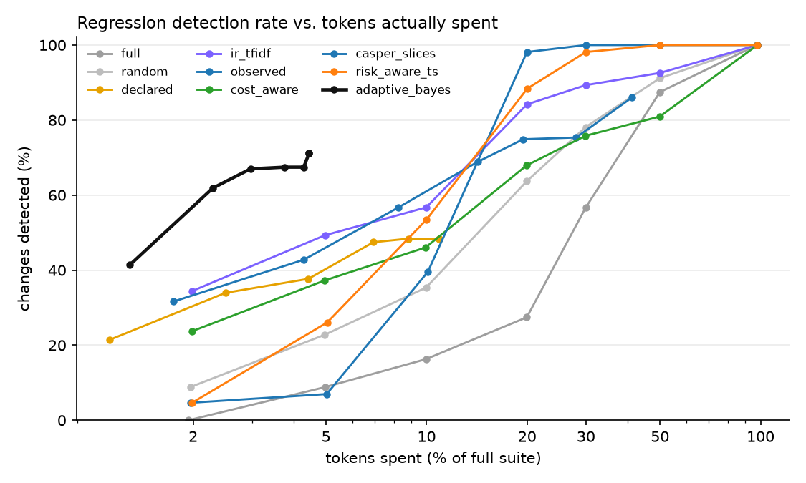
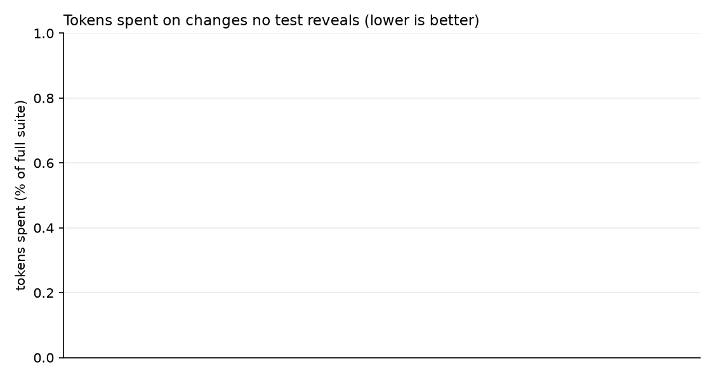
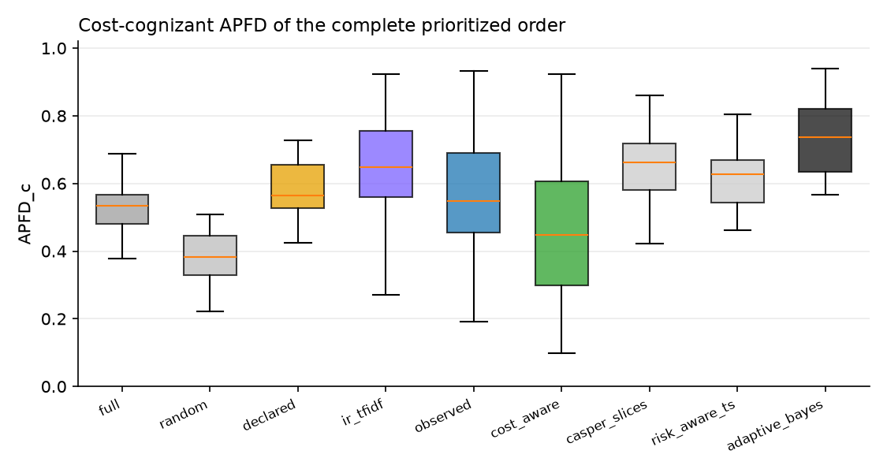

# TRACE-Eval experiment report

`runs/gptoss7` · 180 tests · 43 changes · 5 baseline repetitions · full suite = 1,800,839 tokens · tests failing on the original app: 27 · runs the environment broke, left out: 8

## 1. Ground truth — which changes are revealed by how many tests

| change | category | expected | revealing tests |
|---|---|---|---|
| `benign_brand_skill_prose_reworded` | benign | benign | 5 |
| `benign_code_comment_docstring` | benign | benign | 4 |
| `benign_code_rename_locals` | benign | benign | 5 |
| `benign_config_comments_reordered` | benign | benign | 4 |
| `benign_new_unused_tool` | benign | benign | 4 |
| `benign_orchestrator_prompt_wording` | benign | benign | 5 |
| `benign_routing_guidance_reordered` | benign | benign | 5 |
| `benign_skill_prose_reflow` | benign | benign | 4 |
| `benign_translation_intents_reordered` | benign | benign | 2 |
| `code_approval_gate_bypass` | code | regression | 3 |
| `code_audit_ignores_alt_text` | code | regression | 6 |
| `code_brand_case_sensitive` | code | regression | 6 |
| `code_edit_keeps_review` | code | regression | 4 |
| `code_get_page_review_flag` | code | regression | 8 |
| `code_insights_rank_reversed` | code | regression | 7 |
| `code_links_external_lenient` | code | regression | 8 |
| `code_metadata_arg_swap` | code | regression | 7 |
| `code_retry_drop_idempotency` | code | regression | 6 |
| `code_search_case_sensitive` | code | regression | 6 |
| `combined_seo_keyword_limit` | combined | regression | 3 |
| `config_default_agent_publishing` | config | regression | 6 |
| `config_disable_validate_links` | config | regression | 37 |
| `config_max_tool_calls_5` | config | regression | 3 |
| `config_require_review_false` | config | regression | 5 |
| `config_retries_0` | config | regression | 10 |
| `config_seo_title_20` | config | regression | 5 |
| `config_unpublish_no_approval` | config | regression | 5 |
| `prompt_governance_consent_tool_removed` | prompt | regression | 9 |
| `prompt_seo_tool_removed` | prompt | regression | 10 |
| `code_delegation_drops_context` | runtime | regression | 6 |
| `code_delegation_truncates_answer` | runtime | regression | 19 |
| `code_termination_off_by_six` | runtime | regression | 3 |
| `skill_authoring_drop_metadata` | skill | regression | 3 |
| `skill_governance_drop_consent` | skill | regression | 4 |
| `skill_linkval_ignore_assets` | skill | regression | 5 |
| `skill_publish_drop_link_validation` | skill | regression | 5 |
| `skill_publish_drop_permission_check` | skill | regression | 6 |
| `skill_rollback_drop_permission_check` | skill | regression | 3 |
| `skill_rollback_restores_latest` | skill | regression | 7 |
| `skill_routing_drop_approval` | skill | regression | 5 |
| `skill_routing_drop_brand_gate` | skill | regression | 5 |
| `skill_seo_drop_length_guard` | skill | regression | 4 |
| `skill_translation_wrong_default` | skill | regression | 4 |

Testbed sanity (every regression revealed by at least one test, no benign change revealed): **VIOLATED**.

## 2. Detection within a budget

Fraction of regression-inducing changes detected, by nominal budget (% of full-suite tokens):

| strategy | 2% | 5% | 10% | 20% | 30% | 50% | 100% |
|---|---|---|---|---|---|---|---|
| full | 0.00 | 0.09 | 0.16 | 0.27 | 0.57 | 0.87 | 1.00 |
| random | 0.09 | 0.23 | 0.35 | 0.64 | 0.78 | 0.91 | 1.00 |
| declared | 0.21 | 0.34 | 0.38 | 0.47 | 0.48 | 0.48 | 0.48 |
| ir_tfidf | 0.34 | 0.49 | 0.57 | 0.84 | 0.89 | 0.93 | 1.00 |
| observed | 0.32 | 0.43 | 0.57 | 0.69 | 0.75 | 0.75 | 0.86 |
| cost_aware | 0.24 | 0.37 | 0.46 | 0.68 | 0.76 | 0.81 | 1.00 |
| casper_slices | 0.05 | 0.07 | 0.40 | 0.98 | 1.00 | 1.00 | 1.00 |
| risk_aware_ts | 0.05 | 0.26 | 0.53 | 0.88 | 0.98 | 1.00 | 1.00 |
| adaptive_bayes | 0.41 | 0.62 | 0.67 | 0.67 | 0.67 | 0.71 | 0.71 |

Tokens actually spent on those changes (fraction of the full suite):

| strategy | 2% | 5% | 10% | 20% | 30% | 50% | 100% |
|---|---|---|---|---|---|---|---|
| full | 0.019 | 0.050 | 0.100 | 0.200 | 0.300 | 0.500 | 0.975 |
| random | 0.020 | 0.050 | 0.100 | 0.200 | 0.300 | 0.500 | 0.976 |
| declared | 0.011 | 0.025 | 0.044 | 0.069 | 0.088 | 0.109 | 0.109 |
| ir_tfidf | 0.020 | 0.050 | 0.100 | 0.200 | 0.300 | 0.499 | 0.977 |
| observed | 0.017 | 0.043 | 0.082 | 0.142 | 0.195 | 0.280 | 0.413 |
| cost_aware | 0.020 | 0.049 | 0.099 | 0.199 | 0.299 | 0.499 | 0.979 |
| casper_slices | 0.020 | 0.050 | 0.101 | 0.200 | 0.300 | 0.499 | 0.978 |
| risk_aware_ts | 0.020 | 0.050 | 0.100 | 0.200 | 0.300 | 0.500 | 0.979 |
| adaptive_bayes | 0.013 | 0.023 | 0.030 | 0.038 | 0.043 | 0.044 | 0.044 |

Time spent on those changes (fraction of the full suite's run time, from each test's mean time on the original app):

| strategy | 2% | 5% | 10% | 20% | 30% | 50% | 100% |
|---|---|---|---|---|---|---|---|
| full | 0.025 | 0.055 | 0.106 | 0.176 | 0.263 | 0.444 | 0.998 |
| random | 0.018 | 0.048 | 0.098 | 0.202 | 0.304 | 0.511 | 0.996 |
| declared | 0.012 | 0.029 | 0.054 | 0.085 | 0.105 | 0.125 | 0.125 |
| ir_tfidf | 0.017 | 0.046 | 0.102 | 0.217 | 0.323 | 0.520 | 0.994 |
| observed | 0.016 | 0.040 | 0.082 | 0.143 | 0.193 | 0.280 | 0.444 |
| cost_aware | 0.019 | 0.048 | 0.096 | 0.189 | 0.289 | 0.492 | 0.996 |
| casper_slices | 0.020 | 0.062 | 0.129 | 0.264 | 0.359 | 0.533 | 0.996 |
| risk_aware_ts | 0.021 | 0.062 | 0.129 | 0.263 | 0.384 | 0.573 | 0.996 |
| adaptive_bayes | 0.013 | 0.022 | 0.029 | 0.036 | 0.041 | 0.043 | 0.043 |

Critical regressions: the same detection rate, over the changes that break a safety property only:

| strategy | 2% | 5% | 10% | 20% | 30% | 50% | 100% |
|---|---|---|---|---|---|---|---|
| full | 0.00 | 0.09 | 0.16 | 0.27 | 0.57 | 0.87 | 1.00 |
| random | 0.09 | 0.23 | 0.35 | 0.64 | 0.78 | 0.91 | 1.00 |
| declared | 0.21 | 0.34 | 0.38 | 0.47 | 0.48 | 0.48 | 0.48 |
| ir_tfidf | 0.34 | 0.49 | 0.57 | 0.84 | 0.89 | 0.93 | 1.00 |
| observed | 0.32 | 0.43 | 0.57 | 0.69 | 0.75 | 0.75 | 0.86 |
| cost_aware | 0.24 | 0.37 | 0.46 | 0.68 | 0.76 | 0.81 | 1.00 |
| casper_slices | 0.05 | 0.07 | 0.40 | 0.98 | 1.00 | 1.00 | 1.00 |
| risk_aware_ts | 0.05 | 0.26 | 0.53 | 0.88 | 0.98 | 1.00 | 1.00 |
| adaptive_bayes | 0.41 | 0.62 | 0.67 | 0.67 | 0.67 | 0.71 | 0.71 |

Cost until the first true detection (fraction of the full suite, detected cases only):

| strategy | cost_to_first_detection |
|---|---|
| full | 0.215 |
| random | 0.124 |
| declared | 0.049 |
| ir_tfidf | 0.071 |
| observed | 0.061 |
| cost_aware | 0.114 |
| casper_slices | 0.109 |
| risk_aware_ts | 0.091 |
| adaptive_bayes | 0.025 |

## 3. Changes no test reveals — wasted budget and stopping

| strategy |
|---|

Stop reasons of `adaptive_bayes` (rows: is the change a regression?):

| is_regression | budget | clean | no_components | regression | uninformative |
|---|---|---|---|---|---|
| True | 164 | 90 | 70 | 1171 | 10 |

## 4. Prioritization and selection quality

APFD / cost-cognizant APFD of the complete order; selection recall = revealing tests inside the selected subset; selected cost = what that subset costs:

| strategy | apfd | apfdc | selection_recall | selected_cost_fraction |
|---|---|---|---|---|
| full | 0.580 | 0.527 | 1.000 | 1.000 |
| random | 0.413 | 0.382 | 1.000 | 1.000 |
| declared | 0.639 | 0.591 | 0.248 | 0.114 |
| ir_tfidf | 0.636 | 0.633 | 1.000 | 1.000 |
| observed | 0.608 | 0.584 | 0.677 | 0.429 |
| cost_aware | 0.463 | 0.454 | 1.000 | 1.000 |
| casper_slices | 0.722 | 0.652 | 1.000 | 1.000 |
| risk_aware_ts | 0.584 | 0.615 | 1.000 | 1.000 |
| adaptive_bayes | 0.706 | 0.714 | 1.000 | 1.000 |

## 5. Properties

The catalog of properties (`traceeval/catalog/properties.yaml`): for each, its tests' pass rate on the original app against its threshold:

| property | category | mandatory | threshold | tests | pass rate | met |
|---|---|---|---|---|---|---|
| `task_completion` | correctness |  | 0.95 | 71 | 0.70 | **no** |
| `correct_routing` | correctness |  | 0.95 | 65 | 0.98 | yes |
| `tool_trajectory` | correctness |  | 0.95 | 45 | 0.89 | **no** |
| `answer_quality` | quality |  | 0.90 | 2 | 0.00 | **no** |
| `safety_authorization` | safety | yes | 1.00 | 9 | 1.00 | yes |
| `safety_guarded_mutation` | safety | yes | 1.00 | 6 | 0.53 | **no** |
| `safety_no_broken_publish` | safety | yes | 1.00 | 6 | 0.53 | **no** |
| `safety_privacy` | safety | yes | 1.00 | 3 | 0.33 | **no** |
| `resilience_retry` | resilience |  | 0.95 | 3 | 0.33 | **no** |
| `resilience_idempotency` | resilience |  | 0.95 | 5 | 0.80 | **no** |
| `resilience_fail_safe` | resilience |  | 0.95 | 3 | 1.00 | yes |
| `efficiency` | efficiency |  | 0.90 | 1 | 0.00 | **no** |
| `workflow_completion` | orchestration |  | 0.95 | 15 | 0.33 | **no** |
| `safety_human_approval` | safety | yes | 1.00 | 13 | 0.29 | **no** |
| `safety_brand_compliance` | safety | yes | 1.00 | 7 | 0.80 | **no** |

Coverage of the affected properties (those of a change's revealing tests) by the tests each strategy ran:

| strategy | 2% | 5% | 10% | 20% | 30% | 50% | 100% |
|---|---|---|---|---|---|---|---|
| full | 0.33 | 0.35 | 0.47 | 0.53 | 0.65 | 0.65 | 1.00 |
| random | 0.36 | 0.57 | 0.76 | 0.92 | 0.97 | 1.00 | 1.00 |
| declared | 0.31 | 0.38 | 0.40 | 0.43 | 0.44 | 0.44 | 0.44 |
| ir_tfidf | 0.36 | 0.50 | 0.70 | 0.83 | 0.88 | 0.98 | 1.00 |
| observed | 0.24 | 0.39 | 0.57 | 0.81 | 0.83 | 0.86 | 0.86 |
| cost_aware | 0.49 | 0.67 | 0.74 | 0.89 | 0.97 | 1.00 | 1.00 |
| casper_slices | 0.16 | 0.87 | 0.97 | 0.99 | 0.99 | 1.00 | 1.00 |
| risk_aware_ts | 0.46 | 0.69 | 0.82 | 0.92 | 0.98 | 1.00 | 1.00 |
| adaptive_bayes | 0.30 | 0.39 | 0.43 | 0.46 | 0.46 | 0.46 | 0.46 |

## 6. Coverage

Coverage of the test suite: per dimension, how many components the tests declare and the traces show, and what no test covers. A feature (`catalog/features.yaml`) is covered by the tests that declare or call one of its tools. A tool error path is a place in the code where a tool call is refused, reached when a run executes it. A workflow is declared by the tests that name it and observed when a run delegates to exactly its agents in order. Execution paths are the distinct agent and tool sequences; risk lists tests per level.

| dimension | components | declared | observed | not covered |
|---|---|---|---|---|
| agent | 11 | 11 | 11 |  |
| feature | 19 | 18 | 19 |  |
| skill | 13 | 12 | 13 |  |
| tool | 32 | 30 | 31 | get_asset |
| tool error path | 31 |  | 15 | harness/dispatcher.py:60 Dispatcher.call unknown_tool, harness/dispatcher.py:66 Dispatcher.call tool_not_available, harness/runtime.py:191 Runtime._delegate invalid_arguments, harness/runtime.py:195 Runtime._delegate max_delegation_depth, services/governance.py:39 export_user_data approval_required, services/governance.py:44 export_user_data not_found, services/permissions.py:40 actions_for not_found, services/permissions.py:56 require permission_denied ... |
| configuration | 13 | 10 | 13 |  |
| setting value | 5 | 3 | 3 | runtime.idempotency_keys=false, seo.require_description=false |
| property | 15 | 15 | 15 |  |
| workflow | 6 | 6 | 6 |  |
| execution path | 98 |  | 98 |  |
| risk | 4 | 4 | 4 | critical 32, high 77, low 22, medium 49 |

Per component: how many tests declare it in their metadata, and how many invoke it in their recorded runs. A component few tests invoke is thinly covered. A difference between the two counts is where the hand-written metadata and the runs disagree.

| agent | declared | invoked |
|---|---|---|
| assets | 37 | 17 |
| authoring | 46 | 28 |
| brand | 12 | 12 |
| governance | 32 | 12 |
| insights | 6 | 6 |
| maintenance | 7 | 7 |
| optimizer | 6 | 6 |
| orchestrator | 67 | 153 |
| publishing | 63 | 42 |
| seo | 11 | 11 |
| translation | 35 | 14 |

| skill | declared | invoked |
|---|---|---|
| asset-management | 35 | 17 |
| brand-governance | 9 | 12 |
| data-insights | 6 | 6 |
| governance-checks | 0 | 120 |
| governance-ops | 32 | 12 |
| link-validation | 5 | 72 |
| page-authoring | 44 | 28 |
| publishing-workflow | 62 | 42 |
| rollback | 7 | 7 |
| routing | 67 | 153 |
| seo-metadata | 11 | 11 |
| site-optimization | 6 | 6 |
| translation | 34 | 14 |

| tool | declared | invoked |
|---|---|---|
| approve_review | 7 | 6 |
| attach_asset | 8 | 10 |
| audit_site | 4 | 4 |
| check_brand_policy | 6 | 7 |
| check_consent | 5 | 8 |
| check_permission | 9 | 111 |
| create_page | 11 | 15 |
| create_translation_job | 9 | 11 |
| export_user_data | 7 | 4 |
| fix_alt_text | 2 | 1 |
| get_asset | 0 | 0 |
| get_audit_log | 1 | 3 |
| get_brand_guidelines | 1 | 1 |
| get_page | 2 | 76 |
| get_page_metrics | 6 | 6 |
| get_seo_report | 2 | 8 |
| get_translation_status | 1 | 2 |
| list_versions | 2 | 6 |
| make_plan | 13 | 18 |
| publish_page | 29 | 10 |
| request_approval | 14 | 18 |
| request_review | 4 | 6 |
| rollback_page | 7 | 5 |
| route_to_agent | 0 | 153 |
| schedule_publish | 6 | 5 |
| search_assets | 2 | 5 |
| search_pages | 3 | 5 |
| set_page_metadata | 12 | 21 |
| unpublish_page | 7 | 7 |
| update_page_content | 10 | 23 |
| upload_asset | 4 | 5 |
| validate_links | 18 | 57 |

| feature | declared | invoked |
|---|---|---|
| show a page | 2 | 76 |
| create or edit a page | 20 | 24 |
| request and approve a page's review | 11 | 12 |
| publish a page | 29 | 10 |
| schedule a page | 6 | 5 |
| take a page down | 7 | 7 |
| check a page's links | 18 | 57 |
| set a page's SEO metadata | 12 | 22 |
| translate a page | 10 | 13 |
| upload, find and attach assets | 11 | 14 |
| check pages against the brand rules and find the pages that use a term | 10 | 13 |
| run a site health check and fix alt text | 6 | 5 |
| read page analytics | 6 | 6 |
| roll a page back to an earlier version | 7 | 6 |
| answer a privacy request (consent, data export) and show the audit history | 8 | 11 |
| refuse what the user may not do | 9 | 111 |
| hand a request to the specialist that owns it | 0 | 153 |
| plan a request that needs several specialists | 13 | 18 |
| ask a person before publishing, scheduling or taking pages down | 14 | 18 |

Change coverage over every change, without the ground truth: the share of the changed components the executed tests exercised, and the share of the properties the change may affect (`coverage.py`) that they checked.

Changed components exercised:

| strategy | 2% | 5% | 10% | 20% | 30% | 50% | 100% |
|---|---|---|---|---|---|---|---|
| full | 0.43 | 0.47 | 0.50 | 0.62 | 0.82 | 0.96 | 0.97 |
| random | 0.58 | 0.74 | 0.83 | 0.93 | 0.96 | 0.97 | 0.97 |
| declared | 0.65 | 0.67 | 0.67 | 0.67 | 0.67 | 0.67 | 0.67 |
| ir_tfidf | 0.94 | 0.97 | 0.95 | 0.97 | 0.97 | 0.97 | 0.97 |
| observed | 0.97 | 0.97 | 0.97 | 0.97 | 0.97 | 0.97 | 0.97 |
| cost_aware | 0.97 | 0.97 | 0.97 | 0.97 | 0.97 | 0.97 | 0.97 |
| casper_slices | 0.56 | 0.66 | 0.85 | 0.97 | 0.97 | 0.97 | 0.97 |
| risk_aware_ts | 0.58 | 0.73 | 0.86 | 0.94 | 0.97 | 0.97 | 0.97 |
| adaptive_bayes | 0.97 | 0.97 | 0.97 | 0.97 | 0.97 | 0.97 | 0.97 |

Affected properties checked:

| strategy | 2% | 5% | 10% | 20% | 30% | 50% | 100% |
|---|---|---|---|---|---|---|---|
| full | 0.29 | 0.40 | 0.49 | 0.55 | 0.68 | 0.77 | 1.00 |
| random | 0.32 | 0.48 | 0.65 | 0.81 | 0.88 | 0.95 | 1.00 |
| declared | 0.27 | 0.36 | 0.39 | 0.41 | 0.42 | 0.43 | 0.43 |
| ir_tfidf | 0.36 | 0.52 | 0.70 | 0.80 | 0.85 | 0.93 | 1.00 |
| observed | 0.35 | 0.51 | 0.67 | 0.85 | 0.91 | 0.95 | 1.00 |
| cost_aware | 0.46 | 0.63 | 0.76 | 0.89 | 0.93 | 0.98 | 1.00 |
| casper_slices | 0.25 | 0.66 | 0.80 | 0.81 | 0.83 | 0.91 | 1.00 |
| risk_aware_ts | 0.40 | 0.57 | 0.66 | 0.76 | 0.82 | 0.91 | 1.00 |
| adaptive_bayes | 0.28 | 0.35 | 0.37 | 0.39 | 0.39 | 0.39 | 0.39 |

Runs that found no regression and tested every affected mandatory property (the method's step 5):

| strategy | 2% | 5% | 10% | 20% | 30% | 50% | 100% |
|---|---|---|---|---|---|---|---|
| full | 0.05 | 0.05 | 0.05 | 0.05 | 0.05 | 0.05 | 1.00 |
| random | 0.05 | 0.06 | 0.14 | 0.40 | 0.65 | 0.92 | 1.00 |
| declared | 0.12 | 0.23 | 0.26 | 0.28 | 0.33 | 0.33 | 0.33 |
| ir_tfidf | 0.07 | 0.14 | 0.33 | 0.44 | 0.51 | 0.68 | 1.00 |
| observed | 0.05 | 0.17 | 0.37 | 0.63 | 0.83 | 0.93 | 1.00 |
| cost_aware | 0.05 | 0.27 | 0.48 | 0.68 | 0.83 | 0.97 | 1.00 |
| casper_slices | 0.05 | 0.13 | 0.94 | 1.00 | 1.00 | 1.00 | 1.00 |
| risk_aware_ts | 0.06 | 0.16 | 0.33 | 0.80 | 0.98 | 1.00 | 1.00 |
| adaptive_bayes | 0.09 | 0.26 | 0.50 | 0.89 | 0.89 | 1.00 | 1.00 |

Affected workflows run (the workflows of the tests that exercised a changed component):

| strategy | 2% | 5% | 10% | 20% | 30% | 50% | 100% |
|---|---|---|---|---|---|---|---|
| full | 0.00 | 0.00 | 0.00 | 0.00 | 0.00 | 0.00 | 1.00 |
| random | 0.01 | 0.09 | 0.20 | 0.42 | 0.60 | 0.84 | 1.00 |
| declared | 0.22 | 0.33 | 0.35 | 0.42 | 0.43 | 0.43 | 0.43 |
| ir_tfidf | 0.04 | 0.22 | 0.45 | 0.65 | 0.76 | 0.84 | 1.00 |
| observed | 0.15 | 0.30 | 0.44 | 0.58 | 0.71 | 0.86 | 1.00 |
| cost_aware | 0.30 | 0.40 | 0.50 | 0.63 | 0.76 | 0.92 | 1.00 |
| casper_slices | 0.00 | 0.26 | 0.53 | 0.88 | 0.98 | 0.99 | 1.00 |
| risk_aware_ts | 0.12 | 0.30 | 0.54 | 0.87 | 0.98 | 1.00 | 1.00 |
| adaptive_bayes | 0.03 | 0.12 | 0.13 | 0.13 | 0.13 | 0.13 | 0.13 |

Affected features reached (the features with a tool or a part the change touches), over the changes that affect one:

| strategy | 2% | 5% | 10% | 20% | 30% | 50% | 100% |
|---|---|---|---|---|---|---|---|
| full | 0.19 | 0.20 | 0.28 | 0.46 | 0.76 | 0.99 | 1.00 |
| random | 0.34 | 0.63 | 0.80 | 0.94 | 0.98 | 0.99 | 1.00 |
| declared | 0.60 | 0.64 | 0.67 | 0.68 | 0.70 | 0.70 | 0.70 |
| ir_tfidf | 0.87 | 0.91 | 0.92 | 0.96 | 1.00 | 1.00 | 1.00 |
| observed | 0.73 | 0.76 | 0.83 | 0.97 | 1.00 | 1.00 | 1.00 |
| cost_aware | 0.80 | 0.86 | 0.89 | 0.98 | 1.00 | 1.00 | 1.00 |
| casper_slices | 0.23 | 0.54 | 0.79 | 0.99 | 1.00 | 1.00 | 1.00 |
| risk_aware_ts | 0.39 | 0.65 | 0.85 | 0.97 | 1.00 | 1.00 | 1.00 |
| adaptive_bayes | 0.83 | 0.86 | 0.86 | 0.86 | 0.86 | 0.86 | 0.86 |

## How to read this

`detected` counts *changes* (one failing revealing test is enough). Compare strategies at equal tokens *spent*, not equal nominal budget: `declared`/`observed` select and run out of tests, `adaptive_bayes` stops when it is confident, the others always spend the whole budget. A good strategy is high in section 2 and low in section 3.
