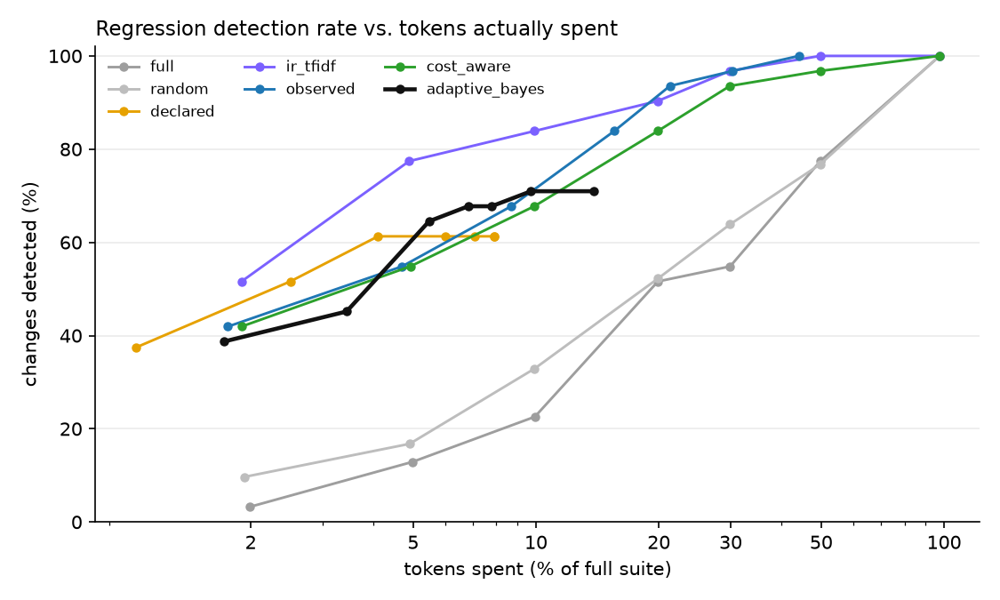
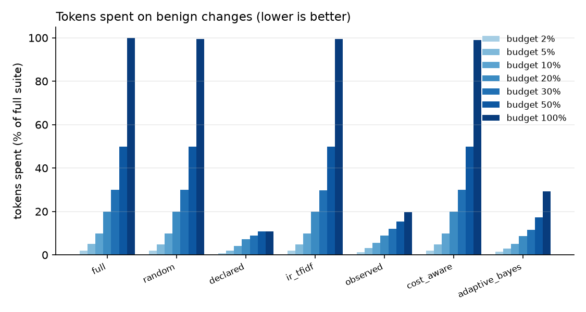
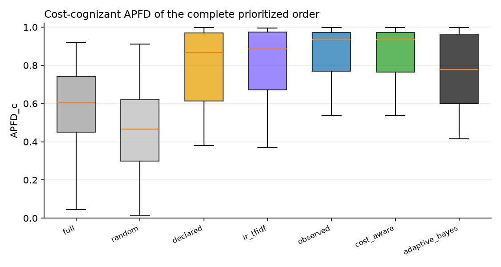

# TRACE-Eval experiment report

`runs/qwen2` · 136 tests · 38 changes · 3 baseline repetitions · full suite = 1,080,378 tokens · 0 flaky tests at baseline

## 1. Ground truth — which changes are revealed by how many tests

| change | category | expected | revealing tests |
|---|---|---|---|
| `benign_code_comment_docstring` | benign | benign | 0 |
| `benign_code_rename_locals` | benign | benign | 0 |
| `benign_config_comments_reordered` | benign | benign | 0 |
| `benign_new_unused_tool` | benign | benign | 0 |
| `benign_orchestrator_prompt_wording` | benign | benign | 0 |
| `benign_skill_prose_reflow` | benign | benign | 0 |
| `benign_translation_intents_reordered` | benign | benign | 0 |
| `code_approval_gate_bypass` | code | regression | 1 |
| `code_edit_keeps_review` | code | regression | 1 |
| `code_get_page_review_flag` | code | regression | 15 |
| `code_links_external_lenient` | code | regression | 6 |
| `code_links_unknown_url_crash` | code | regression | 1 |
| `code_metadata_arg_swap` | code | regression | 5 |
| `code_metadata_keywords_crash` | code | regression | 1 |
| `code_retry_disabled` | code | regression | 5 |
| `code_retry_drop_idempotency` | code | regression | 5 |
| `combined_seo_keyword_limit` | combined | regression | 1 |
| `config_approval_drop_unpublish` | config | regression | 1 |
| `config_default_agent_publishing` | config | regression | 3 |
| `config_disable_validate_links` | config | regression | 43 |
| `config_max_tool_calls_5` | config | regression | 8 |
| `config_require_review_false` | config | regression | 3 |
| `config_retries_0` | config | regression | 5 |
| `config_seo_title_20` | config | regression | 1 |
| `prompt_governance_consent_tool_removed` | prompt | regression | 4 |
| `prompt_seo_tool_removed` | prompt | regression | 5 |
| `code_delegation_depth_zero` | runtime | regression | 108 |
| `code_delegation_truncates_answer` | runtime | regression | 6 |
| `code_termination_off_by_six` | runtime | regression | 2 |
| `skill_authoring_drop_metadata` | skill | regression | 1 |
| `skill_governance_drop_consent` | skill | regression | 5 |
| `skill_linkval_ignore_assets` | skill | regression | 1 |
| `skill_publish_drop_link_validation` | skill | regression | 1 |
| `skill_publish_drop_permission_check` | skill | regression | 3 |
| `skill_rollback_drop_permission_check` | skill | regression | 1 |
| `skill_rollback_restores_latest` | skill | regression | 2 |
| `skill_seo_drop_length_guard` | skill | regression | 1 |
| `skill_translation_wrong_default` | skill | regression | 2 |

Testbed sanity (every regression revealed by ≥1 test, no benign change revealed): **OK**.

## 2. Detection within a budget

Fraction of regression-inducing changes detected, by nominal budget (% of full-suite tokens):

| strategy | 2% | 5% | 10% | 20% | 30% | 50% | 100% |
|---|---|---|---|---|---|---|---|
| full | 0.03 | 0.13 | 0.23 | 0.52 | 0.55 | 0.77 | 1.00 |
| random | 0.10 | 0.17 | 0.33 | 0.52 | 0.64 | 0.77 | 1.00 |
| declared | 0.37 | 0.52 | 0.61 | 0.61 | 0.61 | 0.61 | 0.61 |
| ir_tfidf | 0.52 | 0.77 | 0.84 | 0.90 | 0.97 | 1.00 | 1.00 |
| observed | 0.42 | 0.55 | 0.68 | 0.84 | 0.94 | 0.97 | 1.00 |
| cost_aware | 0.42 | 0.55 | 0.68 | 0.84 | 0.94 | 0.97 | 1.00 |
| adaptive_bayes | 0.39 | 0.45 | 0.65 | 0.68 | 0.68 | 0.71 | 0.71 |

Tokens actually spent on those changes (fraction of the full suite):

| strategy | 2% | 5% | 10% | 20% | 30% | 50% | 100% |
|---|---|---|---|---|---|---|---|
| full | 0.020 | 0.050 | 0.099 | 0.199 | 0.299 | 0.497 | 0.976 |
| random | 0.019 | 0.049 | 0.099 | 0.199 | 0.299 | 0.498 | 0.974 |
| declared | 0.010 | 0.025 | 0.041 | 0.060 | 0.071 | 0.079 | 0.079 |
| ir_tfidf | 0.019 | 0.049 | 0.099 | 0.199 | 0.299 | 0.497 | 0.974 |
| observed | 0.018 | 0.047 | 0.087 | 0.155 | 0.213 | 0.304 | 0.441 |
| cost_aware | 0.019 | 0.049 | 0.099 | 0.199 | 0.299 | 0.497 | 0.974 |
| adaptive_bayes | 0.017 | 0.034 | 0.055 | 0.068 | 0.078 | 0.097 | 0.139 |

Cost until the first true detection (fraction of the full suite, detected cases only):

| strategy | cost_to_first_detection |
|---|---|
| full | 0.176 |
| random | 0.161 |
| declared | 0.020 |
| ir_tfidf | 0.036 |
| observed | 0.057 |
| cost_aware | 0.058 |
| adaptive_bayes | 0.036 |

## 3. Benign changes — wasted budget and stopping

| strategy | 2% | 5% | 10% | 20% | 30% | 50% | 100% |
|---|---|---|---|---|---|---|---|
| full | 0.020 | 0.050 | 0.099 | 0.199 | 0.299 | 0.499 | 0.999 |
| random | 0.019 | 0.049 | 0.099 | 0.199 | 0.299 | 0.499 | 0.995 |
| declared | 0.008 | 0.021 | 0.042 | 0.072 | 0.089 | 0.108 | 0.108 |
| ir_tfidf | 0.019 | 0.049 | 0.098 | 0.198 | 0.298 | 0.498 | 0.995 |
| observed | 0.011 | 0.033 | 0.056 | 0.090 | 0.120 | 0.154 | 0.196 |
| cost_aware | 0.019 | 0.049 | 0.099 | 0.199 | 0.299 | 0.498 | 0.989 |
| adaptive_bayes | 0.014 | 0.029 | 0.050 | 0.086 | 0.115 | 0.172 | 0.292 |

Stop reasons of `adaptive_bayes` (rows: is the change a regression?):

| is_regression | budget | clean | no_components | regression | uninformative |
|---|---|---|---|---|---|
| False | 80 | 85 | 70 | 0 | 10 |
| True | 280 | 230 | 0 | 560 | 15 |

## 4. Prioritization and selection quality

APFD / cost-cognizant APFD of the complete order; selection recall = revealing tests inside the selected subset; selected cost = what that subset costs:

| strategy | apfd | apfdc | selection_recall | selected_cost_fraction |
|---|---|---|---|---|
| full | 0.691 | 0.584 | 1.000 | 1.000 |
| random | 0.454 | 0.451 | 1.000 | 1.000 |
| declared | 0.834 | 0.782 | 0.501 | 0.082 |
| ir_tfidf | 0.787 | 0.805 | 1.000 | 1.000 |
| observed | 0.815 | 0.840 | 1.000 | 0.463 |
| cost_aware | 0.816 | 0.840 | 1.000 | 1.000 |
| adaptive_bayes | 0.786 | 0.762 | 1.000 | 1.000 |

## How to read this

`detected` counts *changes* (one failing revealing test is enough). Compare strategies at equal tokens *spent*, not equal nominal budget: `declared`/`observed` select and run out of tests, `adaptive_bayes` stops when it is confident, the others always spend the whole budget. A good strategy is high in section 2 and low in section 3.
