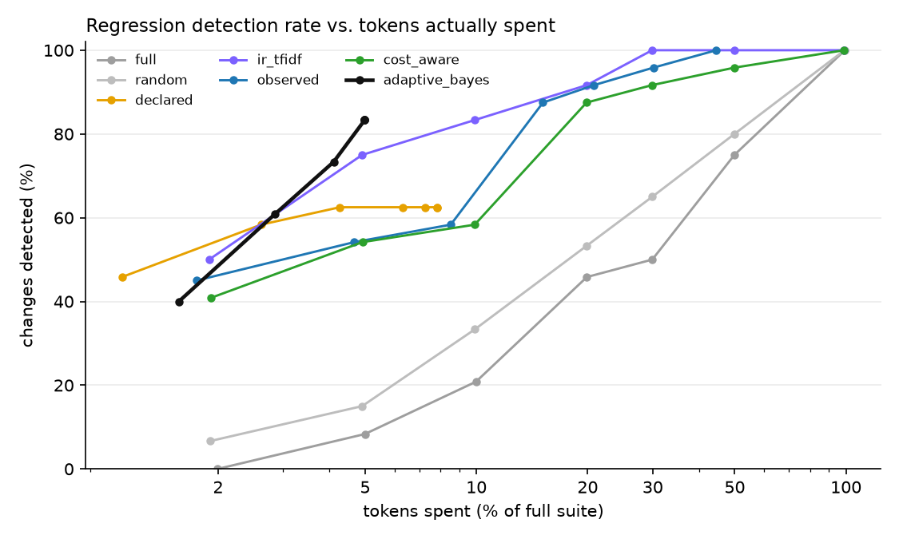
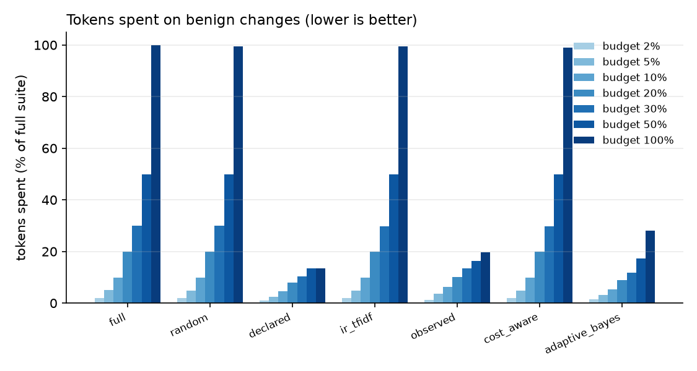
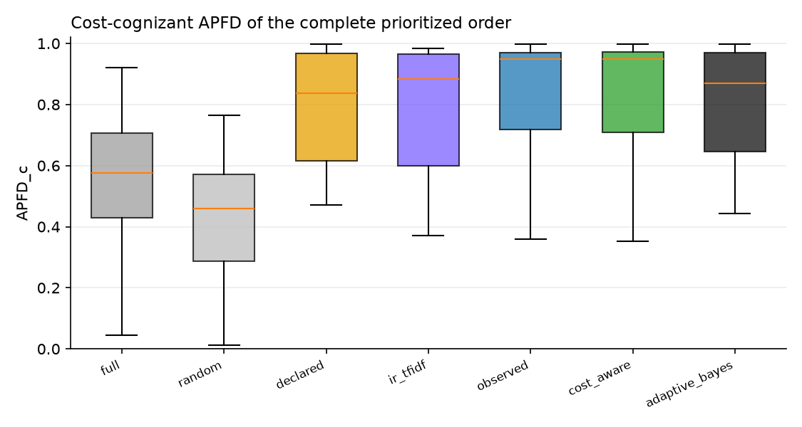

# TRACE-Eval experiment report

`runs/qwen4` · 136 tests · 33 changes · 3 baseline repetitions · full suite = 1,074,549 tokens · tests failing on the original app: 2

## 1. Ground truth — which changes are revealed by how many tests

| change | category | expected | revealing tests |
|---|---|---|---|
| `benign_code_comment_docstring` | benign | benign | 0 |
| `benign_code_rename_locals` | benign | benign | 0 |
| `benign_config_comments_reordered` | benign | benign | 0 |
| `benign_new_unused_tool` | benign | benign | 0 |
| `benign_orchestrator_prompt_wording` | benign | benign | 0 |
| `benign_skill_prose_reflow` | benign | benign | 0 |
| `benign_translation_intents_reordered` | benign | benign | 0 |
| `code_approval_gate_bypass` | code | regression | 1 |
| `code_edit_keeps_review` | code | regression | 1 |
| `code_get_page_review_flag` | code | regression | 15 |
| `code_links_external_lenient` | code | regression | 6 |
| `code_metadata_arg_swap` | code | regression | 5 |
| `code_retry_drop_idempotency` | code | regression | 5 |
| `combined_seo_keyword_limit` | combined | regression | 0 |
| `config_default_agent_publishing` | config | regression | 3 |
| `config_disable_validate_links` | config | regression | 43 |
| `config_max_tool_calls_5` | config | regression | 7 |
| `config_require_review_false` | config | regression | 3 |
| `config_retries_0` | config | regression | 4 |
| `config_seo_title_20` | config | regression | 1 |
| `prompt_governance_consent_tool_removed` | prompt | regression | 3 |
| `prompt_seo_tool_removed` | prompt | regression | 4 |
| `code_delegation_truncates_answer` | runtime | regression | 5 |
| `code_termination_off_by_six` | runtime | regression | 2 |
| `skill_authoring_drop_metadata` | skill | regression | 1 |
| `skill_governance_drop_consent` | skill | regression | 5 |
| `skill_linkval_ignore_assets` | skill | regression | 1 |
| `skill_publish_drop_link_validation` | skill | regression | 0 |
| `skill_publish_drop_permission_check` | skill | regression | 3 |
| `skill_rollback_drop_permission_check` | skill | regression | 1 |
| `skill_rollback_restores_latest` | skill | regression | 2 |
| `skill_seo_drop_length_guard` | skill | regression | 1 |
| `skill_translation_wrong_default` | skill | regression | 2 |

Testbed sanity (every regression revealed by ≥1 test, no benign change revealed): **VIOLATED**.

## 2. Detection within a budget

Fraction of regression-inducing changes detected, by nominal budget (% of full-suite tokens):

| strategy | 2% | 5% | 10% | 20% | 30% | 50% | 100% |
|---|---|---|---|---|---|---|---|
| full | 0.00 | 0.08 | 0.21 | 0.46 | 0.50 | 0.75 | 1.00 |
| random | 0.07 | 0.15 | 0.33 | 0.53 | 0.65 | 0.80 | 1.00 |
| declared | 0.46 | 0.58 | 0.62 | 0.62 | 0.62 | 0.62 | 0.62 |
| ir_tfidf | 0.50 | 0.75 | 0.83 | 0.92 | 1.00 | 1.00 | 1.00 |
| observed | 0.45 | 0.54 | 0.58 | 0.88 | 0.92 | 0.96 | 1.00 |
| cost_aware | 0.41 | 0.54 | 0.58 | 0.88 | 0.92 | 0.96 | 1.00 |
| adaptive_bayes | 0.40 | 0.61 | 0.73 | 0.83 | 0.83 | 0.83 | 0.83 |

Tokens actually spent on those changes (fraction of the full suite):

| strategy | 2% | 5% | 10% | 20% | 30% | 50% | 100% |
|---|---|---|---|---|---|---|---|
| full | 0.020 | 0.050 | 0.100 | 0.199 | 0.299 | 0.499 | 0.993 |
| random | 0.019 | 0.049 | 0.099 | 0.199 | 0.299 | 0.499 | 0.991 |
| declared | 0.011 | 0.026 | 0.043 | 0.063 | 0.073 | 0.078 | 0.078 |
| ir_tfidf | 0.019 | 0.049 | 0.099 | 0.199 | 0.299 | 0.499 | 0.989 |
| observed | 0.017 | 0.047 | 0.085 | 0.151 | 0.208 | 0.301 | 0.446 |
| cost_aware | 0.019 | 0.049 | 0.099 | 0.199 | 0.299 | 0.498 | 0.988 |
| adaptive_bayes | 0.016 | 0.028 | 0.041 | 0.050 | 0.050 | 0.050 | 0.050 |

Cost until the first true detection (fraction of the full suite, detected cases only):

| strategy | cost_to_first_detection |
|---|---|
| full | 0.201 |
| random | 0.160 |
| declared | 0.018 |
| ir_tfidf | 0.039 |
| observed | 0.061 |
| cost_aware | 0.064 |
| adaptive_bayes | 0.033 |

## 3. Benign changes — wasted budget and stopping

| strategy | 2% | 5% | 10% | 20% | 30% | 50% | 100% |
|---|---|---|---|---|---|---|---|
| full | 0.020 | 0.050 | 0.100 | 0.199 | 0.299 | 0.499 | 0.999 |
| random | 0.019 | 0.049 | 0.099 | 0.199 | 0.299 | 0.499 | 0.994 |
| declared | 0.010 | 0.024 | 0.046 | 0.079 | 0.104 | 0.134 | 0.134 |
| ir_tfidf | 0.019 | 0.049 | 0.099 | 0.199 | 0.298 | 0.499 | 0.994 |
| observed | 0.013 | 0.036 | 0.062 | 0.101 | 0.133 | 0.164 | 0.198 |
| cost_aware | 0.019 | 0.049 | 0.099 | 0.199 | 0.298 | 0.498 | 0.989 |
| adaptive_bayes | 0.014 | 0.031 | 0.053 | 0.090 | 0.119 | 0.172 | 0.282 |

Stop reasons of `adaptive_bayes` (rows: is the change a regression?):

| is_regression | budget | clean | no_components | regression | uninformative |
|---|---|---|---|---|---|
| False | 107 | 102 | 70 | 24 | 12 |
| True | 135 | 70 | 0 | 635 | 0 |

## 4. Prioritization and selection quality

APFD / cost-cognizant APFD of the complete order; selection recall = revealing tests inside the selected subset; selected cost = what that subset costs:

| strategy | apfd | apfdc | selection_recall | selected_cost_fraction |
|---|---|---|---|---|
| full | 0.673 | 0.564 | 1.000 | 1.000 |
| random | 0.428 | 0.426 | 1.000 | 1.000 |
| declared | 0.830 | 0.784 | 0.483 | 0.082 |
| ir_tfidf | 0.778 | 0.793 | 1.000 | 1.000 |
| observed | 0.804 | 0.828 | 1.000 | 0.450 |
| cost_aware | 0.801 | 0.825 | 1.000 | 1.000 |
| adaptive_bayes | 0.824 | 0.802 | 1.000 | 1.000 |

## How to read this

`detected` counts *changes* (one failing revealing test is enough). Compare strategies at equal tokens *spent*, not equal nominal budget: `declared`/`observed` select and run out of tests, `adaptive_bayes` stops when it is confident, the others always spend the whole budget. A good strategy is high in section 2 and low in section 3.
