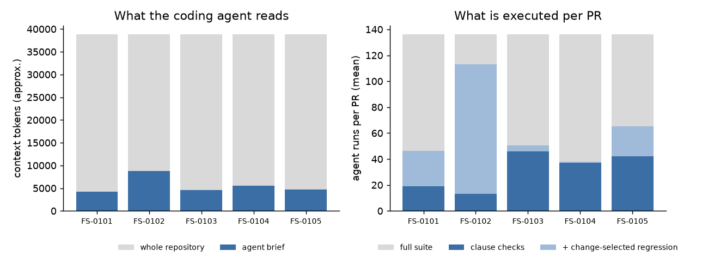

# Spec-driven development: evidence report

5 change requests, 25 pull requests, 168 recorded baseline runs (47,279 tokens of source in 59 files).

Each request is a spec: prose intent plus machine-checkable clauses. Each PR is a variant of the system. The clauses are checked, the change-affected regression tests are run, and the result is an evidence record with the assurance rung reached per clause (L0 reviewed, L1 example-tested, L2 property-tested, L3 monitored, L4 statically checked, L5 proven).

## Verdicts

| request | PR | expected | verdict | what failed / gap | rungs reached | clause runs | regression cases (of full) | tokens (of full) | s |
|---|---|---|---|---|---|---|---|---|---|
| FS-0101 | pr_correct | accepted | **accepted** | - | L5×1, L4×5, L3×1, L1×4 | 21 | 50 (168) | 860,155 (1,592,834) | 2.4 |
| FS-0101 | pr_no_lower_bound | rejected | **rejected** | function_contract:review_age_ok (contract) | L4×5, L3×1, L1×4 | 21 | 50 (168) | 860,155 (1,592,834) | 1.9 |
| FS-0101 | pr_off_by_one | rejected | **rejected** | function_contract:review_age_ok (contract), scenario:PUB-01 (example) | L4×5, L3×1, L1×3 | 21 | 50 (168) | 860,204 (1,592,834) | 1.4 |
| FS-0101 | pr_branchy | accepted | **accepted with gaps** | function_contract:review_age_ok (contract, L2 < L5) | L4×5, L3×1, L2×1, L1×4 | 21 | 50 (168) | 860,155 (1,592,834) | 1.4 |
| FS-0101 | pr_in_adapter | rejected | **rejected** | function_contract:review_age_ok (contract, L2 < L5), always_on_calls:publish_page+schedule_publish (trace), function_in_layer:review_age_ok (placement), function_in_layer:approval_age_days (placement), forbid_import_in:datetime (placement) | L4×2, L1×4 | 21 | 57 (168) | 949,290 (1,592,834) | 1.5 |
| FS-0101 | pr_unwired | rejected | **rejected** | always_on_calls:publish_page+schedule_publish (trace), scenario:please-publish-the-staleapproval (example) | L5×1, L4×5, L1×3 | 21 | 50 (168) | 857,740 (1,592,834) | 1.4 |
| FS-0102 | current | rejected | **rejected** | property_over_set:tool (contract), always_on_calls:unpublish_page+export_user_data+approve_review (trace), scenario:PUB-06 (example), scenario:take-down-the-old (example), function_in_layer:approver_for (placement) | L4×4, L3×1, L1×2 | 17 | 0 (168) | 206,284 (1,592,834) | 0.6 |
| FS-0102 | pr_correct | accepted | **accepted** | - | L4×5, L3×2, L2×1, L1×4 | 17 | 168 (168) | 1,543,007 (1,592,834) | 3.5 |
| FS-0102 | pr_self_approved | rejected | **rejected** | property_over_set:tool (contract), scenario:take-down-the-old (example) | L4×5, L3×2, L1×3 | 17 | 168 (168) | 1,542,802 (1,592,834) | 4.3 |
| FS-0102 | pr_in_dispatcher | rejected | **rejected** | function_in_layer:approver_for (placement), forbid_name_in:users (placement) | L4×3, L3×2, L2×1, L1×4 | 17 | 168 (168) | 1,543,007 (1,592,834) | 3.8 |
| FS-0102 | code_approval_gate_bypass | rejected | **rejected** | property_over_set:tool (contract), always_on_calls:unpublish_page+export_user_data+approve_review (trace), never_on_calls:unpublish_page+export_user_data+approve_review (trace), scenario:take-down-the-old (example), scenario:PUB-07 (example), regression-tests (example) | L4×5, L1×1 | 17 | 168 (168) | 1,543,914 (1,592,834) | 3.3 |
| FS-0103 | pr_correct | rejected | **rejected** | regression-tests (example) | L5×1, L4×5, L3×2, L1×3 | 50 | 53 (168) | 904,047 (1,592,834) | 1.5 |
| FS-0103 | pr_gate_ignores_version | rejected | **rejected** | precedes_in_audit:publish_page+schedule_publish (trace), function_contract:links_clean (contract) | L4×5, L3×1, L1×4 | 50 | 53 (168) | 899,614 (1,592,834) | 1.7 |
| FS-0103 | pr_gate_in_adapter | rejected | **rejected** | function_contract:links_clean (contract, L2 < L5), function_in_layer:links_clean (placement), regression-tests (example) | L4×4, L3×2, L1×3 | 50 | 53 (168) | 904,047 (1,592,834) | 1.9 |
| FS-0103 | pr_validate_after_schedule | rejected | **rejected** | scenario:PUB-09 (example), skill_step_order:publishing-workflow#2 (placement), regression-tests (example) | L5×1, L4×4, L3×2, L1×2 | 50 | 58 (168) | 953,794 (1,592,834) | 2.1 |
| FS-0103 | code_links_external_lenient | rejected | **rejected** | always_in_audit:validate_links (trace), scenario:PUB-02 (example), regression-tests (example) | L5×1, L4×5, L3×1, L1×2 | 50 | 53 (168) | 916,758 (1,592,834) | 1.9 |
| FS-0104 | pr_config_70 | rejected | **rejected** | property_over_range:n (contract), scenario:SEO-01 (example), scenario:SEO-01#2 (example), regression-tests (example) | L4×3, L3×1 | 26 | 8 (168) | 357,558 (1,592,834) | 0.8 |
| FS-0104 | pr_config_20 | rejected | **rejected** | setting_in_range:seo.max_title_length (setting), property_over_range:n (contract), scenario:SEO-01 (example), scenario:SEO-01#2 (example), regression-tests (example) | L4×2, L3×1 | 26 | 8 (168) | 357,558 (1,592,834) | 0.8 |
| FS-0104 | pr_hardcoded_70 | rejected | **rejected** | property_over_range:n (contract), scenario:SEO-01 (example), scenario:SEO-01#2 (example), forbid_literal_in:70 (placement), regression-tests (example) | L4×2, L3×1 | 26 | 8 (168) | 357,558 (1,592,834) | 0.8 |
| FS-0104 | pr_drop_guard | rejected | **rejected** | property_over_range:n (contract), scenario:SEO-01 (example), scenario:SEO-01#2 (example), regression-tests (example) | L4×3, L3×1 | 26 | 8 (168) | 357,558 (1,592,834) | 0.9 |
| FS-0105 | current | rejected | **rejected** | property_over_set:tool (contract), scenario:PUB-09 (example) | L4×5, L3×1, L1×2 | 49 | 0 (168) | 823,377 (1,592,834) | 1.3 |
| FS-0105 | pr_fix | accepted | **accepted** | - | L4×5, L3×1, L2×1, L1×3 | 49 | 14 (168) | 838,280 (1,592,834) | 1.6 |
| FS-0105 | pr_partial_fix | rejected | **rejected** | property_over_set:tool (contract) | L4×5, L3×1, L1×3 | 49 | 5 (168) | 823,377 (1,592,834) | 1.4 |
| FS-0105 | code_retry_drop_idempotency | rejected | **rejected** | property_over_set:tool (contract), always_on_calls:publish_page+schedule_publish+unpublish_page+request_review (trace), scenario:PUB-12 (example), scenario:PUB-09 (example), regression-tests (example) | L4×5 | 49 | 117 (168) | 1,475,525 (1,592,834) | 3.3 |
| FS-0105 | config_retries_0 | rejected | **rejected** | setting_in_range:runtime.retries (setting), property_over_set:tool (contract), scenario:PUB-12 (example), regression-tests (example) | L4×4, L3×1, L1×1 | 49 | 117 (168) | 1,454,909 (1,592,834) | 3.4 |

## Resources: with the spec vs. without

| | without a spec (today) | with the spec (this run) |
|---|---|---|
| context handed to the coding agent | the repository: 47,279 tokens, 59 files | the brief: 4,463–9,393 tokens (12% of the repo on average) |
| checks per PR | full suite: 168 runs, 1,592,834 agent tokens | clause checks: 17–50 runs; change-selected regression cases: 0–168 of 168 (37% on average; a harness change selects most of the suite, a config change a few cases); 58% of the full-suite tokens in total |
| what the checks say | pass/fail of example tests (L1) | per clause: 1 at L5, 20 at L4, 5 at L3, 3 at L2, 15 at L1 over the accepted PRs |
| when a PR is wrong | a test fails, somewhere | the failing clause names the rule, the counterexample or the misplaced code |

## FS-0101: An editorial approval is valid for 30 days

A page may only be published or scheduled while its editorial approval is recent. The validity
window is a platform setting (30 days to start with), not a number in code. A stale approval is
refused with an explanation and leaves an audit entry; the author has to request a new review.
Approving a review records the approval date.

**Clauses** (template, required rung)

- `setting_in_range:publishing.review_max_age_days` (setting, L4): publishing.review_max_age_days is an integer between 1 and 365
- `function_contract:review_age_ok` (contract, L5): services/workflow.py::review_age_ok: for every input with max_age_days >= 1, result == (0 <= age_days <= max_age_days)
- `always_on_calls:publish_page+schedule_publish` (trace, L3): every successful call of publish_page, schedule_publish satisfies: approval_age(run, event.args.page_id) <= config('publishing.review_max_age_days')
- `scenario:please-publish-the-staleapproval` (example, L1): scenario 'Please publish the stale-approval page' ends as expected
- `scenario:PUB-01` (example, L1): scenario PUB-01 ends as expected
- `scenario:PUB-01#2` (example, L1): scenario PUB-01 ends as expected
- `function_in_layer:review_age_ok` (placement, L4): review_age_ok is defined in services/workflow.py
- `function_in_layer:approval_age_days` (placement, L4): approval_age_days is defined in services/workflow.py
- `forbid_import_in:datetime` (placement, L4): nothing under tools, harness imports datetime
- `forbid_literal_in:30` (placement, L4): nothing under services/workflow.py, tools, skills hard-codes the value 30

Spec check against the current product model:

- note: setting_in_range:publishing.review_max_age_days (key): config key publishing.review_max_age_days is not in the current configuration - the request introduces it
- note: function_contract:review_age_ok (function): services/workflow.py::review_age_ok is not in the current code - the request introduces it

**Agent brief (the locate step)**

Read 5 files, ~4,463 tokens (9% of the repository):

- `config/runtime.yaml` — publishing.review_max_age_days
- `services/workflow.py` — publish_page, request_review, schedule_publish
- `skills/page-authoring/SKILL.md` — call: request_review
- `skills/publishing-workflow/SKILL.md` — call: publish_page, call: request_review, call: schedule_publish
- `tools/publish_tools.py` — publish_page, request_review, schedule_publish

Checks that will run: setting_in_range:publishing.review_max_age_days (setting, 0 runs), function_contract:review_age_ok (contract, 0 runs, 300 examples + proof), always_on_calls:publish_page+schedule_publish (trace, 18 runs), scenario:please-publish-the-staleapproval (example, 1 runs), scenario:PUB-01 (example, 1 runs), scenario:PUB-01#2 (example, 1 runs), function_in_layer:review_age_ok (placement, 0 runs), function_in_layer:approval_age_days (placement, 0 runs), forbid_import_in:datetime (placement, 0 runs), forbid_literal_in:30 (placement, 0 runs). Recorded runs in scope: 18 of 168.

### FS-0101/pr_correct — Add the 30-day approval window (config + service + adapters + skill prose)

Verdict: **accepted** (expected accepted). rule in the service layer, limit in config, proven for all inputs. Change: 4 file(s), 45 diff lines; components: `code:services/workflow.py`, `code:services/workflow.py::_check_review_age`, `code:services/workflow.py::approval_age_days`, `code:services/workflow.py::approve_review`, `code:services/workflow.py::publish_page`, `code:services/workflow.py::review_age_ok`, `code:services/workflow.py::schedule_publish`, `code:tools/publish_tools.py::publish_page` ….

| clause | kind | reached | required | status | evidence |
|---|---|---|---|---|---|
| setting_in_range:publishing.review_max_age_days | setting | L4 | L4 | pass | publishing.review_max_age_days = 30 |
| function_contract:review_age_ok | contract | L5 | L5 | pass | proven for all inputs in the stated domain (solver: unsat) |
| always_on_calls:publish_page+schedule_publish | trace | L3 | L3 | pass | holds over 18 runs |
| scenario:please-publish-the-staleapproval | example | L1 | L1 | pass | expected outcome observed |
| scenario:PUB-01 | example | L1 | L1 | pass | expected outcome observed |
| scenario:PUB-01#2 | example | L1 | L1 | pass | expected outcome observed |
| function_in_layer:review_age_ok | placement | L4 | L4 | pass | 1 rules hold |
| function_in_layer:approval_age_days | placement | L4 | L4 | pass | 1 rules hold |
| forbid_import_in:datetime | placement | L4 | L4 | pass | 1 rules hold |
| forbid_literal_in:30 | placement | L4 | L4 | pass | 1 rules hold |
| regression-tests | example | L1 | L1 | pass | 50 of 168 catalog cases selected by observed dependencies (3 failing on the baseline, not run); all pass |

### FS-0101/pr_no_lower_bound — Same, but `age_days <= max_age_days` (no lower bound)

Verdict: **rejected** (expected rejected). a future-dated approval (negative age) would be accepted; no fixture has one, only the proof sees it. Change: 4 file(s), 45 diff lines; components: `code:services/workflow.py`, `code:services/workflow.py::_check_review_age`, `code:services/workflow.py::approval_age_days`, `code:services/workflow.py::approve_review`, `code:services/workflow.py::publish_page`, `code:services/workflow.py::review_age_ok`, `code:services/workflow.py::schedule_publish`, `code:tools/publish_tools.py::publish_page` ….

| clause | kind | reached | required | status | evidence |
|---|---|---|---|---|---|
| setting_in_range:publishing.review_max_age_days | setting | L4 | L4 | pass | publishing.review_max_age_days = 30 |
| function_contract:review_age_ok | contract | L5 | L5 | FAIL | counterexample found (property test and solver) |
| always_on_calls:publish_page+schedule_publish | trace | L3 | L3 | pass | holds over 18 runs |
| scenario:please-publish-the-staleapproval | example | L1 | L1 | pass | expected outcome observed |
| scenario:PUB-01 | example | L1 | L1 | pass | expected outcome observed |
| scenario:PUB-01#2 | example | L1 | L1 | pass | expected outcome observed |
| function_in_layer:review_age_ok | placement | L4 | L4 | pass | 1 rules hold |
| function_in_layer:approval_age_days | placement | L4 | L4 | pass | 1 rules hold |
| forbid_import_in:datetime | placement | L4 | L4 | pass | 1 rules hold |
| forbid_literal_in:30 | placement | L4 | L4 | pass | 1 rules hold |
| regression-tests | example | L1 | L1 | pass | 50 of 168 catalog cases selected by observed dependencies (3 failing on the baseline, not run); all pass |

- counterexample {'age_days': -1, 'max_age_days': 1, 'result': True}: 'result == (0 <= age_days <= max_age_days)' is false
- solver counterexample: {'age_days': -1, 'max_age_days': 1}

### FS-0101/pr_off_by_one — Same, but `<` instead of `<=` at the boundary

Verdict: **rejected** (expected rejected). an approval exactly 30 days old is refused. Change: 4 file(s), 45 diff lines; components: `code:services/workflow.py`, `code:services/workflow.py::_check_review_age`, `code:services/workflow.py::approval_age_days`, `code:services/workflow.py::approve_review`, `code:services/workflow.py::publish_page`, `code:services/workflow.py::review_age_ok`, `code:services/workflow.py::schedule_publish`, `code:tools/publish_tools.py::publish_page` ….

| clause | kind | reached | required | status | evidence |
|---|---|---|---|---|---|
| setting_in_range:publishing.review_max_age_days | setting | L4 | L4 | pass | publishing.review_max_age_days = 30 |
| function_contract:review_age_ok | contract | L5 | L5 | FAIL | counterexample found (property test and solver) |
| always_on_calls:publish_page+schedule_publish | trace | L3 | L3 | pass | holds over 18 runs |
| scenario:please-publish-the-staleapproval | example | L1 | L1 | pass | expected outcome observed |
| scenario:PUB-01 | example | L1 | L1 | FAIL | failed checks: state:pages.p4.status, required:publish_page, audit:publish_page, tool_error:publish_page |
| scenario:PUB-01#2 | example | L1 | L1 | pass | expected outcome observed |
| function_in_layer:review_age_ok | placement | L4 | L4 | pass | 1 rules hold |
| function_in_layer:approval_age_days | placement | L4 | L4 | pass | 1 rules hold |
| forbid_import_in:datetime | placement | L4 | L4 | pass | 1 rules hold |
| forbid_literal_in:30 | placement | L4 | L4 | pass | 1 rules hold |
| regression-tests | example | L1 | L1 | pass | 50 of 168 catalog cases selected by observed dependencies (3 failing on the baseline, not run); all pass |

- counterexample {'age_days': 1, 'max_age_days': 1, 'result': False}: 'result == (0 <= age_days <= max_age_days)' is false
- solver counterexample: {'age_days': 1, 'max_age_days': 1}
- case PUB-01: 'Please publish the welcome page' -> 'The approval for page p4 is 30 days old; approvals are valid for 30 days - please request a new review.'
- failed check state:pages.p4.status: pages.p4.status == 'published' (actual 'draft')
- failed check required:publish_page: ok tools: ['check_permission', 'get_page', 'validate_links']
- failed check audit:publish_page: expected 1, found 0
- failed check tool_error:publish_page: validation_error: the approval of p4 is 30 days old; approvals are valid for 30 days - request a new review

### FS-0101/pr_branchy — Same rule, written with an if-branch instead of one comparison

Verdict: **accepted with gaps** (expected accepted). behaviourally correct, but the proof backend only translates straight-line code: the contract stays at L2 and the required L5 is reported as a gap for the owner to decide on. Change: 4 file(s), 47 diff lines; components: `code:services/workflow.py`, `code:services/workflow.py::_check_review_age`, `code:services/workflow.py::approval_age_days`, `code:services/workflow.py::approve_review`, `code:services/workflow.py::publish_page`, `code:services/workflow.py::review_age_ok`, `code:services/workflow.py::schedule_publish`, `code:tools/publish_tools.py::publish_page` ….

| clause | kind | reached | required | status | evidence |
|---|---|---|---|---|---|
| setting_in_range:publishing.review_max_age_days | setting | L4 | L4 | pass | publishing.review_max_age_days = 30 |
| function_contract:review_age_ok | contract | L2 | L5 | gap | holds on 300 generated examples; no proof: line 3 is a If; only assignments and a return are translated; reached L2, L5 required |
| always_on_calls:publish_page+schedule_publish | trace | L3 | L3 | pass | holds over 18 runs |
| scenario:please-publish-the-staleapproval | example | L1 | L1 | pass | expected outcome observed |
| scenario:PUB-01 | example | L1 | L1 | pass | expected outcome observed |
| scenario:PUB-01#2 | example | L1 | L1 | pass | expected outcome observed |
| function_in_layer:review_age_ok | placement | L4 | L4 | pass | 1 rules hold |
| function_in_layer:approval_age_days | placement | L4 | L4 | pass | 1 rules hold |
| forbid_import_in:datetime | placement | L4 | L4 | pass | 1 rules hold |
| forbid_literal_in:30 | placement | L4 | L4 | pass | 1 rules hold |
| regression-tests | example | L1 | L1 | pass | 50 of 168 catalog cases selected by observed dependencies (3 failing on the baseline, not run); all pass |

- 300 examples, no counterexample

### FS-0101/pr_in_adapter — Same behaviour, but the date logic written inside tools/publish_tools.py

Verdict: **rejected** (expected rejected). every run-time check passes; the contract cannot find the function where the spec says it lives, and the placement rules fail. Change: 4 file(s), 22 diff lines; components: `code:services/workflow.py::approve_review`, `code:tools/publish_tools.py`, `code:tools/publish_tools.py::_refuse_stale_approval`, `code:tools/publish_tools.py::publish_page`, `code:tools/publish_tools.py::schedule_publish`, `config:publishing.review_max_age_days`, `line:services/workflow.py:59`, `line:tools/publish_tools.py:59` ….

| clause | kind | reached | required | status | evidence |
|---|---|---|---|---|---|
| setting_in_range:publishing.review_max_age_days | setting | L4 | L4 | pass | publishing.review_max_age_days = 30 |
| function_contract:review_age_ok | contract | L2 | L5 | FAIL | services/workflow.py::review_age_ok does not exist |
| always_on_calls:publish_page+schedule_publish | trace | L3 | L3 | FAIL | 1 violation(s) in 18 runs |
| scenario:please-publish-the-staleapproval | example | L1 | L1 | pass | expected outcome observed |
| scenario:PUB-01 | example | L1 | L1 | pass | expected outcome observed |
| scenario:PUB-01#2 | example | L1 | L1 | pass | expected outcome observed |
| function_in_layer:review_age_ok | placement | L4 | L4 | FAIL | review_age_ok is not defined in services/workflow.py |
| function_in_layer:approval_age_days | placement | L4 | L4 | FAIL | approval_age_days is not defined in services/workflow.py |
| forbid_import_in:datetime | placement | L4 | L4 | FAIL | tools/publish_tools.py imports datetime (line 7) |
| forbid_literal_in:30 | placement | L4 | L4 | pass | 1 rules hold |
| regression-tests | example | L1 | L1 | pass | 57 of 168 catalog cases selected by observed dependencies (3 failing on the baseline, not run); all pass |

- 18 runs in scope, 18 matching events checked
- PUB-10: {'kind': 'tool.call', 'tool': 'schedule_publish', 'args': {'at': '2026-11-02T08:00:00Z', 'page_id': 'p5'}, 'status': 'ok', 'idempotency_key': 'idem-4c970e3bf6', '_error': 'ValueError: page p5 has no recorded approval date'}
- define {'function': 'review_age_ok', 'in': 'services/workflow.py'}
- review_age_ok is not defined in services/workflow.py
- define {'function': 'approval_age_days', 'in': 'services/workflow.py'}
- approval_age_days is not defined in services/workflow.py
- forbid_import {'module': 'datetime', 'in': ['tools', 'harness']}
- tools/publish_tools.py imports datetime (line 7)

### FS-0101/pr_unwired — Service functions added and proven, but the adapters never pass the limit

Verdict: **rejected** (expected rejected). the unit-level proof holds; the stale-approval example fails, and so does the monitor, through an unrelated run (PUB-10: Gemma schedules a page that was never approved). Change: 3 file(s), 33 diff lines; components: `code:services/workflow.py`, `code:services/workflow.py::_check_review_age`, `code:services/workflow.py::approval_age_days`, `code:services/workflow.py::approve_review`, `code:services/workflow.py::publish_page`, `code:services/workflow.py::review_age_ok`, `code:services/workflow.py::schedule_publish`, `config:publishing.review_max_age_days` ….

| clause | kind | reached | required | status | evidence |
|---|---|---|---|---|---|
| setting_in_range:publishing.review_max_age_days | setting | L4 | L4 | pass | publishing.review_max_age_days = 30 |
| function_contract:review_age_ok | contract | L5 | L5 | pass | proven for all inputs in the stated domain (solver: unsat) |
| always_on_calls:publish_page+schedule_publish | trace | L3 | L3 | FAIL | 1 violation(s) in 18 runs |
| scenario:please-publish-the-staleapproval | example | L1 | L1 | FAIL | failed checks: state:pages.p11.status, audit:publish_refused, audit:publish_page, response~30 days, response~new review |
| scenario:PUB-01 | example | L1 | L1 | pass | expected outcome observed |
| scenario:PUB-01#2 | example | L1 | L1 | pass | expected outcome observed |
| function_in_layer:review_age_ok | placement | L4 | L4 | pass | 1 rules hold |
| function_in_layer:approval_age_days | placement | L4 | L4 | pass | 1 rules hold |
| forbid_import_in:datetime | placement | L4 | L4 | pass | 1 rules hold |
| forbid_literal_in:30 | placement | L4 | L4 | pass | 1 rules hold |
| regression-tests | example | L1 | L1 | pass | 50 of 168 catalog cases selected by observed dependencies (3 failing on the baseline, not run); all pass |

- 18 runs in scope, 18 matching events checked
- PUB-10: {'kind': 'tool.call', 'tool': 'schedule_publish', 'args': {'at': '2026-11-02T08:00:00Z', 'page_id': 'p5'}, 'status': 'ok', 'idempotency_key': 'idem-4c970e3bf6', '_error': 'ValueError: page p5 has no recorded approval date'}
- case inline: 'Please publish the stale-approval page' -> 'Published p11 at /content/site/blog/stale-approval.'
- failed check state:pages.p11.status: pages.p11.status == 'draft' (actual 'published')
- failed check audit:publish_refused: expected 1, found 0
- failed check audit:publish_page: expected 0, found 1
- failed check response~30 days: message: 'Published p11 at /content/site/blog/stale-approval.'
- failed check response~new review: message: 'Published p11 at /content/site/blog/stale-approval.'

## FS-0102: A guarded operation needs a valid approval token and records who approved

unpublish_page, export_user_data and approve_review are guarded: the harness refuses them unless the
request carries an approval token that belongs to a known user, and it records that user as the
approver (audit entry `approval_used`, `approved_by` on the call). Today any non-empty token passes
and nobody is recorded. The gate stays in one place (the dispatcher); resolving a token to a user is
a permissions-service function; the harness never inspects the user table itself.

**Clauses** (template, required rung)

- `setting_contains:tools.requires_approval` (setting, L4): tools.requires_approval contains unpublish_page, approve_review, export_user_data
- `property_over_set:tool` (contract, L2): for every tool in unpublish_page, export_user_data: not applied(run, tool) and audit_count(run, tool) == 0 and audit_count(run, 'approval_used') == 0
- `always_on_calls:unpublish_page+export_user_data+approve_review` (trace, L3): every successful call of unpublish_page, export_user_data, approve_review satisfies: event.approved_by is not None and event.approved_by == token_owner(run, call_token(run, event))
- `never_on_calls:unpublish_page+export_user_data+approve_review` (trace, L3): no call of unpublish_page, export_user_data, approve_review ever happens with: event.status == 'ok' and token_owner(run, call_token(run, event)) is None
- `scenario:PUB-06` (example, L1): scenario PUB-06 ends as expected
- `scenario:take-down-the-old` (example, L1): scenario 'Take down the old news page' ends as expected
- `scenario:PUB-07` (example, L1): scenario PUB-07 ends as expected
- `function_in_layer:approver_for` (placement, L4): approver_for is defined in services/permissions.py
- `function_in_layer:Dispatcher._needs_approval` (placement, L4): Dispatcher._needs_approval is defined in harness/dispatcher.py
- `forbid_name_in:users` (placement, L4): nothing under harness uses the name users
- `forbid_literal_in:tools.requires_approval` (placement, L4): nothing under tools, services, skills hard-codes the value tools.requires_approval

**Agent brief (the locate step)**

Read 9 files, ~9,393 tokens (20% of the repository):

- `config/runtime.yaml` — tools.requires_approval
- `harness/dispatcher.py`
- `services/governance.py` — export_user_data
- `services/permissions.py`
- `services/workflow.py` — approve_review, unpublish_page
- `skills/governance-ops/SKILL.md` — call: export_user_data
- `skills/publishing-workflow/SKILL.md` — call: approve_review, call: unpublish_page
- `tools/governance_tools.py` — export_user_data
- `tools/publish_tools.py` — approve_review, unpublish_page

Checks that will run: setting_contains:tools.requires_approval (setting, 0 runs), property_over_set:tool (contract, 2 runs), always_on_calls:unpublish_page+export_user_data+approve_review (trace, 12 runs), never_on_calls:unpublish_page+export_user_data+approve_review (trace, 12 runs), scenario:PUB-06 (example, 1 runs), scenario:take-down-the-old (example, 1 runs), scenario:PUB-07 (example, 1 runs), function_in_layer:approver_for (placement, 0 runs), function_in_layer:Dispatcher._needs_approval (placement, 0 runs), forbid_name_in:users (placement, 0 runs), forbid_literal_in:tools.requires_approval (placement, 0 runs). Recorded runs in scope: 12 of 168.

### FS-0102/current — The current gate: any non-empty token passes and nobody is recorded

Verdict: **rejected** (expected rejected). the spec exposes a weakness of the current code: a made-up token takes a page down. No change: the current code.

| clause | kind | reached | required | status | evidence |
|---|---|---|---|---|---|
| setting_contains:tools.requires_approval | setting | L4 | L4 | pass | tools.requires_approval = ['approve_review', 'export_user_data', 'unpublish_page'] |
| property_over_set:tool | contract | L2 | L2 | FAIL | counterexample found |
| always_on_calls:unpublish_page+export_user_data+approve_review | trace | L3 | L3 | FAIL | 10 violation(s) in 12 runs |
| never_on_calls:unpublish_page+export_user_data+approve_review | trace | L3 | L3 | pass | holds over 12 runs |
| scenario:PUB-06 | example | L1 | L1 | FAIL | failed checks: audit:approval_used |
| scenario:take-down-the-old | example | L1 | L1 | FAIL | failed checks: state:pages.p7.status, forbidden:unpublish_page, audit:unpublish_page, response~approval |
| scenario:PUB-07 | example | L1 | L1 | pass | expected outcome observed |
| function_in_layer:approver_for | placement | L4 | L4 | FAIL | approver_for is not defined in services/permissions.py |
| function_in_layer:Dispatcher._needs_approval | placement | L4 | L4 | pass | 1 rules hold |
| forbid_name_in:users | placement | L4 | L4 | pass | 1 rules hold |
| forbid_literal_in:tools.requires_approval | placement | L4 | L4 | pass | 1 rules hold |
| regression-tests | example | L1 | L1 | pass | 0 of 168 catalog cases selected by observed dependencies; all pass |

- enumerated 2 values ['unpublish_page', 'export_user_data']
- tool='unpublish_page' (case PUB-06, fault healthy): post-condition false
- 12 runs in scope, 10 matching events checked
- PUB-06: {'kind': 'tool.call', 'tool': 'unpublish_page', 'args': {'page_id': 'p7'}, 'status': 'ok', 'idempotency_key': 'idem-9cea4a58ee'}
- PUB-22: {'kind': 'tool.call', 'tool': 'approve_review', 'args': {'page_id': 'p5', 'reviewer_id': 'carol'}, 'status': 'ok', 'idempotency_key': 'idem-b1aada4ffa'}
- GOV-01: {'kind': 'tool.call', 'tool': 'export_user_data', 'args': {'subject_id': 's1'}, 'status': 'ok', 'idempotency_key': 'idem-cfda60aed2'}
- ORC-02: {'kind': 'tool.call', 'tool': 'unpublish_page', 'args': {'page_id': 'p7'}, 'status': 'ok', 'idempotency_key': 'idem-9cea4a58ee'}
- WF3-01: {'kind': 'tool.call', 'tool': 'unpublish_page', 'args': {'page_id': 'p13'}, 'status': 'ok', 'idempotency_key': 'idem-93a18714fa'}
- case PUB-06: 'Take down the old news page' -> 'The old news page (p7) has been unpublished.'
- failed check audit:approval_used: expected 1, found 0
- case inline: 'Take down the old news page' -> 'Unpublished p7 (/content/site/blog/old-news).'
- failed check state:pages.p7.status: pages.p7.status == 'published' (actual 'draft')
- failed check forbidden:unpublish_page: ok tools: ['check_permission', 'get_page', 'unpublish_page']
- failed check audit:unpublish_page: expected 0, found 1
- failed check response~approval: message: 'Unpublished p7 (/content/site/blog/old-news).'
- define {'function': 'approver_for', 'in': 'services/permissions.py'}
- approver_for is not defined in services/permissions.py

### FS-0102/pr_correct — Resolve the token against the user table (permissions service) and record the approver (dispatcher)

Verdict: **accepted** (expected accepted). 2 files: the lookup is a permissions-service function, the gate stays in the one place it lives. Change: 2 file(s), 13 diff lines; components: `code:harness/dispatcher.py`, `code:harness/dispatcher.py::Dispatcher.call`, `code:services/permissions.py::approver_for`, `line:harness/dispatcher.py:11`, `line:harness/dispatcher.py:126`, `line:harness/dispatcher.py:127`, `line:harness/dispatcher.py:13`, `line:harness/dispatcher.py:144` ….

| clause | kind | reached | required | status | evidence |
|---|---|---|---|---|---|
| setting_contains:tools.requires_approval | setting | L4 | L4 | pass | tools.requires_approval = ['approve_review', 'export_user_data', 'unpublish_page'] |
| property_over_set:tool | contract | L2 | L2 | pass | holds over 2 runs |
| always_on_calls:unpublish_page+export_user_data+approve_review | trace | L3 | L3 | pass | holds over 12 runs |
| never_on_calls:unpublish_page+export_user_data+approve_review | trace | L3 | L3 | pass | holds over 12 runs |
| scenario:PUB-06 | example | L1 | L1 | pass | expected outcome observed |
| scenario:take-down-the-old | example | L1 | L1 | pass | expected outcome observed |
| scenario:PUB-07 | example | L1 | L1 | pass | expected outcome observed |
| function_in_layer:approver_for | placement | L4 | L4 | pass | 1 rules hold |
| function_in_layer:Dispatcher._needs_approval | placement | L4 | L4 | pass | 1 rules hold |
| forbid_name_in:users | placement | L4 | L4 | pass | 1 rules hold |
| forbid_literal_in:tools.requires_approval | placement | L4 | L4 | pass | 1 rules hold |
| regression-tests | example | L1 | L1 | pass | 168 of 168 catalog cases selected by observed dependencies (4 failing on the baseline, not run); all pass |

### FS-0102/pr_self_approved — Same, but an unknown token falls back to 'approved by the caller'

Verdict: **rejected** (expected rejected). the property and an example catch the made-up token. Change: 2 file(s), 15 diff lines; components: `code:harness/dispatcher.py`, `code:harness/dispatcher.py::Dispatcher.call`, `code:services/permissions.py::approver_for`, `line:harness/dispatcher.py:11`, `line:harness/dispatcher.py:126`, `line:harness/dispatcher.py:127`, `line:harness/dispatcher.py:13`, `line:harness/dispatcher.py:144` ….

| clause | kind | reached | required | status | evidence |
|---|---|---|---|---|---|
| setting_contains:tools.requires_approval | setting | L4 | L4 | pass | tools.requires_approval = ['approve_review', 'export_user_data', 'unpublish_page'] |
| property_over_set:tool | contract | L2 | L2 | FAIL | counterexample found |
| always_on_calls:unpublish_page+export_user_data+approve_review | trace | L3 | L3 | pass | holds over 12 runs |
| never_on_calls:unpublish_page+export_user_data+approve_review | trace | L3 | L3 | pass | holds over 12 runs |
| scenario:PUB-06 | example | L1 | L1 | pass | expected outcome observed |
| scenario:take-down-the-old | example | L1 | L1 | FAIL | failed checks: state:pages.p7.status, forbidden:unpublish_page, audit:unpublish_page, audit:approval_used, response~approval |
| scenario:PUB-07 | example | L1 | L1 | pass | expected outcome observed |
| function_in_layer:approver_for | placement | L4 | L4 | pass | 1 rules hold |
| function_in_layer:Dispatcher._needs_approval | placement | L4 | L4 | pass | 1 rules hold |
| forbid_name_in:users | placement | L4 | L4 | pass | 1 rules hold |
| forbid_literal_in:tools.requires_approval | placement | L4 | L4 | pass | 1 rules hold |
| regression-tests | example | L1 | L1 | pass | 168 of 168 catalog cases selected by observed dependencies (4 failing on the baseline, not run); all pass |

- enumerated 2 values ['unpublish_page', 'export_user_data']
- tool='unpublish_page' (case PUB-06, fault healthy): post-condition false
- case inline: 'Take down the old news page' -> 'Unpublished p7 (/content/site/blog/old-news).'
- failed check state:pages.p7.status: pages.p7.status == 'published' (actual 'draft')
- failed check forbidden:unpublish_page: ok tools: ['check_permission', 'get_page', 'unpublish_page']
- failed check audit:unpublish_page: expected 0, found 1
- failed check audit:approval_used: expected 0, found 1
- failed check response~approval: message: 'Unpublished p7 (/content/site/blog/old-news).'

### FS-0102/pr_in_dispatcher — Same behaviour, but the user-table lookup written inside the dispatcher

Verdict: **rejected** (expected rejected). every run-time check passes; the harness must not inspect the user table (placement). Change: 1 file(s), 12 diff lines; components: `code:harness/dispatcher.py`, `code:harness/dispatcher.py::Dispatcher.call`, `line:harness/dispatcher.py:11`, `line:harness/dispatcher.py:126`, `line:harness/dispatcher.py:127`, `line:harness/dispatcher.py:13`, `line:harness/dispatcher.py:144`, `line:harness/dispatcher.py:145` ….

| clause | kind | reached | required | status | evidence |
|---|---|---|---|---|---|
| setting_contains:tools.requires_approval | setting | L4 | L4 | pass | tools.requires_approval = ['approve_review', 'export_user_data', 'unpublish_page'] |
| property_over_set:tool | contract | L2 | L2 | pass | holds over 2 runs |
| always_on_calls:unpublish_page+export_user_data+approve_review | trace | L3 | L3 | pass | holds over 12 runs |
| never_on_calls:unpublish_page+export_user_data+approve_review | trace | L3 | L3 | pass | holds over 12 runs |
| scenario:PUB-06 | example | L1 | L1 | pass | expected outcome observed |
| scenario:take-down-the-old | example | L1 | L1 | pass | expected outcome observed |
| scenario:PUB-07 | example | L1 | L1 | pass | expected outcome observed |
| function_in_layer:approver_for | placement | L4 | L4 | FAIL | approver_for is not defined in services/permissions.py |
| function_in_layer:Dispatcher._needs_approval | placement | L4 | L4 | pass | 1 rules hold |
| forbid_name_in:users | placement | L4 | L4 | FAIL | harness/dispatcher.py uses users (line 59) |
| forbid_literal_in:tools.requires_approval | placement | L4 | L4 | pass | 1 rules hold |
| regression-tests | example | L1 | L1 | pass | 168 of 168 catalog cases selected by observed dependencies (4 failing on the baseline, not run); all pass |

- define {'function': 'approver_for', 'in': 'services/permissions.py'}
- approver_for is not defined in services/permissions.py
- forbid_name {'name': 'users', 'in': ['harness']}
- harness/dispatcher.py uses users (line 59)

### FS-0102/code_approval_gate_bypass — Correct PR plus a later change: the dispatcher stops enforcing the gate

Verdict: **rejected** (expected rejected). monitor: a guarded call succeeded without an approver. Change: 2 file(s), 15 diff lines; components: `code:harness/dispatcher.py`, `code:harness/dispatcher.py::Dispatcher._needs_approval`, `code:harness/dispatcher.py::Dispatcher.call`, `code:services/permissions.py::approver_for`, `line:harness/dispatcher.py:11`, `line:harness/dispatcher.py:126`, `line:harness/dispatcher.py:127`, `line:harness/dispatcher.py:13` ….

| clause | kind | reached | required | status | evidence |
|---|---|---|---|---|---|
| setting_contains:tools.requires_approval | setting | L4 | L4 | pass | tools.requires_approval = ['approve_review', 'export_user_data', 'unpublish_page'] |
| property_over_set:tool | contract | L2 | L2 | FAIL | counterexample found |
| always_on_calls:unpublish_page+export_user_data+approve_review | trace | L3 | L3 | FAIL | 1 violation(s) in 12 runs |
| never_on_calls:unpublish_page+export_user_data+approve_review | trace | L3 | L3 | FAIL | 1 violation(s) in 12 runs |
| scenario:PUB-06 | example | L1 | L1 | pass | expected outcome observed |
| scenario:take-down-the-old | example | L1 | L1 | FAIL | failed checks: state:pages.p7.status, forbidden:unpublish_page, audit:unpublish_page, audit:approval_used, response~approval |
| scenario:PUB-07 | example | L1 | L1 | FAIL | failed checks: state:pages.p7.status, forbidden:unpublish_page, audit:unpublish_page |
| function_in_layer:approver_for | placement | L4 | L4 | pass | 1 rules hold |
| function_in_layer:Dispatcher._needs_approval | placement | L4 | L4 | pass | 1 rules hold |
| forbid_name_in:users | placement | L4 | L4 | pass | 1 rules hold |
| forbid_literal_in:tools.requires_approval | placement | L4 | L4 | pass | 1 rules hold |
| regression-tests | example | L1 | L1 | FAIL | 168 of 168 catalog cases selected by observed dependencies (4 failing on the baseline, not run); failed: ['PUB-07'] |

- enumerated 2 values ['unpublish_page', 'export_user_data']
- tool='unpublish_page' (case PUB-06, fault healthy): post-condition false
- 12 runs in scope, 11 matching events checked
- PUB-07: {'kind': 'tool.call', 'tool': 'unpublish_page', 'args': {'page_id': 'p7'}, 'status': 'ok', 'idempotency_key': 'idem-9cea4a58ee'}
- 12 runs in scope, 14 matching events checked
- PUB-07: {'kind': 'tool.call', 'tool': 'unpublish_page', 'args': {'page_id': 'p7'}, 'status': 'ok', 'idempotency_key': 'idem-9cea4a58ee'}
- case inline: 'Take down the old news page' -> 'Unpublished p7 (/content/site/blog/old-news).'
- failed check state:pages.p7.status: pages.p7.status == 'published' (actual 'draft')
- failed check forbidden:unpublish_page: ok tools: ['check_permission', 'get_page', 'unpublish_page']
- failed check audit:unpublish_page: expected 0, found 1
- failed check audit:approval_used: expected 0, found 1
- failed check response~approval: message: 'Unpublished p7 (/content/site/blog/old-news).'
- case PUB-07: 'Take down the old news page' -> 'Unpublished p7 (/content/site/blog/old-news).'
- failed check state:pages.p7.status: pages.p7.status == 'published' (actual 'draft')
- failed check forbidden:unpublish_page: ok tools: ['check_permission', 'get_page', 'unpublish_page']
- failed check audit:unpublish_page: expected 0, found 1
- PUB-07

## FS-0103: Nothing goes live without a clean link check of its current version

Today "validate links before publishing" is enforced only by the order of steps in the publishing
skill - a prompt. Move the rule into the service layer: a link validation is stamped on the page
together with the page version it was made for, and publishing or scheduling is refused (audited as
publish_refused, rule FS-0103) unless the page carries a clean stamp for its *current* version.
The validation result itself must be truthful: it reports exactly the links that are broken
according to the platform's reachability data.

**Clauses** (template, required rung)

- `precedes_in_audit:publish_page+schedule_publish` (trace, L3): every publish_page, schedule_publish is preceded, for the same page_id, by {"action": "validate_links", "broken": 0}
- `always_in_audit:validate_links` (trace, L3): every audit entry validate_links satisfies: event.broken == expected_broken(run, event.page_id)
- `function_contract:links_clean` (contract, L5): services/workflow.py::links_clean: for every input with page_version >= 1 and broken >= 0, result == (check_version == page_version and broken == 0)
- `scenario:PUB-02` (example, L1): scenario PUB-02 ends as expected
- `scenario:PUB-09` (example, L1): scenario PUB-09 ends as expected
- `scenario:PUB-01` (example, L1): scenario PUB-01 ends as expected
- `function_in_layer:links_clean` (placement, L4): links_clean is defined in services/workflow.py
- `function_in_layer:validate_links` (placement, L4): validate_links is defined in services/links.py
- `forbid_name_in:link_check` (placement, L4): nothing under tools, harness uses the name link_check
- `skill_step_order:publishing-workflow` (placement, L4): in skill publishing-workflow, the step include link-validation comes before the step call publish_page
- `skill_step_order:publishing-workflow#2` (placement, L4): in skill publishing-workflow, the step include link-validation comes before the step call schedule_publish

Spec check against the current product model:

- note: function_contract:links_clean (function): services/workflow.py::links_clean is not in the current code - the request introduces it

**Agent brief (the locate step)**

Read 5 files, ~4,783 tokens (10% of the repository):

- `services/links.py` — validate_links
- `services/workflow.py` — publish_page, schedule_publish, unpublish_page
- `skills/link-validation/SKILL.md` — call: validate_links
- `skills/publishing-workflow/SKILL.md` — call: publish_page, call: schedule_publish, call: unpublish_page
- `tools/publish_tools.py` — publish_page, schedule_publish, unpublish_page, validate_links

Checks that will run: precedes_in_audit:publish_page+schedule_publish (trace, 18 runs), always_in_audit:validate_links (trace, 45 runs), function_contract:links_clean (contract, 0 runs, 200 examples + proof), scenario:PUB-02 (example, 1 runs), scenario:PUB-09 (example, 1 runs), scenario:PUB-01 (example, 1 runs), function_in_layer:links_clean (placement, 0 runs), function_in_layer:validate_links (placement, 0 runs), forbid_name_in:link_check (placement, 0 runs), skill_step_order:publishing-workflow (placement, 0 runs), skill_step_order:publishing-workflow#2 (placement, 0 runs). Recorded runs in scope: 47 of 168.

### FS-0103/pr_correct — Stamp each validation on the page (links service); publish and schedule refuse without a clean stamp for the current version (workflow service)

Verdict: **rejected** (expected rejected). 2 files: the rule moves from the skill procedure (a prompt) into the service, and is proven; with Gemma it exposes a slip: in DS-INTENTS/i02 and i05 the agent publishes or schedules without validating links, which the service now refuses, so those regression tests fail. Change: 2 file(s), 22 diff lines; components: `code:services/links.py::validate_links`, `code:services/workflow.py::_require_clean_links`, `code:services/workflow.py::links_clean`, `code:services/workflow.py::publish_page`, `code:services/workflow.py::schedule_publish`, `line:services/links.py:53`, `line:services/links.py:54`, `line:services/workflow.py:101` ….

| clause | kind | reached | required | status | evidence |
|---|---|---|---|---|---|
| precedes_in_audit:publish_page+schedule_publish | trace | L3 | L3 | pass | holds over 18 runs |
| always_in_audit:validate_links | trace | L3 | L3 | pass | holds over 45 runs |
| function_contract:links_clean | contract | L5 | L5 | pass | proven for all inputs in the stated domain (solver: unsat) |
| scenario:PUB-02 | example | L1 | L1 | pass | expected outcome observed |
| scenario:PUB-09 | example | L1 | L1 | pass | expected outcome observed |
| scenario:PUB-01 | example | L1 | L1 | pass | expected outcome observed |
| function_in_layer:links_clean | placement | L4 | L4 | pass | 1 rules hold |
| function_in_layer:validate_links | placement | L4 | L4 | pass | 1 rules hold |
| forbid_name_in:link_check | placement | L4 | L4 | pass | 1 rules hold |
| skill_step_order:publishing-workflow | placement | L4 | L4 | pass | 1 rules hold |
| skill_step_order:publishing-workflow#2 | placement | L4 | L4 | pass | 1 rules hold |
| regression-tests | example | L1 | L1 | FAIL | 53 of 168 catalog cases selected by observed dependencies (3 failing on the baseline, not run); failed: ['DS-INTENTS/i02', 'DS-INTENTS/i05'] |

- DS-INTENTS/i02
- DS-INTENTS/i05

### FS-0103/pr_gate_ignores_version — Same, but the gate looks only at the broken count, not at the version the check was made for

Verdict: **rejected** (expected rejected). no recorded scenario edits a page after validating it; only the proof sees the stale check. Change: 2 file(s), 22 diff lines; components: `code:services/links.py::validate_links`, `code:services/workflow.py::_require_clean_links`, `code:services/workflow.py::links_clean`, `code:services/workflow.py::publish_page`, `code:services/workflow.py::schedule_publish`, `line:services/links.py:53`, `line:services/links.py:54`, `line:services/workflow.py:101` ….

| clause | kind | reached | required | status | evidence |
|---|---|---|---|---|---|
| precedes_in_audit:publish_page+schedule_publish | trace | L3 | L3 | FAIL | 2 violation(s) in 18 runs |
| always_in_audit:validate_links | trace | L3 | L3 | pass | holds over 45 runs |
| function_contract:links_clean | contract | L5 | L5 | FAIL | counterexample found (solver) |
| scenario:PUB-02 | example | L1 | L1 | pass | expected outcome observed |
| scenario:PUB-09 | example | L1 | L1 | pass | expected outcome observed |
| scenario:PUB-01 | example | L1 | L1 | pass | expected outcome observed |
| function_in_layer:links_clean | placement | L4 | L4 | pass | 1 rules hold |
| function_in_layer:validate_links | placement | L4 | L4 | pass | 1 rules hold |
| forbid_name_in:link_check | placement | L4 | L4 | pass | 1 rules hold |
| skill_step_order:publishing-workflow | placement | L4 | L4 | pass | 1 rules hold |
| skill_step_order:publishing-workflow#2 | placement | L4 | L4 | pass | 1 rules hold |
| regression-tests | example | L1 | L1 | pass | 53 of 168 catalog cases selected by observed dependencies (3 failing on the baseline, not run); all pass |

- 18 runs in scope, 18 matching audit checked
- DS-INTENTS/i02: {'seq': 2, 'action': 'publish_page', 'page_id': 'p4', 'idempotency_key': 'idem-0f84112a6c'}
- DS-INTENTS/i05: {'seq': 1, 'action': 'schedule_publish', 'page_id': 'p4'}
- 200 examples, no counterexample
- solver counterexample: {'check_version': 2, 'page_version': 1, 'broken': 0}

### FS-0103/pr_gate_in_adapter — Same behaviour, but the gate written inside tools/publish_tools.py

Verdict: **rejected** (expected rejected). every run-time check passes; the contract cannot find links_clean in the service and the placement rules fail. Change: 3 file(s), 22 diff lines; components: `code:services/links.py::validate_links`, `code:services/workflow.py::publish_page`, `code:services/workflow.py::schedule_publish`, `code:tools/publish_tools.py::_require_clean_links`, `code:tools/publish_tools.py::publish_page`, `code:tools/publish_tools.py::schedule_publish`, `line:services/links.py:53`, `line:services/links.py:54` ….

| clause | kind | reached | required | status | evidence |
|---|---|---|---|---|---|
| precedes_in_audit:publish_page+schedule_publish | trace | L3 | L3 | pass | holds over 18 runs |
| always_in_audit:validate_links | trace | L3 | L3 | pass | holds over 45 runs |
| function_contract:links_clean | contract | L2 | L5 | FAIL | services/workflow.py::links_clean does not exist |
| scenario:PUB-02 | example | L1 | L1 | pass | expected outcome observed |
| scenario:PUB-09 | example | L1 | L1 | pass | expected outcome observed |
| scenario:PUB-01 | example | L1 | L1 | pass | expected outcome observed |
| function_in_layer:links_clean | placement | L4 | L4 | FAIL | links_clean is not defined in services/workflow.py |
| function_in_layer:validate_links | placement | L4 | L4 | pass | 1 rules hold |
| forbid_name_in:link_check | placement | L4 | L4 | pass | 1 rules hold |
| skill_step_order:publishing-workflow | placement | L4 | L4 | pass | 1 rules hold |
| skill_step_order:publishing-workflow#2 | placement | L4 | L4 | pass | 1 rules hold |
| regression-tests | example | L1 | L1 | FAIL | 53 of 168 catalog cases selected by observed dependencies (3 failing on the baseline, not run); failed: ['DS-INTENTS/i02', 'DS-INTENTS/i05'] |

- define {'function': 'links_clean', 'in': 'services/workflow.py'}
- links_clean is not defined in services/workflow.py
- DS-INTENTS/i02
- DS-INTENTS/i05

### FS-0103/pr_validate_after_schedule — Correct PR plus a skill reordering: link validation moved after the schedule step

Verdict: **rejected** (expected rejected). the service gate holds (nothing unvalidated is scheduled) but scheduling stops working: example and skill-order lint fail. Change: 3 file(s), 24 diff lines; components: `code:services/links.py::validate_links`, `code:services/workflow.py::_require_clean_links`, `code:services/workflow.py::links_clean`, `code:services/workflow.py::publish_page`, `code:services/workflow.py::schedule_publish`, `line:services/links.py:53`, `line:services/links.py:54`, `line:services/workflow.py:101` ….

| clause | kind | reached | required | status | evidence |
|---|---|---|---|---|---|
| precedes_in_audit:publish_page+schedule_publish | trace | L3 | L3 | pass | holds over 18 runs |
| always_in_audit:validate_links | trace | L3 | L3 | pass | holds over 45 runs |
| function_contract:links_clean | contract | L5 | L5 | pass | proven for all inputs in the stated domain (solver: unsat) |
| scenario:PUB-02 | example | L1 | L1 | pass | expected outcome observed |
| scenario:PUB-09 | example | L1 | L1 | FAIL | failed checks: state:pages.p4.status, state:pages.p4.link_check.broken, required:validate_links, required:schedule_publish, audit:validate_links, audit:schedule_publish |
| scenario:PUB-01 | example | L1 | L1 | pass | expected outcome observed |
| function_in_layer:links_clean | placement | L4 | L4 | pass | 1 rules hold |
| function_in_layer:validate_links | placement | L4 | L4 | pass | 1 rules hold |
| forbid_name_in:link_check | placement | L4 | L4 | pass | 1 rules hold |
| skill_step_order:publishing-workflow | placement | L4 | L4 | pass | 1 rules hold |
| skill_step_order:publishing-workflow#2 | placement | L4 | L4 | FAIL | skill publishing-workflow: {'include': 'link-validation'} comes after {'call': 'schedule_publish'} |
| regression-tests | example | L1 | L1 | FAIL | 58 of 168 catalog cases selected by observed dependencies (3 failing on the baseline, not run); failed: ['DS-INTENTS/i02', 'DS-INTENTS/i05', 'DS-INTENTS/i06', 'PUB-09', 'PUB-15'] |

- case PUB-09: 'Schedule the welcome page for 2026-11-01T09:00:00Z' -> 'The welcome page (p4) has been scheduled for 2026-11-01T09:00:00Z.'
- failed check state:pages.p4.status: pages.p4.status == 'scheduled' (actual 'draft')
- failed check state:pages.p4.link_check.broken: pages.p4.link_check.broken missing
- failed check required:validate_links: ok tools: ['check_permission', 'get_page']
- failed check required:schedule_publish: ok tools: ['check_permission', 'get_page']
- failed check audit:validate_links: expected 1, found 0
- failed check audit:schedule_publish: expected 1, found 0
- skill_order {'skill': 'publishing-workflow', 'first': {'include': 'link-validation'}, 'then': {'call': 'schedule_publish'}}
- skill publishing-workflow: {'include': 'link-validation'} comes after {'call': 'schedule_publish'}
- DS-INTENTS/i02
- DS-INTENTS/i05
- DS-INTENTS/i06
- PUB-09
- PUB-15

### FS-0103/code_links_external_lenient — Correct PR plus a later change: validate_links treats every external URL as reachable

Verdict: **rejected** (expected rejected). ordering and the gate hold; the independent oracle on the validation result fails. Change: 2 file(s), 24 diff lines; components: `code:services/links.py::validate_links`, `code:services/workflow.py::_require_clean_links`, `code:services/workflow.py::links_clean`, `code:services/workflow.py::publish_page`, `code:services/workflow.py::schedule_publish`, `line:services/links.py:37`, `line:services/links.py:53`, `line:services/links.py:54` ….

| clause | kind | reached | required | status | evidence |
|---|---|---|---|---|---|
| precedes_in_audit:publish_page+schedule_publish | trace | L3 | L3 | pass | holds over 18 runs |
| always_in_audit:validate_links | trace | L3 | L3 | FAIL | 6 violation(s) in 45 runs |
| function_contract:links_clean | contract | L5 | L5 | pass | proven for all inputs in the stated domain (solver: unsat) |
| scenario:PUB-02 | example | L1 | L1 | FAIL | failed checks: state:pages.p2.status, forbidden:publish_page, response~old.example.com/gone |
| scenario:PUB-09 | example | L1 | L1 | pass | expected outcome observed |
| scenario:PUB-01 | example | L1 | L1 | pass | expected outcome observed |
| function_in_layer:links_clean | placement | L4 | L4 | pass | 1 rules hold |
| function_in_layer:validate_links | placement | L4 | L4 | pass | 1 rules hold |
| forbid_name_in:link_check | placement | L4 | L4 | pass | 1 rules hold |
| skill_step_order:publishing-workflow | placement | L4 | L4 | pass | 1 rules hold |
| skill_step_order:publishing-workflow#2 | placement | L4 | L4 | pass | 1 rules hold |
| regression-tests | example | L1 | L1 | FAIL | 53 of 168 catalog cases selected by observed dependencies (3 failing on the baseline, not run); failed: ['AUT-02', 'AUT-07', 'DS-INTENTS/i02', 'DS-INTENTS/i05', 'DS-INTENTS/i21', 'MNT-05', 'PUB-02', 'PUB-21'] |

- 45 runs in scope, 45 matching audit checked
- AUT-02: {'seq': 4, 'action': 'validate_links', 'page_id': 'p100', 'broken': 0}
- AUT-07: {'seq': 2, 'action': 'validate_links', 'page_id': 'p1', 'broken': 0}
- PUB-02: {'seq': 1, 'action': 'validate_links', 'page_id': 'p2', 'broken': 0}
- PUB-21: {'seq': 1, 'action': 'validate_links', 'page_id': 'p4', 'broken': 0}
- MNT-05: {'seq': 2, 'action': 'validate_links', 'page_id': 'p2', 'broken': 0}
- case PUB-02: 'Publish the product launch post' -> 'Published p2 at /content/site/blog/launch.'
- failed check state:pages.p2.status: pages.p2.status == 'draft' (actual 'published')
- failed check forbidden:publish_page: ok tools: ['check_permission', 'get_page', 'publish_page', 'validate_links']
- failed check response~old.example.com/gone: message: 'Published p2 at /content/site/blog/launch.'
- AUT-02
- AUT-07
- DS-INTENTS/i02
- DS-INTENTS/i05
- DS-INTENTS/i21
- MNT-05
- PUB-02
- PUB-21

## FS-0104: The SEO title limit is a setting, raised to 70

The maximum length of an SEO title is a platform setting. Raise it from 60 to 70 characters.
The SEO agent applies a requested title exactly when it is within the limit, and tells the user the
limit when it refuses. Nothing in code, skills or adapters may hold the number itself.

**Clauses** (template, required rung)

- `setting_in_range:seo.max_title_length` (setting, L4): seo.max_title_length is an integer between 10 and 120
- `property_over_range:n` (contract, L2): for every n in 1..120: applied(run, 'set_page_metadata') == (n <= config('seo.max_title_length'))
- `always_on_calls:set_page_metadata` (trace, L3): every successful call of set_page_metadata satisfies: event.args.get('title') is None or len(event.args['title']) <= config('seo.max_title_length')
- `scenario:SEO-01` (example, L1): scenario SEO-01 ends as expected
- `scenario:SEO-01#2` (example, L1): scenario SEO-01 ends as expected
- `forbid_literal_in:70` (placement, L4): nothing under tools, services, skills hard-codes the value 70
- `forbid_literal_in:60` (placement, L4): nothing under tools, skills hard-codes the value 60

**Agent brief (the locate step)**

Read 5 files, ~5,937 tokens (13% of the repository):

- `config/runtime.yaml` — seo.max_title_length
- `services/repository.py` — set_page_metadata
- `skills/page-authoring/SKILL.md` — call: set_page_metadata
- `skills/seo-metadata/SKILL.md` — call: set_page_metadata
- `tools/content_tools.py` — set_page_metadata

Checks that will run: setting_in_range:seo.max_title_length (setting, 0 runs), property_over_range:n (contract, 60 runs), always_on_calls:set_page_metadata (trace, 21 runs), scenario:SEO-01 (example, 1 runs), scenario:SEO-01#2 (example, 1 runs), forbid_literal_in:70 (placement, 0 runs), forbid_literal_in:60 (placement, 0 runs). Recorded runs in scope: 21 of 168.

### FS-0104/pr_config_70 — Raise the SEO title limit to 70 (configuration only, 0 code lines)

Verdict: **rejected** (expected rejected). nothing to generate: a setting change verified by schema, property, boundary examples and monitor; but Gemma applies an over-long title whatever the limit (as in SEO-02), and the property finds one. Change: 1 file(s), 2 diff lines; components: `config:seo.max_title_length`.

| clause | kind | reached | required | status | evidence |
|---|---|---|---|---|---|
| setting_in_range:seo.max_title_length | setting | L4 | L4 | pass | seo.max_title_length = 70 |
| property_over_range:n | contract | L2 | L2 | FAIL | counterexample found |
| always_on_calls:set_page_metadata | trace | L3 | L3 | pass | holds over 21 runs |
| scenario:SEO-01 | example | L1 | L1 | FAIL | failed checks: harness |
| scenario:SEO-01#2 | example | L1 | L1 | FAIL | failed checks: harness |
| forbid_literal_in:70 | placement | L4 | L4 | pass | 1 rules hold |
| forbid_literal_in:60 | placement | L4 | L4 | pass | 1 rules hold |
| regression-tests | example | L1 | L1 | FAIL | 8 of 168 catalog cases selected by observed dependencies (1 failing on the baseline, not run); failed: ['SEO-01', 'SEO-03', 'SEO-04', 'SEO-05', 'SEO-06', 'SEO-07', 'SEO-08'] |

- 3 generated scenarios
- n=1 (case SEO-01, fault healthy): post-condition false; failed checks ['harness']
- case SEO-01: 'Improve the SEO metadata of the welcome post' -> ''
- failed check harness: Traceback (most recent call last):   File "C:\Users\cipri\OneDrive - University of Bucharest, Faculty of Mathematics and Computer Science\FMI\Adobe\_TEsting\trace-eval\traceeval\experiment\executor.py", line 108, in run_case     run = runtime.run(case.agent, case.request, dict(case.context))           ^^^^^^^^^^^^^^^^^^^^^^^^^^^^^^^^^^^^^^^^^^^^^^^^^^^^^^^^^   File "C:\Users\cipri\OneDrive - University of Bucharest, Faculty of Mathematics and Computer Science\FMI\Adobe\_TEsting\trace-eval\runs\sdd\variants\FS-0104_pr_config_70\sut\harness\runtime.py", line 101, in run     message = self._run_agent(agent_name, request, ctx, depth=0)               ^^^^^^^^^^^^^^^^^^^^^^^^^^^^^^^^^^^^^^^^^^^^^^^^^^   File "C:\Users\cipri\OneDrive - University of Bucharest, Faculty of Mathematics and Computer Science\FMI\Adobe\_TEsting\trace-eval\runs\sdd\variants\FS-0104_pr_config_70\sut\harness\runtime.py", line 150, in _run_agent     action = backend.next_action()              ^^^^^^^^^^^^^^^^^^^^^   File "C:\Users\cipri\OneDrive - University of Bucharest, Faculty of Mathematics and Computer Science\FMI\Adobe\_TEsting\trace-eval\runs\sdd\variants\FS-0104_pr_config_70\sut\harness\backends\llm_openai.py", line 156, in next_action     resp = self.client.chat.completions.create(**kwargs)            ^^^^^^^^^^^^^^^^^^^^^^^^^^^^^^^^^^^^^^^^^^^^^   File "C:\Users\cipri\OneDrive - University of Bucharest, Faculty of Mathematics and Computer Science\FMI\Adobe\_TEsting\trace-eval\traceeval\llm\cache.py", line 57, in create     raise CacheMiss( traceeval.llm.cache.CacheMiss: no recorded answer for this request in C:\Users\cipri\OneDrive - University of Bucharest, Faculty of Mathematics and Computer Science\FMI\Adobe\_TEsting\trace-eval\tests\cassettes\gemma.jsonl; record it with a model (--backend vllm or hf with TRACEEVAL_CACHE=C:\Users\cipri\OneDrive - University of Bucharest, Faculty of Mathematics and Computer Science\FMI\Adobe\_TEsting\trace-eval\tests\cassettes\gemma.jsonl) 
- case SEO-01: 'Improve the SEO metadata of the welcome post' -> ''
- failed check harness: Traceback (most recent call last):   File "C:\Users\cipri\OneDrive - University of Bucharest, Faculty of Mathematics and Computer Science\FMI\Adobe\_TEsting\trace-eval\traceeval\experiment\executor.py", line 108, in run_case     run = runtime.run(case.agent, case.request, dict(case.context))           ^^^^^^^^^^^^^^^^^^^^^^^^^^^^^^^^^^^^^^^^^^^^^^^^^^^^^^^^^   File "C:\Users\cipri\OneDrive - University of Bucharest, Faculty of Mathematics and Computer Science\FMI\Adobe\_TEsting\trace-eval\runs\sdd\variants\FS-0104_pr_config_70\sut\harness\runtime.py", line 101, in run     message = self._run_agent(agent_name, request, ctx, depth=0)               ^^^^^^^^^^^^^^^^^^^^^^^^^^^^^^^^^^^^^^^^^^^^^^^^^^   File "C:\Users\cipri\OneDrive - University of Bucharest, Faculty of Mathematics and Computer Science\FMI\Adobe\_TEsting\trace-eval\runs\sdd\variants\FS-0104_pr_config_70\sut\harness\runtime.py", line 150, in _run_agent     action = backend.next_action()              ^^^^^^^^^^^^^^^^^^^^^   File "C:\Users\cipri\OneDrive - University of Bucharest, Faculty of Mathematics and Computer Science\FMI\Adobe\_TEsting\trace-eval\runs\sdd\variants\FS-0104_pr_config_70\sut\harness\backends\llm_openai.py", line 156, in next_action     resp = self.client.chat.completions.create(**kwargs)            ^^^^^^^^^^^^^^^^^^^^^^^^^^^^^^^^^^^^^^^^^^^^^   File "C:\Users\cipri\OneDrive - University of Bucharest, Faculty of Mathematics and Computer Science\FMI\Adobe\_TEsting\trace-eval\traceeval\llm\cache.py", line 57, in create     raise CacheMiss( traceeval.llm.cache.CacheMiss: no recorded answer for this request in C:\Users\cipri\OneDrive - University of Bucharest, Faculty of Mathematics and Computer Science\FMI\Adobe\_TEsting\trace-eval\tests\cassettes\gemma.jsonl; record it with a model (--backend vllm or hf with TRACEEVAL_CACHE=C:\Users\cipri\OneDrive - University of Bucharest, Faculty of Mathematics and Computer Science\FMI\Adobe\_TEsting\trace-eval\tests\cassettes\gemma.jsonl) 
- SEO-01
- SEO-03
- SEO-04
- SEO-05
- SEO-06
- SEO-07
- SEO-08

### FS-0104/pr_config_20 — Limit set to 20 instead of 70

Verdict: **rejected** (expected rejected). schema-valid but not what the request says. Change: 1 file(s), 2 diff lines; components: `config:seo.max_title_length`.

| clause | kind | reached | required | status | evidence |
|---|---|---|---|---|---|
| setting_in_range:seo.max_title_length | setting | L4 | L4 | FAIL | seo.max_title_length = 20; seo.max_title_length = 20, this request requires 70 |
| property_over_range:n | contract | L2 | L2 | FAIL | counterexample found |
| always_on_calls:set_page_metadata | trace | L3 | L3 | pass | holds over 21 runs |
| scenario:SEO-01 | example | L1 | L1 | FAIL | failed checks: harness |
| scenario:SEO-01#2 | example | L1 | L1 | FAIL | failed checks: harness |
| forbid_literal_in:70 | placement | L4 | L4 | pass | 1 rules hold |
| forbid_literal_in:60 | placement | L4 | L4 | pass | 1 rules hold |
| regression-tests | example | L1 | L1 | FAIL | 8 of 168 catalog cases selected by observed dependencies (1 failing on the baseline, not run); failed: ['SEO-01', 'SEO-03', 'SEO-04', 'SEO-05', 'SEO-06', 'SEO-07', 'SEO-08'] |

- seo.max_title_length = 20, this request requires 70
- 3 generated scenarios
- n=1 (case SEO-01, fault healthy): post-condition false; failed checks ['harness']
- case SEO-01: 'Improve the SEO metadata of the welcome post' -> ''
- failed check harness: Traceback (most recent call last):   File "C:\Users\cipri\OneDrive - University of Bucharest, Faculty of Mathematics and Computer Science\FMI\Adobe\_TEsting\trace-eval\traceeval\experiment\executor.py", line 108, in run_case     run = runtime.run(case.agent, case.request, dict(case.context))           ^^^^^^^^^^^^^^^^^^^^^^^^^^^^^^^^^^^^^^^^^^^^^^^^^^^^^^^^^   File "C:\Users\cipri\OneDrive - University of Bucharest, Faculty of Mathematics and Computer Science\FMI\Adobe\_TEsting\trace-eval\runs\sdd\variants\FS-0104_pr_config_20\sut\harness\runtime.py", line 101, in run     message = self._run_agent(agent_name, request, ctx, depth=0)               ^^^^^^^^^^^^^^^^^^^^^^^^^^^^^^^^^^^^^^^^^^^^^^^^^^   File "C:\Users\cipri\OneDrive - University of Bucharest, Faculty of Mathematics and Computer Science\FMI\Adobe\_TEsting\trace-eval\runs\sdd\variants\FS-0104_pr_config_20\sut\harness\runtime.py", line 150, in _run_agent     action = backend.next_action()              ^^^^^^^^^^^^^^^^^^^^^   File "C:\Users\cipri\OneDrive - University of Bucharest, Faculty of Mathematics and Computer Science\FMI\Adobe\_TEsting\trace-eval\runs\sdd\variants\FS-0104_pr_config_20\sut\harness\backends\llm_openai.py", line 156, in next_action     resp = self.client.chat.completions.create(**kwargs)            ^^^^^^^^^^^^^^^^^^^^^^^^^^^^^^^^^^^^^^^^^^^^^   File "C:\Users\cipri\OneDrive - University of Bucharest, Faculty of Mathematics and Computer Science\FMI\Adobe\_TEsting\trace-eval\traceeval\llm\cache.py", line 57, in create     raise CacheMiss( traceeval.llm.cache.CacheMiss: no recorded answer for this request in C:\Users\cipri\OneDrive - University of Bucharest, Faculty of Mathematics and Computer Science\FMI\Adobe\_TEsting\trace-eval\tests\cassettes\gemma.jsonl; record it with a model (--backend vllm or hf with TRACEEVAL_CACHE=C:\Users\cipri\OneDrive - University of Bucharest, Faculty of Mathematics and Computer Science\FMI\Adobe\_TEsting\trace-eval\tests\cassettes\gemma.jsonl) 
- case SEO-01: 'Improve the SEO metadata of the welcome post' -> ''
- failed check harness: Traceback (most recent call last):   File "C:\Users\cipri\OneDrive - University of Bucharest, Faculty of Mathematics and Computer Science\FMI\Adobe\_TEsting\trace-eval\traceeval\experiment\executor.py", line 108, in run_case     run = runtime.run(case.agent, case.request, dict(case.context))           ^^^^^^^^^^^^^^^^^^^^^^^^^^^^^^^^^^^^^^^^^^^^^^^^^^^^^^^^^   File "C:\Users\cipri\OneDrive - University of Bucharest, Faculty of Mathematics and Computer Science\FMI\Adobe\_TEsting\trace-eval\runs\sdd\variants\FS-0104_pr_config_20\sut\harness\runtime.py", line 101, in run     message = self._run_agent(agent_name, request, ctx, depth=0)               ^^^^^^^^^^^^^^^^^^^^^^^^^^^^^^^^^^^^^^^^^^^^^^^^^^   File "C:\Users\cipri\OneDrive - University of Bucharest, Faculty of Mathematics and Computer Science\FMI\Adobe\_TEsting\trace-eval\runs\sdd\variants\FS-0104_pr_config_20\sut\harness\runtime.py", line 150, in _run_agent     action = backend.next_action()              ^^^^^^^^^^^^^^^^^^^^^   File "C:\Users\cipri\OneDrive - University of Bucharest, Faculty of Mathematics and Computer Science\FMI\Adobe\_TEsting\trace-eval\runs\sdd\variants\FS-0104_pr_config_20\sut\harness\backends\llm_openai.py", line 156, in next_action     resp = self.client.chat.completions.create(**kwargs)            ^^^^^^^^^^^^^^^^^^^^^^^^^^^^^^^^^^^^^^^^^^^^^   File "C:\Users\cipri\OneDrive - University of Bucharest, Faculty of Mathematics and Computer Science\FMI\Adobe\_TEsting\trace-eval\traceeval\llm\cache.py", line 57, in create     raise CacheMiss( traceeval.llm.cache.CacheMiss: no recorded answer for this request in C:\Users\cipri\OneDrive - University of Bucharest, Faculty of Mathematics and Computer Science\FMI\Adobe\_TEsting\trace-eval\tests\cassettes\gemma.jsonl; record it with a model (--backend vllm or hf with TRACEEVAL_CACHE=C:\Users\cipri\OneDrive - University of Bucharest, Faculty of Mathematics and Computer Science\FMI\Adobe\_TEsting\trace-eval\tests\cassettes\gemma.jsonl) 
- SEO-01
- SEO-03
- SEO-04
- SEO-05
- SEO-06
- SEO-07
- SEO-08

### FS-0104/pr_hardcoded_70 — Limit 70 written into the skill procedure instead of read from config

Verdict: **rejected** (expected rejected). behaviourally identical to the correct PR; only the placement lint tells them apart (with Gemma every FS-0104 PR also fails the title property). Change: 2 file(s), 6 diff lines; components: `config:seo.max_title_length`, `skill:seo-metadata#procedure`.

| clause | kind | reached | required | status | evidence |
|---|---|---|---|---|---|
| setting_in_range:seo.max_title_length | setting | L4 | L4 | pass | seo.max_title_length = 70 |
| property_over_range:n | contract | L2 | L2 | FAIL | counterexample found |
| always_on_calls:set_page_metadata | trace | L3 | L3 | pass | holds over 21 runs |
| scenario:SEO-01 | example | L1 | L1 | FAIL | failed checks: harness |
| scenario:SEO-01#2 | example | L1 | L1 | FAIL | failed checks: harness |
| forbid_literal_in:70 | placement | L4 | L4 | FAIL | skills/seo-metadata/SKILL.md hard-codes 70 |
| forbid_literal_in:60 | placement | L4 | L4 | pass | 1 rules hold |
| regression-tests | example | L1 | L1 | FAIL | 8 of 168 catalog cases selected by observed dependencies (1 failing on the baseline, not run); failed: ['SEO-01', 'SEO-03', 'SEO-04', 'SEO-05', 'SEO-06', 'SEO-07', 'SEO-08'] |

- 3 generated scenarios
- n=1 (case SEO-01, fault healthy): post-condition false; failed checks ['harness']
- case SEO-01: 'Improve the SEO metadata of the welcome post' -> ''
- failed check harness: Traceback (most recent call last):   File "C:\Users\cipri\OneDrive - University of Bucharest, Faculty of Mathematics and Computer Science\FMI\Adobe\_TEsting\trace-eval\traceeval\experiment\executor.py", line 108, in run_case     run = runtime.run(case.agent, case.request, dict(case.context))           ^^^^^^^^^^^^^^^^^^^^^^^^^^^^^^^^^^^^^^^^^^^^^^^^^^^^^^^^^   File "C:\Users\cipri\OneDrive - University of Bucharest, Faculty of Mathematics and Computer Science\FMI\Adobe\_TEsting\trace-eval\runs\sdd\variants\FS-0104_pr_hardcoded_70\sut\harness\runtime.py", line 101, in run     message = self._run_agent(agent_name, request, ctx, depth=0)               ^^^^^^^^^^^^^^^^^^^^^^^^^^^^^^^^^^^^^^^^^^^^^^^^^^   File "C:\Users\cipri\OneDrive - University of Bucharest, Faculty of Mathematics and Computer Science\FMI\Adobe\_TEsting\trace-eval\runs\sdd\variants\FS-0104_pr_hardcoded_70\sut\harness\runtime.py", line 150, in _run_agent     action = backend.next_action()              ^^^^^^^^^^^^^^^^^^^^^   File "C:\Users\cipri\OneDrive - University of Bucharest, Faculty of Mathematics and Computer Science\FMI\Adobe\_TEsting\trace-eval\runs\sdd\variants\FS-0104_pr_hardcoded_70\sut\harness\backends\llm_openai.py", line 156, in next_action     resp = self.client.chat.completions.create(**kwargs)            ^^^^^^^^^^^^^^^^^^^^^^^^^^^^^^^^^^^^^^^^^^^^^   File "C:\Users\cipri\OneDrive - University of Bucharest, Faculty of Mathematics and Computer Science\FMI\Adobe\_TEsting\trace-eval\traceeval\llm\cache.py", line 57, in create     raise CacheMiss( traceeval.llm.cache.CacheMiss: no recorded answer for this request in C:\Users\cipri\OneDrive - University of Bucharest, Faculty of Mathematics and Computer Science\FMI\Adobe\_TEsting\trace-eval\tests\cassettes\gemma.jsonl; record it with a model (--backend vllm or hf with TRACEEVAL_CACHE=C:\Users\cipri\OneDrive - University of Bucharest, Faculty of Mathematics and Computer Science\FMI\Adobe\_TEsting\trace-eval\tests\cassettes\gemma.jsonl) 
- case SEO-01: 'Improve the SEO metadata of the welcome post' -> ''
- failed check harness: Traceback (most recent call last):   File "C:\Users\cipri\OneDrive - University of Bucharest, Faculty of Mathematics and Computer Science\FMI\Adobe\_TEsting\trace-eval\traceeval\experiment\executor.py", line 108, in run_case     run = runtime.run(case.agent, case.request, dict(case.context))           ^^^^^^^^^^^^^^^^^^^^^^^^^^^^^^^^^^^^^^^^^^^^^^^^^^^^^^^^^   File "C:\Users\cipri\OneDrive - University of Bucharest, Faculty of Mathematics and Computer Science\FMI\Adobe\_TEsting\trace-eval\runs\sdd\variants\FS-0104_pr_hardcoded_70\sut\harness\runtime.py", line 101, in run     message = self._run_agent(agent_name, request, ctx, depth=0)               ^^^^^^^^^^^^^^^^^^^^^^^^^^^^^^^^^^^^^^^^^^^^^^^^^^   File "C:\Users\cipri\OneDrive - University of Bucharest, Faculty of Mathematics and Computer Science\FMI\Adobe\_TEsting\trace-eval\runs\sdd\variants\FS-0104_pr_hardcoded_70\sut\harness\runtime.py", line 150, in _run_agent     action = backend.next_action()              ^^^^^^^^^^^^^^^^^^^^^   File "C:\Users\cipri\OneDrive - University of Bucharest, Faculty of Mathematics and Computer Science\FMI\Adobe\_TEsting\trace-eval\runs\sdd\variants\FS-0104_pr_hardcoded_70\sut\harness\backends\llm_openai.py", line 156, in next_action     resp = self.client.chat.completions.create(**kwargs)            ^^^^^^^^^^^^^^^^^^^^^^^^^^^^^^^^^^^^^^^^^^^^^   File "C:\Users\cipri\OneDrive - University of Bucharest, Faculty of Mathematics and Computer Science\FMI\Adobe\_TEsting\trace-eval\traceeval\llm\cache.py", line 57, in create     raise CacheMiss( traceeval.llm.cache.CacheMiss: no recorded answer for this request in C:\Users\cipri\OneDrive - University of Bucharest, Faculty of Mathematics and Computer Science\FMI\Adobe\_TEsting\trace-eval\tests\cassettes\gemma.jsonl; record it with a model (--backend vllm or hf with TRACEEVAL_CACHE=C:\Users\cipri\OneDrive - University of Bucharest, Faculty of Mathematics and Computer Science\FMI\Adobe\_TEsting\trace-eval\tests\cassettes\gemma.jsonl) 
- forbid_literal {'value': 70, 'in': ['tools', 'services', 'skills']}
- skills/seo-metadata/SKILL.md hard-codes 70
- SEO-01
- SEO-03
- SEO-04
- SEO-05
- SEO-06
- SEO-07
- SEO-08

### FS-0104/pr_drop_guard — Limit raised to 70 but the skill's length guard deleted

Verdict: **rejected** (expected rejected). property over titles of every length finds the smallest over-long title that gets applied. Change: 2 file(s), 8 diff lines; components: `config:seo.max_title_length`, `skill:seo-metadata#procedure`, `skill:seo-metadata#prose`.

| clause | kind | reached | required | status | evidence |
|---|---|---|---|---|---|
| setting_in_range:seo.max_title_length | setting | L4 | L4 | pass | seo.max_title_length = 70 |
| property_over_range:n | contract | L2 | L2 | FAIL | counterexample found |
| always_on_calls:set_page_metadata | trace | L3 | L3 | pass | holds over 21 runs |
| scenario:SEO-01 | example | L1 | L1 | FAIL | failed checks: harness |
| scenario:SEO-01#2 | example | L1 | L1 | FAIL | failed checks: harness |
| forbid_literal_in:70 | placement | L4 | L4 | pass | 1 rules hold |
| forbid_literal_in:60 | placement | L4 | L4 | pass | 1 rules hold |
| regression-tests | example | L1 | L1 | FAIL | 8 of 168 catalog cases selected by observed dependencies (1 failing on the baseline, not run); failed: ['SEO-01', 'SEO-03', 'SEO-04', 'SEO-05', 'SEO-06', 'SEO-07', 'SEO-08'] |

- 3 generated scenarios
- n=1 (case SEO-01, fault healthy): post-condition false; failed checks ['harness']
- case SEO-01: 'Improve the SEO metadata of the welcome post' -> ''
- failed check harness: Traceback (most recent call last):   File "C:\Users\cipri\OneDrive - University of Bucharest, Faculty of Mathematics and Computer Science\FMI\Adobe\_TEsting\trace-eval\traceeval\experiment\executor.py", line 108, in run_case     run = runtime.run(case.agent, case.request, dict(case.context))           ^^^^^^^^^^^^^^^^^^^^^^^^^^^^^^^^^^^^^^^^^^^^^^^^^^^^^^^^^   File "C:\Users\cipri\OneDrive - University of Bucharest, Faculty of Mathematics and Computer Science\FMI\Adobe\_TEsting\trace-eval\runs\sdd\variants\FS-0104_pr_drop_guard\sut\harness\runtime.py", line 101, in run     message = self._run_agent(agent_name, request, ctx, depth=0)               ^^^^^^^^^^^^^^^^^^^^^^^^^^^^^^^^^^^^^^^^^^^^^^^^^^   File "C:\Users\cipri\OneDrive - University of Bucharest, Faculty of Mathematics and Computer Science\FMI\Adobe\_TEsting\trace-eval\runs\sdd\variants\FS-0104_pr_drop_guard\sut\harness\runtime.py", line 150, in _run_agent     action = backend.next_action()              ^^^^^^^^^^^^^^^^^^^^^   File "C:\Users\cipri\OneDrive - University of Bucharest, Faculty of Mathematics and Computer Science\FMI\Adobe\_TEsting\trace-eval\runs\sdd\variants\FS-0104_pr_drop_guard\sut\harness\backends\llm_openai.py", line 156, in next_action     resp = self.client.chat.completions.create(**kwargs)            ^^^^^^^^^^^^^^^^^^^^^^^^^^^^^^^^^^^^^^^^^^^^^   File "C:\Users\cipri\OneDrive - University of Bucharest, Faculty of Mathematics and Computer Science\FMI\Adobe\_TEsting\trace-eval\traceeval\llm\cache.py", line 57, in create     raise CacheMiss( traceeval.llm.cache.CacheMiss: no recorded answer for this request in C:\Users\cipri\OneDrive - University of Bucharest, Faculty of Mathematics and Computer Science\FMI\Adobe\_TEsting\trace-eval\tests\cassettes\gemma.jsonl; record it with a model (--backend vllm or hf with TRACEEVAL_CACHE=C:\Users\cipri\OneDrive - University of Bucharest, Faculty of Mathematics and Computer Science\FMI\Adobe\_TEsting\trace-eval\tests\cassettes\gemma.jsonl) 
- case SEO-01: 'Improve the SEO metadata of the welcome post' -> ''
- failed check harness: Traceback (most recent call last):   File "C:\Users\cipri\OneDrive - University of Bucharest, Faculty of Mathematics and Computer Science\FMI\Adobe\_TEsting\trace-eval\traceeval\experiment\executor.py", line 108, in run_case     run = runtime.run(case.agent, case.request, dict(case.context))           ^^^^^^^^^^^^^^^^^^^^^^^^^^^^^^^^^^^^^^^^^^^^^^^^^^^^^^^^^   File "C:\Users\cipri\OneDrive - University of Bucharest, Faculty of Mathematics and Computer Science\FMI\Adobe\_TEsting\trace-eval\runs\sdd\variants\FS-0104_pr_drop_guard\sut\harness\runtime.py", line 101, in run     message = self._run_agent(agent_name, request, ctx, depth=0)               ^^^^^^^^^^^^^^^^^^^^^^^^^^^^^^^^^^^^^^^^^^^^^^^^^^   File "C:\Users\cipri\OneDrive - University of Bucharest, Faculty of Mathematics and Computer Science\FMI\Adobe\_TEsting\trace-eval\runs\sdd\variants\FS-0104_pr_drop_guard\sut\harness\runtime.py", line 150, in _run_agent     action = backend.next_action()              ^^^^^^^^^^^^^^^^^^^^^   File "C:\Users\cipri\OneDrive - University of Bucharest, Faculty of Mathematics and Computer Science\FMI\Adobe\_TEsting\trace-eval\runs\sdd\variants\FS-0104_pr_drop_guard\sut\harness\backends\llm_openai.py", line 156, in next_action     resp = self.client.chat.completions.create(**kwargs)            ^^^^^^^^^^^^^^^^^^^^^^^^^^^^^^^^^^^^^^^^^^^^^   File "C:\Users\cipri\OneDrive - University of Bucharest, Faculty of Mathematics and Computer Science\FMI\Adobe\_TEsting\trace-eval\traceeval\llm\cache.py", line 57, in create     raise CacheMiss( traceeval.llm.cache.CacheMiss: no recorded answer for this request in C:\Users\cipri\OneDrive - University of Bucharest, Faculty of Mathematics and Computer Science\FMI\Adobe\_TEsting\trace-eval\tests\cassettes\gemma.jsonl; record it with a model (--backend vllm or hf with TRACEEVAL_CACHE=C:\Users\cipri\OneDrive - University of Bucharest, Faculty of Mathematics and Computer Science\FMI\Adobe\_TEsting\trace-eval\tests\cassettes\gemma.jsonl) 
- SEO-01
- SEO-03
- SEO-04
- SEO-05
- SEO-06
- SEO-07
- SEO-08

## FS-0105: A retried publishing write never duplicates its effect

Transient failures are retried (at least once). When the acknowledgement of a write made by the
publishing workflow is lost and the call is retried, the effect happens once: every write tool the
publishing skill uses is idempotent under its idempotency key. Retrying is the harness's job (one
place); services honour the key; adapters only pass it through.

**Clauses** (template, required rung)

- `setting_in_range:runtime.retries` (setting, L4): runtime.retries is an integer between 1 and 5
- `setting_equals:runtime.idempotency_keys` (setting, L4): runtime.idempotency_keys is set to True
- `property_over_set:tool` (contract, L2): for every tool in skill_write_tools publishing-workflow: run.passed and audit_count(run, tool) == audit_count(baseline_run(run.test_id), tool)
- `always_on_calls:publish_page+schedule_publish+unpublish_page+request_review` (trace, L3): every successful call of publish_page, schedule_publish, unpublish_page, request_review satisfies: event.idempotency_key is not None
- `scenario:PUB-12` (example, L1): scenario PUB-12 ends as expected
- `scenario:PUB-09` (example, L1): scenario PUB-09 ends as expected
- `function_in_layer:with_retry` (placement, L4): with_retry is defined in harness/retry.py
- `forbid_name_in:TransientError` (placement, L4): nothing under tools uses the name TransientError
- `forbid_name_in:with_retry` (placement, L4): nothing under tools, services uses the name with_retry

**Agent brief (the locate step)**

Read 6 files, ~4,938 tokens (10% of the repository):

- `config/runtime.yaml` — runtime.idempotency_keys, runtime.retries
- `harness/retry.py`
- `services/workflow.py` — approve_review, publish_page, request_review, schedule_publish, unpublish_page
- `skills/page-authoring/SKILL.md` — call: request_review
- `skills/publishing-workflow/SKILL.md` — call: approve_review, call: publish_page, call: request_review, call: schedule_publish, call: unpublish_page
- `tools/publish_tools.py` — approve_review, publish_page, request_review, schedule_publish, unpublish_page

Checks that will run: setting_in_range:runtime.retries (setting, 0 runs), setting_equals:runtime.idempotency_keys (setting, 0 runs), property_over_set:tool (contract, 5 runs), always_on_calls:publish_page+schedule_publish+unpublish_page+request_review (trace, 42 runs), scenario:PUB-12 (example, 1 runs), scenario:PUB-09 (example, 1 runs), function_in_layer:with_retry (placement, 0 runs), forbid_name_in:TransientError (placement, 0 runs), forbid_name_in:with_retry (placement, 0 runs). Recorded runs in scope: 42 of 168.

### FS-0105/current — Specify 'retried publishing writes never duplicate' against the current code

Verdict: **rejected** (expected rejected). the spec finds a latent defect: schedule_publish, unpublish_page and approve_review duplicate their effect after a lost acknowledgement. No change: the current code.

| clause | kind | reached | required | status | evidence |
|---|---|---|---|---|---|
| setting_in_range:runtime.retries | setting | L4 | L4 | pass | runtime.retries = 2 |
| setting_equals:runtime.idempotency_keys | setting | L4 | L4 | pass | runtime.idempotency_keys = True |
| property_over_set:tool | contract | L2 | L2 | FAIL | counterexample found |
| always_on_calls:publish_page+schedule_publish+unpublish_page+request_review | trace | L3 | L3 | pass | holds over 42 runs |
| scenario:PUB-12 | example | L1 | L1 | pass | expected outcome observed |
| scenario:PUB-09 | example | L1 | L1 | FAIL | failed checks: audit:schedule_publish |
| function_in_layer:with_retry | placement | L4 | L4 | pass | 1 rules hold |
| forbid_name_in:TransientError | placement | L4 | L4 | pass | 1 rules hold |
| forbid_name_in:with_retry | placement | L4 | L4 | pass | 1 rules hold |
| regression-tests | example | L1 | L1 | pass | 0 of 168 catalog cases selected by observed dependencies; all pass |

- enumerated 5 values ['approve_review', 'publish_page', 'request_review', 'schedule_publish', 'unpublish_page']
- tool='approve_review' (case PUB-22, fault ack_timeout_once:approve_review): post-condition false; failed checks ['audit:approve_review']
- tool='schedule_publish' (case PUB-09, fault ack_timeout_once:schedule_publish): post-condition false
- tool='unpublish_page' (case PUB-06, fault ack_timeout_once:unpublish_page): post-condition false
- case PUB-09: 'Schedule the welcome page for 2026-11-01T09:00:00Z' -> 'Scheduled p4 for publication at 2026-11-01T09:00:00Z.'
- failed check audit:schedule_publish: expected 1, found 2

### FS-0105/pr_fix — Thread the idempotency key through schedule_publish, unpublish_page and approve_review

Verdict: **accepted** (expected accepted). 2 files: the three services honour the key, the three adapters pass it through. Change: 2 file(s), 33 diff lines; components: `code:services/workflow.py::approve_review`, `code:services/workflow.py::schedule_publish`, `code:services/workflow.py::unpublish_page`, `code:tools/publish_tools.py::approve_review`, `code:tools/publish_tools.py::schedule_publish`, `code:tools/publish_tools.py::unpublish_page`, `line:services/workflow.py:101`, `line:services/workflow.py:102` ….

| clause | kind | reached | required | status | evidence |
|---|---|---|---|---|---|
| setting_in_range:runtime.retries | setting | L4 | L4 | pass | runtime.retries = 2 |
| setting_equals:runtime.idempotency_keys | setting | L4 | L4 | pass | runtime.idempotency_keys = True |
| property_over_set:tool | contract | L2 | L2 | pass | holds over 5 runs |
| always_on_calls:publish_page+schedule_publish+unpublish_page+request_review | trace | L3 | L3 | pass | holds over 42 runs |
| scenario:PUB-12 | example | L1 | L1 | pass | expected outcome observed |
| scenario:PUB-09 | example | L1 | L1 | pass | expected outcome observed |
| function_in_layer:with_retry | placement | L4 | L4 | pass | 1 rules hold |
| forbid_name_in:TransientError | placement | L4 | L4 | pass | 1 rules hold |
| forbid_name_in:with_retry | placement | L4 | L4 | pass | 1 rules hold |
| regression-tests | example | L1 | L1 | pass | 14 of 168 catalog cases selected by observed dependencies (2 failing on the baseline, not run); all pass |

### FS-0105/pr_partial_fix — Same fix, but unpublish_page forgotten

Verdict: **rejected** (expected rejected). quantifying over the skill's write tools (from the product model) catches the one left out. Change: 2 file(s), 11 diff lines; components: `code:services/workflow.py::schedule_publish`, `code:tools/publish_tools.py::schedule_publish`, `line:services/workflow.py:101`, `line:services/workflow.py:102`, `line:services/workflow.py:93`, `line:tools/publish_tools.py:81`, `tool:schedule_publish`.

| clause | kind | reached | required | status | evidence |
|---|---|---|---|---|---|
| setting_in_range:runtime.retries | setting | L4 | L4 | pass | runtime.retries = 2 |
| setting_equals:runtime.idempotency_keys | setting | L4 | L4 | pass | runtime.idempotency_keys = True |
| property_over_set:tool | contract | L2 | L2 | FAIL | counterexample found |
| always_on_calls:publish_page+schedule_publish+unpublish_page+request_review | trace | L3 | L3 | pass | holds over 42 runs |
| scenario:PUB-12 | example | L1 | L1 | pass | expected outcome observed |
| scenario:PUB-09 | example | L1 | L1 | pass | expected outcome observed |
| function_in_layer:with_retry | placement | L4 | L4 | pass | 1 rules hold |
| forbid_name_in:TransientError | placement | L4 | L4 | pass | 1 rules hold |
| forbid_name_in:with_retry | placement | L4 | L4 | pass | 1 rules hold |
| regression-tests | example | L1 | L1 | pass | 5 of 168 catalog cases selected by observed dependencies (2 failing on the baseline, not run); all pass |

- enumerated 5 values ['approve_review', 'publish_page', 'request_review', 'schedule_publish', 'unpublish_page']
- tool='approve_review' (case PUB-22, fault ack_timeout_once:approve_review): post-condition false; failed checks ['audit:approve_review']
- tool='unpublish_page' (case PUB-06, fault ack_timeout_once:unpublish_page): post-condition false

### FS-0105/code_retry_drop_idempotency — Correct PR plus a later change: retries no longer carry idempotency keys

Verdict: **rejected** (expected rejected). monitor: successful writes without a key; property: the duplicates are back. Change: 3 file(s), 35 diff lines; components: `code:harness/retry.py::with_retry`, `code:services/workflow.py::approve_review`, `code:services/workflow.py::schedule_publish`, `code:services/workflow.py::unpublish_page`, `code:tools/publish_tools.py::approve_review`, `code:tools/publish_tools.py::schedule_publish`, `code:tools/publish_tools.py::unpublish_page`, `line:harness/retry.py:28` ….

| clause | kind | reached | required | status | evidence |
|---|---|---|---|---|---|
| setting_in_range:runtime.retries | setting | L4 | L4 | pass | runtime.retries = 2 |
| setting_equals:runtime.idempotency_keys | setting | L4 | L4 | pass | runtime.idempotency_keys = True |
| property_over_set:tool | contract | L2 | L2 | FAIL | counterexample found |
| always_on_calls:publish_page+schedule_publish+unpublish_page+request_review | trace | L3 | L3 | FAIL | 45 violation(s) in 42 runs |
| scenario:PUB-12 | example | L1 | L1 | FAIL | failed checks: audit:publish_page |
| scenario:PUB-09 | example | L1 | L1 | FAIL | failed checks: audit:schedule_publish |
| function_in_layer:with_retry | placement | L4 | L4 | pass | 1 rules hold |
| forbid_name_in:TransientError | placement | L4 | L4 | pass | 1 rules hold |
| forbid_name_in:with_retry | placement | L4 | L4 | pass | 1 rules hold |
| regression-tests | example | L1 | L1 | FAIL | 117 of 168 catalog cases selected by observed dependencies (4 failing on the baseline, not run); failed: ['AST-06', 'AUT-09', 'AUT-11', 'PUB-12', 'TRN-06'] |

- enumerated 5 values ['approve_review', 'publish_page', 'request_review', 'schedule_publish', 'unpublish_page']
- tool='approve_review' (case PUB-22, fault ack_timeout_once:approve_review): post-condition false; failed checks ['audit:approve_review']
- tool='publish_page' (case PUB-01, fault ack_timeout_once:publish_page): post-condition false; failed checks ['audit:publish_page']
- tool='request_review' (case AUT-01, fault ack_timeout_once:request_review): post-condition false
- tool='schedule_publish' (case PUB-09, fault ack_timeout_once:schedule_publish): post-condition false
- tool='unpublish_page' (case PUB-06, fault ack_timeout_once:unpublish_page): post-condition false
- 42 runs in scope, 45 matching events checked
- AUT-01: {'kind': 'tool.call', 'tool': 'request_review', 'args': {'page_id': 'p100'}, 'status': 'ok', 'idempotency_key': None}
- AUT-04: {'kind': 'tool.call', 'tool': 'request_review', 'args': {'page_id': 'p4'}, 'status': 'ok', 'idempotency_key': None}
- AUT-06: {'kind': 'tool.call', 'tool': 'request_review', 'args': {'page_id': 'p100'}, 'status': 'ok', 'idempotency_key': None}
- AUT-08: {'kind': 'tool.call', 'tool': 'request_review', 'args': {'page_id': 'p100'}, 'status': 'ok', 'idempotency_key': None}
- AUT-09: {'kind': 'tool.call', 'tool': 'request_review', 'args': {'page_id': 'p101'}, 'status': 'ok', 'idempotency_key': None}
- case PUB-12: 'Please publish the welcome page' -> 'Published p4 at /content/site/blog/welcome.'
- failed check audit:publish_page: expected 1, found 2
- case PUB-09: 'Schedule the welcome page for 2026-11-01T09:00:00Z' -> 'Scheduled p4 for publication at 2026-11-01T09:00:00Z.'
- failed check audit:schedule_publish: expected 1, found 2
- AST-06
- AUT-09
- AUT-11
- PUB-12
- TRN-06

### FS-0105/config_retries_0 — Correct PR plus a later change: transient failures no longer retried

Verdict: **rejected** (expected rejected). setting clause (static) and the property both fail. Change: 3 file(s), 35 diff lines; components: `code:services/workflow.py::approve_review`, `code:services/workflow.py::schedule_publish`, `code:services/workflow.py::unpublish_page`, `code:tools/publish_tools.py::approve_review`, `code:tools/publish_tools.py::schedule_publish`, `code:tools/publish_tools.py::unpublish_page`, `config:runtime.retries`, `line:services/workflow.py:101` ….

| clause | kind | reached | required | status | evidence |
|---|---|---|---|---|---|
| setting_in_range:runtime.retries | setting | L4 | L4 | FAIL | runtime.retries = 0; runtime.retries = 0 is below the minimum 1 |
| setting_equals:runtime.idempotency_keys | setting | L4 | L4 | pass | runtime.idempotency_keys = True |
| property_over_set:tool | contract | L2 | L2 | FAIL | counterexample found |
| always_on_calls:publish_page+schedule_publish+unpublish_page+request_review | trace | L3 | L3 | pass | holds over 42 runs |
| scenario:PUB-12 | example | L1 | L1 | FAIL | failed checks: tool_error:publish_page |
| scenario:PUB-09 | example | L1 | L1 | pass | expected outcome observed |
| function_in_layer:with_retry | placement | L4 | L4 | pass | 1 rules hold |
| forbid_name_in:TransientError | placement | L4 | L4 | pass | 1 rules hold |
| forbid_name_in:with_retry | placement | L4 | L4 | pass | 1 rules hold |
| regression-tests | example | L1 | L1 | FAIL | 117 of 168 catalog cases selected by observed dependencies (4 failing on the baseline, not run); failed: ['AST-06', 'AUT-08', 'AUT-09', 'AUT-11', 'PUB-11', 'PUB-12', 'PUB-13', 'TRN-06'] |

- runtime.retries = 0 is below the minimum 1
- enumerated 5 values ['approve_review', 'publish_page', 'request_review', 'schedule_publish', 'unpublish_page']
- tool='approve_review' (case PUB-22, fault ack_timeout_once:approve_review): post-condition false; failed checks ['state:pages.p5.status', 'required:approve_review', 'required:publish_page', 'tool_error:approve_review']
- tool='publish_page' (case PUB-01, fault ack_timeout_once:publish_page): post-condition false; failed checks ['required:publish_page', 'tool_error:publish_page']
- tool='request_review' (case AUT-01, fault ack_timeout_once:request_review): post-condition false; failed checks ['tool_error:request_review']
- tool='schedule_publish' (case PUB-09, fault ack_timeout_once:schedule_publish): post-condition false; failed checks ['required:schedule_publish', 'tool_error:schedule_publish']
- tool='unpublish_page' (case PUB-06, fault ack_timeout_once:unpublish_page): post-condition false; failed checks ['required:unpublish_page', 'tool_error:unpublish_page']
- case PUB-12: 'Please publish the welcome page' -> 'I encountered a transient error while trying to publish page p4. Please try again later.'
- failed check tool_error:publish_page: transient_error: [fault:ack_timeout_once:publish_page] acknowledgement of publish_page timed out
- AST-06
- AUT-08
- AUT-09
- AUT-11
- PUB-11
- PUB-12
- PUB-13
- TRN-06

